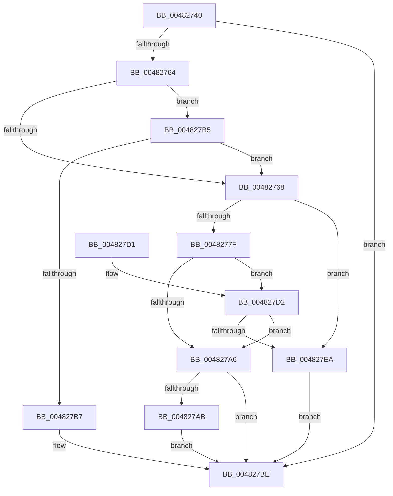

# PoRegisterSystemState

- RVA: `0x00482740`–`0x00482804` (길이 `196` bytes)
- VA: `0x0000000140482740`
- 실행 섹션: `.text`
- PDB 이름 있음: `예`; PDB Function 태그: `아니요`
- unwind 정보 RVA: `0x00092D90`
- 디코드: `60`개 명령, `196/196` bytes 표시
- 미해석 바이트: `0` (있으면 어셈블리에 `.byte`로 보존)

> 이 문서는 커널 이미지의 기계어와 PDB 기호를 분석해 생성했습니다. 4번과 5번은 함수 원형과 자료형을 바이너리 사용 방식에서 추정한 C 해석이며 원본 소스 복구 결과는 아닙니다.

## 1. Dependencies

- 직접 호출 지점: **7**; 고유 호출 대상: **7**
- 직접 호출자로 확인된 함수: **0**
- RIP 상대 이미지 참조: **0**

### Outgoing calls
- `0x0048276D` → [PopDiagTraceRegisterSystemState](PopDiagTraceRegisterSystemState_function_0048280C.md) (function, `0x0048280C`)
- `0x00482798` → [PoCaptureReasonContext](../23/PoCaptureReasonContext_function_00230A38.md) (function, `0x00230A38`)
- `0x004827AE` → [PoDestroyReasonContext](../23/PoDestroyReasonContext_function_00230944.md) (function, `0x00230944`)
- `0x004827B9` → [PoSetSystemState](PoSetSystemState_function_00482A50.md) (function, `0x00482A50`)
- `0x004827DC` → [PopPowerRequestCreateCommon](../23/PopPowerRequestCreateCommon_function_00230150.md) (function, `0x00230150`)
- `0x004827F2` → [PopGetLegacyPowerRequestFlags](PopGetLegacyPowerRequestFlags_function_00486DD8.md) (function, `0x00486DD8`)
- `0x004827FD` → [PopApplyLegacyPowerRequestFlags](../47/PopApplyLegacyPowerRequestFlags_function_00477364.md) (function, `0x00477364`)

### Direct callers
- 이 함수 시작 RVA로 연결되는 직접 call은 확인되지 않았습니다. 간접 호출은 완전히 역산할 수 없습니다.

### Static image references
- 디코드된 RIP-relative 메모리 참조가 없습니다.

## 2. Other-region calls and transfers

- 다른 실행 섹션으로 향하는 call: **0**
- 별도 외부 분기/꼬리 이동을 확인하지 못했습니다.

## 3. Assembly (complete function range)

```asm
00482740  48 89 5C 24 08                  mov qword ptr [rsp + 8], rbx
00482745  48 89 74 24 10                  mov qword ptr [rsp + 0x10], rsi
0048274A  57                              push rdi
0048274B  48 83 EC 30                     sub rsp, 0x30
0048274F  48 83 64 24 58 00               and qword ptr [rsp + 0x58], 0
00482755  33 DB                           xor ebx, ebx
00482757  8B FA                           mov edi, edx
00482759  48 8B F1                        mov rsi, rcx
0048275C  F7 C2 F8 FF FF 7F               test edx, 0x7ffffff8
00482762  75 5A                           jne 0x1404827be
00482764  85 D2                           test edx, edx
00482766  75 4D                           jne 0x1404827b5
00482768  48 8B D6                        mov rdx, rsi
0048276B  8B CF                           mov ecx, edi
0048276D  E8 9A 00 00 00                  call 0x14048280c
00482772  48 8B DE                        mov rbx, rsi
00482775  48 89 5C 24 50                  mov qword ptr [rsp + 0x50], rbx
0048277A  48 85 F6                        test rsi, rsi
0048277D  75 6B                           jne 0x1404827ea
0048277F  48 8D 44 24 58                  lea rax, [rsp + 0x58]
00482784  41 B1 01                        mov r9b, 1
00482787  48 89 44 24 28                  mov qword ptr [rsp + 0x28], rax
0048278C  45 33 C0                        xor r8d, r8d
0048278F  48 21 74 24 20                  and qword ptr [rsp + 0x20], rsi
00482794  33 D2                           xor edx, edx
00482796  33 C9                           xor ecx, ecx
00482798  E8 9B E2 DA FF                  call 0x140230a38
0048279D  48 8B 74 24 58                  mov rsi, qword ptr [rsp + 0x58]
004827A2  85 C0                           test eax, eax
004827A4  79 2C                           jns 0x1404827d2
004827A6  48 85 F6                        test rsi, rsi
004827A9  74 13                           je 0x1404827be
004827AB  48 8B CE                        mov rcx, rsi
004827AE  E8 91 E1 DA FF                  call 0x140230944
004827B3  EB 09                           jmp 0x1404827be
004827B5  78 B1                           js 0x140482768
004827B7  8B CF                           mov ecx, edi
004827B9  E8 92 02 00 00                  call 0x140482a50
004827BE  48 8B 74 24 48                  mov rsi, qword ptr [rsp + 0x48]
004827C3  48 8B C3                        mov rax, rbx
004827C6  48 8B 5C 24 40                  mov rbx, qword ptr [rsp + 0x40]
004827CB  48 83 C4 30                     add rsp, 0x30
004827CF  5F                              pop rdi
004827D0  C3                              ret
004827D1  CC                              int3
004827D2  4C 8D 44 24 50                  lea r8, [rsp + 0x50]
004827D7  33 D2                           xor edx, edx
004827D9  48 8B CE                        mov rcx, rsi
004827DC  E8 6F D9 DA FF                  call 0x140230150
004827E1  48 8B 5C 24 50                  mov rbx, qword ptr [rsp + 0x50]
004827E6  85 C0                           test eax, eax
004827E8  78 BC                           js 0x1404827a6
004827EA  45 33 C0                        xor r8d, r8d
004827ED  8B D7                           mov edx, edi
004827EF  48 8B CB                        mov rcx, rbx
004827F2  E8 E1 45 00 00                  call 0x140486dd8
004827F7  44 8B C0                        mov r8d, eax
004827FA  48 8B CB                        mov rcx, rbx
004827FD  E8 62 4B FF FF                  call 0x140477364
00482802  EB BA                           jmp 0x1404827be
```

## 4. C-style interpretation (structured pseudocode)

```c
__int64 __fastcall PoRegisterSystemState(__int64 a1, int a2, int a3)
{
    __int64 result;
    __int64 v_rbx;
    __int64 v_rsp;
    unsigned __int64 v_stack_m10;
    unsigned __int64 v_stack_m18;
    unsigned __int64 v_stack_p10;
    unsigned __int64 v_stack_p18;
    unsigned __int64 v_stack_p20;
    unsigned __int64 v_stack_p50;
    unsigned __int64 v_stack_p8;

    v_stack_p8 = v_rbx;
    v_stack_p10 = v_rsi;
    v_rsp = (v_rsp) - (48);
    v_rbx = 0;
    if (((a2) & (0x7FFFFFF8ULL)) != 0) goto loc_004827BE;
    if (a2 != 0) goto loc_004827B5;
loc_00482768:
    result = PopDiagTraceRegisterSystemState((unsigned int)((unsigned int)((unsigned int)(a2))), a1, a3, a4);
    v_stack_p18 = a1;
    if (a1 != 0) goto loc_004827EA;
    v_stack_m10 = v_stack_p20;
    a3 = 0;
    a2 = 0;
    a1 = 0;
    result = PoCaptureReasonContext(a1, a2, a3, 1);
    if (!sign_flag) goto loc_004827D2;
loc_004827A6:
    if (v_stack_p20 == 0) goto loc_004827BE;
    result = PoDestroyReasonContext(v_stack_p20, a2, a3, 1);
    goto loc_004827BE;
loc_004827B5:
    if (sign_flag) goto loc_00482768;
    result = PoSetSystemState((unsigned int)((unsigned int)((unsigned int)(a2))), a2, a3, 1);
loc_004827BE:
    v_rsp = (v_rsp) + (48);
    return 0;
loc_004827D2:
    a2 = 0;
    result = PopPowerRequestCreateCommon(v_stack_p10, a2, v_stack_p50, 1);
    if (sign_flag) goto loc_004827A6;
loc_004827EA:
    a3 = 0;
    result = PopGetLegacyPowerRequestFlags(v_stack_p50, (unsigned int)((unsigned int)((unsigned int)(a2))), a3, 1);
    result = PopApplyLegacyPowerRequestFlags(v_stack_p50, (unsigned int)((unsigned int)((unsigned int)(a2))), (unsigned int)((unsigned int)(result)), 1);
    goto loc_004827BE;
}
```

## 5. (Beta) C Style

```c
int64_t PoRegisterSystemState(int64_t Arg1, int32_t Arg2, int32_t Arg3)
{
    int64_t result;
    int64_t local_rbx;
    int64_t local_rsp;
    uint64_t v_stack_m10;
    uint64_t v_stack_m18;
    uint64_t v_stack_p10;
    uint64_t v_stack_p18;
    uint64_t v_stack_p20;
    uint64_t v_stack_p50;
    uint64_t v_stack_p8;

    v_stack_p8 = local_rbx;
    v_stack_p10 = local_rsi;
    local_rsp = (local_rsp) - (48);
    local_rbx = 0;
    if (((Arg2) & (0x7FFFFFF8ULL)) != 0) goto loc_004827BE;
    if (Arg2 != 0) goto loc_004827B5;
loc_00482768:
    result = PopDiagTraceRegisterSystemState((uint32_t)((uint32_t)((uint32_t)(Arg2))), Arg1, Arg3, a4);
    v_stack_p18 = Arg1;
    if (Arg1 != 0) goto loc_004827EA;
    v_stack_m10 = v_stack_p20;
    Arg3 = 0;
    Arg2 = 0;
    Arg1 = 0;
    result = PoCaptureReasonContext(Arg1, Arg2, Arg3, 1);
    if (!sign_flag) goto loc_004827D2;
loc_004827A6:
    if (v_stack_p20 == 0) goto loc_004827BE;
    result = PoDestroyReasonContext(v_stack_p20, Arg2, Arg3, 1);
    goto loc_004827BE;
loc_004827B5:
    if (sign_flag) goto loc_00482768;
    result = PoSetSystemState((uint32_t)((uint32_t)((uint32_t)(Arg2))), Arg2, Arg3, 1);
loc_004827BE:
    local_rsp = (local_rsp) + (48);
    return 0;
loc_004827D2:
    Arg2 = 0;
    result = PopPowerRequestCreateCommon(v_stack_p10, Arg2, v_stack_p50, 1);
    if (sign_flag) goto loc_004827A6;
loc_004827EA:
    Arg3 = 0;
    result = PopGetLegacyPowerRequestFlags(v_stack_p50, (uint32_t)((uint32_t)((uint32_t)(Arg2))), Arg3, 1);
    result = PopApplyLegacyPowerRequestFlags(v_stack_p50, (uint32_t)((uint32_t)((uint32_t)(Arg2))), (uint32_t)((uint32_t)(result)), 1);
    goto loc_004827BE;
}
```

## 6. Execution-region graph

[열기: 2D/3D 그래프와 함수 탐색 컨트롤 패널](../../../control-panel.html?section=text&rva=0x00482740&view=graph)

- 2D 그래프는 위에서 아래로 흐르고, 3D 그래프는 빈 공간을 드래그해 회전합니다. Shift+드래그는 이동, 휠은 확대·축소, 함수 노드 선택은 대상 보고서 이동입니다.

### Static fallback


