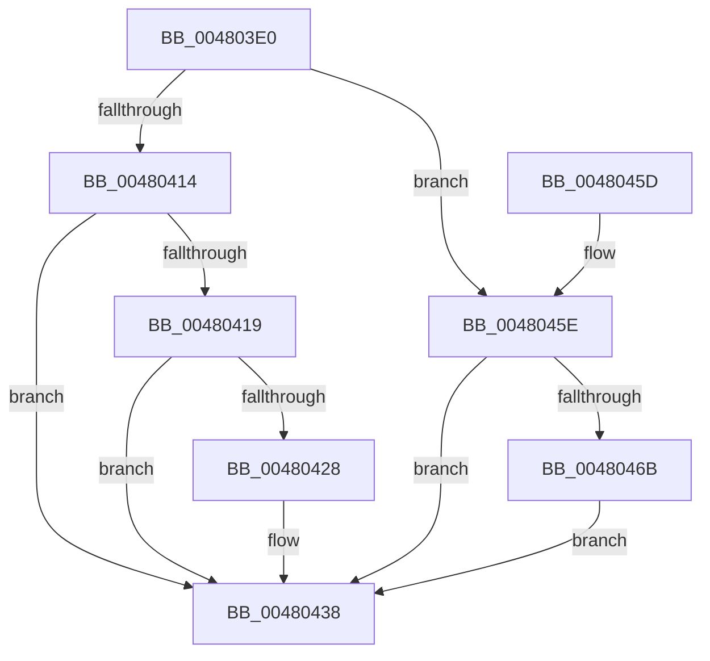

# PoSetPowerState

- RVA: `0x004803E0`–`0x0048047B` (길이 `155` bytes)
- VA: `0x00000001404803E0`
- 실행 섹션: `.text`
- PDB 이름 있음: `예`; PDB Function 태그: `아니요`
- unwind 정보 RVA: `0x0008EBC0`
- 디코드: `49`개 명령, `155/155` bytes 표시
- 미해석 바이트: `0` (있으면 어셈블리에 `.byte`로 보존)

> 이 문서는 커널 이미지의 기계어와 PDB 기호를 분석해 생성했습니다. 4번과 5번은 함수 원형과 자료형을 바이너리 사용 방식에서 추정한 C 해석이며 원본 소스 복구 결과는 아닙니다.

## 1. Dependencies

- 직접 호출 지점: **2**; 고유 호출 대상: **2**
- 직접 호출자로 확인된 함수: **0**
- RIP 상대 이미지 참조: **1**

### Outgoing calls
- `0x00480409` → [KeAcquireSpinLockRaiseToDpc](../20/KeAcquireSpinLockRaiseToDpc_function_00208470.md) (function, `0x00208470`)
- `0x00480441` → [KeReleaseSpinLock](../39/KeReleaseSpinLock_function_00392BA0.md) (function, `0x00392BA0`)

### Direct callers
- 이 함수 시작 RVA로 연결되는 직접 call은 확인되지 않았습니다. 간접 호출은 완전히 역산할 수 없습니다.

### Static image references
- `0x004803FE` → RVA `0x00F0CA80` (`.data`; read)

## 2. Other-region calls and transfers

- 다른 실행 섹션으로 향하는 call: **0**
- 별도 외부 분기/꼬리 이동을 확인하지 못했습니다.

## 3. Assembly (complete function range)

```asm
004803E0  48 89 5C 24 08                  mov qword ptr [rsp + 8], rbx
004803E5  48 89 6C 24 10                  mov qword ptr [rsp + 0x10], rbp
004803EA  48 89 74 24 18                  mov qword ptr [rsp + 0x18], rsi
004803EF  57                              push rdi
004803F0  48 83 EC 20                     sub rsp, 0x20
004803F4  48 8B A9 38 01 00 00            mov rbp, qword ptr [rcx + 0x138]
004803FB  41 8B D8                        mov ebx, r8d
004803FE  48 8D 0D 7B C6 A8 00            lea rcx, [rip + 0xa8c67b]
00480405  8B F2                           mov esi, edx
00480407  33 FF                           xor edi, edi
00480409  E8 62 80 D8 FF                  call 0x140208470
0048040E  8A C8                           mov cl, al
00480410  85 F6                           test esi, esi
00480412  74 4A                           je 0x14048045e
00480414  83 FE 01                        cmp esi, 1
00480417  75 1F                           jne 0x140480438
00480419  8B 7D 10                        mov edi, dword ptr [rbp + 0x10]
0048041C  8B C7                           mov eax, edi
0048041E  C1 EF 04                        shr edi, 4
00480421  83 E7 0F                        and edi, 0xf
00480424  3B FB                           cmp edi, ebx
00480426  74 10                           je 0x140480438
00480428  C1 E3 04                        shl ebx, 4
0048042B  33 D8                           xor ebx, eax
0048042D  81 E3 F0 00 00 00               and ebx, 0xf0
00480433  33 D8                           xor ebx, eax
00480435  89 5D 10                        mov dword ptr [rbp + 0x10], ebx
00480438  8A D1                           mov dl, cl
0048043A  48 8D 0D 3F C6 A8 00            lea rcx, [rip + 0xa8c63f]
00480441  E8 5A 27 F1 FF                  call 0x140392ba0
00480446  48 8B 5C 24 30                  mov rbx, qword ptr [rsp + 0x30]
0048044B  8B C7                           mov eax, edi
0048044D  48 8B 6C 24 38                  mov rbp, qword ptr [rsp + 0x38]
00480452  48 8B 74 24 40                  mov rsi, qword ptr [rsp + 0x40]
00480457  48 83 C4 20                     add rsp, 0x20
0048045B  5F                              pop rdi
0048045C  C3                              ret
0048045D  CC                              int3
0048045E  8B 7D 10                        mov edi, dword ptr [rbp + 0x10]
00480461  44 8B C7                        mov r8d, edi
00480464  83 E7 0F                        and edi, 0xf
00480467  3B FB                           cmp edi, ebx
00480469  74 CD                           je 0x140480438
0048046B  41 8B D0                        mov edx, r8d
0048046E  33 D3                           xor edx, ebx
00480470  83 E2 0F                        and edx, 0xf
00480473  41 33 D0                        xor edx, r8d
00480476  89 55 10                        mov dword ptr [rbp + 0x10], edx
00480479  EB BD                           jmp 0x140480438
```

## 4. C-style interpretation (structured pseudocode)

```c
__int64 __fastcall PoSetPowerState(__int64 a1, int a2, int a3)
{
    __int64 result;
    __int64 v_rbx;
    __int64 v_rdi;
    __int64 v_rsp;
    unsigned __int64 v_stack_p10;
    unsigned __int64 v_stack_p18;
    unsigned __int64 v_stack_p8;

    v_stack_p8 = v_rbx;
    v_stack_p10 = v_rbp;
    v_stack_p18 = v_rsi;
    v_rsp = (v_rsp) - (32);
    v_rdi = 0;
    result = KeAcquireSpinLockRaiseToDpc(v_rip + 11060859, a2, a3, a4);
    if ((unsigned int)((unsigned int)(a2)) == 0) goto loc_0048045E;
    if (((unsigned int)((unsigned int)(a2))) != 1) goto loc_00480438;
    v_rdi = (unsigned int)(((unsigned int)(*(unsigned int *)(*(unsigned __int64 *)(a1 + 312) + 16))) >> (4));
    v_rdi = (unsigned int)((v_rdi) & (15));
    v_rbx = (unsigned int)(a3);
    if (((unsigned int)(v_rdi)) != ((unsigned int)((unsigned int)(a3)))) {
        v_rbx = (unsigned int)(((unsigned int)(a3)) << (4));
        v_rbx = (unsigned int)((v_rbx) ^ ((unsigned int)((unsigned int)((unsigned int)((unsigned int)(*(unsigned int *)(*(unsigned __int64 *)(a1 + 312) + 16)))))));
        v_rbx = (unsigned int)((v_rbx) & (240));
        v_rbx = (unsigned int)((v_rbx) ^ ((unsigned int)((unsigned int)((unsigned int)((unsigned int)(*(unsigned int *)(*(unsigned __int64 *)(a1 + 312) + 16)))))));
        *(unsigned int *)(*(unsigned __int64 *)(a1 + 312) + 16) = (unsigned int)(v_rbx);
    }
    result = KeReleaseSpinLock(v_rip + 11060799, (unsigned __int8)((unsigned __int8)(result)), a3, a4);
    v_rsp = (v_rsp) + (32);
    return (unsigned int)((unsigned int)(v_rdi));
loc_0048045E:
    v_rdi = (unsigned int)(((unsigned int)(*(unsigned int *)(v_stack_p10 + 16))) & (15));
    if (((unsigned int)(v_rdi)) == ((unsigned int)(v_stack_p8))) goto loc_00480438;
    a2 = (unsigned int)(((unsigned int)((unsigned int)((unsigned int)((unsigned int)((unsigned int)(*(unsigned int *)(v_stack_p10 + 16))))))) ^ ((unsigned int)(v_stack_p8)));
    a2 = (unsigned int)((a2) & (15));
    a2 = (unsigned int)((a2) ^ ((unsigned int)((unsigned int)((unsigned int)((unsigned int)(*(unsigned int *)(v_stack_p10 + 16)))))));
    *(unsigned int *)(v_stack_p10 + 16) = a2;
    goto loc_00480438;
}
```

## 5. (Beta) C Style

```c
int64_t PoSetPowerState(void *Arg1, int32_t Arg2, int32_t Arg3)
{
    uint8_t *arg1 = (uint8_t *)Arg1;

    int64_t result;
    int64_t local_rbx;
    int64_t local_rdi;
    int64_t local_rsp;
    uint64_t v_stack_p10;
    uint64_t v_stack_p18;
    uint64_t v_stack_p8;

    v_stack_p8 = local_rbx;
    v_stack_p10 = local_rbp;
    v_stack_p18 = local_rsi;
    local_rsp = (local_rsp) - (32);
    local_rdi = 0;
    result = KeAcquireSpinLockRaiseToDpc(v_rip + 11060859, Arg2, Arg3, a4);
    if ((uint32_t)((uint32_t)(Arg2)) == 0) goto loc_0048045E;
    if (((uint32_t)((uint32_t)(Arg2))) != 1) goto loc_00480438;
    local_rdi = (uint32_t)(((uint32_t)(*(uint32_t *)(*(uint64_t *)(arg1 + 0x138) + 0x10))) >> (4));
    local_rdi = (uint32_t)((local_rdi) & (15));
    local_rbx = (uint32_t)(Arg3);
    if (((uint32_t)(local_rdi)) != ((uint32_t)((uint32_t)(Arg3)))) {
        local_rbx = (uint32_t)(((uint32_t)(Arg3)) << (4));
        local_rbx = (uint32_t)((local_rbx) ^ ((uint32_t)((uint32_t)((uint32_t)((uint32_t)(*(uint32_t *)(*(uint64_t *)(arg1 + 0x138) + 0x10)))))));
        local_rbx = (uint32_t)((local_rbx) & (240));
        local_rbx = (uint32_t)((local_rbx) ^ ((uint32_t)((uint32_t)((uint32_t)((uint32_t)(*(uint32_t *)(*(uint64_t *)(arg1 + 0x138) + 0x10)))))));
        *(uint32_t *)(*(uint64_t *)(arg1 + 0x138) + 0x10) = (uint32_t)(local_rbx);
    }
    result = KeReleaseSpinLock(v_rip + 11060799, (uint8_t)((uint8_t)(result)), Arg3, a4);
    local_rsp = (local_rsp) + (32);
    return (uint32_t)((uint32_t)(local_rdi));
loc_0048045E:
    local_rdi = (uint32_t)(((uint32_t)(*(uint32_t *)(v_stack_p10 + 0x10))) & (15));
    if (((uint32_t)(local_rdi)) == ((uint32_t)(v_stack_p8))) goto loc_00480438;
    Arg2 = (uint32_t)(((uint32_t)((uint32_t)((uint32_t)((uint32_t)((uint32_t)(*(uint32_t *)(v_stack_p10 + 0x10))))))) ^ ((uint32_t)(v_stack_p8)));
    Arg2 = (uint32_t)((Arg2) & (15));
    Arg2 = (uint32_t)((Arg2) ^ ((uint32_t)((uint32_t)((uint32_t)((uint32_t)(*(uint32_t *)(v_stack_p10 + 0x10)))))));
    *(uint32_t *)(v_stack_p10 + 0x10) = Arg2;
    goto loc_00480438;
}
```

### 관측된 메모리 오프셋

구조체 형식이 확인되지 않은 접근은 인자 기준의 오프셋으로만 기록했습니다.

| 기준 인자 | 오프셋 표현 | 폭 (bit) | 접근 |
|---|---:|---:|---|
| `Arg1` | `+ 0x138` | `64` | `R` |

## 6. Execution-region graph

[열기: 2D/3D 그래프와 함수 탐색 컨트롤 패널](../../../control-panel.html?section=text&rva=0x004803E0&view=graph)

- 2D 그래프는 위에서 아래로 흐르고, 3D 그래프는 빈 공간을 드래그해 회전합니다. Shift+드래그는 이동, 휠은 확대·축소, 함수 노드 선택은 대상 보고서 이동입니다.

### Static fallback


