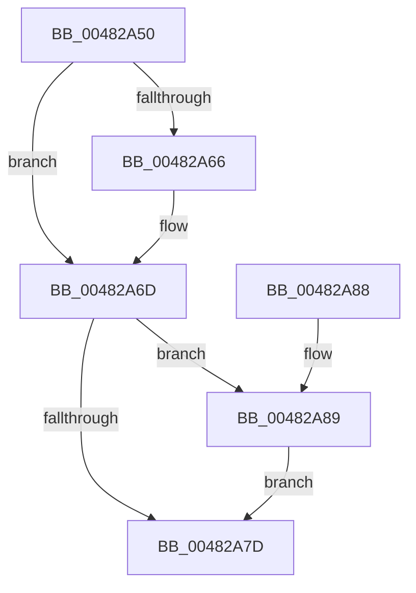

# PoSetSystemState

- RVA: `0x00482A50`–`0x00482A90` (길이 `64` bytes)
- VA: `0x0000000140482A50`
- 실행 섹션: `.text`
- PDB 이름 있음: `예`; PDB Function 태그: `아니요`
- unwind 정보 RVA: `0x0006CF28`
- 디코드: `22`개 명령, `64/64` bytes 표시
- 미해석 바이트: `0` (있으면 어셈블리에 `.byte`로 보존)

> 이 문서는 커널 이미지의 기계어와 PDB 기호를 분석해 생성했습니다. 4번과 5번은 함수 원형과 자료형을 바이너리 사용 방식에서 추정한 C 해석이며 원본 소스 복구 결과는 아닙니다.

## 1. Dependencies

- 직접 호출 지점: **3**; 고유 호출 대상: **3**
- 직접 호출자로 확인된 함수: **1**
- RIP 상대 이미지 참조: **0**

### Outgoing calls
- `0x00482A66` → [PopAcquirePolicyLock](../../pagelk/B7/PopAcquirePolicyLock_function_00B783C0.md) (function, `0x00B783C0`)
- `0x00482A74` → [PopSetSystemState](PopSetSystemState_function_00482A98.md) (function, `0x00482A98`)
- `0x00482A89` → [PopReleasePolicyLock](../../pagelk/B7/PopReleasePolicyLock_function_00B78410.md) (function, `0x00B78410`)

### Direct callers
- [PoRegisterSystemState](PoRegisterSystemState_function_00482740.md) at `0x004827B9`

### Static image references
- 디코드된 RIP-relative 메모리 참조가 없습니다.

## 2. Other-region calls and transfers

- 다른 실행 섹션으로 향하는 call: **2**
  - `0x00482A66` → [PopAcquirePolicyLock](../../pagelk/B7/PopAcquirePolicyLock_function_00B783C0.md) (`.text` → `PAGELK`)
  - `0x00482A89` → [PopReleasePolicyLock](../../pagelk/B7/PopReleasePolicyLock_function_00B78410.md) (`.text` → `PAGELK`)
- 별도 외부 분기/꼬리 이동을 확인하지 못했습니다.

## 3. Assembly (complete function range)

```asm
00482A50  48 89 5C 24 08                  mov qword ptr [rsp + 8], rbx
00482A55  57                              push rdi
00482A56  48 83 EC 20                     sub rsp, 0x20
00482A5A  8B F9                           mov edi, ecx
00482A5C  32 DB                           xor bl, bl
00482A5E  44 0F 20 C0                     mov rax, cr8
00482A62  3C 02                           cmp al, 2
00482A64  73 07                           jae 0x140482a6d
00482A66  E8 55 59 6F 00                  call 0x140b783c0
00482A6B  B3 01                           mov bl, 1
00482A6D  BA 07 00 00 00                  mov edx, 7
00482A72  8B CF                           mov ecx, edi
00482A74  E8 1F 00 00 00                  call 0x140482a98
00482A79  84 DB                           test bl, bl
00482A7B  75 0C                           jne 0x140482a89
00482A7D  48 8B 5C 24 30                  mov rbx, qword ptr [rsp + 0x30]
00482A82  48 83 C4 20                     add rsp, 0x20
00482A86  5F                              pop rdi
00482A87  C3                              ret
00482A88  CC                              int3
00482A89  E8 82 59 6F 00                  call 0x140b78410
00482A8E  EB ED                           jmp 0x140482a7d
```

## 4. C-style interpretation (structured pseudocode)

```c
__int64 __fastcall PoSetSystemState(int a1)
{
    __int64 result;
    __int64 v_rbx;
    __int64 v_rsp;
    unsigned __int64 v_stack_p8;

    v_stack_p8 = v_rbx;
    v_rsp = (v_rsp) - (32);
    v_rbx = 0;
    result = v_cr8;
    if (((unsigned __int8)(v_cr8)) < 2) {
        result = PopAcquirePolicyLock(a1, a2, a3, a4);
        v_rbx = 1;
    }
    result = PopSetSystemState((unsigned int)((unsigned int)((unsigned int)(a1))), 7, a3, a4);
    if ((unsigned __int8)(v_rbx) != 0) goto loc_00482A89;
loc_00482A7D:
    v_rsp = (v_rsp) + (32);
    return result;
loc_00482A89:
    result = PopReleasePolicyLock((unsigned int)((unsigned int)((unsigned int)(a1))), 7, a3, a4);
    goto loc_00482A7D;
}
```

## 5. (Beta) C Style

```c
int64_t PoSetSystemState(int32_t Arg1)
{
    int64_t result;
    int64_t local_rbx;
    int64_t local_rsp;
    uint64_t v_stack_p8;

    v_stack_p8 = local_rbx;
    local_rsp = (local_rsp) - (32);
    local_rbx = 0;
    result = v_cr8;
    if (((uint8_t)(v_cr8)) < 2) {
        result = PopAcquirePolicyLock(Arg1, a2, a3, a4);
        local_rbx = 1;
    }
    result = PopSetSystemState((uint32_t)((uint32_t)((uint32_t)(Arg1))), 7, a3, a4);
    if ((uint8_t)(local_rbx) != 0) goto loc_00482A89;
loc_00482A7D:
    local_rsp = (local_rsp) + (32);
    return result;
loc_00482A89:
    result = PopReleasePolicyLock((uint32_t)((uint32_t)((uint32_t)(Arg1))), 7, a3, a4);
    goto loc_00482A7D;
}
```

## 6. Execution-region graph

[열기: 2D/3D 그래프와 함수 탐색 컨트롤 패널](../../../control-panel.html?section=text&rva=0x00482A50&view=graph)

- 2D 그래프는 위에서 아래로 흐르고, 3D 그래프는 빈 공간을 드래그해 회전합니다. Shift+드래그는 이동, 휠은 확대·축소, 함수 노드 선택은 대상 보고서 이동입니다.

### Static fallback


