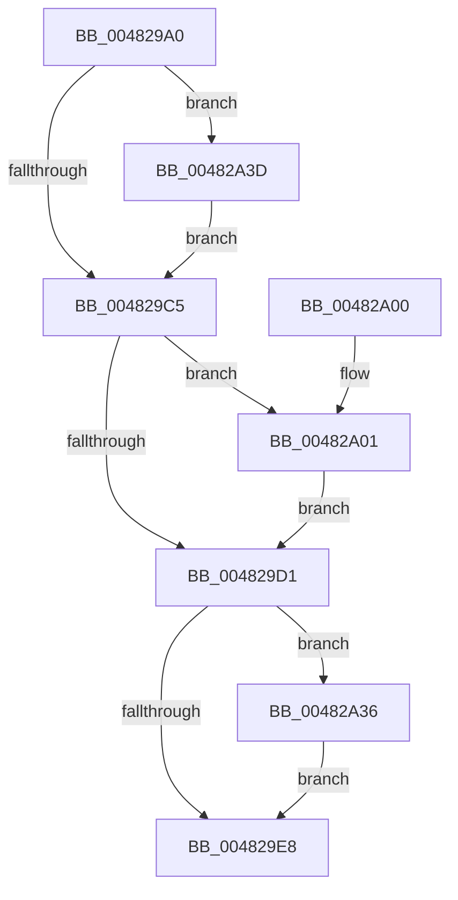

# PoSetUserPresent

- RVA: `0x004829A0`–`0x00482A49` (길이 `169` bytes)
- VA: `0x00000001404829A0`
- 실행 섹션: `.text`
- PDB 이름 있음: `예`; PDB Function 태그: `아니요`
- unwind 정보 RVA: `0x000AEE1C`
- 디코드: `43`개 명령, `169/169` bytes 표시
- 미해석 바이트: `0` (있으면 어셈블리에 `.byte`로 보존)

> 이 문서는 커널 이미지의 기계어와 PDB 기호를 분석해 생성했습니다. 4번과 5번은 함수 원형과 자료형을 바이너리 사용 방식에서 추정한 C 해석이며 원본 소스 복구 결과는 아닙니다.

## 1. Dependencies

- 직접 호출 지점: **6**; 고유 호출 대상: **6**
- 직접 호출자로 확인된 함수: **1**
- RIP 상대 이미지 참조: **2**

### Outgoing calls
- `0x004829D8` → [PopDiagTraceSetSystemState](PopDiagTraceSetSystemState_function_00482AD4.md) (function, `0x00482AD4`)
- `0x004829DF` → [PopUserPresentSet](PopUserPresentSet_function_00482B90.md) (function, `0x00482B90`)
- `0x004829F0` → [_security_check_cookie](../6A/_security_check_cookie_function_006AC640.md) (function, `0x006AC640`)
- `0x00482A2F` → [EtwTraceKernelEvent](../23/EtwTraceKernelEvent_function_00235350.md) (function, `0x00235350`)
- `0x00482A36` → [PopReleasePolicyLock](../../pagelk/B7/PopReleasePolicyLock_function_00B78410.md) (function, `0x00B78410`)
- `0x00482A3D` → [PopAcquirePolicyLock](../../pagelk/B7/PopAcquirePolicyLock_function_00B783C0.md) (function, `0x00B783C0`)

### Direct callers
- [PopTransitionSystemPowerStateEx](../../pagelk/B7/PopTransitionSystemPowerStateEx_function_00B7E8C0.md) at `0x00B7FB3B`

### Static image references
- `0x004829AA` → RVA `0x00E0A740` (`.data`; read)
- `0x004829C5` → RVA `0x00FC6B10` (`ALMOSTRO`; read)

## 2. Other-region calls and transfers

- 다른 실행 섹션으로 향하는 call: **2**
  - `0x00482A36` → [PopReleasePolicyLock](../../pagelk/B7/PopReleasePolicyLock_function_00B78410.md) (`.text` → `PAGELK`)
  - `0x00482A3D` → [PopAcquirePolicyLock](../../pagelk/B7/PopAcquirePolicyLock_function_00B783C0.md) (`.text` → `PAGELK`)
- 별도 외부 분기/꼬리 이동을 확인하지 못했습니다.

## 3. Assembly (complete function range)

```asm
004829A0  48 89 5C 24 10                  mov qword ptr [rsp + 0x10], rbx
004829A5  57                              push rdi
004829A6  48 83 EC 50                     sub rsp, 0x50
004829AA  48 8B 05 8F 7D 98 00            mov rax, qword ptr [rip + 0x987d8f]
004829B1  48 33 C4                        xor rax, rsp
004829B4  48 89 44 24 40                  mov qword ptr [rsp + 0x40], rax
004829B9  8B F9                           mov edi, ecx
004829BB  32 DB                           xor bl, bl
004829BD  44 0F 20 C0                     mov rax, cr8
004829C1  3C 02                           cmp al, 2
004829C3  72 78                           jb 0x140482a3d
004829C5  F7 05 41 41 B4 00 00 80 00 00   test dword ptr [rip + 0xb44141], 0x8000
004829CF  75 30                           jne 0x140482a01
004829D1  8B D7                           mov edx, edi
004829D3  B9 04 00 00 00                  mov ecx, 4
004829D8  E8 F7 00 00 00                  call 0x140482ad4
004829DD  8B CF                           mov ecx, edi
004829DF  E8 AC 01 00 00                  call 0x140482b90
004829E4  84 DB                           test bl, bl
004829E6  75 4E                           jne 0x140482a36
004829E8  48 8B 4C 24 40                  mov rcx, qword ptr [rsp + 0x40]
004829ED  48 33 CC                        xor rcx, rsp
004829F0  E8 4B 9C 22 00                  call 0x1406ac640
004829F5  48 8B 5C 24 68                  mov rbx, qword ptr [rsp + 0x68]
004829FA  48 83 C4 50                     add rsp, 0x50
004829FE  5F                              pop rdi
004829FF  C3                              ret
00482A00  CC                              int3
00482A01  48 83 64 24 30 00               and qword ptr [rsp + 0x30], 0
00482A07  48 8D 4C 24 30                  lea rcx, [rsp + 0x30]
00482A0C  83 64 24 38 00                  and dword ptr [rsp + 0x38], 0
00482A11  41 B9 41 12 00 00               mov r9d, 0x1241
00482A17  83 64 24 3C 00                  and dword ptr [rsp + 0x3c], 0
00482A1C  BA 01 00 00 00                  mov edx, 1
00482A21  41 B8 00 80 00 80               mov r8d, 0x80008000
00482A27  C7 44 24 20 02 18 50 00         mov dword ptr [rsp + 0x20], 0x501802
00482A2F  E8 1C 29 DB FF                  call 0x140235350
00482A34  EB 9B                           jmp 0x1404829d1
00482A36  E8 D5 59 6F 00                  call 0x140b78410
00482A3B  EB AB                           jmp 0x1404829e8
00482A3D  E8 7E 59 6F 00                  call 0x140b783c0
00482A42  B3 01                           mov bl, 1
00482A44  E9 7C FF FF FF                  jmp 0x1404829c5
```

## 4. C-style interpretation (structured pseudocode)

```c
__int64 __fastcall PoSetUserPresent(int a1)
{
    __int64 result;
    __int64 v_rbx;
    __int64 v_rsp;
    unsigned __int64 v_stack_m18;
    unsigned __int64 v_stack_p10;
    unsigned int v_stack_p20;
    unsigned __int64 v_stack_p30;
    unsigned int v_stack_p38;
    unsigned int v_stack_p3C;

    v_stack_p10 = v_rbx;
    v_rsp = (v_rsp) - (80);
    result = (*(unsigned __int64 *)(v_rip + 9993615)) ^ (v_rsp);
    v_stack_m18 = result;
    v_rbx = 0;
    if (((unsigned __int8)(v_cr8)) < 2) goto loc_00482A3D;
loc_004829C5:
    if (((*(unsigned int *)(v_rip + 11813185)) & (0x8000ULL)) != 0) goto loc_00482A01;
loc_004829D1:
    result = PopDiagTraceSetSystemState(4, (unsigned int)((unsigned int)((unsigned int)(a1))), a3, a4);
    result = PopUserPresentSet((unsigned int)((unsigned int)((unsigned int)(a1))), (unsigned int)((unsigned int)((unsigned int)(a1))), a3, a4);
    if (0 != 0) goto loc_00482A36;
loc_004829E8:
    a1 = (v_stack_m18) ^ (v_rsp);
    result = _security_check_cookie(a1, (unsigned int)((unsigned int)((unsigned int)(a1))), a3, a4);
    v_rsp = (v_rsp) + (80);
    return result;
loc_00482A01:
    v_stack_p20 = 0x501802ULL;
    result = EtwTraceKernelEvent(v_stack_p30, 1, (unsigned int)(0x80008000ULL), (unsigned int)(0x1241ULL));
    goto loc_004829D1;
loc_00482A36:
    result = PopReleasePolicyLock(v_stack_p30, 1, (unsigned int)(0x80008000ULL), (unsigned int)(0x1241ULL));
    goto loc_004829E8;
loc_00482A3D:
    result = PopAcquirePolicyLock(v_stack_p30, 1, (unsigned int)(0x80008000ULL), (unsigned int)(0x1241ULL));
    goto loc_004829C5;
}
```

## 5. (Beta) C Style

```c
int64_t PoSetUserPresent(int32_t Arg1)
{
    int64_t result;
    int64_t local_rbx;
    int64_t local_rsp;
    uint64_t v_stack_m18;
    uint64_t v_stack_p10;
    uint32_t v_stack_p20;
    uint64_t v_stack_p30;
    uint32_t v_stack_p38;
    uint32_t v_stack_p3C;

    v_stack_p10 = local_rbx;
    local_rsp = (local_rsp) - (80);
    result = (*(uint64_t *)(v_rip + 0x987D8F)) ^ (local_rsp);
    v_stack_m18 = result;
    local_rbx = 0;
    if (((uint8_t)(v_cr8)) < 2) goto loc_00482A3D;
loc_004829C5:
    if (((*(uint32_t *)(v_rip + 0xB44141)) & (0x8000ULL)) != 0) goto loc_00482A01;
loc_004829D1:
    result = PopDiagTraceSetSystemState(4, (uint32_t)((uint32_t)((uint32_t)(Arg1))), a3, a4);
    result = PopUserPresentSet((uint32_t)((uint32_t)((uint32_t)(Arg1))), (uint32_t)((uint32_t)((uint32_t)(Arg1))), a3, a4);
    if (0 != 0) goto loc_00482A36;
loc_004829E8:
    Arg1 = (v_stack_m18) ^ (local_rsp);
    result = _security_check_cookie(Arg1, (uint32_t)((uint32_t)((uint32_t)(Arg1))), a3, a4);
    local_rsp = (local_rsp) + (80);
    return result;
loc_00482A01:
    v_stack_p20 = 0x501802ULL;
    result = EtwTraceKernelEvent(v_stack_p30, 1, (uint32_t)(0x80008000ULL), (uint32_t)(0x1241ULL));
    goto loc_004829D1;
loc_00482A36:
    result = PopReleasePolicyLock(v_stack_p30, 1, (uint32_t)(0x80008000ULL), (uint32_t)(0x1241ULL));
    goto loc_004829E8;
loc_00482A3D:
    result = PopAcquirePolicyLock(v_stack_p30, 1, (uint32_t)(0x80008000ULL), (uint32_t)(0x1241ULL));
    goto loc_004829C5;
}
```

## 6. Execution-region graph

[열기: 2D/3D 그래프와 함수 탐색 컨트롤 패널](../../../control-panel.html?section=text&rva=0x004829A0&view=graph)

- 2D 그래프는 위에서 아래로 흐르고, 3D 그래프는 빈 공간을 드래그해 회전합니다. Shift+드래그는 이동, 휠은 확대·축소, 함수 노드 선택은 대상 보고서 이동입니다.

### Static fallback


