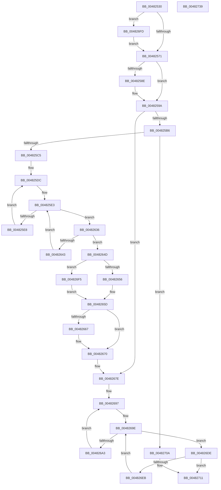

# PopCheckForIdleness

- RVA: `0x00482530`–`0x0048273A` (길이 `522` bytes)
- VA: `0x0000000140482530`
- 실행 섹션: `.text`
- PDB 이름 있음: `예`; PDB Function 태그: `아니요`
- unwind 정보 RVA: `0x00084C9C`
- 디코드: `127`개 명령, `522/522` bytes 표시
- 미해석 바이트: `0` (있으면 어셈블리에 `.byte`로 보존)

> 이 문서는 커널 이미지의 기계어와 PDB 기호를 분석해 생성했습니다. 4번과 5번은 함수 원형과 자료형을 바이너리 사용 방식에서 추정한 C 해석이며 원본 소스 복구 결과는 아닙니다.

## 1. Dependencies

- 직접 호출 지점: **5**; 고유 호출 대상: **5**
- 직접 호출자로 확인된 함수: **0**
- RIP 상대 이미지 참조: **11**

### Outgoing calls
- `0x0048254D` → [KeQueryActiveProcessorCountEx](../24/KeQueryActiveProcessorCountEx_function_00249EF0.md) (function, `0x00249EF0`)
- `0x00482595` → [KiLowerIrqlProcessIrqlFlags](../4F/KiLowerIrqlProcessIrqlFlags_function_004F5698.md) (function, `0x004F5698`)
- `0x00482700` → [KiRaiseIrqlProcessIrqlFlags](../4F/KiRaiseIrqlProcessIrqlFlags_function_004F56FC.md) (function, `0x004F56FC`)
- `0x00482716` → [PopGetPolicyWorker](PopGetPolicyWorker_function_00482D24.md) (function, `0x00482D24`)
- `0x0048271B` → [PopCheckForWork](PopCheckForWork_function_00482CAC.md) (function, `0x00482CAC`)

### Direct callers
- 이 함수 시작 RVA로 연결되는 직접 call은 확인되지 않았습니다. 간접 호출은 완전히 역산할 수 없습니다.

### Static image references
- `0x00482564` → RVA `0x00FC6D20` (`ALMOSTRO`; read)
- `0x00482571` → RVA `0x00F0BC88` (`.data`; read)
- `0x004825A2` → RVA `0x00F0BC80` (`.data`; read)
- `0x004825A9` → RVA `0x00000000` (`image boundary/outside`; read)
- `0x004825C5` → RVA `0x00FC7128` (`ALMOSTRO`; read)
- `0x004825DC` → RVA `0x00FC7120` (`ALMOSTRO`; read)
- `0x004825FF` → RVA `0x00F231B8` (`.data`; read)
- `0x00482670` → RVA `0x00F0BC64` (`.data`; write)
- `0x00482677` → RVA `0x00F0BC60` (`.data`; write)
- `0x00482689` → RVA `0x00F0BC88` (`.data`; write)
- `0x00482690` → RVA `0x00F0BC80` (`.data`; write)

## 2. Other-region calls and transfers

- 다른 실행 섹션으로 향하는 call: **0**
- 별도 외부 분기/꼬리 이동을 확인하지 못했습니다.

## 3. Assembly (complete function range)

```asm
00482530  48 89 5C 24 08                  mov qword ptr [rsp + 8], rbx
00482535  48 89 6C 24 10                  mov qword ptr [rsp + 0x10], rbp
0048253A  48 89 74 24 18                  mov qword ptr [rsp + 0x18], rsi
0048253F  57                              push rdi
00482540  41 56                           push r14
00482542  41 57                           push r15
00482544  48 83 EC 30                     sub rsp, 0x30
00482548  B9 FF FF 00 00                  mov ecx, 0xffff
0048254D  E8 9E 79 DC FF                  call 0x140249ef0
00482552  8B E8                           mov ebp, eax
00482554  44 0F 20 C7                     mov rdi, cr8
00482558  BA 02 00 00 00                  mov edx, 2
0048255D  44 0F 22 C2                     mov cr8, rdx
00482561  45 33 F6                        xor r14d, r14d
00482564  44 39 35 B5 47 B4 00            cmp dword ptr [rip + 0xb447b5], r14d
0048256B  0F 85 8C 01 00 00               jne 0x1404826fd
00482571  48 8B 35 10 97 A8 00            mov rsi, qword ptr [rip + 0xa89710]
00482578  48 BB 20 03 00 00 80 F7 FF FF   movabs rbx, 0xfffff78000000320
00482582  48 8B 1B                        mov rbx, qword ptr [rbx]
00482585  44 39 35 94 47 B4 00            cmp dword ptr [rip + 0xb44794], r14d
0048258C  74 0C                           je 0x14048259a
0048258E  44 0F 20 C1                     mov rcx, cr8
00482592  40 8A D7                        mov dl, dil
00482595  E8 FE 30 07 00                  call 0x1404f5698
0048259A  40 0F B6 C7                     movzx eax, dil
0048259E  44 0F 22 C0                     mov cr8, rax
004825A2  44 38 35 D7 96 A8 00            cmp byte ptr [rip + 0xa896d7], r14b
004825A9  4C 8D 3D 50 DA B7 FF            lea r15, [rip - 0x4825b0]
004825B0  0F 84 C8 00 00 00               je 0x14048267e
004825B6  44 8B DB                        mov r11d, ebx
004825B9  44 2B DE                        sub r11d, esi
004825BC  45 85 DB                        test r11d, r11d
004825BF  0F 8E 45 01 00 00               jle 0x14048270a
004825C5  48 8B 3D 5C 4B B4 00            mov rdi, qword ptr [rip + 0xb44b5c]
004825CC  41 B8 64 00 00 00               mov r8d, 0x64
004825D2  45 8B C8                        mov r9d, r8d
004825D5  41 8B F6                        mov esi, r14d
004825D8  45 0F B7 D6                     movzx r10d, r14w
004825DC  0F B7 0D 3D 4B B4 00            movzx ecx, word ptr [rip + 0xb44b3d]
004825E3  48 85 FF                        test rdi, rdi
004825E6  74 4E                           je 0x140482636
004825E8  48 0F BC D7                     bsf rdx, rdi
004825EC  41 0F B7 CA                     movzx ecx, r10w
004825F0  0F B6 C2                        movzx eax, dl
004825F3  48 0F B3 C7                     btr rdi, rax
004825F7  C1 E1 06                        shl ecx, 6
004825FA  0F B6 C2                        movzx eax, dl
004825FD  03 C8                           add ecx, eax
004825FF  48 8B 05 B2 0B AA 00            mov rax, qword ptr [rip + 0xaa0bb2]
00482606  8B 0C 88                        mov ecx, dword ptr [rax + rcx*4]
00482609  49 8B 84 CF 40 8C FC 00         mov rax, qword ptr [r15 + rcx*8 + 0xfc8c40]
00482611  8B 90 24 89 00 00               mov edx, dword ptr [rax + 0x8924]
00482617  48 8B 48 18                     mov rcx, qword ptr [rax + 0x18]
0048261B  8B 81 8C 02 00 00               mov eax, dword ptr [rcx + 0x28c]
00482621  2B C2                           sub eax, edx
00482623  33 D2                           xor edx, edx
00482625  6B C0 64                        imul eax, eax, 0x64
00482628  41 F7 F3                        div r11d
0048262B  41 3B C1                        cmp eax, r9d
0048262E  44 0F 4C C8                     cmovl r9d, eax
00482632  03 F0                           add esi, eax
00482634  EB A6                           jmp 0x1404825dc
00482636  66 41 FF C2                     inc r10w
0048263A  45 0F B7 D2                     movzx r10d, r10w
0048263E  44 3B D1                        cmp r10d, ecx
00482641  73 0A                           jae 0x14048264d
00482643  4B 8B BC D7 28 71 FC 00         mov rdi, qword ptr [r15 + r10*8 + 0xfc7128]
0048264B  EB 96                           jmp 0x1404825e3
0048264D  45 3B C8                        cmp r9d, r8d
00482650  0F 8F 9F 00 00 00               jg 0x1404826f5
00482656  45 85 C9                        test r9d, r9d
00482659  45 0F 48 CE                     cmovs r9d, r14d
0048265D  8B C6                           mov eax, esi
0048265F  99                              cdq
00482660  F7 FD                           idiv ebp
00482662  41 3B C0                        cmp eax, r8d
00482665  7F 09                           jg 0x140482670
00482667  85 C0                           test eax, eax
00482669  44 8B C0                        mov r8d, eax
0048266C  45 0F 48 C6                     cmovs r8d, r14d
00482670  44 89 0D ED 95 A8 00            mov dword ptr [rip + 0xa895ed], r9d
00482677  44 89 05 E2 95 A8 00            mov dword ptr [rip + 0xa895e2], r8d
0048267E  4C 8B 0D A3 4A B4 00            mov r9, qword ptr [rip + 0xb44aa3]
00482685  45 0F B7 C6                     movzx r8d, r14w
00482689  48 89 1D F8 95 A8 00            mov qword ptr [rip + 0xa895f8], rbx
00482690  C6 05 E9 95 A8 00 01            mov byte ptr [rip + 0xa895e9], 1
00482697  0F B7 0D 82 4A B4 00            movzx ecx, word ptr [rip + 0xb44a82]
0048269E  4D 85 C9                        test r9, r9
004826A1  74 3B                           je 0x1404826de
004826A3  49 0F BC D1                     bsf rdx, r9
004826A7  41 0F B7 C8                     movzx ecx, r8w
004826AB  0F B6 C2                        movzx eax, dl
004826AE  49 0F B3 C1                     btr r9, rax
004826B2  C1 E1 06                        shl ecx, 6
004826B5  0F B6 C2                        movzx eax, dl
004826B8  03 C8                           add ecx, eax
004826BA  48 8B 05 F7 0A AA 00            mov rax, qword ptr [rip + 0xaa0af7]
004826C1  8B 0C 88                        mov ecx, dword ptr [rax + rcx*4]
004826C4  49 8B 94 CF 40 8C FC 00         mov rdx, qword ptr [r15 + rcx*8 + 0xfc8c40]
004826CC  48 8B 42 18                     mov rax, qword ptr [rdx + 0x18]
004826D0  8B 88 8C 02 00 00               mov ecx, dword ptr [rax + 0x28c]
004826D6  89 8A 24 89 00 00               mov dword ptr [rdx + 0x8924], ecx
004826DC  EB B9                           jmp 0x140482697
004826DE  66 41 FF C0                     inc r8w
004826E2  45 0F B7 C0                     movzx r8d, r8w
004826E6  44 3B C1                        cmp r8d, ecx
004826E9  73 26                           jae 0x140482711
004826EB  4F 8B 8C C7 28 71 FC 00         mov r9, qword ptr [r15 + r8*8 + 0xfc7128]
004826F3  EB A9                           jmp 0x14048269e
004826F5  45 8B C8                        mov r9d, r8d
004826F8  E9 60 FF FF FF                  jmp 0x14048265d
004826FD  40 8A CF                        mov cl, dil
00482700  E8 F7 2F 07 00                  call 0x1404f56fc
00482705  E9 67 FE FF FF                  jmp 0x140482571
0048270A  44 88 35 6F 95 A8 00            mov byte ptr [rip + 0xa8956f], r14b
00482711  B9 80 00 00 00                  mov ecx, 0x80
00482716  E8 09 06 00 00                  call 0x140482d24
0048271B  E8 8C 05 00 00                  call 0x140482cac
00482720  48 8B 5C 24 50                  mov rbx, qword ptr [rsp + 0x50]
00482725  48 8B 6C 24 58                  mov rbp, qword ptr [rsp + 0x58]
0048272A  48 8B 74 24 60                  mov rsi, qword ptr [rsp + 0x60]
0048272F  48 83 C4 30                     add rsp, 0x30
00482733  41 5F                           pop r15
00482735  41 5E                           pop r14
00482737  5F                              pop rdi
00482738  C3                              ret
00482739  CC                              int3
```

## 4. C-style interpretation (structured pseudocode)

```c
__int64 __fastcall PopCheckForIdleness(void)
{
    __int64 result;
    __int64 v_r10;
    __int64 v_r11;
    __int64 v_r14;
    __int64 v_rsi;
    __int64 v_rsp;
    unsigned __int64 v_stack_p10;
    unsigned __int64 v_stack_p18;
    unsigned __int64 v_stack_p8;

    v_stack_p8 = v_rbx;
    v_stack_p10 = v_rbp;
    v_stack_p18 = v_rsi;
    v_rsp = (v_rsp) - (48);
    result = KeQueryActiveProcessorCountEx((unsigned int)(0xFFFFULL), a2, a3, a4);
    v_r14 = 0;
    if ((*(unsigned int *)(v_rip + 11814837)) != 0) goto loc_004826FD;
loc_00482571:
    if ((*(unsigned int *)(v_rip + 11814804)) != 0) {
        a1 = 2;
        a2 = (unsigned __int8)(v_cr8);
        result = KiLowerIrqlProcessIrqlFlags(a1, a2, a3, a4);
    }
    if ((*(unsigned __int8 *)(v_rip + 11048663)) == 0) goto loc_0048267E;
    v_r11 = (unsigned int)(((unsigned int)((unsigned int)(*(unsigned __int64 *)(v_rbx)))) - ((unsigned int)(*(unsigned __int64 *)(v_rip + 11048720))));
    if (condition_is_less_or_equal) goto loc_0048270A;
loc_004825DC:
loc_004825E3:
    if (*(unsigned __int64 *)(v_rip + 11815772) == 0) goto loc_00482636;
    a1 = (unsigned int)((0) << (6));
    a1 = (unsigned int)((a1) + ((unsigned int)((unsigned __int8)(a2))));
    result = (unsigned int)(((unsigned int)(*(unsigned int *)(*(unsigned __int64 *)(*(unsigned __int64 *)(v_rip - 4728240 + (unsigned int)(*(unsigned int *)(*(unsigned __int64 *)(v_rip + 11144114) + a1 * 4)) * 8 + 16550976) + 24) + 652))) - ((unsigned int)((unsigned int)(*(unsigned int *)(*(unsigned __int64 *)(v_rip - 4728240 + (unsigned int)(*(unsigned int *)(*(unsigned __int64 *)(v_rip + 11144114) + a1 * 4)) * 8 + 16550976) + 35108)))));
    a2 = 0;
    result = (unsigned int)((result) * ((unsigned int)(result)));
    a4 = 100;
    if (((unsigned int)(result)) < 100) { a4 = (unsigned int)(result); }
    v_rsi = (unsigned int)((0) + ((unsigned int)(result)));
    goto loc_004825DC;
loc_00482636:
    v_r10 = (unsigned __int16)((0) + 1);
    if (((unsigned int)((unsigned __int16)(v_r10))) >= ((unsigned int)(*(unsigned __int64 *)(*(unsigned __int64 *)(v_rip - 4728240 + (unsigned int)(*(unsigned int *)(*(unsigned __int64 *)(v_rip + 11144114) + a1 * 4)) * 8 + 16550976) + 24)))) goto loc_0048264D;
    goto loc_004825E3;
loc_0048264D:
    if (((unsigned int)(a4)) > 100) goto loc_004826F5;
    if (sign_flag) { a4 = 0; }
loc_0048265D:
    if (((unsigned int)((unsigned int)((unsigned int)(v_rsi)))) <= 100) {
        a3 = (unsigned int)((unsigned int)((unsigned int)(v_rsi)));
        if (sign_flag) { a3 = 0; }
    }
    *(unsigned int *)(v_rip + 11048429) = (unsigned int)(a4);
    *(unsigned int *)(v_rip + 11048418) = (unsigned int)(a3);
loc_0048267E:
    *(unsigned __int64 *)(v_rip + 11048440) = *(unsigned __int64 *)(v_rbx);
    *(unsigned __int8 *)(v_rip + 11048425) = 1;
loc_00482697:
loc_0048269E:
    if (*(unsigned __int64 *)(v_rip + 11815587) == 0) goto loc_004826DE;
    a1 = (unsigned int)((0) << (6));
    a1 = (unsigned int)((a1) + (0));
    *(unsigned int *)(*(unsigned __int64 *)(v_rip - 4728240 + (unsigned int)(*(unsigned int *)(*(unsigned __int64 *)(v_rip + 11143927) + a1 * 4)) * 8 + 16550976) + 35108) = (unsigned int)((unsigned int)(*(unsigned int *)(*(unsigned __int64 *)(*(unsigned __int64 *)(v_rip - 4728240 + (unsigned int)(*(unsigned int *)(*(unsigned __int64 *)(v_rip + 11143927) + a1 * 4)) * 8 + 16550976) + 24) + 652)));
    goto loc_00482697;
loc_004826DE:
    a3 = (unsigned __int16)((0) + 1);
    if (((unsigned int)((unsigned __int16)(a3))) >= ((unsigned int)((unsigned int)(*(unsigned int *)(*(unsigned __int64 *)(*(unsigned __int64 *)(v_rip - 4728240 + (unsigned int)(*(unsigned int *)(*(unsigned __int64 *)(v_rip + 11143927) + a1 * 4)) * 8 + 16550976) + 24) + 652))))) goto loc_00482711;
    goto loc_0048269E;
loc_004826F5:
    goto loc_0048265D;
loc_004826FD:
    result = KiRaiseIrqlProcessIrqlFlags((unsigned __int8)(*(unsigned __int64 *)(v_rip - 4728240 + (unsigned __int16)(v_r10) * 8 + 16544040)), *(unsigned __int64 *)(v_rip - 4728240 + (unsigned int)(*(unsigned int *)(*(unsigned __int64 *)(v_rip + 11143927) + a1 * 4)) * 8 + 16550976), (unsigned __int16)(a3), (unsigned int)((unsigned int)((unsigned __int16)(a3))));
    goto loc_00482571;
loc_0048270A:
    *(unsigned __int8 *)(v_rip + 11048303) = 0;
loc_00482711:
    result = PopGetPolicyWorker(128, *(unsigned __int64 *)(v_rip - 4728240 + (unsigned int)(*(unsigned int *)(*(unsigned __int64 *)(v_rip + 11143927) + a1 * 4)) * 8 + 16550976), (unsigned __int16)(a3), (unsigned int)((unsigned int)((unsigned __int16)(a3))));
    result = PopCheckForWork(128, *(unsigned __int64 *)(v_rip - 4728240 + (unsigned int)(*(unsigned int *)(*(unsigned __int64 *)(v_rip + 11143927) + a1 * 4)) * 8 + 16550976), (unsigned __int16)(a3), (unsigned int)((unsigned int)((unsigned __int16)(a3))));
    v_rsp = (v_rsp) + (48);
    return result;
}
```

## 5. (Beta) C Style

```c
void PopCheckForIdleness(void)
{
    int64_t result;
    int64_t local_r10;
    int64_t local_r11;
    int64_t local_r14;
    int64_t local_rsi;
    int64_t local_rsp;
    uint64_t v_stack_p10;
    uint64_t v_stack_p18;
    uint64_t v_stack_p8;

    v_stack_p8 = local_rbx;
    v_stack_p10 = local_rbp;
    v_stack_p18 = local_rsi;
    local_rsp = (local_rsp) - (48);
    result = KeQueryActiveProcessorCountEx((uint32_t)(0xFFFFULL), a2, a3, a4);
    local_r14 = 0;
    if ((*(uint32_t *)(v_rip + 0xB447B5)) != 0) goto loc_004826FD;
loc_00482571:
    if ((*(uint32_t *)(v_rip + 0xB44794)) != 0) {
        a1 = 2;
        a2 = (uint8_t)(v_cr8);
        result = KiLowerIrqlProcessIrqlFlags(a1, a2, a3, a4);
    }
    if ((*(uint8_t *)(v_rip + 0xA896D7)) == 0) goto loc_0048267E;
    local_r11 = (uint32_t)(((uint32_t)((uint32_t)(*(uint64_t *)(local_rbx)))) - ((uint32_t)(*(uint64_t *)(v_rip + 0xA89710))));
    if (condition_is_less_or_equal) goto loc_0048270A;
loc_004825DC:
loc_004825E3:
    if (*(uint64_t *)(v_rip + 0xB44B5C) == 0) goto loc_00482636;
    a1 = (uint32_t)((0) << (6));
    a1 = (uint32_t)((a1) + ((uint32_t)((uint8_t)(a2))));
    result = (uint32_t)(((uint32_t)(*(uint32_t *)(*(uint64_t *)(*(uint64_t *)(v_rip - 0x4825B0 + (uint32_t)(*(uint32_t *)(*(uint64_t *)(v_rip + 0xAA0BB2) + a1 * 4)) * 8 + 0xFC8C40) + 0x18) + 0x28C))) - ((uint32_t)((uint32_t)(*(uint32_t *)(*(uint64_t *)(v_rip - 0x4825B0 + (uint32_t)(*(uint32_t *)(*(uint64_t *)(v_rip + 0xAA0BB2) + a1 * 4)) * 8 + 0xFC8C40) + 0x8924)))));
    a2 = 0;
    result = (uint32_t)((result) * ((uint32_t)(result)));
    a4 = 100;
    if (((uint32_t)(result)) < 100) { a4 = (uint32_t)(result); }
    local_rsi = (uint32_t)((0) + ((uint32_t)(result)));
    goto loc_004825DC;
loc_00482636:
    local_r10 = (uint16_t)((0) + 1);
    if (((uint32_t)((uint16_t)(local_r10))) >= ((uint32_t)(*(uint64_t *)(*(uint64_t *)(v_rip - 0x4825B0 + (uint32_t)(*(uint32_t *)(*(uint64_t *)(v_rip + 0xAA0BB2) + a1 * 4)) * 8 + 0xFC8C40) + 0x18)))) goto loc_0048264D;
    goto loc_004825E3;
loc_0048264D:
    if (((uint32_t)(a4)) > 100) goto loc_004826F5;
    if (sign_flag) { a4 = 0; }
loc_0048265D:
    if (((uint32_t)((uint32_t)((uint32_t)(local_rsi)))) <= 100) {
        a3 = (uint32_t)((uint32_t)((uint32_t)(local_rsi)));
        if (sign_flag) { a3 = 0; }
    }
    *(uint32_t *)(v_rip + 0xA895ED) = (uint32_t)(a4);
    *(uint32_t *)(v_rip + 0xA895E2) = (uint32_t)(a3);
loc_0048267E:
    *(uint64_t *)(v_rip + 0xA895F8) = *(uint64_t *)(local_rbx);
    *(uint8_t *)(v_rip + 0xA895E9) = 1;
loc_00482697:
loc_0048269E:
    if (*(uint64_t *)(v_rip + 0xB44AA3) == 0) goto loc_004826DE;
    a1 = (uint32_t)((0) << (6));
    a1 = (uint32_t)((a1) + (0));
    *(uint32_t *)(*(uint64_t *)(v_rip - 0x4825B0 + (uint32_t)(*(uint32_t *)(*(uint64_t *)(v_rip + 0xAA0AF7) + a1 * 4)) * 8 + 0xFC8C40) + 0x8924) = (uint32_t)((uint32_t)(*(uint32_t *)(*(uint64_t *)(*(uint64_t *)(v_rip - 0x4825B0 + (uint32_t)(*(uint32_t *)(*(uint64_t *)(v_rip + 0xAA0AF7) + a1 * 4)) * 8 + 0xFC8C40) + 0x18) + 0x28C)));
    goto loc_00482697;
loc_004826DE:
    a3 = (uint16_t)((0) + 1);
    if (((uint32_t)((uint16_t)(a3))) >= ((uint32_t)((uint32_t)(*(uint32_t *)(*(uint64_t *)(*(uint64_t *)(v_rip - 0x4825B0 + (uint32_t)(*(uint32_t *)(*(uint64_t *)(v_rip + 0xAA0AF7) + a1 * 4)) * 8 + 0xFC8C40) + 0x18) + 0x28C))))) goto loc_00482711;
    goto loc_0048269E;
loc_004826F5:
    goto loc_0048265D;
loc_004826FD:
    result = KiRaiseIrqlProcessIrqlFlags((uint8_t)(*(uint64_t *)(v_rip - 0x4825B0 + (uint16_t)(local_r10) * 8 + 0xFC7128)), *(uint64_t *)(v_rip - 0x4825B0 + (uint32_t)(*(uint32_t *)(*(uint64_t *)(v_rip + 0xAA0AF7) + a1 * 4)) * 8 + 0xFC8C40), (uint16_t)(a3), (uint32_t)((uint32_t)((uint16_t)(a3))));
    goto loc_00482571;
loc_0048270A:
    *(uint8_t *)(v_rip + 0xA8956F) = 0;
loc_00482711:
    result = PopGetPolicyWorker(128, *(uint64_t *)(v_rip - 0x4825B0 + (uint32_t)(*(uint32_t *)(*(uint64_t *)(v_rip + 0xAA0AF7) + a1 * 4)) * 8 + 0xFC8C40), (uint16_t)(a3), (uint32_t)((uint32_t)((uint16_t)(a3))));
    result = PopCheckForWork(128, *(uint64_t *)(v_rip - 0x4825B0 + (uint32_t)(*(uint32_t *)(*(uint64_t *)(v_rip + 0xAA0AF7) + a1 * 4)) * 8 + 0xFC8C40), (uint16_t)(a3), (uint32_t)((uint32_t)((uint16_t)(a3))));
    local_rsp = (local_rsp) + (48);
    return result;
}
```

## 6. Execution-region graph

[열기: 2D/3D 그래프와 함수 탐색 컨트롤 패널](../../../control-panel.html?section=text&rva=0x00482530&view=graph)

- 2D 그래프는 위에서 아래로 흐르고, 3D 그래프는 빈 공간을 드래그해 회전합니다. Shift+드래그는 이동, 휠은 확대·축소, 함수 노드 선택은 대상 보고서 이동입니다.

### Static fallback


