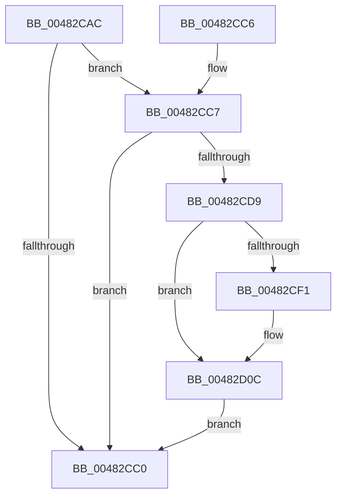

# PopCheckForWork

- RVA: `0x00482CAC`–`0x00482D1C` (길이 `112` bytes)
- VA: `0x0000000140482CAC`
- 실행 섹션: `.text`
- PDB 이름 있음: `예`; PDB Function 태그: `아니요`
- unwind 정보 RVA: `0x000AEE68`
- 디코드: `27`개 명령, `112/112` bytes 표시
- 미해석 바이트: `0` (있으면 어셈블리에 `.byte`로 보존)

> 이 문서는 커널 이미지의 기계어와 PDB 기호를 분석해 생성했습니다. 4번과 5번은 함수 원형과 자료형을 바이너리 사용 방식에서 추정한 C 해석이며 원본 소스 복구 결과는 아닙니다.

## 1. Dependencies

- 직접 호출 지점: **3**; 고유 호출 대상: **3**
- 직접 호출자로 확인된 함수: **11**
- RIP 상대 이미지 참조: **6**

### Outgoing calls
- `0x00482CE0` → [KeAcquireSpinLockRaiseToDpc](../20/KeAcquireSpinLockRaiseToDpc_function_00208470.md) (function, `0x00208470`)
- `0x00482D07` → [ExQueueWorkItem](../2F/ExQueueWorkItem_function_002F9520.md) (function, `0x002F9520`)
- `0x00482D15` → [KeReleaseSpinLock](../39/KeReleaseSpinLock_function_00392BA0.md) (function, `0x00392BA0`)

### Direct callers
- [PoRegisterDeviceForIdleDetection](../27/PoRegisterDeviceForIdleDetection_function_002700E0.md) at `0x002701BC`
- [PopCheckForIdleness](PopCheckForIdleness_function_00482530.md) at `0x0048271B`
- [PopUserPresentSet](PopUserPresentSet_function_00482B90.md) at `0x00482C23`
- [PopSetNotificationWork](PopSetNotificationWork_function_00482C78.md) at `0x00482C99`
- [PoNotifySystemTimeSet](../4D/PoNotifySystemTimeSet_function_004D4F7C.md) at `0x004D505C`
- [PopCoalescingCheck](../5D/PopCoalescingCheck_function_005D4614.md) at `0x005D4651`
- [PopCoalesingTimerDpcCallback](../5D/PopCoalesingTimerDpcCallback_function_005D4680.md) at `0x005D468E`
- [PopPowerAggregatorSystemTransitionExitStateHandler](../../page/76/PopPowerAggregatorSystemTransitionExitStateHandler_function_00765180.md) at `0x007651EF`
- [PopBatteryApplyCompositeState](../../page/AE/PopBatteryApplyCompositeState_function_00AE0CD0.md) at `0x00AE1114`
- [PopReleasePolicyLock](../../pagelk/B7/PopReleasePolicyLock_function_00B78410.md) at `0x00B78428`
- [PopTransitionSystemPowerStateEx](../../pagelk/B7/PopTransitionSystemPowerStateEx_function_00B7E8C0.md) at `0x00B7FB51`

### Static image references
- `0x00482CB2` → RVA `0x00F0CB48` (`.data`; read)
- `0x00482CB8` → RVA `0x00F0C8C4` (`.data`; reference)
- `0x00482CD0` → RVA `0x00F0C8D0` (`.data`; read)
- `0x00482CD9` → RVA `0x00F0CB80` (`.data`; read)
- `0x00482CF5` → RVA `0x00F0CB60` (`.data`; read)
- `0x00482CFC` → RVA `0x00F0CB48` (`.data`; write)

## 2. Other-region calls and transfers

- 다른 실행 섹션으로 향하는 call: **0**
- 별도 외부 분기/꼬리 이동을 확인하지 못했습니다.

## 3. Assembly (complete function range)

```asm
00482CAC  40 53                           push rbx
00482CAE  48 83 EC 20                     sub rsp, 0x20
00482CB2  8B 05 90 9E A8 00               mov eax, dword ptr [rip + 0xa89e90]
00482CB8  85 05 06 9C A8 00               test dword ptr [rip + 0xa89c06], eax
00482CBE  75 07                           jne 0x140482cc7
00482CC0  48 83 C4 20                     add rsp, 0x20
00482CC4  5B                              pop rbx
00482CC5  C3                              ret
00482CC6  CC                              int3
00482CC7  65 48 8B 04 25 88 01 00 00      mov rax, qword ptr gs:[0x188]
00482CD0  48 39 05 F9 9B A8 00            cmp qword ptr [rip + 0xa89bf9], rax
00482CD7  74 E7                           je 0x140482cc0
00482CD9  48 8D 0D A0 9E A8 00            lea rcx, [rip + 0xa89ea0]
00482CE0  E8 8B 57 D8 FF                  call 0x140208470
00482CE5  8B 15 5D 9E A8 00               mov edx, dword ptr [rip + 0xa89e5d]
00482CEB  8A D8                           mov bl, al
00482CED  85 D2                           test edx, edx
00482CEF  79 1B                           jns 0x140482d0c
00482CF1  0F BA F2 1F                     btr edx, 0x1f
00482CF5  48 8D 0D 64 9E A8 00            lea rcx, [rip + 0xa89e64]
00482CFC  89 15 46 9E A8 00               mov dword ptr [rip + 0xa89e46], edx
00482D02  BA 01 00 00 00                  mov edx, 1
00482D07  E8 14 68 E7 FF                  call 0x1402f9520
00482D0C  8A D3                           mov dl, bl
00482D0E  48 8D 0D 6B 9E A8 00            lea rcx, [rip + 0xa89e6b]
00482D15  E8 86 FE F0 FF                  call 0x140392ba0
00482D1A  EB A4                           jmp 0x140482cc0
```

## 4. C-style interpretation (structured pseudocode)

```c
__int64 __fastcall PopCheckForWork(void)
{
    __int64 result;
    __int64 v_rsp;

    v_rsp = (v_rsp) - (32);
    if (((*(unsigned int *)(v_rip + 11049990)) & ((unsigned int)((unsigned int)(*(unsigned int *)(v_rip + 11050640))))) != 0) goto loc_00482CC7;
loc_00482CC0:
    v_rsp = (v_rsp) + (32);
    return (unsigned int)(*(unsigned int *)(v_rip + 11050640));
loc_00482CC7:
    if ((*(unsigned __int64 *)(v_rip + 11049977)) == (*(unsigned __int64 *)(gs_base + (0 + 392)))) goto loc_00482CC0;
    result = KeAcquireSpinLockRaiseToDpc(v_rip + 11050656, a2, a3, a4);
    if (sign_flag) {
        a1 = v_rip + 11050596;
        *(unsigned int *)(v_rip + 11050566) = (unsigned int)((unsigned int)(*(unsigned int *)(v_rip + 11050589)));
        a2 = 1;
        result = ExQueueWorkItem(a1, a2, a3, a4);
    }
    result = KeReleaseSpinLock(v_rip + 11050603, (unsigned __int8)((unsigned __int8)(result)), a3, a4);
    goto loc_00482CC0;
}
```

## 5. (Beta) C Style

```c
void PopCheckForWork(void)
{
    int64_t result;
    int64_t local_rsp;

    local_rsp = (local_rsp) - (32);
    if (((*(uint32_t *)(v_rip + 0xA89C06)) & ((uint32_t)((uint32_t)(*(uint32_t *)(v_rip + 0xA89E90))))) != 0) goto loc_00482CC7;
loc_00482CC0:
    local_rsp = (local_rsp) + (32);
    return (uint32_t)(*(uint32_t *)(v_rip + 0xA89E90));
loc_00482CC7:
    if ((*(uint64_t *)(v_rip + 0xA89BF9)) == (*(uint64_t *)(gs_base + (0 + 0x188)))) goto loc_00482CC0;
    result = KeAcquireSpinLockRaiseToDpc(v_rip + 11050656, a2, a3, a4);
    if (sign_flag) {
        a1 = v_rip + 11050596;
        *(uint32_t *)(v_rip + 0xA89E46) = (uint32_t)((uint32_t)(*(uint32_t *)(v_rip + 0xA89E5D)));
        a2 = 1;
        result = ExQueueWorkItem(a1, a2, a3, a4);
    }
    result = KeReleaseSpinLock(v_rip + 11050603, (uint8_t)((uint8_t)(result)), a3, a4);
    goto loc_00482CC0;
}
```

## 6. Execution-region graph

[열기: 2D/3D 그래프와 함수 탐색 컨트롤 패널](../../../control-panel.html?section=text&rva=0x00482CAC&view=graph)

- 2D 그래프는 위에서 아래로 흐르고, 3D 그래프는 빈 공간을 드래그해 회전합니다. Shift+드래그는 이동, 휠은 확대·축소, 함수 노드 선택은 대상 보고서 이동입니다.

### Static fallback


