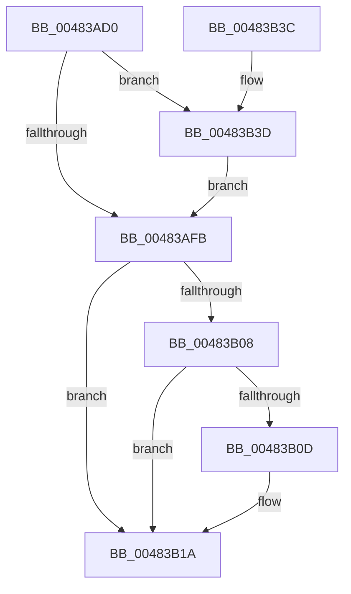

# PopCompleteDirectedPowerTransitionCallback

- RVA: `0x00483AD0`–`0x00483B43` (길이 `115` bytes)
- VA: `0x0000000140483AD0`
- 실행 섹션: `.text`
- PDB 이름 있음: `예`; PDB Function 태그: `아니요`
- unwind 정보 RVA: `0x00071254`
- 디코드: `34`개 명령, `115/115` bytes 표시
- 미해석 바이트: `0` (있으면 어셈블리에 `.byte`로 보존)

> 이 문서는 커널 이미지의 기계어와 PDB 기호를 분석해 생성했습니다. 4번과 5번은 함수 원형과 자료형을 바이너리 사용 방식에서 추정한 C 해석이며 원본 소스 복구 결과는 아닙니다.

## 1. Dependencies

- 직접 호출 지점: **3**; 고유 호출 대상: **3**
- 직접 호출자로 확인된 함수: **2**
- RIP 상대 이미지 참조: **0**

### Outgoing calls
- `0x00483AFE` → [PopCompleteNotifyTransitionCommon](PopCompleteNotifyTransitionCommon_function_00483B4C.md) (function, `0x00483B4C`)
- `0x00483B15` → [PoFxIdleDevice](PoFxIdleDevice_function_00483EE8.md) (function, `0x00483EE8`)
- `0x00483B27` → [KeReleaseSemaphore](../39/KeReleaseSemaphore_function_00397080.md) (function, `0x00397080`)

### Direct callers
- [PopFxCompleteDirectedPowerTransition](../4F/PopFxCompleteDirectedPowerTransition_function_004FB330.md) at `0x004FB462`
- [PopIssueDirectedPowerTransition](../../page/AD/PopIssueDirectedPowerTransition_function_00AD158C.md) at `0x00AD15E9`

### Static image references
- 디코드된 RIP-relative 메모리 참조가 없습니다.

## 2. Other-region calls and transfers

- 다른 실행 섹션으로 향하는 call: **0**
- 별도 외부 분기/꼬리 이동을 확인하지 못했습니다.

## 3. Assembly (complete function range)

```asm
00483AD0  48 89 5C 24 08                  mov qword ptr [rsp + 8], rbx
00483AD5  48 89 74 24 10                  mov qword ptr [rsp + 0x10], rsi
00483ADA  57                              push rdi
00483ADB  48 83 EC 20                     sub rsp, 0x20
00483ADF  48 8B DA                        mov rbx, rdx
00483AE2  45 33 C9                        xor r9d, r9d
00483AE5  48 8B 51 30                     mov rdx, qword ptr [rcx + 0x30]
00483AE9  48 8B F9                        mov rdi, rcx
00483AEC  48 81 C2 A0 00 00 00            add rdx, 0xa0
00483AF3  8B 73 04                        mov esi, dword ptr [rbx + 4]
00483AF6  45 85 C0                        test r8d, r8d
00483AF9  78 42                           js 0x140483b3d
00483AFB  48 8B CB                        mov rcx, rbx
00483AFE  E8 49 00 00 00                  call 0x140483b4c
00483B03  80 3B 02                        cmp byte ptr [rbx], 2
00483B06  75 12                           jne 0x140483b1a
00483B08  83 FE 01                        cmp esi, 1
00483B0B  75 0D                           jne 0x140483b1a
00483B0D  48 8B 4F 30                     mov rcx, qword ptr [rdi + 0x30]
00483B11  48 8B 49 20                     mov rcx, qword ptr [rcx + 0x20]
00483B15  E8 CE 03 00 00                  call 0x140483ee8
00483B1A  48 8B 4B 28                     mov rcx, qword ptr [rbx + 0x28]
00483B1E  45 33 C9                        xor r9d, r9d
00483B21  33 D2                           xor edx, edx
00483B23  45 8D 41 01                     lea r8d, [r9 + 1]
00483B27  E8 54 35 F1 FF                  call 0x140397080
00483B2C  48 8B 5C 24 30                  mov rbx, qword ptr [rsp + 0x30]
00483B31  48 8B 74 24 38                  mov rsi, qword ptr [rsp + 0x38]
00483B36  48 83 C4 20                     add rsp, 0x20
00483B3A  5F                              pop rdi
00483B3B  C3                              ret
00483B3C  CC                              int3
00483B3D  4C 8B 49 60                     mov r9, qword ptr [rcx + 0x60]
00483B41  EB B8                           jmp 0x140483afb
```

## 4. C-style interpretation (structured pseudocode)

```c
__int64 __fastcall PopCompleteDirectedPowerTransitionCallback(__int64 a1, __int64 a2, int a3, int a4)
{
    __int64 result;
    __int64 v_rsp;
    unsigned __int64 v_stack_p10;
    unsigned __int64 v_stack_p8;

    v_stack_p8 = v_rbx;
    v_stack_p10 = v_rsi;
    v_rsp = (v_rsp) - (32);
    a4 = 0;
    a2 = (*(unsigned __int64 *)(a1 + 48)) + (160);
    if (sign_flag) goto loc_00483B3D;
loc_00483AFB:
    result = PopCompleteNotifyTransitionCommon(a2, a2, a3, a4);
    if ((*(unsigned __int8 *)(a2)) != 2) goto loc_00483B1A;
    if (((unsigned int)((unsigned int)(*(unsigned int *)(a2 + 4)))) == 1) {
        a1 = *(unsigned __int64 *)(a1 + 48);
        a1 = *(unsigned __int64 *)(a1 + 32);
        result = PoFxIdleDevice(a1, a2, a3, a4);
    }
    a4 = 0;
    a2 = 0;
    result = KeReleaseSemaphore(*(unsigned __int64 *)(a2 + 40), a2, a4 + 1, a4);
    v_rsp = (v_rsp) + (32);
    return result;
loc_00483B3D:
    goto loc_00483AFB;
}
```

## 5. (Beta) C Style

```c
int64_t PopCompleteDirectedPowerTransitionCallback(void *Arg1, void *Arg2, int32_t Arg3, int32_t Arg4)
{
    uint8_t *arg1 = (uint8_t *)Arg1;
    uint8_t *arg2 = (uint8_t *)Arg2;

    int64_t result;
    int64_t local_rsp;
    uint64_t v_stack_p10;
    uint64_t v_stack_p8;

    v_stack_p8 = local_rbx;
    v_stack_p10 = local_rsi;
    local_rsp = (local_rsp) - (32);
    Arg4 = 0;
    Arg2 = (*(uint64_t *)(arg1 + 0x30)) + (160);
    if (sign_flag) goto loc_00483B3D;
loc_00483AFB:
    result = PopCompleteNotifyTransitionCommon(Arg2, Arg2, Arg3, Arg4);
    if ((*(uint8_t *)(arg2)) != 2) goto loc_00483B1A;
    if (((uint32_t)((uint32_t)(*(uint32_t *)(arg2 + 0x4)))) == 1) {
        Arg1 = *(uint64_t *)(arg1 + 0x30);
        Arg1 = *(uint64_t *)(arg1 + 0x20);
        result = PoFxIdleDevice(Arg1, Arg2, Arg3, Arg4);
    }
    Arg4 = 0;
    Arg2 = 0;
    result = KeReleaseSemaphore(*(uint64_t *)(arg2 + 0x28), Arg2, Arg4 + 1, Arg4);
    local_rsp = (local_rsp) + (32);
    return result;
loc_00483B3D:
    goto loc_00483AFB;
}
```

### 관측된 메모리 오프셋

구조체 형식이 확인되지 않은 접근은 인자 기준의 오프셋으로만 기록했습니다.

| 기준 인자 | 오프셋 표현 | 폭 (bit) | 접근 |
|---|---:|---:|---|
| `Arg1` | `+ 0x30` | `64` | `R` |
| `Arg1` | `+ 0x60` | `64` | `R` |
| `Arg2` | `+ 0x0` | `8` | `R` |
| `Arg2` | `+ 0x4` | `32` | `R` |
| `Arg2` | `+ 0x28` | `64` | `R` |

## 6. Execution-region graph

[열기: 2D/3D 그래프와 함수 탐색 컨트롤 패널](../../../control-panel.html?section=text&rva=0x00483AD0&view=graph)

- 2D 그래프는 위에서 아래로 흐르고, 3D 그래프는 빈 공간을 드래그해 회전합니다. Shift+드래그는 이동, 휠은 확대·축소, 함수 노드 선택은 대상 보고서 이동입니다.

### Static fallback


