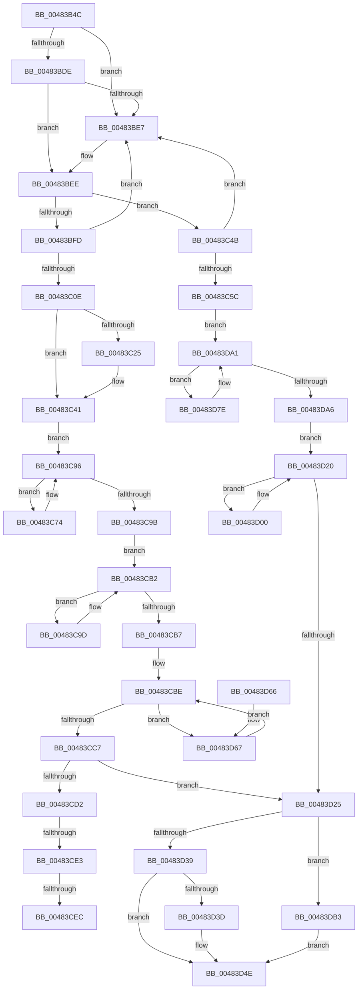

# PopCompleteNotifyTransitionCommon

- RVA: `0x00483B4C`–`0x00483DC3` (길이 `631` bytes)
- VA: `0x0000000140483B4C`
- 실행 섹션: `.text`
- PDB 이름 있음: `예`; PDB Function 태그: `예`
- unwind 정보 RVA: `0x000AEF94`
- 디코드: `177`개 명령, `631/631` bytes 표시
- 미해석 바이트: `0` (있으면 어셈블리에 `.byte`로 보존)

> 이 문서는 커널 이미지의 기계어와 PDB 기호를 분석해 생성했습니다. 4번과 5번은 함수 원형과 자료형을 바이너리 사용 방식에서 추정한 C 해석이며 원본 소스 복구 결과는 아닙니다.

## 1. Dependencies

- 직접 호출 지점: **11**; 고유 호출 대상: **8**
- 직접 호출자로 확인된 함수: **2**
- RIP 상대 이미지 참조: **3**

### Outgoing calls
- `0x00483BC4` → [KeAcquireInStackQueuedSpinLock](../27/KeAcquireInStackQueuedSpinLock_function_002757A0.md) (function, `0x002757A0`)
- `0x00483C36` → [PopReadyParentSleep](PopReadyParentSleep_function_00483DCC.md) (function, `0x00483DCC`)
- `0x00483C83` → [PopReadyParentSleep](PopReadyParentSleep_function_00483DCC.md) (function, `0x00483DCC`)
- `0x00483CAA` → [PopPrepChildWake](PopPrepChildWake_function_00483FBC.md) (function, `0x00483FBC`)
- `0x00483CEF` → [PopDiagTraceDriverVeto](../../pagelk/B7/PopDiagTraceDriverVeto_function_00B70F48.md) (function, `0x00B70F48`)
- `0x00483D0E` → [PopReadyChildWake](PopReadyChildWake_function_00483E58.md) (function, `0x00483E58`)
- `0x00483D2A` → [KeReleaseInStackQueuedSpinLock](../34/KeReleaseInStackQueuedSpinLock_function_00342CE0.md) (function, `0x00342CE0`)
- `0x00483D49` → [KeReleaseSemaphore](../39/KeReleaseSemaphore_function_00397080.md) (function, `0x00397080`)
- `0x00483D71` → [PopPrepChildWake](PopPrepChildWake_function_00483FBC.md) (function, `0x00483FBC`)
- `0x00483D8F` → [PopReadyChildWake](PopReadyChildWake_function_00483E58.md) (function, `0x00483E58`)
- `0x00483DBC` → [KeSetEvent](../33/KeSetEvent_function_0033F310.md) (function, `0x0033F310`)

### Direct callers
- [PopCompleteDirectedPowerTransitionCallback](PopCompleteDirectedPowerTransitionCallback_function_00483AD0.md) at `0x00483AFE`
- [PopSystemIrpCompletion](../../pagelk/B7/PopSystemIrpCompletion_function_00B70CC0.md) at `0x00B70E8E`

### Static image references
- `0x00483B6A` → RVA `0x00F0BCC4` (`.data`; read)
- `0x00483B7D` → RVA `0x00F0BCD0` (`.data`; read)
- `0x00483BAC` → RVA `0x00F8C438` (`.data`; read)

## 2. Other-region calls and transfers

- 다른 실행 섹션으로 향하는 call: **1**
  - `0x00483CEF` → [PopDiagTraceDriverVeto](../../pagelk/B7/PopDiagTraceDriverVeto_function_00B70F48.md) (`.text` → `PAGELK`)
- call이 아닌 외부 분기/꼬리 이동: **3**
  - `0x00483CDD` → [sub_006F530A](../6F/Unknown_function_006F530A.md) (`tail-transfer`)
  - `0x00483CE6` → [sub_006F530A](../6F/Unknown_function_006F530A.md) (`tail-transfer`)
  - `0x00483CFB` → [sub_006F530A](../6F/Unknown_function_006F530A.md) (`tail-transfer`)

## 3. Assembly (complete function range)

```asm
00483B4C  4C 8B DC                        mov r11, rsp
00483B4F  49 89 5B 10                     mov qword ptr [r11 + 0x10], rbx
00483B53  4D 89 4B 20                     mov qword ptr [r11 + 0x20], r9
00483B57  45 89 43 18                     mov dword ptr [r11 + 0x18], r8d
00483B5B  55                              push rbp
00483B5C  56                              push rsi
00483B5D  57                              push rdi
00483B5E  41 54                           push r12
00483B60  41 55                           push r13
00483B62  41 56                           push r14
00483B64  41 57                           push r15
00483B66  48 83 EC 40                     sub rsp, 0x40
00483B6A  44 8B 3D 53 81 A8 00            mov r15d, dword ptr [rip + 0xa88153]
00483B71  33 C0                           xor eax, eax
00483B73  4C 8B B2 68 FF FF FF            mov r14, qword ptr [rdx - 0x98]
00483B7A  48 8B F1                        mov rsi, rcx
00483B7D  48 8B 0D 4C 81 A8 00            mov rcx, qword ptr [rip + 0xa8814c]
00483B84  0F 57 C0                        xorps xmm0, xmm0
00483B87  0F 11 44 24 20                  movups xmmword ptr [rsp + 0x20], xmm0
00483B8C  44 8D 60 01                     lea r12d, [rax + 1]
00483B90  41 C1 EF 17                     shr r15d, 0x17
00483B94  49 89 43 B8                     mov qword ptr [r11 - 0x48], rax
00483B98  45 33 ED                        xor r13d, r13d
00483B9B  48 8B 82 70 FF FF FF            mov rax, qword ptr [rdx - 0x90]
00483BA2  48 8B FA                        mov rdi, rdx
00483BA5  45 22 FC                        and r15b, r12b
00483BA8  49 8D 53 A8                     lea rdx, [r11 - 0x58]
00483BAC  48 3B 05 85 88 B0 00            cmp rax, qword ptr [rip + 0xb08885]
00483BB3  4C 0F 45 E8                     cmovne r13, rax
00483BB7  33 DB                           xor ebx, ebx
00483BB9  48 83 C1 08                     add rcx, 8
00483BBD  88 9C 24 80 00 00 00            mov byte ptr [rsp + 0x80], bl
00483BC4  E8 D7 1B DF FF                  call 0x1402757a0
00483BC9  48 8B 17                        mov rdx, qword ptr [rdi]
00483BCC  48 8D 6E 30                     lea rbp, [rsi + 0x30]
00483BD0  0F B6 47 38                     movzx eax, byte ptr [rdi + 0x38]
00483BD4  48 8D 0C C0                     lea rcx, [rax + rax*8]
00483BD8  48 39 7A 08                     cmp qword ptr [rdx + 8], rdi
00483BDC  75 09                           jne 0x140483be7
00483BDE  48 8B 47 08                     mov rax, qword ptr [rdi + 8]
00483BE2  48 39 38                        cmp qword ptr [rax], rdi
00483BE5  74 07                           je 0x140483bee
00483BE7  B9 03 00 00 00                  mov ecx, 3
00483BEC  CD 29                           int 0x29
00483BEE  48 89 10                        mov qword ptr [rax], rdx
00483BF1  48 89 42 08                     mov qword ptr [rdx + 8], rax
00483BF5  38 9E D0 01 00 00               cmp byte ptr [rsi + 0x1d0], bl
00483BFB  75 4E                           jne 0x140483c4b
00483BFD  48 8D 45 38                     lea rax, [rbp + 0x38]
00483C01  48 8D 04 C8                     lea rax, [rax + rcx*8]
00483C05  48 8B 50 08                     mov rdx, qword ptr [rax + 8]
00483C09  48 39 02                        cmp qword ptr [rdx], rax
00483C0C  75 D9                           jne 0x140483be7
00483C0E  48 89 07                        mov qword ptr [rdi], rax
00483C11  48 89 57 08                     mov qword ptr [rdi + 8], rdx
00483C15  48 89 3A                        mov qword ptr [rdx], rdi
00483C18  48 89 78 08                     mov qword ptr [rax + 8], rdi
00483C1C  FF 4C CD 14                     dec dword ptr [rbp + rcx*8 + 0x14]
00483C20  4D 85 ED                        test r13, r13
00483C23  74 1C                           je 0x140483c41
00483C25  44 8A 47 38                     mov r8b, byte ptr [rdi + 0x38]
00483C29  49 8D 8D A0 00 00 00            lea rcx, [r13 + 0xa0]
00483C30  45 8A CF                        mov r9b, r15b
00483C33  48 8B D5                        mov rdx, rbp
00483C36  E8 91 01 00 00                  call 0x140483dcc
00483C3B  84 C0                           test al, al
00483C3D  41 0F 45 DC                     cmovne ebx, r12d
00483C41  4C 8D 6F 20                     lea r13, [rdi + 0x20]
00483C45  4D 8B 65 00                     mov r12, qword ptr [r13]
00483C49  EB 4B                           jmp 0x140483c96
00483C4B  48 8D 45 18                     lea rax, [rbp + 0x18]
00483C4F  48 8D 04 C8                     lea rax, [rax + rcx*8]
00483C53  48 8B 50 08                     mov rdx, qword ptr [rax + 8]
00483C57  48 39 02                        cmp qword ptr [rdx], rax
00483C5A  75 8B                           jne 0x140483be7
00483C5C  48 89 07                        mov qword ptr [rdi], rax
00483C5F  48 89 57 08                     mov qword ptr [rdi + 8], rdx
00483C63  48 89 3A                        mov qword ptr [rdx], rdi
00483C66  48 89 78 08                     mov qword ptr [rax + 8], rdi
00483C6A  44 01 64 CD 14                  add dword ptr [rbp + rcx*8 + 0x14], r12d
00483C6F  E9 2D 01 00 00                  jmp 0x140483da1
00483C74  44 8A 47 38                     mov r8b, byte ptr [rdi + 0x38]
00483C78  45 8A CF                        mov r9b, r15b
00483C7B  49 8B 4C 24 28                  mov rcx, qword ptr [r12 + 0x28]
00483C80  48 8B D5                        mov rdx, rbp
00483C83  E8 44 01 00 00                  call 0x140483dcc
00483C88  4D 8B 24 24                     mov r12, qword ptr [r12]
00483C8C  8D 4B 01                        lea ecx, [rbx + 1]
00483C8F  84 C0                           test al, al
00483C91  0F 44 CB                        cmove ecx, ebx
00483C94  8B D9                           mov ebx, ecx
00483C96  4D 3B E5                        cmp r12, r13
00483C99  75 D9                           jne 0x140483c74
00483C9B  EB 15                           jmp 0x140483cb2
00483C9D  49 8D 8E A0 00 00 00            lea rcx, [r14 + 0xa0]
00483CA4  45 8A C7                        mov r8b, r15b
00483CA7  48 8B D5                        mov rdx, rbp
00483CAA  E8 0D 03 00 00                  call 0x140483fbc
00483CAF  4D 8B 36                        mov r14, qword ptr [r14]
00483CB2  4D 85 F6                        test r14, r14
00483CB5  75 E6                           jne 0x140483c9d
00483CB7  4C 8D 5F 10                     lea r11, [rdi + 0x10]
00483CBB  4D 8B 13                        mov r10, qword ptr [r11]
00483CBE  4D 3B D3                        cmp r10, r11
00483CC1  0F 85 A0 00 00 00               jne 0x140483d67
00483CC7  8B 84 24 90 00 00 00            mov eax, dword ptr [rsp + 0x90]
00483CCE  85 C0                           test eax, eax
00483CD0  79 53                           jns 0x140483d25
00483CD2  48 8B 8C 24 98 00 00 00         mov rcx, qword ptr [rsp + 0x98]
00483CDA  48 85 C9                        test rcx, rcx
00483CDD  0F 84 27 16 27 00               je 0x1406f530a
00483CE3  80 3E 03                        cmp byte ptr [rsi], 3
00483CE6  0F 85 1E 16 27 00               jne 0x1406f530a
00483CEC  48 8B D7                        mov rdx, rdi
00483CEF  E8 54 D2 6E 00                  call 0x140b70f48
00483CF4  8B 84 24 90 00 00 00            mov eax, dword ptr [rsp + 0x90]
00483CFB  E9 0A 16 27 00                  jmp 0x1406f530a
00483D00  44 8A 47 38                     mov r8b, byte ptr [rdi + 0x38]
00483D04  45 8A CF                        mov r9b, r15b
00483D07  49 8B 4E F8                     mov rcx, qword ptr [r14 - 8]
00483D0B  48 8B D5                        mov rdx, rbp
00483D0E  E8 45 01 00 00                  call 0x140483e58
00483D13  4D 8B 36                        mov r14, qword ptr [r14]
00483D16  8D 4B 01                        lea ecx, [rbx + 1]
00483D19  84 C0                           test al, al
00483D1B  0F 44 CB                        cmove ecx, ebx
00483D1E  8B D9                           mov ebx, ecx
00483D20  4D 3B F4                        cmp r14, r12
00483D23  75 DB                           jne 0x140483d00
00483D25  48 8D 4C 24 20                  lea rcx, [rsp + 0x20]
00483D2A  E8 B1 EF EB FF                  call 0x140342ce0
00483D2F  80 BC 24 80 00 00 00 00         cmp byte ptr [rsp + 0x80], 0
00483D37  75 7A                           jne 0x140483db3
00483D39  85 DB                           test ebx, ebx
00483D3B  74 11                           je 0x140483d4e
00483D3D  48 8B 4E 20                     mov rcx, qword ptr [rsi + 0x20]
00483D41  45 33 C9                        xor r9d, r9d
00483D44  44 8B C3                        mov r8d, ebx
00483D47  33 D2                           xor edx, edx
00483D49  E8 32 33 F1 FF                  call 0x140397080
00483D4E  48 8B 9C 24 88 00 00 00         mov rbx, qword ptr [rsp + 0x88]
00483D56  48 83 C4 40                     add rsp, 0x40
00483D5A  41 5F                           pop r15
00483D5C  41 5E                           pop r14
00483D5E  41 5D                           pop r13
00483D60  41 5C                           pop r12
00483D62  5F                              pop rdi
00483D63  5E                              pop rsi
00483D64  5D                              pop rbp
00483D65  C3                              ret
00483D66  CC                              int3
00483D67  49 8B 4A F8                     mov rcx, qword ptr [r10 - 8]
00483D6B  45 8A C7                        mov r8b, r15b
00483D6E  48 8B D5                        mov rdx, rbp
00483D71  E8 46 02 00 00                  call 0x140483fbc
00483D76  4D 8B 12                        mov r10, qword ptr [r10]
00483D79  E9 40 FF FF FF                  jmp 0x140483cbe
00483D7E  44 8A 47 38                     mov r8b, byte ptr [rdi + 0x38]
00483D82  49 8D 8E A0 00 00 00            lea rcx, [r14 + 0xa0]
00483D89  45 8A CF                        mov r9b, r15b
00483D8C  48 8B D5                        mov rdx, rbp
00483D8F  E8 C4 00 00 00                  call 0x140483e58
00483D94  4D 8B 36                        mov r14, qword ptr [r14]
00483D97  8D 4B 01                        lea ecx, [rbx + 1]
00483D9A  84 C0                           test al, al
00483D9C  0F 44 CB                        cmove ecx, ebx
00483D9F  8B D9                           mov ebx, ecx
00483DA1  4D 85 F6                        test r14, r14
00483DA4  75 D8                           jne 0x140483d7e
00483DA6  4C 8D 67 10                     lea r12, [rdi + 0x10]
00483DAA  4D 8B 34 24                     mov r14, qword ptr [r12]
00483DAE  E9 6D FF FF FF                  jmp 0x140483d20
00483DB3  48 8B 4E 18                     mov rcx, qword ptr [rsi + 0x18]
00483DB7  45 33 C0                        xor r8d, r8d
00483DBA  33 D2                           xor edx, edx
00483DBC  E8 4F B5 EB FF                  call 0x14033f310
00483DC1  EB 8B                           jmp 0x140483d4e
```

## 4. C-style interpretation (structured pseudocode)

```c
__int64 __fastcall PopCompleteNotifyTransitionCommon(__int64 a1, __int64 a2, int a3, __int64 a4)
{
    __int64 result;
    __int64 v_r13;
    __int64 v_r15;
    __int64 v_rbx;
    __int64 v_rsp;
    unsigned __int64 v_stack_m58;
    unsigned __int64 v_stack_p10;
    unsigned int v_stack_p18;
    unsigned __int64 v_stack_p20;
    unsigned __int8 v_stack_p8;

    *(unsigned __int64 *)(v_rsp + 16) = v_rbx;
    *(unsigned __int64 *)(v_rsp + 32) = a4;
    *(unsigned int *)(v_rsp + 24) = a3;
    v_rsp = (v_rsp) - (64);
    result = 0;
    v_stack_m58 = v_xmm0;
    v_r15 = (unsigned int)(((unsigned int)(*(unsigned int *)(v_rip + 11043155))) >> (23));
    *(unsigned __int64 *)(v_rsp - 72) = 0;
    v_r13 = 0;
    v_r15 = (unsigned __int8)((v_r15) & ((unsigned __int8)(result + 1)));
    if ((*(unsigned __int64 *)(a2 - 144)) != (*(unsigned __int64 *)(v_rip + 11569285))) { v_r13 = *(unsigned __int64 *)(a2 - 144); }
    v_rbx = 0;
    a1 = (*(unsigned __int64 *)(v_rip + 11043148)) + (8);
    v_stack_p8 = 0;
    result = KeAcquireInStackQueuedSpinLock(a1, v_rsp - 88, a3, a4);
    if ((*(unsigned __int64 *)(*(unsigned __int64 *)(a2) + 8)) != a2) goto loc_00483BE7;
    if ((*(unsigned __int64 *)(*(unsigned __int64 *)(a2 + 8))) != a2) {
        a1 = 3;
    }
    *(unsigned __int64 *)(*(unsigned __int64 *)(a2 + 8)) = *(unsigned __int64 *)(a2);
    *(unsigned __int64 *)(*(unsigned __int64 *)(a2) + 8) = *(unsigned __int64 *)(a2 + 8);
    if ((*(unsigned __int8 *)(a1 + 464)) != 0) goto loc_00483C4B;
    if ((*(unsigned __int64 *)(*(unsigned __int64 *)(a1 + 48 + 56 + a1 * 8 + 8))) != (a1 + 48 + 56 + a1 * 8)) goto loc_00483BE7;
    *(unsigned __int64 *)(a2) = a1 + 48 + 56 + a1 * 8;
    *(unsigned __int64 *)(a2 + 8) = *(unsigned __int64 *)(a1 + 48 + 56 + a1 * 8 + 8);
    *(unsigned __int64 *)(*(unsigned __int64 *)(a1 + 48 + 56 + a1 * 8 + 8)) = a2;
    *(unsigned __int64 *)(a1 + 48 + 56 + a1 * 8 + 8) = a2;
    result = a1 + 48 + 56 + a1 * 8;
    if (v_r13 != 0) {
        a3 = *(unsigned __int8 *)(a2 + 56);
        a1 = v_r13 + 160;
        a4 = (unsigned __int8)(v_r15);
        a2 = a1 + 48;
        result = PopReadyParentSleep(a1, a2, a3, a4);
        if ((unsigned __int8)(result) != 0) { v_rbx = (unsigned int)(result + 1); }
    }
    goto loc_00483C96;
loc_00483C4B:
    if ((*(unsigned __int64 *)(*(unsigned __int64 *)(a1 + 48 + 24 + a1 * 8 + 8))) != (a1 + 48 + 24 + a1 * 8)) goto loc_00483BE7;
    *(unsigned __int64 *)(a2) = a1 + 48 + 24 + a1 * 8;
    *(unsigned __int64 *)(a2 + 8) = *(unsigned __int64 *)(a1 + 48 + 24 + a1 * 8 + 8);
    *(unsigned __int64 *)(*(unsigned __int64 *)(a1 + 48 + 24 + a1 * 8 + 8)) = a2;
    *(unsigned __int64 *)(a1 + 48 + 24 + a1 * 8 + 8) = a2;
    goto loc_00483DA1;
loc_00483C74:
    result = PopReadyParentSleep(*(unsigned __int64 *)(*(unsigned __int64 *)(a2 + 32) + 40), a1 + 48, *(unsigned __int8 *)(a2 + 56), (unsigned __int8)(v_r15));
    a1 = v_rbx + 1;
    if ((unsigned __int8)(result) == 0) { a1 = (unsigned int)(v_rbx); }
loc_00483C96:
    if ((*(unsigned __int64 *)(*(unsigned __int64 *)(a2 + 32))) != (a2 + 32)) goto loc_00483C74;
    goto loc_00483CB2;
loc_00483C9D:
    result = PopPrepChildWake(*(unsigned __int64 *)(a2 - 152) + 160, a1 + 48, (unsigned __int8)(v_r15), (unsigned __int8)(v_r15));
loc_00483CB2:
    if (*(unsigned __int64 *)(*(unsigned __int64 *)(a2 - 152)) != 0) goto loc_00483C9D;
loc_00483CBE:
    if ((*(unsigned __int64 *)(a2 + 16)) != (a2 + 16)) goto loc_00483D67;
    if (!sign_flag) goto loc_00483D25;
    result = PopDiagTraceDriverVeto(v_stack_p20, a2, (unsigned __int8)(v_r15), (unsigned __int8)(v_r15));
loc_00483D00:
    result = PopReadyChildWake(*(unsigned __int64 *)(*(unsigned __int64 *)(*(unsigned __int64 *)(a2 - 152)) - 8), a1 + 48, *(unsigned __int8 *)(a2 + 56), (unsigned __int8)(v_r15));
    a1 = (unsigned int)((unsigned int)(a1)) + 1;
    if ((unsigned __int8)(result) == 0) { a1 = (unsigned int)((unsigned int)((unsigned int)(a1))); }
loc_00483D20:
    if ((*(unsigned __int64 *)(*(unsigned __int64 *)(*(unsigned __int64 *)(a2 - 152)))) != (*(unsigned __int64 *)(*(unsigned __int64 *)(a2 + 32)))) goto loc_00483D00;
loc_00483D25:
    result = KeReleaseInStackQueuedSpinLock(v_stack_m58, a1 + 48, *(unsigned __int8 *)(a2 + 56), (unsigned __int8)(v_r15));
    if (v_stack_p8 != 0) goto loc_00483DB3;
    if ((unsigned int)((unsigned int)((unsigned int)(a1))) != 0) {
        a1 = *(unsigned __int64 *)(a1 + 32);
        a4 = 0;
        a3 = (unsigned int)((unsigned int)((unsigned int)(a1)));
        a2 = 0;
        result = KeReleaseSemaphore(a1, a2, a3, a4);
    }
    v_rsp = (v_rsp) + (64);
    return result;
loc_00483D67:
    result = PopPrepChildWake(*(unsigned __int64 *)(*(unsigned __int64 *)(a2 + 16) - 8), a1 + 48, (unsigned __int8)(v_r15), a4);
    goto loc_00483CBE;
loc_00483D7E:
    result = PopReadyChildWake(*(unsigned __int64 *)(*(unsigned __int64 *)(*(unsigned __int64 *)(a2 - 152))) + 160, a1 + 48, *(unsigned __int8 *)(a2 + 56), (unsigned __int8)(v_r15));
    a1 = v_stack_p10 + 1;
    if ((unsigned __int8)(result) == 0) { a1 = (unsigned int)(v_stack_p10); }
loc_00483DA1:
    if (*(unsigned __int64 *)(*(unsigned __int64 *)(*(unsigned __int64 *)(*(unsigned __int64 *)(a2 - 152)))) != 0) goto loc_00483D7E;
    goto loc_00483D20;
loc_00483DB3:
    a3 = 0;
    a2 = 0;
    result = KeSetEvent(*(unsigned __int64 *)(a1 + 24), a2, a3, (unsigned __int8)(v_r15));
    goto loc_00483D4E;
}
```

## 5. (Beta) C Style

```c
int64_t PopCompleteNotifyTransitionCommon(void *Arg1, void *Arg2, int32_t Arg3, int64_t Arg4)
{
    uint8_t *arg1 = (uint8_t *)Arg1;
    uint8_t *arg2 = (uint8_t *)Arg2;

    int64_t result;
    int64_t local_r13;
    int64_t local_r15;
    int64_t local_rbx;
    int64_t local_rsp;
    uint64_t v_stack_m58;
    uint64_t v_stack_p10;
    uint32_t v_stack_p18;
    uint64_t v_stack_p20;
    uint8_t v_stack_p8;

    *(uint64_t *)(local_rsp + 0x10) = local_rbx;
    *(uint64_t *)(local_rsp + 0x20) = Arg4;
    *(uint32_t *)(local_rsp + 0x18) = Arg3;
    local_rsp = (local_rsp) - (64);
    result = 0;
    v_stack_m58 = v_xmm0;
    local_r15 = (uint32_t)(((uint32_t)(*(uint32_t *)(v_rip + 0xA88153))) >> (23));
    *(uint64_t *)(local_rsp - 0x48) = 0;
    local_r13 = 0;
    local_r15 = (uint8_t)((local_r15) & ((uint8_t)(result + 1)));
    if ((*(uint64_t *)(arg2 - 0x90)) != (*(uint64_t *)(v_rip + 0xB08885))) { local_r13 = *(uint64_t *)(arg2 - 0x90); }
    local_rbx = 0;
    Arg1 = (*(uint64_t *)(v_rip + 0xA8814C)) + (8);
    v_stack_p8 = 0;
    result = KeAcquireInStackQueuedSpinLock(Arg1, local_rsp - 88, Arg3, Arg4);
    if ((*(uint64_t *)(*(uint64_t *)(arg2) + 0x8)) != Arg2) goto loc_00483BE7;
    if ((*(uint64_t *)(*(uint64_t *)(arg2 + 0x8))) != Arg2) {
        Arg1 = 3;
    }
    *(uint64_t *)(*(uint64_t *)(arg2 + 0x8)) = *(uint64_t *)(arg2);
    *(uint64_t *)(*(uint64_t *)(arg2) + 0x8) = *(uint64_t *)(arg2 + 0x8);
    if ((*(uint8_t *)(arg1 + 0x1D0)) != 0) goto loc_00483C4B;
    if ((*(uint64_t *)(*(uint64_t *)(arg1 + 0x30 + 0x38 + arg1 * 8 + 0x8))) != (Arg1 + 48 + 56 + Arg1 * 8)) goto loc_00483BE7;
    *(void **)(arg2) = Arg1 + 48 + 56 + Arg1 * 8;
    *(uint64_t *)(arg2 + 0x8) = *(uint64_t *)(arg1 + 0x30 + 0x38 + arg1 * 8 + 0x8);
    *(void **)(*(uint64_t *)(arg1 + 0x30 + 0x38 + arg1 * 8 + 0x8)) = Arg2;
    *(void **)(arg1 + 0x30 + 0x38 + arg1 * 8 + 0x8) = Arg2;
    result = Arg1 + 48 + 56 + Arg1 * 8;
    if (local_r13 != 0) {
        Arg3 = *(uint8_t *)(arg2 + 0x38);
        Arg1 = local_r13 + 160;
        Arg4 = (uint8_t)(local_r15);
        Arg2 = Arg1 + 48;
        result = PopReadyParentSleep(Arg1, Arg2, Arg3, Arg4);
        if ((uint8_t)(result) != 0) { local_rbx = (uint32_t)(result + 1); }
    }
    goto loc_00483C96;
loc_00483C4B:
    if ((*(uint64_t *)(*(uint64_t *)(arg1 + 0x30 + 0x18 + arg1 * 8 + 0x8))) != (Arg1 + 48 + 24 + Arg1 * 8)) goto loc_00483BE7;
    *(void **)(arg2) = Arg1 + 48 + 24 + Arg1 * 8;
    *(uint64_t *)(arg2 + 0x8) = *(uint64_t *)(arg1 + 0x30 + 0x18 + arg1 * 8 + 0x8);
    *(void **)(*(uint64_t *)(arg1 + 0x30 + 0x18 + arg1 * 8 + 0x8)) = Arg2;
    *(void **)(arg1 + 0x30 + 0x18 + arg1 * 8 + 0x8) = Arg2;
    goto loc_00483DA1;
loc_00483C74:
    result = PopReadyParentSleep(*(uint64_t *)(*(uint64_t *)(arg2 + 0x20) + 0x28), Arg1 + 48, *(uint8_t *)(arg2 + 0x38), (uint8_t)(local_r15));
    Arg1 = local_rbx + 1;
    if ((uint8_t)(result) == 0) { Arg1 = (uint32_t)(local_rbx); }
loc_00483C96:
    if ((*(uint64_t *)(*(uint64_t *)(arg2 + 0x20))) != (Arg2 + 32)) goto loc_00483C74;
    goto loc_00483CB2;
loc_00483C9D:
    result = PopPrepChildWake(*(uint64_t *)(arg2 - 0x98) + 160, Arg1 + 48, (uint8_t)(local_r15), (uint8_t)(local_r15));
loc_00483CB2:
    if (*(uint64_t *)(*(uint64_t *)(arg2 - 0x98)) != 0) goto loc_00483C9D;
loc_00483CBE:
    if ((*(uint64_t *)(arg2 + 0x10)) != (Arg2 + 16)) goto loc_00483D67;
    if (!sign_flag) goto loc_00483D25;
    result = PopDiagTraceDriverVeto(v_stack_p20, Arg2, (uint8_t)(local_r15), (uint8_t)(local_r15));
loc_00483D00:
    result = PopReadyChildWake(*(uint64_t *)(*(uint64_t *)(*(uint64_t *)(arg2 - 0x98)) - 0x8), Arg1 + 48, *(uint8_t *)(arg2 + 0x38), (uint8_t)(local_r15));
    Arg1 = (uint32_t)((uint32_t)(Arg1)) + 1;
    if ((uint8_t)(result) == 0) { Arg1 = (uint32_t)((uint32_t)((uint32_t)(Arg1))); }
loc_00483D20:
    if ((*(uint64_t *)(*(uint64_t *)(*(uint64_t *)(arg2 - 0x98)))) != (*(uint64_t *)(*(uint64_t *)(arg2 + 0x20)))) goto loc_00483D00;
loc_00483D25:
    result = KeReleaseInStackQueuedSpinLock(v_stack_m58, Arg1 + 48, *(uint8_t *)(arg2 + 0x38), (uint8_t)(local_r15));
    if (v_stack_p8 != 0) goto loc_00483DB3;
    if ((uint32_t)((uint32_t)((uint32_t)(Arg1))) != 0) {
        Arg1 = *(uint64_t *)(arg1 + 0x20);
        Arg4 = 0;
        Arg3 = (uint32_t)((uint32_t)((uint32_t)(Arg1)));
        Arg2 = 0;
        result = KeReleaseSemaphore(Arg1, Arg2, Arg3, Arg4);
    }
    local_rsp = (local_rsp) + (64);
    return result;
loc_00483D67:
    result = PopPrepChildWake(*(uint64_t *)(*(uint64_t *)(arg2 + 0x10) - 0x8), Arg1 + 48, (uint8_t)(local_r15), Arg4);
    goto loc_00483CBE;
loc_00483D7E:
    result = PopReadyChildWake(*(uint64_t *)(*(uint64_t *)(*(uint64_t *)(arg2 - 0x98))) + 160, Arg1 + 48, *(uint8_t *)(arg2 + 0x38), (uint8_t)(local_r15));
    Arg1 = v_stack_p10 + 1;
    if ((uint8_t)(result) == 0) { Arg1 = (uint32_t)(v_stack_p10); }
loc_00483DA1:
    if (*(uint64_t *)(*(uint64_t *)(*(uint64_t *)(*(uint64_t *)(arg2 - 0x98)))) != 0) goto loc_00483D7E;
    goto loc_00483D20;
loc_00483DB3:
    Arg3 = 0;
    Arg2 = 0;
    result = KeSetEvent(*(uint64_t *)(arg1 + 0x18), Arg2, Arg3, (uint8_t)(local_r15));
    goto loc_00483D4E;
}
```

### 관측된 메모리 오프셋

구조체 형식이 확인되지 않은 접근은 인자 기준의 오프셋으로만 기록했습니다.

| 기준 인자 | 오프셋 표현 | 폭 (bit) | 접근 |
|---|---:|---:|---|
| `Arg1` | `+ 0x0` | `8` | `R` |
| `Arg1` | `+ 0x0 + rcx*8` | `64` | `R` |
| `Arg1` | `+ 0x8` | `64` | `R` |
| `Arg1` | `+ 0x8` | `64` | `W` |
| `Arg1` | `+ 0x14 + rcx*8` | `32` | `R/W` |
| `Arg1` | `+ 0x18` | `64` | `R` |
| `Arg1` | `+ 0x20` | `64` | `R` |
| `Arg1` | `+ 0x30` | `64` | `R` |
| `Arg1` | `+ 0x38` | `64` | `R` |
| `Arg1` | `+ 0x1D0` | `8` | `R` |
| `Arg2` | `- 0x98` | `64` | `R` |
| `Arg2` | `- 0x90` | `64` | `R` |
| `Arg2` | `+ 0x0` | `64` | `R` |
| `Arg2` | `+ 0x0` | `64` | `W` |
| `Arg2` | `+ 0x8` | `64` | `R` |
| `Arg2` | `+ 0x8` | `64` | `W` |
| `Arg2` | `+ 0x10` | `64` | `R` |
| `Arg2` | `+ 0x20` | `64` | `R` |
| `Arg2` | `+ 0x38` | `8` | `R` |

## 6. Execution-region graph

[열기: 2D/3D 그래프와 함수 탐색 컨트롤 패널](../../../control-panel.html?section=text&rva=0x00483B4C&view=graph)

- 2D 그래프는 위에서 아래로 흐르고, 3D 그래프는 빈 공간을 드래그해 회전합니다. Shift+드래그는 이동, 휠은 확대·축소, 함수 노드 선택은 대상 보고서 이동입니다.

### Static fallback


