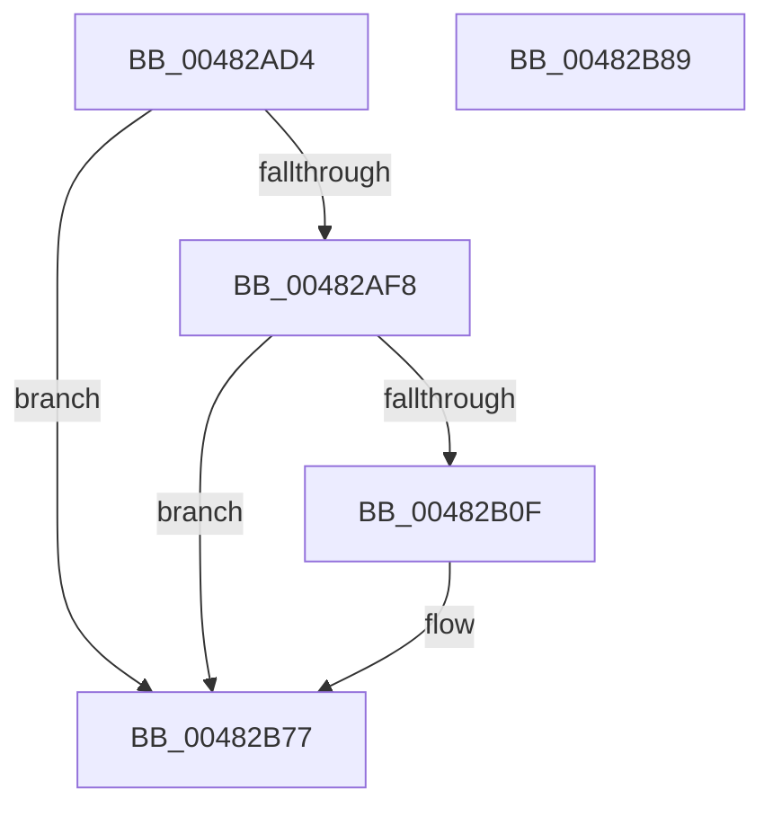

# PopDiagTraceSetSystemState

- RVA: `0x00482AD4`–`0x00482B8A` (길이 `182` bytes)
- VA: `0x0000000140482AD4`
- 실행 섹션: `.text`
- PDB 이름 있음: `예`; PDB Function 태그: `아니요`
- unwind 정보 RVA: `0x000AD3B0`
- 디코드: `38`개 명령, `182/182` bytes 표시
- 미해석 바이트: `0` (있으면 어셈블리에 `.byte`로 보존)

> 이 문서는 커널 이미지의 기계어와 PDB 기호를 분석해 생성했습니다. 4번과 5번은 함수 원형과 자료형을 바이너리 사용 방식에서 추정한 C 해석이며 원본 소스 복구 결과는 아닙니다.

## 1. Dependencies

- 직접 호출 지점: **3**; 고유 호출 대상: **3**
- 직접 호출자로 확인된 함수: **2**
- RIP 상대 이미지 참조: **4**

### Outgoing calls
- `0x00482B06` → [EtwEventEnabled](../39/EtwEventEnabled_function_00392450.md) (function, `0x00392450`)
- `0x00482B72` → [EtwWriteEx](../25/EtwWriteEx_function_0025F0D0.md) (function, `0x0025F0D0`)
- `0x00482B7F` → [_security_check_cookie](../6A/_security_check_cookie_function_006AC640.md) (function, `0x006AC640`)

### Direct callers
- [PoSetUserPresent](PoSetUserPresent_function_004829A0.md) at `0x004829D8`
- [PopSetSystemState](PopSetSystemState_function_00482A98.md) at `0x00482AAE`

### Static image references
- `0x00482AE0` → RVA `0x00E0A740` (`.data`; read)
- `0x00482AEF` → RVA `0x00E67858` (`.data`; read)
- `0x00482AF8` → RVA `0x00F0B408` (`.data`; read)
- `0x00482AFF` → RVA `0x0001A4F0` (`.rdata`; read)

## 2. Other-region calls and transfers

- 다른 실행 섹션으로 향하는 call: **0**
- 별도 외부 분기/꼬리 이동을 확인하지 못했습니다.

## 3. Assembly (complete function range)

```asm
00482AD4  89 54 24 10                     mov dword ptr [rsp + 0x10], edx
00482AD8  89 4C 24 08                     mov dword ptr [rsp + 8], ecx
00482ADC  48 83 EC 78                     sub rsp, 0x78
00482AE0  48 8B 05 59 7C 98 00            mov rax, qword ptr [rip + 0x987c59]
00482AE7  48 33 C4                        xor rax, rsp
00482AEA  48 89 44 24 60                  mov qword ptr [rsp + 0x60], rax
00482AEF  80 3D 62 4D 9E 00 00            cmp byte ptr [rip + 0x9e4d62], 0
00482AF6  74 7F                           je 0x140482b77
00482AF8  48 8B 0D 09 89 A8 00            mov rcx, qword ptr [rip + 0xa88909]
00482AFF  48 8D 15 EA 79 B9 FF            lea rdx, [rip - 0x468616]
00482B06  E8 45 F9 F0 FF                  call 0x140392450
00482B0B  84 C0                           test al, al
00482B0D  74 68                           je 0x140482b77
00482B0F  83 64 24 4C 00                  and dword ptr [rsp + 0x4c], 0
00482B14  48 8D 84 24 80 00 00 00         lea rax, [rsp + 0x80]
00482B1C  83 64 24 5C 00                  and dword ptr [rsp + 0x5c], 0
00482B21  48 8D 15 C8 79 B9 FF            lea rdx, [rip - 0x468638]
00482B28  48 89 44 24 40                  mov qword ptr [rsp + 0x40], rax
00482B2D  B9 04 00 00 00                  mov ecx, 4
00482B32  48 8D 84 24 88 00 00 00         lea rax, [rsp + 0x88]
00482B3A  89 4C 24 48                     mov dword ptr [rsp + 0x48], ecx
00482B3E  48 89 44 24 50                  mov qword ptr [rsp + 0x50], rax
00482B43  45 33 C9                        xor r9d, r9d
00482B46  48 8D 44 24 40                  lea rax, [rsp + 0x40]
00482B4B  89 4C 24 58                     mov dword ptr [rsp + 0x58], ecx
00482B4F  48 8B 0D B2 88 A8 00            mov rcx, qword ptr [rip + 0xa888b2]
00482B56  45 33 C0                        xor r8d, r8d
00482B59  48 89 44 24 38                  mov qword ptr [rsp + 0x38], rax
00482B5E  C7 44 24 30 02 00 00 00         mov dword ptr [rsp + 0x30], 2
00482B66  48 83 64 24 28 00               and qword ptr [rsp + 0x28], 0
00482B6C  48 83 64 24 20 00               and qword ptr [rsp + 0x20], 0
00482B72  E8 59 C5 DD FF                  call 0x14025f0d0
00482B77  48 8B 4C 24 60                  mov rcx, qword ptr [rsp + 0x60]
00482B7C  48 33 CC                        xor rcx, rsp
00482B7F  E8 BC 9A 22 00                  call 0x1406ac640
00482B84  48 83 C4 78                     add rsp, 0x78
00482B88  C3                              ret
00482B89  CC                              int3
```

## 4. C-style interpretation (structured pseudocode)

```c
__int64 __fastcall PopDiagTraceSetSystemState(int a1, int a2, int a3, int a4)
{
    __int64 result;
    __int64 v_rsp;
    unsigned __int64 v_stack_m18;
    unsigned int v_stack_m1C;
    unsigned int v_stack_m20;
    unsigned __int64 v_stack_m28;
    unsigned int v_stack_m2C;
    unsigned int v_stack_m30;
    unsigned __int64 v_stack_m38;
    unsigned __int64 v_stack_m40;
    unsigned int v_stack_m48;
    unsigned __int64 v_stack_m50;
    unsigned __int64 v_stack_m58;
    unsigned int v_stack_p10;
    unsigned int v_stack_p8;

    v_stack_p10 = a2;
    v_stack_p8 = a1;
    v_rsp = (v_rsp) - (120);
    result = (*(unsigned __int64 *)(v_rip + 9993305)) ^ (v_rsp);
    v_stack_m18 = result;
    if ((*(unsigned __int8 *)(v_rip + 10374498)) == 0) goto loc_00482B77;
    result = EtwEventEnabled(*(unsigned __int64 *)(v_rip + 11045129), v_rip - 4621846, a3, a4);
    if ((unsigned __int8)(result) != 0) {
        result = v_stack_p8;
        a2 = v_rip - 4621880;
        v_stack_m38 = result;
        a1 = 4;
        result = v_stack_p10;
        v_stack_m30 = a1;
        v_stack_m28 = result;
        a4 = 0;
        result = v_stack_m38;
        v_stack_m20 = a1;
        a1 = *(unsigned __int64 *)(v_rip + 11045042);
        a3 = 0;
        v_stack_m40 = result;
        v_stack_m48 = 2;
        result = EtwWriteEx(a1, a2, a3, a4);
    }
    a1 = (v_stack_m18) ^ (v_rsp);
    result = _security_check_cookie(a1, a2, a3, a4);
    v_rsp = (v_rsp) + (120);
    return result;
}
```

## 5. (Beta) C Style

```c
int64_t PopDiagTraceSetSystemState(int32_t Arg1, int32_t Arg2, int32_t Arg3, int32_t Arg4)
{
    int64_t result;
    int64_t local_rsp;
    uint64_t v_stack_m18;
    uint32_t v_stack_m1C;
    uint32_t v_stack_m20;
    uint64_t v_stack_m28;
    uint32_t v_stack_m2C;
    uint32_t v_stack_m30;
    uint64_t v_stack_m38;
    uint64_t v_stack_m40;
    uint32_t v_stack_m48;
    uint64_t v_stack_m50;
    uint64_t v_stack_m58;
    uint32_t v_stack_p10;
    uint32_t v_stack_p8;

    v_stack_p10 = Arg2;
    v_stack_p8 = Arg1;
    local_rsp = (local_rsp) - (120);
    result = (*(uint64_t *)(v_rip + 0x987C59)) ^ (local_rsp);
    v_stack_m18 = result;
    if ((*(uint8_t *)(v_rip + 0x9E4D62)) == 0) goto loc_00482B77;
    result = EtwEventEnabled(*(uint64_t *)(v_rip + 0xA88909), v_rip - 4621846, Arg3, Arg4);
    if ((uint8_t)(result) != 0) {
        result = v_stack_p8;
        Arg2 = v_rip - 4621880;
        v_stack_m38 = result;
        Arg1 = 4;
        result = v_stack_p10;
        v_stack_m30 = Arg1;
        v_stack_m28 = result;
        Arg4 = 0;
        result = v_stack_m38;
        v_stack_m20 = Arg1;
        Arg1 = *(uint64_t *)(v_rip + 0xA888B2);
        Arg3 = 0;
        v_stack_m40 = result;
        v_stack_m48 = 2;
        result = EtwWriteEx(Arg1, Arg2, Arg3, Arg4);
    }
    Arg1 = (v_stack_m18) ^ (local_rsp);
    result = _security_check_cookie(Arg1, Arg2, Arg3, Arg4);
    local_rsp = (local_rsp) + (120);
    return result;
}
```

## 6. Execution-region graph

[열기: 2D/3D 그래프와 함수 탐색 컨트롤 패널](../../../control-panel.html?section=text&rva=0x00482AD4&view=graph)

- 2D 그래프는 위에서 아래로 흐르고, 3D 그래프는 빈 공간을 드래그해 회전합니다. Shift+드래그는 이동, 휠은 확대·축소, 함수 노드 선택은 대상 보고서 이동입니다.

### Static fallback


