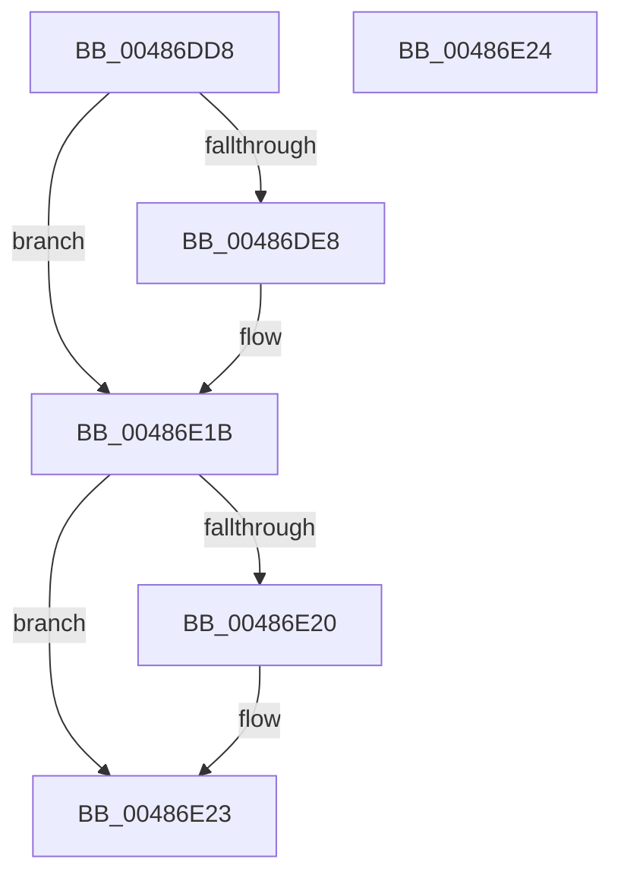

# PopGetLegacyPowerRequestFlags

- RVA: `0x00486DD8`–`0x00486E25` (길이 `77` bytes)
- VA: `0x0000000140486DD8`
- 실행 섹션: `.text`
- PDB 이름 있음: `예`; PDB Function 태그: `아니요`
- unwind 정보 RVA: `0x000DB714`
- 디코드: `24`개 명령, `77/77` bytes 표시
- 미해석 바이트: `0` (있으면 어셈블리에 `.byte`로 보존)

> 이 문서는 커널 이미지의 기계어와 PDB 기호를 분석해 생성했습니다. 4번과 5번은 함수 원형과 자료형을 바이너리 사용 방식에서 추정한 C 해석이며 원본 소스 복구 결과는 아닙니다.

## 1. Dependencies

- 직접 호출 지점: **0**; 고유 호출 대상: **0**
- 직접 호출자로 확인된 함수: **2**
- RIP 상대 이미지 참조: **0**

### Outgoing calls
- 직접 디코드된 call 명령이 없습니다.

### Direct callers
- [PoRegisterSystemState](PoRegisterSystemState_function_00482740.md) at `0x004827F2`
- [NtSetThreadExecutionState](../../page/AC/NtSetThreadExecutionState_function_00AC0A40.md) at `0x00AC0B65`

### Static image references
- 디코드된 RIP-relative 메모리 참조가 없습니다.

## 2. Other-region calls and transfers

- 다른 실행 섹션으로 향하는 call: **0**
- 별도 외부 분기/꼬리 이동을 확인하지 못했습니다.

## 3. Assembly (complete function range)

```asm
00486DD8  33 C0                           xor eax, eax
00486DDA  4C 8B D9                        mov r11, rcx
00486DDD  41 BA 00 00 00 80               mov r10d, 0x80000000
00486DE3  48 85 C9                        test rcx, rcx
00486DE6  74 33                           je 0x140486e1b
00486DE8  39 41 28                        cmp dword ptr [rcx + 0x28], eax
00486DEB  41 B9 02 00 00 80               mov r9d, 0x80000002
00486DF1  45 0F 46 CA                     cmovbe r9d, r10d
00486DF5  41 8B C9                        mov ecx, r9d
00486DF8  83 C9 01                        or ecx, 1
00486DFB  41 39 43 2C                     cmp dword ptr [r11 + 0x2c], eax
00486DFF  41 0F 44 C9                     cmove ecx, r9d
00486E03  44 8B D1                        mov r10d, ecx
00486E06  41 83 CA 40                     or r10d, 0x40
00486E0A  41 39 43 30                     cmp dword ptr [r11 + 0x30], eax
00486E0E  44 0F 44 D1                     cmove r10d, ecx
00486E12  41 8B C2                        mov eax, r10d
00486E15  33 C2                           xor eax, edx
00486E17  0F BA F0 1F                     btr eax, 0x1f
00486E1B  4D 85 C0                        test r8, r8
00486E1E  74 03                           je 0x140486e23
00486E20  45 89 10                        mov dword ptr [r8], r10d
00486E23  C3                              ret
00486E24  CC                              int3
```

## 4. C-style interpretation (structured pseudocode)

```c
__int64 __fastcall PopGetLegacyPowerRequestFlags(__int64 a1, int a2, __int64 a3)
{
    __int64 result;
    __int64 v_r10;

    result = 0;
    v_r10 = (unsigned int)(0x80000000ULL);
    if (a1 != 0) {
        a4 = 0x80000002ULL;
        if ((*(unsigned int *)(a1 + 40)) <= 0) { a4 = (unsigned int)((unsigned int)(0x80000000ULL)); }
        a1 = (unsigned int)(a4);
        a1 = (unsigned int)((a1) | (1));
        if ((*(unsigned int *)(a1 + 44)) == 0) { a1 = (unsigned int)(a4); }
        v_r10 = (unsigned int)(a1);
        v_r10 = (unsigned int)((v_r10) | (64));
        if ((*(unsigned int *)(a1 + 48)) == 0) { v_r10 = (unsigned int)(a1); }
        result = (unsigned int)(v_r10);
        result = (unsigned int)((result) ^ (a2));
    }
    if (a3 != 0) {
        *(unsigned int *)(a3) = (unsigned int)(v_r10);
    }
    return result;
}
```

## 5. (Beta) C Style

```c
int64_t PopGetLegacyPowerRequestFlags(void *Arg1, int32_t Arg2, int64_t Arg3)
{
    uint8_t *arg1 = (uint8_t *)Arg1;

    int64_t result;
    int64_t local_r10;

    result = 0;
    local_r10 = (uint32_t)(0x80000000ULL);
    if (Arg1 != NULL) {
        a4 = 0x80000002ULL;
        if ((*(uint32_t *)(arg1 + 0x28)) <= 0) { a4 = (uint32_t)((uint32_t)(0x80000000ULL)); }
        Arg1 = (uint32_t)(a4);
        Arg1 = (uint32_t)((Arg1) | (1));
        if ((*(uint32_t *)(arg1 + 0x2C)) == 0) { Arg1 = (uint32_t)(a4); }
        local_r10 = (uint32_t)(Arg1);
        local_r10 = (uint32_t)((local_r10) | (64));
        if ((*(uint32_t *)(arg1 + 0x30)) == 0) { local_r10 = (uint32_t)(Arg1); }
        result = (uint32_t)(local_r10);
        result = (uint32_t)((result) ^ (Arg2));
    }
    if (Arg3 != 0) {
        *(uint32_t *)(Arg3) = (uint32_t)(local_r10);
    }
    return result;
}
```

### 관측된 메모리 오프셋

구조체 형식이 확인되지 않은 접근은 인자 기준의 오프셋으로만 기록했습니다.

| 기준 인자 | 오프셋 표현 | 폭 (bit) | 접근 |
|---|---:|---:|---|
| `Arg1` | `+ 0x2C` | `32` | `R` |
| `Arg1` | `+ 0x30` | `32` | `R` |

## 6. Execution-region graph

[열기: 2D/3D 그래프와 함수 탐색 컨트롤 패널](../../../control-panel.html?section=text&rva=0x00486DD8&view=graph)

- 2D 그래프는 위에서 아래로 흐르고, 3D 그래프는 빈 공간을 드래그해 회전합니다. Shift+드래그는 이동, 휠은 확대·축소, 함수 노드 선택은 대상 보고서 이동입니다.

### Static fallback


