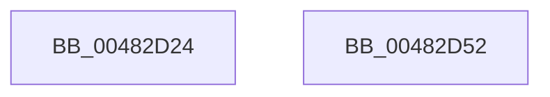

# PopGetPolicyWorker

- RVA: `0x00482D24`–`0x00482D53` (길이 `47` bytes)
- VA: `0x0000000140482D24`
- 실행 섹션: `.text`
- PDB 이름 있음: `예`; PDB Function 태그: `아니요`
- unwind 정보 RVA: `0x0005CF00`
- 디코드: `13`개 명령, `47/47` bytes 표시
- 미해석 바이트: `0` (있으면 어셈블리에 `.byte`로 보존)

> 이 문서는 커널 이미지의 기계어와 PDB 기호를 분석해 생성했습니다. 4번과 5번은 함수 원형과 자료형을 바이너리 사용 방식에서 추정한 C 해석이며 원본 소스 복구 결과는 아닙니다.

## 1. Dependencies

- 직접 호출 지점: **2**; 고유 호출 대상: **2**
- 직접 호출자로 확인된 함수: **12**
- RIP 상대 이미지 참조: **2**

### Outgoing calls
- `0x00482D33` → [KeAcquireSpinLockRaiseToDpc](../20/KeAcquireSpinLockRaiseToDpc_function_00208470.md) (function, `0x00208470`)
- `0x00482D47` → [KeReleaseSpinLock](../39/KeReleaseSpinLock_function_00392BA0.md) (function, `0x00392BA0`)

### Direct callers
- [PopCheckForIdleness](PopCheckForIdleness_function_00482530.md) at `0x00482716`
- [PopUserPresentSet](PopUserPresentSet_function_00482B90.md) at `0x00482C1E`
- [PopSetNotificationWork](PopSetNotificationWork_function_00482C78.md) at `0x00482C94`
- [PoNotifySystemTimeSet](../4D/PoNotifySystemTimeSet_function_004D4F7C.md) at `0x004D5057`
- [PopCoalescingCheck](../5D/PopCoalescingCheck_function_005D4614.md) at `0x005D464C`
- [PopCoalesingTimerDpcCallback](../5D/PopCoalesingTimerDpcCallback_function_005D4680.md) at `0x005D4689`
- [PopExecutePowerAction](../../page/75/PopExecutePowerAction_function_0075E6B4.md) at `0x0075EAD1`
- [PopPowerAggregatorSystemTransitionExitStateHandler](../../page/76/PopPowerAggregatorSystemTransitionExitStateHandler_function_00765180.md) at `0x007651EA`
- [PopPolicyWorkerAction](../../page/A9/PopPolicyWorkerAction_function_00A9CC40.md) at `0x00A9CD09`
- [PopPolicyWorkerAction](../../page/A9/PopPolicyWorkerAction_function_00A9CC40.md) at `0x00A9CDCB`
- [PopPolicyWorkerActionPromote](../../page/AB/PopPolicyWorkerActionPromote_function_00ABFE10.md) at `0x00ABFE90`
- [PopBatteryApplyCompositeState](../../page/AE/PopBatteryApplyCompositeState_function_00AE0CD0.md) at `0x00AE110F`
- [PopTransitionSystemPowerStateEx](../../pagelk/B7/PopTransitionSystemPowerStateEx_function_00B7E8C0.md) at `0x00B7EE54`

### Static image references
- `0x00482D2C` → RVA `0x00F0CB80` (`.data`; read)
- `0x00482D38` → RVA `0x00F0C8C4` (`.data`; read/write)

## 2. Other-region calls and transfers

- 다른 실행 섹션으로 향하는 call: **0**
- 별도 외부 분기/꼬리 이동을 확인하지 못했습니다.

## 3. Assembly (complete function range)

```asm
00482D24  40 53                           push rbx
00482D26  48 83 EC 20                     sub rsp, 0x20
00482D2A  8B D9                           mov ebx, ecx
00482D2C  48 8D 0D 4D 9E A8 00            lea rcx, [rip + 0xa89e4d]
00482D33  E8 38 57 D8 FF                  call 0x140208470
00482D38  09 1D 86 9B A8 00               or dword ptr [rip + 0xa89b86], ebx
00482D3E  48 8D 0D 3B 9E A8 00            lea rcx, [rip + 0xa89e3b]
00482D45  8A D0                           mov dl, al
00482D47  E8 54 FE F0 FF                  call 0x140392ba0
00482D4C  48 83 C4 20                     add rsp, 0x20
00482D50  5B                              pop rbx
00482D51  C3                              ret
00482D52  CC                              int3
```

## 4. C-style interpretation (structured pseudocode)

```c
__int64 __fastcall PopGetPolicyWorker(int a1)
{
    __int64 result;
    __int64 v_rsp;

    v_rsp = (v_rsp) - (32);
    result = KeAcquireSpinLockRaiseToDpc(v_rip + 11050573, a2, a3, a4);
    result = KeReleaseSpinLock(v_rip + 11050555, (unsigned __int8)(result), a3, a4);
    v_rsp = (v_rsp) + (32);
    return result;
}
```

## 5. (Beta) C Style

```c
int64_t PopGetPolicyWorker(int32_t Arg1)
{
    int64_t result;
    int64_t local_rsp;

    local_rsp = (local_rsp) - (32);
    result = KeAcquireSpinLockRaiseToDpc(v_rip + 11050573, a2, a3, a4);
    result = KeReleaseSpinLock(v_rip + 11050555, (uint8_t)(result), a3, a4);
    local_rsp = (local_rsp) + (32);
    return result;
}
```

## 6. Execution-region graph

[열기: 2D/3D 그래프와 함수 탐색 컨트롤 패널](../../../control-panel.html?section=text&rva=0x00482D24&view=graph)

- 2D 그래프는 위에서 아래로 흐르고, 3D 그래프는 빈 공간을 드래그해 회전합니다. Shift+드래그는 이동, 휠은 확대·축소, 함수 노드 선택은 대상 보고서 이동입니다.

### Static fallback


