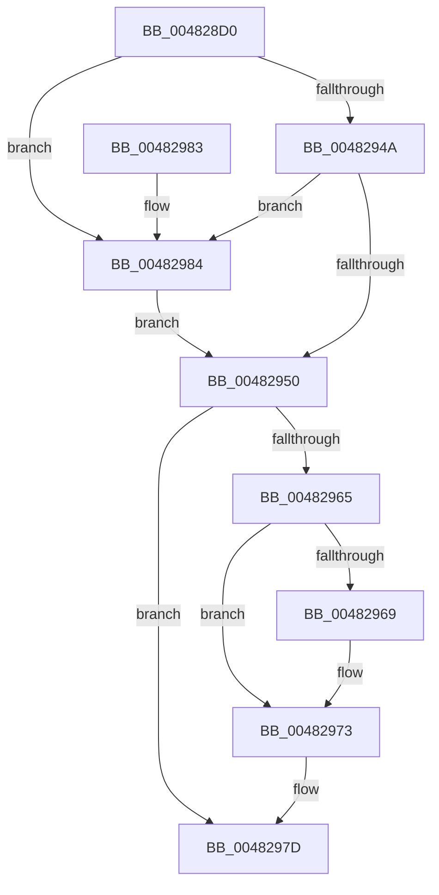

# PopInitilizeAcDcSettings

- RVA: `0x004828D0`–`0x0048298C` (길이 `188` bytes)
- VA: `0x00000001404828D0`
- 실행 섹션: `.text`
- PDB 이름 있음: `예`; PDB Function 태그: `아니요`
- unwind 정보 RVA: `0x000AEE10`
- 디코드: `46`개 명령, `188/188` bytes 표시
- 미해석 바이트: `0` (있으면 어셈블리에 `.byte`로 보존)

> 이 문서는 커널 이미지의 기계어와 PDB 기호를 분석해 생성했습니다. 4번과 5번은 함수 원형과 자료형을 바이너리 사용 방식에서 추정한 C 해석이며 원본 소스 복구 결과는 아닙니다.

## 1. Dependencies

- 직접 호출 지점: **7**; 고유 호출 대상: **5**
- 직접 호출자로 확인된 함수: **2**
- RIP 상대 이미지 참조: **3**

### Outgoing calls
- `0x004828FA` → [PopSetPowerSettingValue](../../page/91/PopSetPowerSettingValue_function_00914E54.md) (function, `0x00914E54`)
- `0x00482922` → [PopSetPowerSettingValue](../../page/91/PopSetPowerSettingValue_function_00914E54.md) (function, `0x00914E54`)
- `0x00482930` → [ExAcquireFastMutex](../20/ExAcquireFastMutex_function_0020E5A0.md) (function, `0x0020E5A0`)
- `0x0048293F` → [PopFindPowerSettingConfiguration](../../page/91/PopFindPowerSettingConfiguration_function_009152E0.md) (function, `0x009152E0`)
- `0x00482957` → [ExReleaseFastMutex](../25/ExReleaseFastMutex_function_002519C0.md) (function, `0x002519C0`)
- `0x0048296E` → [PopSetNotificationWork](PopSetNotificationWork_function_00482C78.md) (function, `0x00482C78`)
- `0x00482978` → [PopSetNotificationWork](PopSetNotificationWork_function_00482C78.md) (function, `0x00482C78`)

### Direct callers
- [PopBatteryApplyCompositeState](../../page/AE/PopBatteryApplyCompositeState_function_00AE0CD0.md) at `0x00AE0D52`
- [PoInitSystem](../../init/C7/PoInitSystem_function_00C72358.md) at `0x00C729EB`
- [PoInitSystem](../../init/C7/PoInitSystem_function_00C72358.md) at `0x00C73107`

### Static image references
- `0x004828ED` → RVA `0x0001A610` (`.rdata`; read)
- `0x00482927` → RVA `0x00F0DF40` (`.data`; read)
- `0x0048295C` → RVA `0x00F0CA60` (`.data`; read)

## 2. Other-region calls and transfers

- 다른 실행 섹션으로 향하는 call: **3**
  - `0x004828FA` → [PopSetPowerSettingValue](../../page/91/PopSetPowerSettingValue_function_00914E54.md) (`.text` → `PAGE`)
  - `0x00482922` → [PopSetPowerSettingValue](../../page/91/PopSetPowerSettingValue_function_00914E54.md) (`.text` → `PAGE`)
  - `0x0048293F` → [PopFindPowerSettingConfiguration](../../page/91/PopFindPowerSettingConfiguration_function_009152E0.md) (`.text` → `PAGE`)
- 별도 외부 분기/꼬리 이동을 확인하지 못했습니다.

## 3. Assembly (complete function range)

```asm
004828D0  40 53                           push rbx
004828D2  48 83 EC 30                     sub rsp, 0x30
004828D6  83 64 24 40 00                  and dword ptr [rsp + 0x40], 0
004828DB  48 8D 44 24 40                  lea rax, [rsp + 0x40]
004828E0  BB 04 00 00 00                  mov ebx, 4
004828E5  48 89 44 24 20                  mov qword ptr [rsp + 0x20], rax
004828EA  44 8B CB                        mov r9d, ebx
004828ED  48 8D 0D 1C 7D B9 FF            lea rcx, [rip - 0x4682e4]
004828F4  45 33 C0                        xor r8d, r8d
004828F7  83 CA FF                        or edx, 0xffffffff
004828FA  E8 55 25 49 00                  call 0x140914e54
004828FF  48 8D 44 24 40                  lea rax, [rsp + 0x40]
00482904  C7 44 24 40 01 00 00 00         mov dword ptr [rsp + 0x40], 1
0048290C  44 8B CB                        mov r9d, ebx
0048290F  48 89 44 24 20                  mov qword ptr [rsp + 0x20], rax
00482914  44 8D 43 FD                     lea r8d, [rbx - 3]
00482918  83 CA FF                        or edx, 0xffffffff
0048291B  48 8D 0D EE 7C B9 FF            lea rcx, [rip - 0x468312]
00482922  E8 2D 25 49 00                  call 0x140914e54
00482927  48 8D 0D 12 B6 A8 00            lea rcx, [rip + 0xa8b612]
0048292E  32 DB                           xor bl, bl
00482930  E8 6B BC D8 FF                  call 0x14020e5a0
00482935  83 CA FF                        or edx, 0xffffffff
00482938  48 8D 0D D1 7C B9 FF            lea rcx, [rip - 0x46832f]
0048293F  E8 9C 29 49 00                  call 0x1409152e0
00482944  83 78 38 00                     cmp dword ptr [rax + 0x38], 0
00482948  75 3A                           jne 0x140482984
0048294A  83 78 3C 00                     cmp dword ptr [rax + 0x3c], 0
0048294E  75 34                           jne 0x140482984
00482950  48 8D 0D E9 B5 A8 00            lea rcx, [rip + 0xa8b5e9]
00482957  E8 64 F0 DC FF                  call 0x1402519c0
0048295C  83 3D FD A0 A8 00 03            cmp dword ptr [rip + 0xa8a0fd], 3
00482963  72 18                           jb 0x14048297d
00482965  84 DB                           test bl, bl
00482967  74 0A                           je 0x140482973
00482969  B9 80 00 00 00                  mov ecx, 0x80
0048296E  E8 05 03 00 00                  call 0x140482c78
00482973  B9 20 00 00 00                  mov ecx, 0x20
00482978  E8 FB 02 00 00                  call 0x140482c78
0048297D  48 83 C4 30                     add rsp, 0x30
00482981  5B                              pop rbx
00482982  C3                              ret
00482983  CC                              int3
00482984  83 48 34 01                     or dword ptr [rax + 0x34], 1
00482988  B3 01                           mov bl, 1
0048298A  EB C4                           jmp 0x140482950
```

## 4. C-style interpretation (structured pseudocode)

```c
__int64 __fastcall PopInitilizeAcDcSettings(__int64 a1, int a2, int a3)
{
    __int64 result;
    __int64 v_rbx;
    __int64 v_rsp;
    unsigned __int64 v_stack_m18;
    unsigned int v_stack_p8;

    v_rsp = (v_rsp) - (48);
    v_stack_m18 = v_stack_p8;
    a3 = 0;
    a2 = (unsigned int)((a2) | (0xFFFFFFFFULL));
    result = PopSetPowerSettingValue(v_rip - 4621028, a2, a3, 4);
    v_stack_p8 = 1;
    v_stack_m18 = v_stack_p8;
    a2 = (unsigned int)((a2) | (0xFFFFFFFFULL));
    result = PopSetPowerSettingValue(v_rip - 4621074, a2, 4 - 3, 4);
    v_rbx = 0;
    result = ExAcquireFastMutex(v_rip + 11056658, a2, 4 - 3, 4);
    a2 = (unsigned int)((a2) | (0xFFFFFFFFULL));
    result = PopFindPowerSettingConfiguration(v_rip - 4621103, a2, 4 - 3, 4);
    if ((*(unsigned int *)(result + 56)) != 0) goto loc_00482984;
    if ((*(unsigned int *)(result + 60)) != 0) goto loc_00482984;
loc_00482950:
    result = ExReleaseFastMutex(v_rip + 11056617, a2, 4 - 3, 4);
    if ((*(unsigned int *)(v_rip + 11051261)) < 3) goto loc_0048297D;
    if (0 != 0) {
        a1 = 128;
        result = PopSetNotificationWork(a1, a2, 4 - 3, 4);
    }
    result = PopSetNotificationWork(32, a2, 4 - 3, 4);
loc_0048297D:
    v_rsp = (v_rsp) + (48);
    return result;
loc_00482984:
    goto loc_00482950;
}
```

## 5. (Beta) C Style

```c
int64_t PopInitilizeAcDcSettings(int64_t Arg1, int32_t Arg2, int32_t Arg3)
{
    int64_t result;
    int64_t local_rbx;
    int64_t local_rsp;
    uint64_t v_stack_m18;
    uint32_t v_stack_p8;

    local_rsp = (local_rsp) - (48);
    v_stack_m18 = v_stack_p8;
    Arg3 = 0;
    Arg2 = (uint32_t)((Arg2) | (0xFFFFFFFFULL));
    result = PopSetPowerSettingValue(v_rip - 4621028, Arg2, Arg3, 4);
    v_stack_p8 = 1;
    v_stack_m18 = v_stack_p8;
    Arg2 = (uint32_t)((Arg2) | (0xFFFFFFFFULL));
    result = PopSetPowerSettingValue(v_rip - 4621074, Arg2, 4 - 3, 4);
    local_rbx = 0;
    result = ExAcquireFastMutex(v_rip + 11056658, Arg2, 4 - 3, 4);
    Arg2 = (uint32_t)((Arg2) | (0xFFFFFFFFULL));
    result = PopFindPowerSettingConfiguration(v_rip - 4621103, Arg2, 4 - 3, 4);
    if ((*(uint32_t *)(result + 0x38)) != 0) goto loc_00482984;
    if ((*(uint32_t *)(result + 0x3C)) != 0) goto loc_00482984;
loc_00482950:
    result = ExReleaseFastMutex(v_rip + 11056617, Arg2, 4 - 3, 4);
    if ((*(uint32_t *)(v_rip + 0xA8A0FD)) < 3) goto loc_0048297D;
    if (0 != 0) {
        Arg1 = 128;
        result = PopSetNotificationWork(Arg1, Arg2, 4 - 3, 4);
    }
    result = PopSetNotificationWork(32, Arg2, 4 - 3, 4);
loc_0048297D:
    local_rsp = (local_rsp) + (48);
    return result;
loc_00482984:
    goto loc_00482950;
}
```

## 6. Execution-region graph

[열기: 2D/3D 그래프와 함수 탐색 컨트롤 패널](../../../control-panel.html?section=text&rva=0x004828D0&view=graph)

- 2D 그래프는 위에서 아래로 흐르고, 3D 그래프는 빈 공간을 드래그해 회전합니다. Shift+드래그는 이동, 휠은 확대·축소, 함수 노드 선택은 대상 보고서 이동입니다.

### Static fallback


