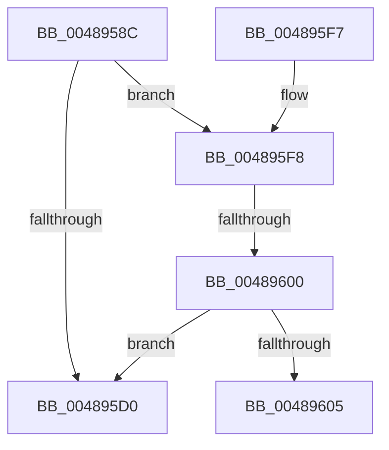

# PopPlNotifyDeviceDState

- RVA: `0x0048958C`–`0x0048960C` (길이 `128` bytes)
- VA: `0x000000014048958C`
- 실행 섹션: `.text`
- PDB 이름 있음: `예`; PDB Function 태그: `예`
- unwind 정보 RVA: `0x000AFF98`
- 디코드: `40`개 명령, `128/128` bytes 표시
- 미해석 바이트: `0` (있으면 어셈블리에 `.byte`로 보존)

> 이 문서는 커널 이미지의 기계어와 PDB 기호를 분석해 생성했습니다. 4번과 5번은 함수 원형과 자료형을 바이너리 사용 방식에서 추정한 C 해석이며 원본 소스 복구 결과는 아닙니다.

## 1. Dependencies

- 직접 호출 지점: **1**; 고유 호출 대상: **1**
- 직접 호출자로 확인된 함수: **1**
- RIP 상대 이미지 참조: **1**

### Outgoing calls
- `0x004895D7` → [_security_check_cookie](../6A/_security_check_cookie_function_006AC640.md) (function, `0x006AC640`)

### Direct callers
- [PopPepDeviceDState](../2B/PopPepDeviceDState_function_002BFE70.md) at `0x002BFF07`
- [PopPepDeviceDState](../2B/PopPepDeviceDState_function_002BFE70.md) at `0x002BFFFD`

### Static image references
- `0x004895A8` → RVA `0x00E0A740` (`.data`; read)

## 2. Other-region calls and transfers

- 다른 실행 섹션으로 향하는 call: **0**
- call이 아닌 외부 분기/꼬리 이동: **2**
  - `0x004895FA` → [sub_006F5DD8](../6F/Unknown_function_006F5DD8.md) (`tail-transfer`)
  - `0x00489607` → [sub_006F5DD8](../6F/Unknown_function_006F5DD8.md) (`tail-transfer`)

## 3. Assembly (complete function range)

```asm
0048958C  48 89 5C 24 10                  mov qword ptr [rsp + 0x10], rbx
00489591  55                              push rbp
00489592  56                              push rsi
00489593  57                              push rdi
00489594  41 54                           push r12
00489596  41 55                           push r13
00489598  41 56                           push r14
0048959A  41 57                           push r15
0048959C  48 8D 6C 24 E0                  lea rbp, [rsp - 0x20]
004895A1  48 81 EC 20 01 00 00            sub rsp, 0x120
004895A8  48 8B 05 91 11 98 00            mov rax, qword ptr [rip + 0x981191]
004895AF  48 33 C4                        xor rax, rsp
004895B2  48 89 45 10                     mov qword ptr [rbp + 0x10], rax
004895B6  4C 8B B9 C8 04 00 00            mov r15, qword ptr [rcx + 0x4c8]
004895BD  41 8A F1                        mov sil, r9b
004895C0  44 89 44 24 40                  mov dword ptr [rsp + 0x40], r8d
004895C5  41 8B F8                        mov edi, r8d
004895C8  4C 8B F1                        mov r14, rcx
004895CB  4D 85 FF                        test r15, r15
004895CE  75 28                           jne 0x1404895f8
004895D0  48 8B 4D 10                     mov rcx, qword ptr [rbp + 0x10]
004895D4  48 33 CC                        xor rcx, rsp
004895D7  E8 64 30 22 00                  call 0x1406ac640
004895DC  48 8B 9C 24 68 01 00 00         mov rbx, qword ptr [rsp + 0x168]
004895E4  48 81 C4 20 01 00 00            add rsp, 0x120
004895EB  41 5F                           pop r15
004895ED  41 5E                           pop r14
004895EF  41 5D                           pop r13
004895F1  41 5C                           pop r12
004895F3  5F                              pop rdi
004895F4  5E                              pop rsi
004895F5  5D                              pop rbp
004895F6  C3                              ret
004895F7  CC                              int3
004895F8  3B FA                           cmp edi, edx
004895FA  0F 8E D8 C7 26 00               jle 0x1406f5dd8
00489600  40 84 F6                        test sil, sil
00489603  74 CB                           je 0x1404895d0
00489605  3B FA                           cmp edi, edx
00489607  E9 CC C7 26 00                  jmp 0x1406f5dd8
```

## 4. C-style interpretation (structured pseudocode)

```c
__int64 __fastcall PopPlNotifyDeviceDState(__int64 a1, int a2, int a3, unsigned __int8 a4)
{
    __int64 result;
    __int64 v_rsp;
    unsigned int v_stack_m118;
    unsigned __int64 v_stack_m48;
    unsigned __int64 v_stack_m58;
    unsigned __int64 v_stack_p10;

    v_stack_p10 = v_rbx;
    v_rsp = (v_rsp) - (288);
    result = (*(unsigned __int64 *)(v_rip + 9965969)) ^ (v_rsp);
    v_stack_m48 = result;
    v_stack_m118 = a3;
    if (*(unsigned __int64 *)(a1 + 1224) != 0) goto loc_004895F8;
loc_004895D0:
    a1 = (v_stack_m48) ^ (v_rsp);
    result = _security_check_cookie(a1, a2, a3, a4);
    v_rsp = (v_rsp) + (288);
    return result;
loc_004895F8:
    if (a4 == 0) goto loc_004895D0;
}
```

## 5. (Beta) C Style

```c
int64_t PopPlNotifyDeviceDState(void *Arg1, int32_t Arg2, int32_t Arg3, uint8_t Arg4)
{
    uint8_t *arg1 = (uint8_t *)Arg1;

    int64_t result;
    int64_t local_rsp;
    uint32_t v_stack_m118;
    uint64_t v_stack_m48;
    uint64_t v_stack_m58;
    uint64_t v_stack_p10;

    v_stack_p10 = local_rbx;
    local_rsp = (local_rsp) - (288);
    result = (*(uint64_t *)(v_rip + 0x981191)) ^ (local_rsp);
    v_stack_m48 = result;
    v_stack_m118 = Arg3;
    if (*(uint64_t *)(arg1 + 0x4C8) != 0) goto loc_004895F8;
loc_004895D0:
    Arg1 = (v_stack_m48) ^ (local_rsp);
    result = _security_check_cookie(Arg1, Arg2, Arg3, Arg4);
    local_rsp = (local_rsp) + (288);
    return result;
loc_004895F8:
    if (Arg4 == 0) goto loc_004895D0;
}
```

### 관측된 메모리 오프셋

구조체 형식이 확인되지 않은 접근은 인자 기준의 오프셋으로만 기록했습니다.

| 기준 인자 | 오프셋 표현 | 폭 (bit) | 접근 |
|---|---:|---:|---|
| `Arg1` | `+ 0x4C8` | `64` | `R` |

## 6. Execution-region graph

[열기: 2D/3D 그래프와 함수 탐색 컨트롤 패널](../../../control-panel.html?section=text&rva=0x0048958C&view=graph)

- 2D 그래프는 위에서 아래로 흐르고, 3D 그래프는 빈 공간을 드래그해 회전합니다. Shift+드래그는 이동, 휠은 확대·축소, 함수 노드 선택은 대상 보고서 이동입니다.

### Static fallback


