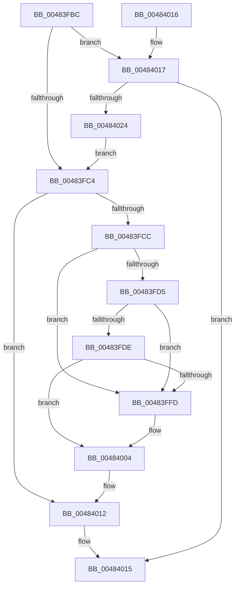

# PopPrepChildWake

- RVA: `0x00483FBC`–`0x00484026` (길이 `106` bytes)
- VA: `0x0000000140483FBC`
- 실행 섹션: `.text`
- PDB 이름 있음: `예`; PDB Function 태그: `아니요`
- unwind 정보 RVA: `0x000DB714`
- 디코드: `34`개 명령, `106/106` bytes 표시
- 미해석 바이트: `0` (있으면 어셈블리에 `.byte`로 보존)

> 이 문서는 커널 이미지의 기계어와 PDB 기호를 분석해 생성했습니다. 4번과 5번은 함수 원형과 자료형을 바이너리 사용 방식에서 추정한 C 해석이며 원본 소스 복구 결과는 아닙니다.

## 1. Dependencies

- 직접 호출 지점: **0**; 고유 호출 대상: **0**
- 직접 호출자로 확인된 함수: **1**
- RIP 상대 이미지 참조: **0**

### Outgoing calls
- 직접 디코드된 call 명령이 없습니다.

### Direct callers
- [PopCompleteNotifyTransitionCommon](PopCompleteNotifyTransitionCommon_function_00483B4C.md) at `0x00483CAA`
- [PopCompleteNotifyTransitionCommon](PopCompleteNotifyTransitionCommon_function_00483B4C.md) at `0x00483D71`

### Static image references
- 디코드된 RIP-relative 메모리 참조가 없습니다.

## 2. Other-region calls and transfers

- 다른 실행 섹션으로 향하는 call: **0**
- 별도 외부 분기/꼬리 이동을 확인하지 못했습니다.

## 3. Assembly (complete function range)

```asm
00483FBC  4C 8B CA                        mov r9, rdx
00483FBF  45 84 C0                        test r8b, r8b
00483FC2  75 53                           jne 0x140484017
00483FC4  8B 41 60                        mov eax, dword ptr [rcx + 0x60]
00483FC7  39 41 64                        cmp dword ptr [rcx + 0x64], eax
00483FCA  75 46                           jne 0x140484012
00483FCC  48 8B 01                        mov rax, qword ptr [rcx]
00483FCF  48 39 48 08                     cmp qword ptr [rax + 8], rcx
00483FD3  75 28                           jne 0x140483ffd
00483FD5  48 8B 51 08                     mov rdx, qword ptr [rcx + 8]
00483FD9  48 39 0A                        cmp qword ptr [rdx], rcx
00483FDC  75 1F                           jne 0x140483ffd
00483FDE  48 89 02                        mov qword ptr [rdx], rax
00483FE1  48 89 50 08                     mov qword ptr [rax + 8], rdx
00483FE5  0F B6 41 38                     movzx eax, byte ptr [rcx + 0x38]
00483FE9  48 FF C0                        inc rax
00483FEC  48 8D 04 C0                     lea rax, [rax + rax*8]
00483FF0  49 8D 14 C1                     lea rdx, [r9 + rax*8]
00483FF4  48 8B 42 08                     mov rax, qword ptr [rdx + 8]
00483FF8  48 39 10                        cmp qword ptr [rax], rdx
00483FFB  74 07                           je 0x140484004
00483FFD  B9 03 00 00 00                  mov ecx, 3
00484002  CD 29                           int 0x29
00484004  48 89 11                        mov qword ptr [rcx], rdx
00484007  48 89 41 08                     mov qword ptr [rcx + 8], rax
0048400B  48 89 08                        mov qword ptr [rax], rcx
0048400E  48 89 4A 08                     mov qword ptr [rdx + 8], rcx
00484012  FF 49 64                        dec dword ptr [rcx + 0x64]
00484015  C3                              ret
00484016  CC                              int3
00484017  8B 81 58 02 00 00               mov eax, dword ptr [rcx + 0x258]
0048401D  A9 00 00 03 00                  test eax, 0x30000
00484022  74 F1                           je 0x140484015
00484024  EB 9E                           jmp 0x140483fc4
```

## 4. C-style interpretation (structured pseudocode)

```c
__int64 __fastcall PopPrepChildWake(__int64 a1, __int64 a2, unsigned __int8 a3)
{
    __int64 result;

    if (a3 != 0) goto loc_00484017;
loc_00483FC4:
    if ((*(unsigned int *)(a1 + 100)) != ((unsigned int)((unsigned int)(*(unsigned int *)(a1 + 96))))) goto loc_00484012;
    if ((*(unsigned __int64 *)(*(unsigned __int64 *)(a1) + 8)) != a1) goto loc_00483FFD;
    if ((*(unsigned __int64 *)(*(unsigned __int64 *)(a1 + 8))) != a1) goto loc_00483FFD;
    *(unsigned __int64 *)(*(unsigned __int64 *)(a1 + 8)) = *(unsigned __int64 *)(a1);
    *(unsigned __int64 *)(*(unsigned __int64 *)(a1) + 8) = *(unsigned __int64 *)(a1 + 8);
    result = (*(unsigned __int8 *)(a1 + 56)) + 1;
    if ((*(unsigned __int64 *)(*(unsigned __int64 *)(a2 + result + result * 8 * 8 + 8))) != (a2 + result + result * 8 * 8)) {
        a1 = 3;
    }
    *(unsigned __int64 *)(a1) = a2 + result + result * 8 * 8;
    *(unsigned __int64 *)(a1 + 8) = *(unsigned __int64 *)(a2 + result + result * 8 * 8 + 8);
    *(unsigned __int64 *)(*(unsigned __int64 *)(a2 + result + result * 8 * 8 + 8)) = a1;
    *(unsigned __int64 *)(a2 + result + result * 8 * 8 + 8) = a1;
loc_00484012:
loc_00484015:
    return *(unsigned __int64 *)(a2 + result + result * 8 * 8 + 8);
loc_00484017:
    if ((((unsigned int)((unsigned int)(*(unsigned int *)(a1 + 600)))) & (0x30000ULL)) == 0) goto loc_00484015;
    goto loc_00483FC4;
}
```

## 5. (Beta) C Style

```c
int64_t PopPrepChildWake(void *Arg1, void *Arg2, uint8_t Arg3)
{
    uint8_t *arg1 = (uint8_t *)Arg1;
    uint8_t *arg2 = (uint8_t *)Arg2;

    int64_t result;

    if (Arg3 != 0) goto loc_00484017;
loc_00483FC4:
    if ((*(uint32_t *)(arg1 + 0x64)) != ((uint32_t)((uint32_t)(*(uint32_t *)(arg1 + 0x60))))) goto loc_00484012;
    if ((*(uint64_t *)(*(uint64_t *)(arg1) + 0x8)) != Arg1) goto loc_00483FFD;
    if ((*(uint64_t *)(*(uint64_t *)(arg1 + 0x8))) != Arg1) goto loc_00483FFD;
    *(uint64_t *)(*(uint64_t *)(arg1 + 0x8)) = *(uint64_t *)(arg1);
    *(uint64_t *)(*(uint64_t *)(arg1) + 0x8) = *(uint64_t *)(arg1 + 0x8);
    result = (*(uint8_t *)(arg1 + 0x38)) + 1;
    if ((*(uint64_t *)(*(uint64_t *)(arg2 + result + result * 8 * 8 + 0x8))) != (Arg2 + result + result * 8 * 8)) {
        Arg1 = 3;
    }
    *(void **)(arg1) = Arg2 + result + result * 8 * 8;
    *(uint64_t *)(arg1 + 0x8) = *(uint64_t *)(arg2 + result + result * 8 * 8 + 0x8);
    *(void **)(*(uint64_t *)(arg2 + result + result * 8 * 8 + 0x8)) = Arg1;
    *(void **)(arg2 + result + result * 8 * 8 + 0x8) = Arg1;
loc_00484012:
loc_00484015:
    return *(uint64_t *)(arg2 + result + result * 8 * 8 + 0x8);
loc_00484017:
    if ((((uint32_t)((uint32_t)(*(uint32_t *)(arg1 + 0x258)))) & (0x30000ULL)) == 0) goto loc_00484015;
    goto loc_00483FC4;
}
```

### 관측된 메모리 오프셋

구조체 형식이 확인되지 않은 접근은 인자 기준의 오프셋으로만 기록했습니다.

| 기준 인자 | 오프셋 표현 | 폭 (bit) | 접근 |
|---|---:|---:|---|
| `Arg1` | `+ 0x0` | `64` | `R` |
| `Arg1` | `+ 0x8` | `64` | `R` |
| `Arg1` | `+ 0x38` | `8` | `R` |
| `Arg1` | `+ 0x60` | `32` | `R` |
| `Arg1` | `+ 0x64` | `32` | `R` |
| `Arg1` | `+ 0x258` | `32` | `R` |
| `Arg2` | `+ 0x0 + rax*8` | `64` | `R` |
| `Arg2` | `+ 0x8` | `64` | `R` |

## 6. Execution-region graph

[열기: 2D/3D 그래프와 함수 탐색 컨트롤 패널](../../../control-panel.html?section=text&rva=0x00483FBC&view=graph)

- 2D 그래프는 위에서 아래로 흐르고, 3D 그래프는 빈 공간을 드래그해 회전합니다. Shift+드래그는 이동, 휠은 확대·축소, 함수 노드 선택은 대상 보고서 이동입니다.

### Static fallback


