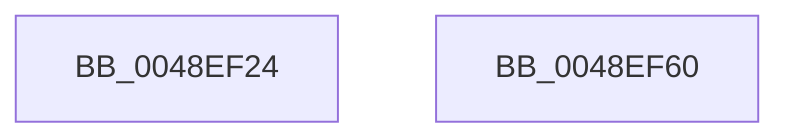

# PopPrintEx

- RVA: `0x0048EF24`–`0x0048EF61` (길이 `61` bytes)
- VA: `0x000000014048EF24`
- 실행 섹션: `.text`
- PDB 이름 있음: `예`; PDB Function 태그: `아니요`
- unwind 정보 RVA: `0x000B29D0`
- 디코드: `16`개 명령, `61/61` bytes 표시
- 미해석 바이트: `0` (있으면 어셈블리에 `.byte`로 보존)

> 이 문서는 커널 이미지의 기계어와 PDB 기호를 분석해 생성했습니다. 4번과 5번은 함수 원형과 자료형을 바이너리 사용 방식에서 추정한 C 해석이며 원본 소스 복구 결과는 아닙니다.

## 1. Dependencies

- 직접 호출 지점: **1**; 고유 호출 대상: **1**
- 직접 호출자로 확인된 함수: **14**
- RIP 상대 이미지 참조: **1**

### Outgoing calls
- `0x0048EF56` → [vDbgPrintExWithPrefixInternal](../35/vDbgPrintExWithPrefixInternal_function_00359314.md) (function, `0x00359314`)

### Direct callers
- [PopCoalescingSetTimer](PopCoalescingSetTimer_function_0048EEC0.md) at `0x0048EEDF`
- [PoFxRegisterDevice](../../page/75/PoFxRegisterDevice_function_00758940.md) at `0x007589A5`
- [PoFxRegisterDevice](../../page/75/PoFxRegisterDevice_function_00758940.md) at `0x007589BC`
- [PoFxRegisterDevice](../../page/75/PoFxRegisterDevice_function_00758940.md) at `0x007589CB`
- [PopCoalescingNotify](../../page/75/PopCoalescingNotify_function_0075C0E0.md) at `0x0075C116`
- [PopDeferDoze](../../page/75/PopDeferDoze_function_0075FF88.md) at `0x007600BF`
- [PopDiagTraceIoCoalescingOn](../../page/76/PopDiagTraceIoCoalescingOn_function_00761AB4.md) at `0x00761B0B`
- [PopSessionConnectionChange](../../page/76/PopSessionConnectionChange_function_0076BDEC.md) at `0x0076BE5D`
- [PopSessionConnectionChangeV2](../../page/76/PopSessionConnectionChangeV2_function_0076BEA8.md) at `0x0076BF15`
- [PopSessionWinlogonNotification](../../page/76/PopSessionWinlogonNotification_function_0076BF60.md) at `0x0076BFDB`
- [PopSetSessionDisplayStatus](../../page/91/PopSetSessionDisplayStatus_function_00912E7C.md) at `0x00912ECE`
- [PopSetSessionUserStatus](../../page/91/PopSetSessionUserStatus_function_00914BB8.md) at `0x00914BF6`
- [NtPowerInformation](../../page/95/NtPowerInformation_function_00955D80.md) at `0x00956FD3`
- [NtPowerInformation](../../page/95/NtPowerInformation_function_00955D80.md) at `0x00957532`
- [PopCheckThermalPolicy](../../page/A4/PopCheckThermalPolicy_function_00A4E6C8.md) at `0x00A4E8DC`
- [PopDiagTraceIoCoalescingOff](../../page/AC/PopDiagTraceIoCoalescingOff_function_00AC0D50.md) at `0x00AC0D60`
- [sub_00B218E0](../../page/B2/Unknown_function_00B218E0.md) at `0x00B21911`

### Static image references
- `0x0048EF4F` → RVA `0x006C7800` (` ?? ::FNODOBFM::`string'`; read)

## 2. Other-region calls and transfers

- 다른 실행 섹션으로 향하는 call: **0**
- 별도 외부 분기/꼬리 이동을 확인하지 못했습니다.

## 3. Assembly (complete function range)

```asm
0048EF24  4C 8B DC                        mov r11, rsp
0048EF27  49 89 53 10                     mov qword ptr [r11 + 0x10], rdx
0048EF2B  4D 89 43 18                     mov qword ptr [r11 + 0x18], r8
0048EF2F  4D 89 4B 20                     mov qword ptr [r11 + 0x20], r9
0048EF33  48 83 EC 48                     sub rsp, 0x48
0048EF37  49 8D 43 18                     lea rax, [r11 + 0x18]
0048EF3B  C6 44 24 28 01                  mov byte ptr [rsp + 0x28], 1
0048EF40  4C 8B CA                        mov r9, rdx
0048EF43  49 89 43 D8                     mov qword ptr [r11 - 0x28], rax
0048EF47  44 8B C1                        mov r8d, ecx
0048EF4A  BA 92 00 00 00                  mov edx, 0x92
0048EF4F  48 8D 0D AA 88 23 00            lea rcx, [rip + 0x2388aa]
0048EF56  E8 B9 A3 EC FF                  call 0x140359314
0048EF5B  48 83 C4 48                     add rsp, 0x48
0048EF5F  C3                              ret
0048EF60  CC                              int3
```

## 4. C-style interpretation (structured pseudocode)

```c
__int64 __fastcall PopPrintEx(int a1, __int64 a2, __int64 a3, __int64 a4)
{
    __int64 result;
    __int64 v_rsp;
    unsigned __int8 v_stack_m20;

    *(unsigned __int64 *)(v_rsp + 16) = a2;
    *(unsigned __int64 *)(v_rsp + 24) = a3;
    *(unsigned __int64 *)(v_rsp + 32) = a4;
    v_rsp = (v_rsp) - (72);
    v_stack_m20 = 1;
    *(unsigned __int64 *)(v_rsp - 40) = v_rsp + 24;
    result = vDbgPrintExWithPrefixInternal(v_rip + 2328746, 146, (unsigned int)(a1), a2);
    v_rsp = (v_rsp) + (72);
    return result;
}
```

## 5. (Beta) C Style

```c
int64_t PopPrintEx(int32_t Arg1, int64_t Arg2, int64_t Arg3, int64_t Arg4)
{
    int64_t result;
    int64_t local_rsp;
    uint8_t v_stack_m20;

    *(uint64_t *)(local_rsp + 0x10) = Arg2;
    *(uint64_t *)(local_rsp + 0x18) = Arg3;
    *(uint64_t *)(local_rsp + 0x20) = Arg4;
    local_rsp = (local_rsp) - (72);
    v_stack_m20 = 1;
    *(uint64_t *)(local_rsp - 0x28) = local_rsp + 24;
    result = vDbgPrintExWithPrefixInternal(v_rip + 2328746, 146, (uint32_t)(Arg1), Arg2);
    local_rsp = (local_rsp) + (72);
    return result;
}
```

## 6. Execution-region graph

[열기: 2D/3D 그래프와 함수 탐색 컨트롤 패널](../../../control-panel.html?section=text&rva=0x0048EF24&view=graph)

- 2D 그래프는 위에서 아래로 흐르고, 3D 그래프는 빈 공간을 드래그해 회전합니다. Shift+드래그는 이동, 휠은 확대·축소, 함수 노드 선택은 대상 보고서 이동입니다.

### Static fallback


