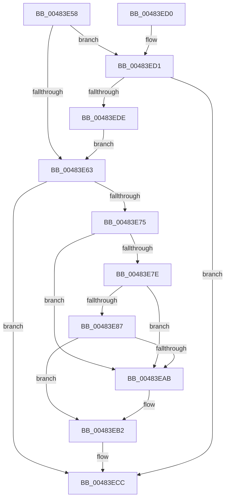

# PopReadyChildWake

- RVA: `0x00483E58`–`0x00483EE0` (길이 `136` bytes)
- VA: `0x0000000140483E58`
- 실행 섹션: `.text`
- PDB 이름 있음: `예`; PDB Function 태그: `아니요`
- unwind 정보 RVA: `0x000DB714`
- 디코드: `40`개 명령, `136/136` bytes 표시
- 미해석 바이트: `0` (있으면 어셈블리에 `.byte`로 보존)

> 이 문서는 커널 이미지의 기계어와 PDB 기호를 분석해 생성했습니다. 4번과 5번은 함수 원형과 자료형을 바이너리 사용 방식에서 추정한 C 해석이며 원본 소스 복구 결과는 아닙니다.

## 1. Dependencies

- 직접 호출 지점: **0**; 고유 호출 대상: **0**
- 직접 호출자로 확인된 함수: **1**
- RIP 상대 이미지 참조: **0**

### Outgoing calls
- 직접 디코드된 call 명령이 없습니다.

### Direct callers
- [PopCompleteNotifyTransitionCommon](PopCompleteNotifyTransitionCommon_function_00483B4C.md) at `0x00483D0E`
- [PopCompleteNotifyTransitionCommon](PopCompleteNotifyTransitionCommon_function_00483B4C.md) at `0x00483D8F`

### Static image references
- 디코드된 RIP-relative 메모리 참조가 없습니다.

## 2. Other-region calls and transfers

- 다른 실행 섹션으로 향하는 call: **0**
- 별도 외부 분기/꼬리 이동을 확인하지 못했습니다.

## 3. Assembly (complete function range)

```asm
00483E58  45 32 DB                        xor r11b, r11b
00483E5B  4C 8B D1                        mov r10, rcx
00483E5E  45 84 C9                        test r9b, r9b
00483E61  75 6E                           jne 0x140483ed1
00483E63  41 B9 01 00 00 00               mov r9d, 1
00483E69  44 01 49 64                     add dword ptr [rcx + 0x64], r9d
00483E6D  8B 41 64                        mov eax, dword ptr [rcx + 0x64]
00483E70  3B 41 60                        cmp eax, dword ptr [rcx + 0x60]
00483E73  72 57                           jb 0x140483ecc
00483E75  48 8B 01                        mov rax, qword ptr [rcx]
00483E78  4C 39 50 08                     cmp qword ptr [rax + 8], r10
00483E7C  75 2D                           jne 0x140483eab
00483E7E  48 8B 49 08                     mov rcx, qword ptr [rcx + 8]
00483E82  4C 39 11                        cmp qword ptr [rcx], r10
00483E85  75 24                           jne 0x140483eab
00483E87  48 89 01                        mov qword ptr [rcx], rax
00483E8A  48 89 48 08                     mov qword ptr [rax + 8], rcx
00483E8E  41 0F B6 42 38                  movzx eax, byte ptr [r10 + 0x38]
00483E93  48 8D 0C C5 07 00 00 00         lea rcx, [rax*8 + 7]
00483E9B  48 03 C8                        add rcx, rax
00483E9E  48 8D 04 CA                     lea rax, [rdx + rcx*8]
00483EA2  48 8B 48 08                     mov rcx, qword ptr [rax + 8]
00483EA6  48 39 01                        cmp qword ptr [rcx], rax
00483EA9  74 07                           je 0x140483eb2
00483EAB  B9 03 00 00 00                  mov ecx, 3
00483EB0  CD 29                           int 0x29
00483EB2  49 89 02                        mov qword ptr [r10], rax
00483EB5  49 89 4A 08                     mov qword ptr [r10 + 8], rcx
00483EB9  4C 89 11                        mov qword ptr [rcx], r10
00483EBC  4C 89 50 08                     mov qword ptr [rax + 8], r10
00483EC0  45 38 42 38                     cmp byte ptr [r10 + 0x38], r8b
00483EC4  45 0F B6 DB                     movzx r11d, r11b
00483EC8  45 0F 44 D9                     cmove r11d, r9d
00483ECC  41 8A C3                        mov al, r11b
00483ECF  C3                              ret
00483ED0  CC                              int3
00483ED1  8B 81 58 02 00 00               mov eax, dword ptr [rcx + 0x258]
00483ED7  A9 00 00 03 00                  test eax, 0x30000
00483EDC  74 EE                           je 0x140483ecc
00483EDE  EB 83                           jmp 0x140483e63
```

## 4. C-style interpretation (structured pseudocode)

```c
__int64 __fastcall PopReadyChildWake(__int64 a1, __int64 a2, unsigned __int8 a3, unsigned __int8 a4)
{
    __int64 v_r11;

    v_r11 = 0;
    if (a4 != 0) goto loc_00483ED1;
loc_00483E63:
    if (((unsigned int)((unsigned int)(*(unsigned int *)(a1 + 100)))) < (*(unsigned int *)(a1 + 96))) goto loc_00483ECC;
    if ((*(unsigned __int64 *)(*(unsigned __int64 *)(a1) + 8)) != a1) goto loc_00483EAB;
    if ((*(unsigned __int64 *)(*(unsigned __int64 *)(a1 + 8))) != a1) goto loc_00483EAB;
    *(unsigned __int64 *)(*(unsigned __int64 *)(a1 + 8)) = *(unsigned __int64 *)(a1);
    *(unsigned __int64 *)(*(unsigned __int64 *)(a1) + 8) = *(unsigned __int64 *)(a1 + 8);
    a1 = (*(unsigned __int8 *)(a1 + 56) * 8 + 7) + (*(unsigned __int8 *)(a1 + 56));
    if ((*(unsigned __int64 *)(*(unsigned __int64 *)(a2 + a1 * 8 + 8))) != (a2 + a1 * 8)) {
        a1 = 3;
    }
    *(unsigned __int64 *)(a1) = a2 + a1 * 8;
    *(unsigned __int64 *)(a1 + 8) = a1;
    *(unsigned __int64 *)(a1) = a1;
    *(unsigned __int64 *)(a2 + a1 * 8 + 8) = a1;
    v_r11 = 0;
    if ((*(unsigned __int8 *)(a1 + 56)) == a3) { v_r11 = 1; }
loc_00483ECC:
    return (unsigned __int8)(v_r11);
loc_00483ED1:
    if ((((unsigned int)((unsigned int)(*(unsigned int *)(a1 + 600)))) & (0x30000ULL)) == 0) goto loc_00483ECC;
    goto loc_00483E63;
}
```

## 5. (Beta) C Style

```c
int64_t PopReadyChildWake(void *Arg1, void *Arg2, uint8_t Arg3, uint8_t Arg4)
{
    uint8_t *arg1 = (uint8_t *)Arg1;
    uint8_t *arg2 = (uint8_t *)Arg2;

    int64_t local_r11;

    local_r11 = 0;
    if (Arg4 != 0) goto loc_00483ED1;
loc_00483E63:
    if (((uint32_t)((uint32_t)(*(uint32_t *)(arg1 + 0x64)))) < (*(uint32_t *)(arg1 + 0x60))) goto loc_00483ECC;
    if ((*(uint64_t *)(*(uint64_t *)(arg1) + 0x8)) != Arg1) goto loc_00483EAB;
    if ((*(uint64_t *)(*(uint64_t *)(arg1 + 0x8))) != Arg1) goto loc_00483EAB;
    *(uint64_t *)(*(uint64_t *)(arg1 + 0x8)) = *(uint64_t *)(arg1);
    *(uint64_t *)(*(uint64_t *)(arg1) + 0x8) = *(uint64_t *)(arg1 + 0x8);
    Arg1 = (*(uint8_t *)(arg1 + 0x38) * 8 + 7) + (*(uint8_t *)(arg1 + 0x38));
    if ((*(uint64_t *)(*(uint64_t *)(arg2 + arg1 * 8 + 0x8))) != (Arg2 + Arg1 * 8)) {
        Arg1 = 3;
    }
    *(void **)(arg1) = Arg2 + Arg1 * 8;
    *(void **)(arg1 + 0x8) = Arg1;
    *(void **)(arg1) = Arg1;
    *(void **)(arg2 + arg1 * 8 + 0x8) = Arg1;
    local_r11 = 0;
    if ((*(uint8_t *)(arg1 + 0x38)) == Arg3) { local_r11 = 1; }
loc_00483ECC:
    return (uint8_t)(local_r11);
loc_00483ED1:
    if ((((uint32_t)((uint32_t)(*(uint32_t *)(arg1 + 0x258)))) & (0x30000ULL)) == 0) goto loc_00483ECC;
    goto loc_00483E63;
}
```

### 관측된 메모리 오프셋

구조체 형식이 확인되지 않은 접근은 인자 기준의 오프셋으로만 기록했습니다.

| 기준 인자 | 오프셋 표현 | 폭 (bit) | 접근 |
|---|---:|---:|---|
| `Arg1` | `+ 0x0` | `64` | `R` |
| `Arg1` | `+ 0x0` | `64` | `W` |
| `Arg1` | `+ 0x8` | `64` | `R` |
| `Arg1` | `+ 0x8` | `64` | `W` |
| `Arg1` | `+ 0x38` | `8` | `R` |
| `Arg1` | `+ 0x60` | `32` | `R` |
| `Arg1` | `+ 0x64` | `32` | `R` |
| `Arg1` | `+ 0x64` | `32` | `R/W` |
| `Arg1` | `+ 0x258` | `32` | `R` |
| `Arg2` | `+ 0x0 + rcx*8` | `64` | `R` |
| `Arg2` | `+ 0x8` | `64` | `R` |

## 6. Execution-region graph

[열기: 2D/3D 그래프와 함수 탐색 컨트롤 패널](../../../control-panel.html?section=text&rva=0x00483E58&view=graph)

- 2D 그래프는 위에서 아래로 흐르고, 3D 그래프는 빈 공간을 드래그해 회전합니다. Shift+드래그는 이동, 휠은 확대·축소, 함수 노드 선택은 대상 보고서 이동입니다.

### Static fallback


