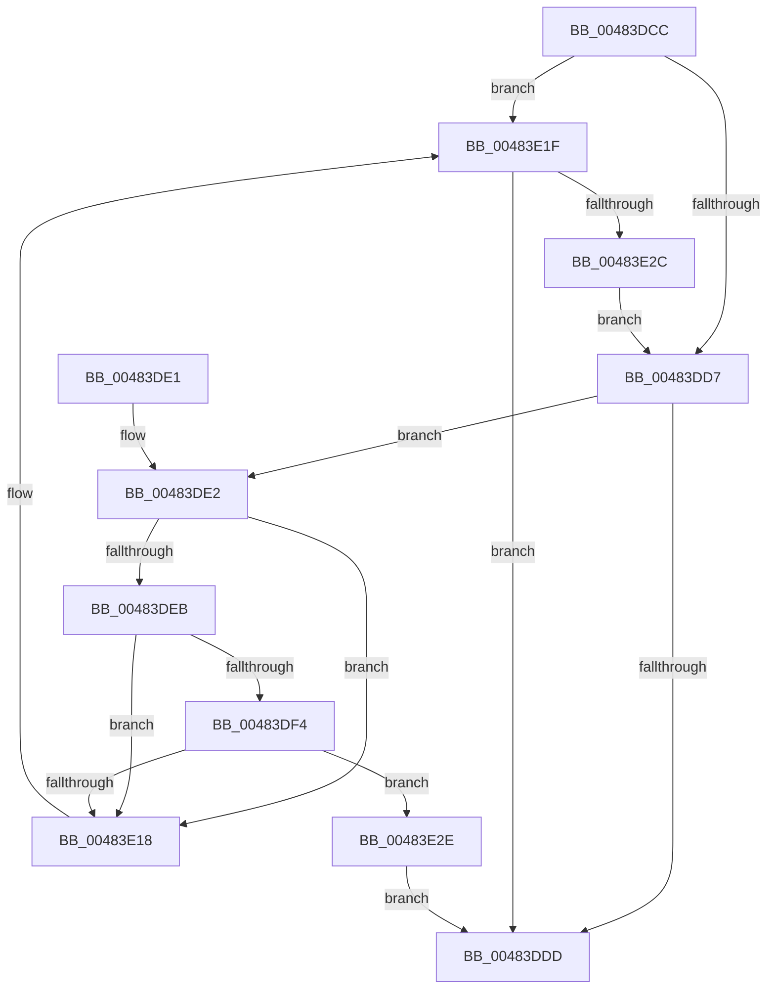

# PopReadyParentSleep

- RVA: `0x00483DCC`–`0x00483E4F` (길이 `131` bytes)
- VA: `0x0000000140483DCC`
- 실행 섹션: `.text`
- PDB 이름 있음: `예`; PDB Function 태그: `아니요`
- unwind 정보 RVA: `0x000DB714`
- 디코드: `39`개 명령, `131/131` bytes 표시
- 미해석 바이트: `0` (있으면 어셈블리에 `.byte`로 보존)

> 이 문서는 커널 이미지의 기계어와 PDB 기호를 분석해 생성했습니다. 4번과 5번은 함수 원형과 자료형을 바이너리 사용 방식에서 추정한 C 해석이며 원본 소스 복구 결과는 아닙니다.

## 1. Dependencies

- 직접 호출 지점: **0**; 고유 호출 대상: **0**
- 직접 호출자로 확인된 함수: **1**
- RIP 상대 이미지 참조: **0**

### Outgoing calls
- 직접 디코드된 call 명령이 없습니다.

### Direct callers
- [PopCompleteNotifyTransitionCommon](PopCompleteNotifyTransitionCommon_function_00483B4C.md) at `0x00483C36`
- [PopCompleteNotifyTransitionCommon](PopCompleteNotifyTransitionCommon_function_00483B4C.md) at `0x00483C83`

### Static image references
- 디코드된 RIP-relative 메모리 참조가 없습니다.

## 2. Other-region calls and transfers

- 다른 실행 섹션으로 향하는 call: **0**
- 별도 외부 분기/꼬리 이동을 확인하지 못했습니다.

## 3. Assembly (complete function range)

```asm
00483DCC  45 32 DB                        xor r11b, r11b
00483DCF  4C 8B D1                        mov r10, rcx
00483DD2  45 84 C9                        test r9b, r9b
00483DD5  75 48                           jne 0x140483e1f
00483DD7  83 41 5C FF                     add dword ptr [rcx + 0x5c], -1
00483DDB  74 05                           je 0x140483de2
00483DDD  41 8A C3                        mov al, r11b
00483DE0  C3                              ret
00483DE1  CC                              int3
00483DE2  48 8B 01                        mov rax, qword ptr [rcx]
00483DE5  4C 39 50 08                     cmp qword ptr [rax + 8], r10
00483DE9  75 2D                           jne 0x140483e18
00483DEB  48 8B 49 08                     mov rcx, qword ptr [rcx + 8]
00483DEF  4C 39 11                        cmp qword ptr [rcx], r10
00483DF2  75 24                           jne 0x140483e18
00483DF4  48 89 01                        mov qword ptr [rcx], rax
00483DF7  48 89 48 08                     mov qword ptr [rax + 8], rcx
00483DFB  41 0F B6 42 38                  movzx eax, byte ptr [r10 + 0x38]
00483E00  48 8D 0C C5 05 00 00 00         lea rcx, [rax*8 + 5]
00483E08  48 03 C8                        add rcx, rax
00483E0B  48 8D 04 CA                     lea rax, [rdx + rcx*8]
00483E0F  48 8B 48 08                     mov rcx, qword ptr [rax + 8]
00483E13  48 39 01                        cmp qword ptr [rcx], rax
00483E16  74 16                           je 0x140483e2e
00483E18  B9 03 00 00 00                  mov ecx, 3
00483E1D  CD 29                           int 0x29
00483E1F  8B 81 58 02 00 00               mov eax, dword ptr [rcx + 0x258]
00483E25  A9 00 00 03 00                  test eax, 0x30000
00483E2A  74 B1                           je 0x140483ddd
00483E2C  EB A9                           jmp 0x140483dd7
00483E2E  49 89 02                        mov qword ptr [r10], rax
00483E31  49 89 4A 08                     mov qword ptr [r10 + 8], rcx
00483E35  4C 89 11                        mov qword ptr [rcx], r10
00483E38  4C 89 50 08                     mov qword ptr [rax + 8], r10
00483E3C  B8 01 00 00 00                  mov eax, 1
00483E41  45 38 42 38                     cmp byte ptr [r10 + 0x38], r8b
00483E45  45 0F B6 DB                     movzx r11d, r11b
00483E49  44 0F 44 D8                     cmove r11d, eax
00483E4D  EB 8E                           jmp 0x140483ddd
```

## 4. C-style interpretation (structured pseudocode)

```c
__int64 __fastcall PopReadyParentSleep(__int64 a1, __int64 a2, unsigned __int8 a3, unsigned __int8 a4)
{
    __int64 v_r11;

    v_r11 = 0;
    if (a4 != 0) goto loc_00483E1F;
loc_00483DD7:
    if (a4 == 0) goto loc_00483DE2;
loc_00483DDD:
    return 0;
loc_00483DE2:
    if ((*(unsigned __int64 *)(*(unsigned __int64 *)(a1) + 8)) != a1) goto loc_00483E18;
    if ((*(unsigned __int64 *)(*(unsigned __int64 *)(a1 + 8))) != a1) goto loc_00483E18;
    *(unsigned __int64 *)(*(unsigned __int64 *)(a1 + 8)) = *(unsigned __int64 *)(a1);
    *(unsigned __int64 *)(*(unsigned __int64 *)(a1) + 8) = *(unsigned __int64 *)(a1 + 8);
    a1 = (*(unsigned __int8 *)(a1 + 56) * 8 + 5) + (*(unsigned __int8 *)(a1 + 56));
    if ((*(unsigned __int64 *)(*(unsigned __int64 *)(a2 + a1 * 8 + 8))) == (a2 + a1 * 8)) goto loc_00483E2E;
loc_00483E18:
loc_00483E1F:
    if ((((unsigned int)((unsigned int)(*(unsigned int *)(3 + 600)))) & (0x30000ULL)) == 0) goto loc_00483DDD;
    goto loc_00483DD7;
loc_00483E2E:
    *(unsigned __int64 *)(a1) = (unsigned int)(*(unsigned int *)(3 + 600));
    *(unsigned __int64 *)(a1 + 8) = 3;
    *(unsigned __int64 *)(3) = a1;
    *(unsigned __int64 *)((unsigned int)(*(unsigned int *)(3 + 600)) + 8) = a1;
    v_r11 = 0;
    if ((*(unsigned __int8 *)(a1 + 56)) == a3) { v_r11 = 1; }
    goto loc_00483DDD;
}
```

## 5. (Beta) C Style

```c
int64_t PopReadyParentSleep(void *Arg1, void *Arg2, uint8_t Arg3, uint8_t Arg4)
{
    uint8_t *arg1 = (uint8_t *)Arg1;
    uint8_t *arg2 = (uint8_t *)Arg2;

    int64_t local_r11;

    local_r11 = 0;
    if (Arg4 != 0) goto loc_00483E1F;
loc_00483DD7:
    if (Arg4 == 0) goto loc_00483DE2;
loc_00483DDD:
    return 0;
loc_00483DE2:
    if ((*(uint64_t *)(*(uint64_t *)(arg1) + 0x8)) != Arg1) goto loc_00483E18;
    if ((*(uint64_t *)(*(uint64_t *)(arg1 + 0x8))) != Arg1) goto loc_00483E18;
    *(uint64_t *)(*(uint64_t *)(arg1 + 0x8)) = *(uint64_t *)(arg1);
    *(uint64_t *)(*(uint64_t *)(arg1) + 0x8) = *(uint64_t *)(arg1 + 0x8);
    Arg1 = (*(uint8_t *)(arg1 + 0x38) * 8 + 5) + (*(uint8_t *)(arg1 + 0x38));
    if ((*(uint64_t *)(*(uint64_t *)(arg2 + arg1 * 8 + 0x8))) == (Arg2 + Arg1 * 8)) goto loc_00483E2E;
loc_00483E18:
loc_00483E1F:
    if ((((uint32_t)((uint32_t)(*(uint32_t *)(3 + 0x258)))) & (0x30000ULL)) == 0) goto loc_00483DDD;
    goto loc_00483DD7;
loc_00483E2E:
    *(uint64_t *)(arg1) = (uint32_t)(*(uint32_t *)(3 + 0x258));
    *(uint64_t *)(arg1 + 0x8) = 3;
    *(void **)(3) = Arg1;
    *(void **)((uint32_t)(*(uint32_t *)(3 + 0x258)) + 0x8) = Arg1;
    local_r11 = 0;
    if ((*(uint8_t *)(arg1 + 0x38)) == Arg3) { local_r11 = 1; }
    goto loc_00483DDD;
}
```

### 관측된 메모리 오프셋

구조체 형식이 확인되지 않은 접근은 인자 기준의 오프셋으로만 기록했습니다.

| 기준 인자 | 오프셋 표현 | 폭 (bit) | 접근 |
|---|---:|---:|---|
| `Arg1` | `+ 0x0` | `64` | `W` |
| `Arg1` | `+ 0x8` | `64` | `W` |
| `Arg1` | `+ 0x38` | `8` | `R` |
| `Arg2` | `+ 0x0 + rcx*8` | `64` | `R` |
| `Arg2` | `+ 0x8` | `64` | `R` |
| `Arg2` | `+ 0x8` | `64` | `W` |

## 6. Execution-region graph

[열기: 2D/3D 그래프와 함수 탐색 컨트롤 패널](../../../control-panel.html?section=text&rva=0x00483DCC&view=graph)

- 2D 그래프는 위에서 아래로 흐르고, 3D 그래프는 빈 공간을 드래그해 회전합니다. Shift+드래그는 이동, 휠은 확대·축소, 함수 노드 선택은 대상 보고서 이동입니다.

### Static fallback


