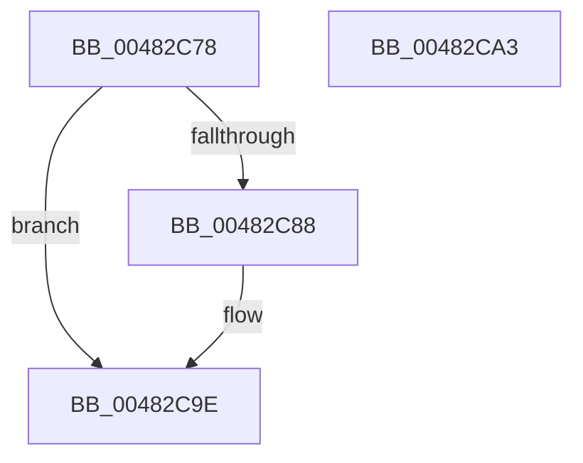

# PopSetNotificationWork

- RVA: `0x00482C78`–`0x00482CA4` (길이 `44` bytes)
- VA: `0x0000000140482C78`
- 실행 섹션: `.text`
- PDB 이름 있음: `예`; PDB Function 태그: `아니요`
- unwind 정보 RVA: `0x0005C788`
- 디코드: `12`개 명령, `44/44` bytes 표시
- 미해석 바이트: `0` (있으면 어셈블리에 `.byte`로 보존)

> 이 문서는 커널 이미지의 기계어와 PDB 기호를 분석해 생성했습니다. 4번과 5번은 함수 원형과 자료형을 바이너리 사용 방식에서 추정한 C 해석이며 원본 소스 복구 결과는 아닙니다.

## 1. Dependencies

- 직접 호출 지점: **2**; 고유 호출 대상: **2**
- 직접 호출자로 확인된 함수: **8**
- RIP 상대 이미지 참조: **2**

### Outgoing calls
- `0x00482C94` → [PopGetPolicyWorker](PopGetPolicyWorker_function_00482D24.md) (function, `0x00482D24`)
- `0x00482C99` → [PopCheckForWork](PopCheckForWork_function_00482CAC.md) (function, `0x00482CAC`)

### Direct callers
- [PopInitilizeAcDcSettings](PopInitilizeAcDcSettings_function_004828D0.md) at `0x0048296E`
- [PopInitilizeAcDcSettings](PopInitilizeAcDcSettings_function_004828D0.md) at `0x00482978`
- [sub_006F8088](../6F/Unknown_function_006F8088.md) at `0x006F80FF`
- [PopExecutePowerAction](../../page/75/PopExecutePowerAction_function_0075E6B4.md) at `0x0075EB3C`
- [PopApplyPolicy](../../page/91/PopApplyPolicy_function_009107B0.md) at `0x009109AE`
- [PopGetSettingNotificationName](../../page/91/PopGetSettingNotificationName_function_0091346C.md) at `0x0091374B`
- [PopSetPowerSettingValue](../../page/91/PopSetPowerSettingValue_function_00914E54.md) at `0x00914FA7`
- [PopSetPowerSettingValue](../../page/91/PopSetPowerSettingValue_function_00914E54.md) at `0x00914FB6`
- [PoRegisterPowerSettingCallback](../../page/A8/PoRegisterPowerSettingCallback_function_00A82150.md) at `0x00A82399`
- [PopBatteryApplyCompositeState](../../page/AE/PopBatteryApplyCompositeState_function_00AE0CD0.md) at `0x00AE0D3C`
- [PopBatteryApplyCompositeState](../../page/AE/PopBatteryApplyCompositeState_function_00AE0CD0.md) at `0x00AE0E11`

### Static image references
- `0x00482C7C` → RVA `0x00F0C8C8` (`.data`; read)
- `0x00482C88` → RVA `0x00F0C8C8` (`.data`; read/write)

## 2. Other-region calls and transfers

- 다른 실행 섹션으로 향하는 call: **0**
- 별도 외부 분기/꼬리 이동을 확인하지 못했습니다.

## 3. Assembly (complete function range)

```asm
00482C78  48 83 EC 28                     sub rsp, 0x28
00482C7C  8B 05 46 9C A8 00               mov eax, dword ptr [rip + 0xa89c46]
00482C82  23 C1                           and eax, ecx
00482C84  3B C1                           cmp eax, ecx
00482C86  74 16                           je 0x140482c9e
00482C88  F0 09 0D 39 9C A8 00            lock or dword ptr [rip + 0xa89c39], ecx
00482C8F  B9 04 00 00 00                  mov ecx, 4
00482C94  E8 8B 00 00 00                  call 0x140482d24
00482C99  E8 0E 00 00 00                  call 0x140482cac
00482C9E  48 83 C4 28                     add rsp, 0x28
00482CA2  C3                              ret
00482CA3  CC                              int3
```

## 4. C-style interpretation (structured pseudocode)

```c
__int64 __fastcall PopSetNotificationWork(int a1)
{
    __int64 result;
    __int64 v_rsp;

    v_rsp = (v_rsp) - (40);
    result = (unsigned int)(((unsigned int)(*(unsigned int *)(v_rip + 11050054))) & (a1));
    if (((unsigned int)(result)) != a1) {
        a1 = 4;
        result = PopGetPolicyWorker(a1, a2, a3, a4);
        result = PopCheckForWork(a1, a2, a3, a4);
    }
    v_rsp = (v_rsp) + (40);
    return result;
}
```

## 5. (Beta) C Style

```c
int64_t PopSetNotificationWork(int32_t Arg1)
{
    int64_t result;
    int64_t local_rsp;

    local_rsp = (local_rsp) - (40);
    result = (uint32_t)(((uint32_t)(*(uint32_t *)(v_rip + 0xA89C46))) & (Arg1));
    if (((uint32_t)(result)) != Arg1) {
        Arg1 = 4;
        result = PopGetPolicyWorker(Arg1, a2, a3, a4);
        result = PopCheckForWork(Arg1, a2, a3, a4);
    }
    local_rsp = (local_rsp) + (40);
    return result;
}
```

## 6. Execution-region graph

[열기: 2D/3D 그래프와 함수 탐색 컨트롤 패널](../../../control-panel.html?section=text&rva=0x00482C78&view=graph)

- 2D 그래프는 위에서 아래로 흐르고, 3D 그래프는 빈 공간을 드래그해 회전합니다. Shift+드래그는 이동, 휠은 확대·축소, 함수 노드 선택은 대상 보고서 이동입니다.

### Static fallback


