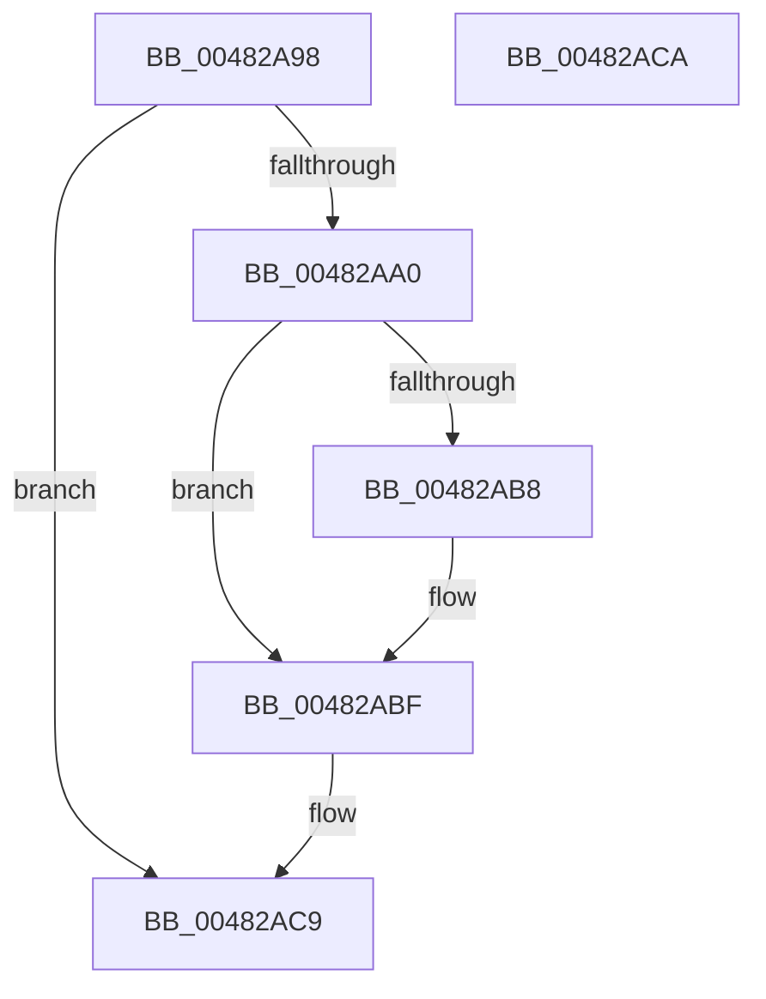

# PopSetSystemState

- RVA: `0x00482A98`–`0x00482ACB` (길이 `51` bytes)
- VA: `0x0000000140482A98`
- 실행 섹션: `.text`
- PDB 이름 있음: `예`; PDB Function 태그: `아니요`
- unwind 정보 RVA: `0x000AEE34`
- 디코드: `17`개 명령, `51/51` bytes 표시
- 미해석 바이트: `0` (있으면 어셈블리에 `.byte`로 보존)

> 이 문서는 커널 이미지의 기계어와 PDB 기호를 분석해 생성했습니다. 4번과 5번은 함수 원형과 자료형을 바이너리 사용 방식에서 추정한 C 해석이며 원본 소스 복구 결과는 아닙니다.

## 1. Dependencies

- 직접 호출 지점: **2**; 고유 호출 대상: **2**
- 직접 호출자로 확인된 함수: **3**
- RIP 상대 이미지 참조: **0**

### Outgoing calls
- `0x00482AAE` → [PopDiagTraceSetSystemState](PopDiagTraceSetSystemState_function_00482AD4.md) (function, `0x00482AD4`)
- `0x00482ABA` → [PopUserPresentSet](PopUserPresentSet_function_00482B90.md) (function, `0x00482B90`)

### Direct callers
- [PoSetSystemState](PoSetSystemState_function_00482A50.md) at `0x00482A74`
- [PopAllowAwayModeSettingCallback](../../page/75/PopAllowAwayModeSettingCallback_function_00758000.md) at `0x00758073`
- [PopIssueActionRequest](../../page/A9/PopIssueActionRequest_function_00A9CE54.md) at `0x00A9CEFC`

### Static image references
- 디코드된 RIP-relative 메모리 참조가 없습니다.

## 2. Other-region calls and transfers

- 다른 실행 섹션으로 향하는 call: **0**
- 별도 외부 분기/꼬리 이동을 확인하지 못했습니다.

## 3. Assembly (complete function range)

```asm
00482A98  F7 C1 F8 FF FF FF               test ecx, 0xfffffff8
00482A9E  75 29                           jne 0x140482ac9
00482AA0  48 89 5C 24 08                  mov qword ptr [rsp + 8], rbx
00482AA5  57                              push rdi
00482AA6  48 83 EC 20                     sub rsp, 0x20
00482AAA  8B FA                           mov edi, edx
00482AAC  8B D9                           mov ebx, ecx
00482AAE  E8 21 00 00 00                  call 0x140482ad4
00482AB3  F6 C3 04                        test bl, 4
00482AB6  74 07                           je 0x140482abf
00482AB8  8B CF                           mov ecx, edi
00482ABA  E8 D1 00 00 00                  call 0x140482b90
00482ABF  48 8B 5C 24 30                  mov rbx, qword ptr [rsp + 0x30]
00482AC4  48 83 C4 20                     add rsp, 0x20
00482AC8  5F                              pop rdi
00482AC9  C3                              ret
00482ACA  CC                              int3
```

## 4. C-style interpretation (structured pseudocode)

```c
__int64 __fastcall PopSetSystemState(int a1, int a2)
{
    __int64 result;
    __int64 v_rsp;
    unsigned __int64 v_stack_p8;

    if (((a1) & (0xFFFFFFF8ULL)) != 0) goto loc_00482AC9;
    v_stack_p8 = v_rbx;
    v_rsp = (v_rsp) - (32);
    result = PopDiagTraceSetSystemState(a1, a2, a3, a4);
    if ((((unsigned __int8)((unsigned int)(a1))) & (4)) != 0) {
        a1 = (unsigned int)((unsigned int)(a2));
        result = PopUserPresentSet(a1, a2, a3, a4);
    }
    v_rsp = (v_rsp) + (32);
loc_00482AC9:
    return result;
}
```

## 5. (Beta) C Style

```c
int64_t PopSetSystemState(int32_t Arg1, int32_t Arg2)
{
    int64_t result;
    int64_t local_rsp;
    uint64_t v_stack_p8;

    if (((Arg1) & (0xFFFFFFF8ULL)) != 0) goto loc_00482AC9;
    v_stack_p8 = local_rbx;
    local_rsp = (local_rsp) - (32);
    result = PopDiagTraceSetSystemState(Arg1, Arg2, a3, a4);
    if ((((uint8_t)((uint32_t)(Arg1))) & (4)) != 0) {
        Arg1 = (uint32_t)((uint32_t)(Arg2));
        result = PopUserPresentSet(Arg1, Arg2, a3, a4);
    }
    local_rsp = (local_rsp) + (32);
loc_00482AC9:
    return result;
}
```

## 6. Execution-region graph

[열기: 2D/3D 그래프와 함수 탐색 컨트롤 패널](../../../control-panel.html?section=text&rva=0x00482A98&view=graph)

- 2D 그래프는 위에서 아래로 흐르고, 3D 그래프는 빈 공간을 드래그해 회전합니다. Shift+드래그는 이동, 휠은 확대·축소, 함수 노드 선택은 대상 보고서 이동입니다.

### Static fallback


