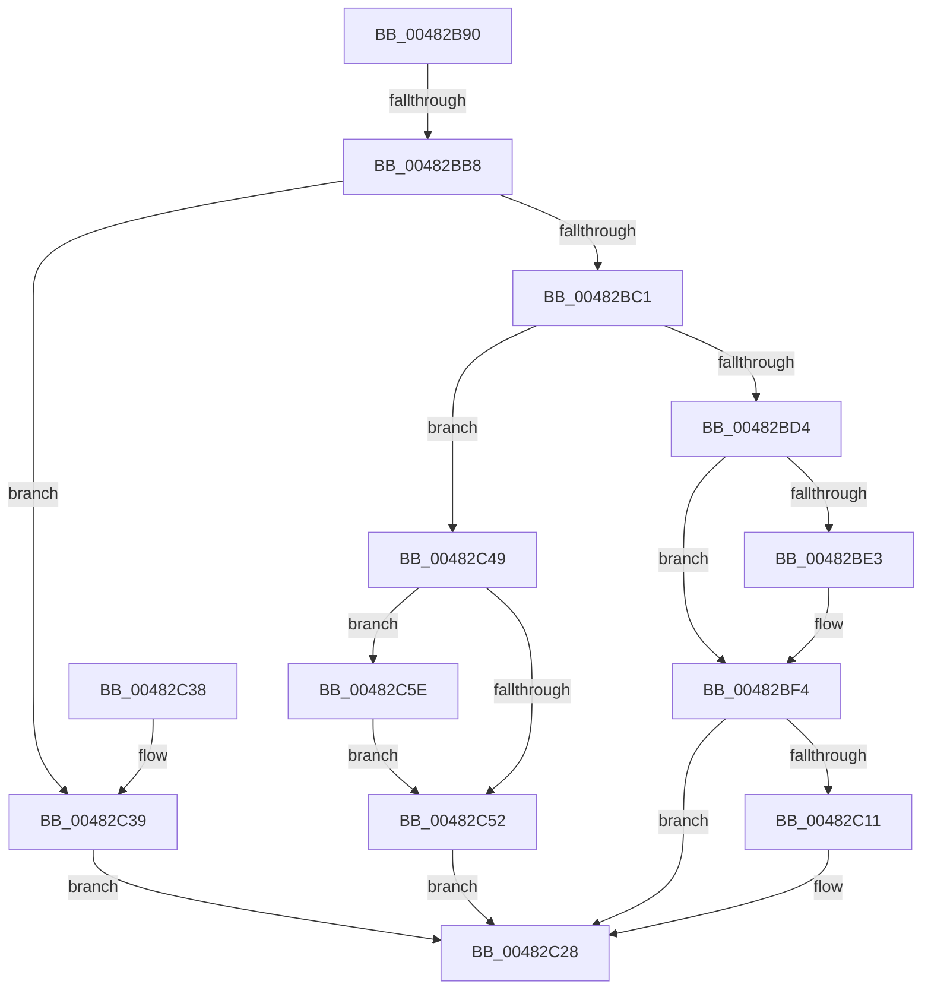

# PopUserPresentSet

- RVA: `0x00482B90`–`0x00482C71` (길이 `225` bytes)
- VA: `0x0000000140482B90`
- 실행 섹션: `.text`
- PDB 이름 있음: `예`; PDB Function 태그: `예`
- unwind 정보 RVA: `0x000AEE44`
- 디코드: `51`개 명령, `225/225` bytes 표시
- 미해석 바이트: `0` (있으면 어셈블리에 `.byte`로 보존)

> 이 문서는 커널 이미지의 기계어와 PDB 기호를 분석해 생성했습니다. 4번과 5번은 함수 원형과 자료형을 바이너리 사용 방식에서 추정한 C 해석이며 원본 소스 복구 결과는 아닙니다.

## 1. Dependencies

- 직접 호출 지점: **7**; 고유 호출 대상: **6**
- 직접 호출자로 확인된 함수: **2**
- RIP 상대 이미지 참조: **13**

### Outgoing calls
- `0x00482BC4` → [KeAcquireSpinLockRaiseToDpc](../20/KeAcquireSpinLockRaiseToDpc_function_00208470.md) (function, `0x00208470`)
- `0x00482BEF` → [ExQueueWorkItem](../2F/ExQueueWorkItem_function_002F9520.md) (function, `0x002F9520`)
- `0x00482C03` → [KeReleaseSpinLock](../39/KeReleaseSpinLock_function_00392BA0.md) (function, `0x00392BA0`)
- `0x00482C1E` → [PopGetPolicyWorker](PopGetPolicyWorker_function_00482D24.md) (function, `0x00482D24`)
- `0x00482C23` → [PopCheckForWork](PopCheckForWork_function_00482CAC.md) (function, `0x00482CAC`)
- `0x00482C57` → [KeReleaseSpinLock](../39/KeReleaseSpinLock_function_00392BA0.md) (function, `0x00392BA0`)
- `0x00482C6A` → [KeSetEvent](../33/KeSetEvent_function_0033F310.md) (function, `0x0033F310`)

### Direct callers
- [PoSetUserPresent](PoSetUserPresent_function_004829A0.md) at `0x004829DF`
- [PopSetSystemState](PopSetSystemState_function_00482A98.md) at `0x00482ABA`

### Static image references
- `0x00482B9F` → RVA `0x00F0CF0C` (`.data`; read)
- `0x00482BA9` → RVA `0x00F0DEF8` (`.data`; read)
- `0x00482BB8` → RVA `0x00F0BD41` (`.data`; read)
- `0x00482BC9` → RVA `0x00F0CE14` (`.data`; read)
- `0x00482BD4` → RVA `0x00E676E4` (`.data`; read)
- `0x00482BDB` → RVA `0x00E676E8` (`.data`; write)
- `0x00482BE8` → RVA `0x00F0DF00` (`.data`; read)
- `0x00482BF6` → RVA `0x00E676E4` (`.data`; write)
- `0x00482C08` → RVA `0x00E0B558` (`.data`; read)
- `0x00482C11` → RVA `0x00F09380` (`.data`; read/write)
- `0x00482C39` → RVA `0x00F0C684` (`.data`; read/write)
- `0x00482C41` → RVA `0x00F0C688` (`.data`; read/write)
- `0x00482C61` → RVA `0x00F0D160` (`.data`; read)

## 2. Other-region calls and transfers

- 다른 실행 섹션으로 향하는 call: **0**
- call이 아닌 외부 분기/꼬리 이동: **1**
  - `0x00482BB2` → [sub_006F52A6](../6F/Unknown_function_006F52A6.md) (`tail-transfer`)

## 3. Assembly (complete function range)

```asm
00482B90  48 89 5C 24 08                  mov qword ptr [rsp + 8], rbx
00482B95  48 89 6C 24 10                  mov qword ptr [rsp + 0x10], rbp
00482B9A  57                              push rdi
00482B9B  48 83 EC 50                     sub rsp, 0x50
00482B9F  F7 05 63 A3 A8 00 00 00 04 00   test dword ptr [rip + 0xa8a363], 0x40000
00482BA9  48 8D 2D 48 B3 A8 00            lea rbp, [rip + 0xa8b348]
00482BB0  8B F9                           mov edi, ecx
00482BB2  0F 85 EE 26 27 00               jne 0x1406f52a6
00482BB8  80 3D 82 91 A8 00 03            cmp byte ptr [rip + 0xa89182], 3
00482BBF  74 78                           je 0x140482c39
00482BC1  48 8B CD                        mov rcx, rbp
00482BC4  E8 A7 58 D8 FF                  call 0x140208470
00482BC9  83 3D 44 A2 A8 00 00            cmp dword ptr [rip + 0xa8a244], 0
00482BD0  8A D8                           mov bl, al
00482BD2  75 75                           jne 0x140482c49
00482BD4  83 3D 09 4B 9E 00 00            cmp dword ptr [rip + 0x9e4b09], 0
00482BDB  89 3D 07 4B 9E 00               mov dword ptr [rip + 0x9e4b07], edi
00482BE1  75 11                           jne 0x140482bf4
00482BE3  BA 01 00 00 00                  mov edx, 1
00482BE8  48 8D 0D 11 B3 A8 00            lea rcx, [rip + 0xa8b311]
00482BEF  E8 2C 69 E7 FF                  call 0x1402f9520
00482BF4  8A D3                           mov dl, bl
00482BF6  C7 05 E4 4A 9E 00 01 00 00 00   mov dword ptr [rip + 0x9e4ae4], 1
00482C00  48 8B CD                        mov rcx, rbp
00482C03  E8 98 FF F0 FF                  call 0x140392ba0
00482C08  83 3D 49 89 98 00 00            cmp dword ptr [rip + 0x988949], 0
00482C0F  74 17                           je 0x140482c28
00482C11  F0 83 0D 67 67 A8 00 04         lock or dword ptr [rip + 0xa86767], 4
00482C19  B9 80 00 00 00                  mov ecx, 0x80
00482C1E  E8 01 01 00 00                  call 0x140482d24
00482C23  E8 84 00 00 00                  call 0x140482cac
00482C28  48 8B 5C 24 60                  mov rbx, qword ptr [rsp + 0x60]
00482C2D  48 8B 6C 24 68                  mov rbp, qword ptr [rsp + 0x68]
00482C32  48 83 C4 50                     add rsp, 0x50
00482C36  5F                              pop rdi
00482C37  C3                              ret
00482C38  CC                              int3
00482C39  F0 83 0D 43 9A A8 00 01         lock or dword ptr [rip + 0xa89a43], 1
00482C41  87 3D 41 9A A8 00               xchg dword ptr [rip + 0xa89a41], edi
00482C47  EB DF                           jmp 0x140482c28
00482C49  83 3D 94 4A 9E 00 00            cmp dword ptr [rip + 0x9e4a94], 0
00482C50  74 0C                           je 0x140482c5e
00482C52  8A D3                           mov dl, bl
00482C54  48 8B CD                        mov rcx, rbp
00482C57  E8 44 FF F0 FF                  call 0x140392ba0
00482C5C  EB CA                           jmp 0x140482c28
00482C5E  45 33 C0                        xor r8d, r8d
00482C61  48 8D 0D F8 A4 A8 00            lea rcx, [rip + 0xa8a4f8]
00482C68  33 D2                           xor edx, edx
00482C6A  E8 A1 C6 EB FF                  call 0x14033f310
00482C6F  EB E1                           jmp 0x140482c52
```

## 4. C-style interpretation (structured pseudocode)

```c
__int64 __fastcall PopUserPresentSet(int a1, __int64 a2, int a3)
{
    __int64 result;
    __int64 v_rsp;
    unsigned __int64 v_stack_p10;
    unsigned __int64 v_stack_p8;

    v_stack_p8 = v_rbx;
    v_stack_p10 = v_rbp;
    v_rsp = (v_rsp) - (80);
    if ((*(unsigned __int8 *)(v_rip + 11047298)) == 3) goto loc_00482C39;
    result = KeAcquireSpinLockRaiseToDpc(v_rip + 11055944, a2, a3, a4);
    if ((*(unsigned int *)(v_rip + 11051588)) != 0) goto loc_00482C49;
    *(unsigned int *)(v_rip + 10373895) = (unsigned int)((unsigned int)(a1));
    if ((*(unsigned int *)(v_rip + 10373897)) == 0) {
        a2 = 1;
        a1 = v_rip + 11055889;
        result = ExQueueWorkItem(a1, a2, a3, a4);
    }
    *(unsigned int *)(v_rip + 10373860) = 1;
    result = KeReleaseSpinLock(v_rip + 11055944, (unsigned __int8)((unsigned __int8)(result)), a3, a4);
    if ((*(unsigned int *)(v_rip + 9996617)) != 0) {
        a1 = 128;
        result = PopGetPolicyWorker(a1, (unsigned __int8)((unsigned __int8)(result)), a3, a4);
        result = PopCheckForWork(a1, (unsigned __int8)((unsigned __int8)(result)), a3, a4);
    }
    v_rsp = (v_rsp) + (80);
    return result;
loc_00482C39:
    goto loc_00482C28;
loc_00482C49:
    if ((*(unsigned int *)(v_rip + 10373780)) == 0) goto loc_00482C5E;
loc_00482C52:
    result = KeReleaseSpinLock(v_stack_p10, (unsigned __int8)(v_stack_p8), a3, a4);
    goto loc_00482C28;
loc_00482C5E:
    a3 = 0;
    a2 = 0;
    result = KeSetEvent(v_rip + 11052280, a2, a3, a4);
    goto loc_00482C52;
}
```

## 5. (Beta) C Style

```c
int64_t PopUserPresentSet(int32_t Arg1, int64_t Arg2, int32_t Arg3)
{
    int64_t result;
    int64_t local_rsp;
    uint64_t v_stack_p10;
    uint64_t v_stack_p8;

    v_stack_p8 = local_rbx;
    v_stack_p10 = local_rbp;
    local_rsp = (local_rsp) - (80);
    if ((*(uint8_t *)(v_rip + 0xA89182)) == 3) goto loc_00482C39;
    result = KeAcquireSpinLockRaiseToDpc(v_rip + 11055944, Arg2, Arg3, a4);
    if ((*(uint32_t *)(v_rip + 0xA8A244)) != 0) goto loc_00482C49;
    *(uint32_t *)(v_rip + 0x9E4B07) = (uint32_t)((uint32_t)(Arg1));
    if ((*(uint32_t *)(v_rip + 0x9E4B09)) == 0) {
        Arg2 = 1;
        Arg1 = v_rip + 11055889;
        result = ExQueueWorkItem(Arg1, Arg2, Arg3, a4);
    }
    *(uint32_t *)(v_rip + 0x9E4AE4) = 1;
    result = KeReleaseSpinLock(v_rip + 11055944, (uint8_t)((uint8_t)(result)), Arg3, a4);
    if ((*(uint32_t *)(v_rip + 0x988949)) != 0) {
        Arg1 = 128;
        result = PopGetPolicyWorker(Arg1, (uint8_t)((uint8_t)(result)), Arg3, a4);
        result = PopCheckForWork(Arg1, (uint8_t)((uint8_t)(result)), Arg3, a4);
    }
    local_rsp = (local_rsp) + (80);
    return result;
loc_00482C39:
    goto loc_00482C28;
loc_00482C49:
    if ((*(uint32_t *)(v_rip + 0x9E4A94)) == 0) goto loc_00482C5E;
loc_00482C52:
    result = KeReleaseSpinLock(v_stack_p10, (uint8_t)(v_stack_p8), Arg3, a4);
    goto loc_00482C28;
loc_00482C5E:
    Arg3 = 0;
    Arg2 = 0;
    result = KeSetEvent(v_rip + 11052280, Arg2, Arg3, a4);
    goto loc_00482C52;
}
```

## 6. Execution-region graph

[열기: 2D/3D 그래프와 함수 탐색 컨트롤 패널](../../../control-panel.html?section=text&rva=0x00482B90&view=graph)

- 2D 그래프는 위에서 아래로 흐르고, 3D 그래프는 빈 공간을 드래그해 회전합니다. Shift+드래그는 이동, 휠은 확대·축소, 함수 노드 선택은 대상 보고서 이동입니다.

### Static fallback


