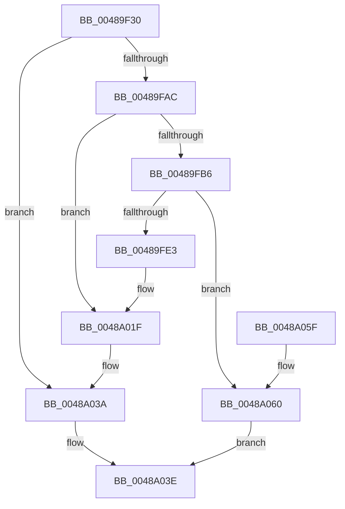

# PpmCapturePerformanceDistributionCallback

- RVA: `0x00489F30`–`0x0048A067` (길이 `311` bytes)
- VA: `0x0000000140489F30`
- 실행 섹션: `.text`
- PDB 이름 있음: `예`; PDB Function 태그: `아니요`
- unwind 정보 RVA: `0x000B00B0`
- 디코드: `85`개 명령, `311/311` bytes 표시
- 미해석 바이트: `0` (있으면 어셈블리에 `.byte`로 보존)

> 이 문서는 커널 이미지의 기계어와 PDB 기호를 분석해 생성했습니다. 4번과 5번은 함수 원형과 자료형을 바이너리 사용 방식에서 추정한 C 해석이며 원본 소스 복구 결과는 아닙니다.

## 1. Dependencies

- 직접 호출 지점: **1**; 고유 호출 대상: **1**
- 직접 호출자로 확인된 함수: **1**
- RIP 상대 이미지 참조: **2**

### Outgoing calls
- `0x00489FDA` → [PpmSnapPerformanceAccumulation](../2D/PpmSnapPerformanceAccumulation_function_002DE090.md) (function, `0x002DE090`)

### Direct callers
- [PpmCapturePerformanceDistribution](PpmCapturePerformanceDistribution_function_00489C88.md) at `0x00489D65`

### Static image references
- `0x00489FE3` → RVA `0x00FC6FB8` (`ALMOSTRO`; read)
- `0x0048A002` → RVA `0x00FC6FB0` (`ALMOSTRO`; read)

## 2. Other-region calls and transfers

- 다른 실행 섹션으로 향하는 call: **0**
- 별도 외부 분기/꼬리 이동을 확인하지 못했습니다.

## 3. Assembly (complete function range)

```asm
00489F30  4C 8B DC                        mov r11, rsp
00489F33  49 89 5B 08                     mov qword ptr [r11 + 8], rbx
00489F37  49 89 6B 10                     mov qword ptr [r11 + 0x10], rbp
00489F3B  49 89 73 18                     mov qword ptr [r11 + 0x18], rsi
00489F3F  49 89 7B 20                     mov qword ptr [r11 + 0x20], rdi
00489F43  41 54                           push r12
00489F45  41 56                           push r14
00489F47  41 57                           push r15
00489F49  48 83 EC 70                     sub rsp, 0x70
00489F4D  44 8B 42 0C                     mov r8d, dword ptr [rdx + 0xc]
00489F51  33 C0                           xor eax, eax
00489F53  0F 57 C0                        xorps xmm0, xmm0
00489F56  4C 8B F1                        mov r14, rcx
00489F59  48 8B 89 B8 89 00 00            mov rcx, qword ptr [rcx + 0x89b8]
00489F60  48 8B FA                        mov rdi, rdx
00489F63  0F 11 44 24 30                  movups xmmword ptr [rsp + 0x30], xmm0
00489F68  0F 11 44 24 40                  movups xmmword ptr [rsp + 0x40], xmm0
00489F6D  0F 11 44 24 50                  movups xmmword ptr [rsp + 0x50], xmm0
00489F72  49 89 43 D8                     mov qword ptr [r11 - 0x28], rax
00489F76  41 8D 40 07                     lea eax, [r8 + 7]
00489F7A  8B E8                           mov ebp, eax
00489F7C  83 E5 F8                        and ebp, 0xfffffff8
00489F7F  41 3B C0                        cmp eax, r8d
00489F82  48 8B C1                        mov rax, rcx
00489F85  41 0F 42 E8                     cmovb ebp, r8d
00489F89  48 F7 D8                        neg rax
00489F8C  45 1B FF                        sbb r15d, r15d
00489F8F  33 F6                           xor esi, esi
00489F91  41 83 E7 02                     and r15d, 2
00489F95  41 8B C7                        mov eax, r15d
00489F98  44 8D 65 08                     lea r12d, [rbp + 8]
00489F9C  C1 E0 04                        shl eax, 4
00489F9F  44 03 E0                        add r12d, eax
00489FA2  44 3B 62 08                     cmp r12d, dword ptr [rdx + 8]
00489FA6  0F 87 8E 00 00 00               ja 0x14048a03a
00489FAC  8B DD                           mov ebx, ebp
00489FAE  48 03 1A                        add rbx, qword ptr [rdx]
00489FB1  48 85 C9                        test rcx, rcx
00489FB4  74 69                           je 0x14048a01f
00489FB6  65 48 8B 04 25 20 00 00 00      mov rax, qword ptr gs:[0x20]
00489FBF  49 8B CE                        mov rcx, r14
00489FC2  4C 3B F0                        cmp r14, rax
00489FC5  49 89 73 A0                     mov qword ptr [r11 - 0x60], rsi
00489FC9  49 8D 43 A8                     lea rax, [r11 - 0x58]
00489FCD  41 0F 95 C0                     setne r8b
00489FD1  49 89 43 98                     mov qword ptr [r11 - 0x68], rax
00489FD5  45 33 C9                        xor r9d, r9d
00489FD8  33 D2                           xor edx, edx
00489FDA  E8 B1 40 E5 FF                  call 0x1402de090
00489FDF  84 C0                           test al, al
00489FE1  74 7D                           je 0x14048a060
00489FE3  8B 0D CF CF B3 00               mov ecx, dword ptr [rip + 0xb3cfcf]
00489FE9  48 69 54 24 38 FF 00 00 00      imul rdx, qword ptr [rsp + 0x38], 0xff
00489FF2  4C 8B 44 24 48                  mov r8, qword ptr [rsp + 0x48]
00489FF7  49 2B D0                        sub rdx, r8
00489FFA  41 83 BE 20 89 00 00 03         cmp dword ptr [r14 + 0x8920], 3
0048A002  0F 44 0D A7 CF B3 00            cmove ecx, dword ptr [rip + 0xb3cfa7]
0048A009  48 D3 EA                        shr rdx, cl
0048A00C  49 D3 E8                        shr r8, cl
0048A00F  4C 89 43 18                     mov qword ptr [rbx + 0x18], r8
0048A013  48 89 53 08                     mov qword ptr [rbx + 8], rdx
0048A017  40 88 73 10                     mov byte ptr [rbx + 0x10], sil
0048A01B  C6 43 20 FF                     mov byte ptr [rbx + 0x20], 0xff
0048A01F  8B 57 10                        mov edx, dword ptr [rdi + 0x10]
0048A022  48 8B 0F                        mov rcx, qword ptr [rdi]
0048A025  89 6C 91 04                     mov dword ptr [rcx + rdx*4 + 4], ebp
0048A029  FF 47 10                        inc dword ptr [rdi + 0x10]
0048A02C  65 8B 0C 25 A4 01 00 00         mov ecx, dword ptr gs:[0x1a4]
0048A034  89 0B                           mov dword ptr [rbx], ecx
0048A036  44 89 7B 04                     mov dword ptr [rbx + 4], r15d
0048A03A  44 89 67 0C                     mov dword ptr [rdi + 0xc], r12d
0048A03E  4C 8D 5C 24 70                  lea r11, [rsp + 0x70]
0048A043  8B C6                           mov eax, esi
0048A045  49 8B 5B 20                     mov rbx, qword ptr [r11 + 0x20]
0048A049  49 8B 6B 28                     mov rbp, qword ptr [r11 + 0x28]
0048A04D  49 8B 73 30                     mov rsi, qword ptr [r11 + 0x30]
0048A051  49 8B 7B 38                     mov rdi, qword ptr [r11 + 0x38]
0048A055  49 8B E3                        mov rsp, r11
0048A058  41 5F                           pop r15
0048A05A  41 5E                           pop r14
0048A05C  41 5C                           pop r12
0048A05E  C3                              ret
0048A05F  CC                              int3
0048A060  BE 01 00 00 C0                  mov esi, 0xc0000001
0048A065  EB D7                           jmp 0x14048a03e
```

## 4. C-style interpretation (structured pseudocode)

```c
__int64 __fastcall PpmCapturePerformanceDistributionCallback(__int64 a1, __int64 a2, __int64 a3, int a4)
{
    __int64 result;
    __int64 v_r12;
    __int64 v_r15;
    __int64 v_rbp;
    __int64 v_rbx;
    __int64 v_rsi;
    __int64 v_rsp;
    unsigned __int64 v_stack_m18;
    unsigned __int64 v_stack_m38;
    unsigned __int64 v_stack_m40;
    unsigned __int64 v_stack_m48;
    unsigned __int64 v_stack_m50;
    unsigned __int64 v_stack_m58;

    *(unsigned __int64 *)(v_rsp + 8) = v_rbx;
    *(unsigned __int64 *)(v_rsp + 16) = v_rbp;
    *(unsigned __int64 *)(v_rsp + 24) = v_rsi;
    *(unsigned __int64 *)(v_rsp + 32) = v_rdi;
    v_rsp = (v_rsp) - (112);
    result = 0;
    v_stack_m58 = v_xmm0;
    v_stack_m48 = v_xmm0;
    v_stack_m38 = v_xmm0;
    *(unsigned __int64 *)(v_rsp - 40) = 0;
    v_rbp = (unsigned int)(((unsigned int)((unsigned int)((unsigned int)(*(unsigned int *)(a2 + 12)) + 7))) & (0xFFFFFFF8ULL));
    if (((unsigned int)((unsigned int)(*(unsigned int *)(a2 + 12)) + 7)) < ((unsigned int)((unsigned int)(*(unsigned int *)(a2 + 12))))) { v_rbp = (unsigned int)((unsigned int)(*(unsigned int *)(a2 + 12))); }
    result = -(*(unsigned __int64 *)(a1 + 35256));
    v_rsi = 0;
    v_r15 = (unsigned int)((v_r15) & (2));
    result = (unsigned int)(((unsigned int)((unsigned int)(v_r15))) << (4));
    v_r12 = (unsigned int)((v_rbp + 8) + ((unsigned int)(result)));
    if (((unsigned int)(v_r12)) > (*(unsigned int *)(a2 + 8))) goto loc_0048A03A;
    v_rbx = ((unsigned int)((unsigned int)(v_rbp))) + (*(unsigned __int64 *)(a2));
    if (*(unsigned __int64 *)(a1 + 35256) == 0) goto loc_0048A01F;
    *(unsigned __int64 *)(v_rsp - 96) = 0;
    a3 = (a1 != (*(unsigned __int64 *)(gs_base + (0 + 32)))) ? 1 : 0;
    *(unsigned __int64 *)(v_rsp - 104) = v_rsp - 88;
    a4 = 0;
    a2 = 0;
    result = PpmSnapPerformanceAccumulation(a1, a2, a3, a4);
    if ((unsigned __int8)(result) == 0) goto loc_0048A060;
    a2 = (a2) * (v_stack_m50);
    a2 = (a2) - (v_stack_m40);
    a1 = (unsigned int)(*(unsigned int *)(v_rip + 11784143));
    if ((*(unsigned int *)(a1 + 35104)) == 3) { a1 = *(unsigned int *)(v_rip + 11784103); }
    a2 = (a2) >> ((unsigned __int8)(a1));
    a3 = (v_stack_m40) >> ((unsigned __int8)(a1));
    *(unsigned __int64 *)(v_rbx + 24) = a3;
    *(unsigned __int64 *)(v_rbx + 8) = a2;
    *(unsigned __int8 *)(v_rbx + 16) = 0;
    *(unsigned __int8 *)(v_rbx + 32) = 255;
loc_0048A01F:
    *(unsigned int *)(*(unsigned __int64 *)(a2) + (unsigned int)(*(unsigned int *)(a2 + 16)) * 4 + 4) = (unsigned int)(v_rbp);
    *(unsigned int *)(v_rbx) = (unsigned int)((unsigned int)(*(unsigned int *)(gs_base + (0 + 420))));
    *(unsigned int *)(v_rbx + 4) = (unsigned int)(v_r15);
loc_0048A03A:
    *(unsigned int *)(a2 + 12) = (unsigned int)(v_r12);
loc_0048A03E:
    return 0;
loc_0048A060:
    goto loc_0048A03E;
}
```

## 5. (Beta) C Style

```c
int64_t PpmCapturePerformanceDistributionCallback(void *Arg1, void *Arg2, int64_t Arg3, int32_t Arg4)
{
    uint8_t *arg1 = (uint8_t *)Arg1;
    uint8_t *arg2 = (uint8_t *)Arg2;

    int64_t result;
    int64_t local_r12;
    int64_t local_r15;
    int64_t local_rbp;
    int64_t local_rbx;
    int64_t local_rsi;
    int64_t local_rsp;
    uint64_t v_stack_m18;
    uint64_t v_stack_m38;
    uint64_t v_stack_m40;
    uint64_t v_stack_m48;
    uint64_t v_stack_m50;
    uint64_t v_stack_m58;

    *(uint64_t *)(local_rsp + 0x8) = local_rbx;
    *(uint64_t *)(local_rsp + 0x10) = local_rbp;
    *(uint64_t *)(local_rsp + 0x18) = local_rsi;
    *(uint64_t *)(local_rsp + 0x20) = local_rdi;
    local_rsp = (local_rsp) - (112);
    result = 0;
    v_stack_m58 = v_xmm0;
    v_stack_m48 = v_xmm0;
    v_stack_m38 = v_xmm0;
    *(uint64_t *)(local_rsp - 0x28) = 0;
    local_rbp = (uint32_t)(((uint32_t)((uint32_t)((uint32_t)(*(uint32_t *)(arg2 + 0xC)) + 7))) & (0xFFFFFFF8ULL));
    if (((uint32_t)((uint32_t)(*(uint32_t *)(arg2 + 0xC)) + 7)) < ((uint32_t)((uint32_t)(*(uint32_t *)(arg2 + 0xC))))) { local_rbp = (uint32_t)((uint32_t)(*(uint32_t *)(arg2 + 0xC))); }
    result = -(*(uint64_t *)(arg1 + 0x89B8));
    local_rsi = 0;
    local_r15 = (uint32_t)((local_r15) & (2));
    result = (uint32_t)(((uint32_t)((uint32_t)(local_r15))) << (4));
    local_r12 = (uint32_t)((local_rbp + 8) + ((uint32_t)(result)));
    if (((uint32_t)(local_r12)) > (*(uint32_t *)(arg2 + 0x8))) goto loc_0048A03A;
    local_rbx = ((uint32_t)((uint32_t)(local_rbp))) + (*(uint64_t *)(arg2));
    if (*(uint64_t *)(arg1 + 0x89B8) == 0) goto loc_0048A01F;
    *(uint64_t *)(local_rsp - 0x60) = 0;
    Arg3 = (Arg1 != (*(uint64_t *)(gs_base + (0 + 0x20)))) ? 1 : 0;
    *(uint64_t *)(local_rsp - 0x68) = local_rsp - 88;
    Arg4 = 0;
    Arg2 = 0;
    result = PpmSnapPerformanceAccumulation(Arg1, Arg2, Arg3, Arg4);
    if ((uint8_t)(result) == 0) goto loc_0048A060;
    Arg2 = (Arg2) * (v_stack_m50);
    Arg2 = (Arg2) - (v_stack_m40);
    Arg1 = (uint32_t)(*(uint32_t *)(v_rip + 0xB3CFCF));
    if ((*(uint32_t *)(arg1 + 0x8920)) == 3) { Arg1 = *(uint32_t *)(v_rip + 0xB3CFA7); }
    Arg2 = (Arg2) >> ((uint8_t)(Arg1));
    Arg3 = (v_stack_m40) >> ((uint8_t)(Arg1));
    *(uint64_t *)(local_rbx + 0x18) = Arg3;
    *(void **)(local_rbx + 0x8) = Arg2;
    *(uint8_t *)(local_rbx + 0x10) = 0;
    *(uint8_t *)(local_rbx + 0x20) = 255;
loc_0048A01F:
    *(uint32_t *)(*(uint64_t *)(arg2) + (uint32_t)(*(uint32_t *)(arg2 + 0x10)) * 4 + 0x4) = (uint32_t)(local_rbp);
    *(uint32_t *)(local_rbx) = (uint32_t)((uint32_t)(*(uint32_t *)(gs_base + (0 + 0x1A4))));
    *(uint32_t *)(local_rbx + 0x4) = (uint32_t)(local_r15);
loc_0048A03A:
    *(uint32_t *)(arg2 + 0xC) = (uint32_t)(local_r12);
loc_0048A03E:
    return 0;
loc_0048A060:
    goto loc_0048A03E;
}
```

### 관측된 메모리 오프셋

구조체 형식이 확인되지 않은 접근은 인자 기준의 오프셋으로만 기록했습니다.

| 기준 인자 | 오프셋 표현 | 폭 (bit) | 접근 |
|---|---:|---:|---|
| `Arg1` | `+ 0x89B8` | `64` | `R` |
| `Arg2` | `+ 0x0` | `64` | `R` |
| `Arg2` | `+ 0x8` | `32` | `R` |
| `Arg2` | `+ 0xC` | `32` | `R` |
| `Arg2` | `+ 0xC` | `32` | `W` |
| `Arg2` | `+ 0x10` | `32` | `R` |
| `Arg2` | `+ 0x10` | `32` | `R/W` |

## 6. Execution-region graph

[열기: 2D/3D 그래프와 함수 탐색 컨트롤 패널](../../../control-panel.html?section=text&rva=0x00489F30&view=graph)

- 2D 그래프는 위에서 아래로 흐르고, 3D 그래프는 빈 공간을 드래그해 회전합니다. Shift+드래그는 이동, 휠은 확대·축소, 함수 노드 선택은 대상 보고서 이동입니다.

### Static fallback


