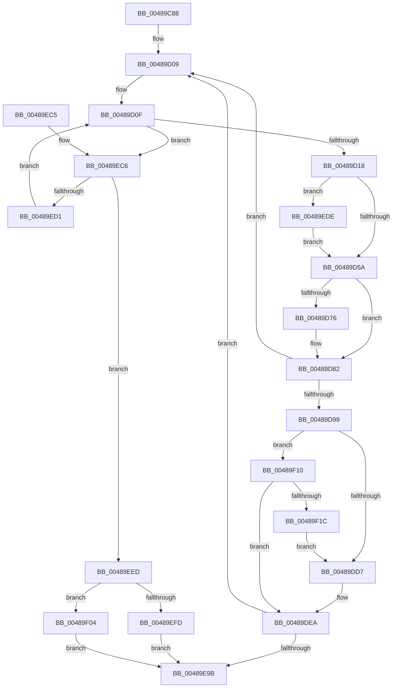

# PpmCapturePerformanceDistribution

- RVA: `0x00489C88`–`0x00489F29` (길이 `673` bytes)
- VA: `0x0000000140489C88`
- 실행 섹션: `.text`
- PDB 이름 있음: `예`; PDB Function 태그: `아니요`
- unwind 정보 RVA: `0x000B0088`
- 디코드: `170`개 명령, `673/673` bytes 표시
- 미해석 바이트: `0` (있으면 어셈블리에 `.byte`로 보존)

> 이 문서는 커널 이미지의 기계어와 PDB 기호를 분석해 생성했습니다. 4번과 5번은 함수 원형과 자료형을 바이너리 사용 방식에서 추정한 C 해석이며 원본 소스 복구 결과는 아닙니다.

## 1. Dependencies

- 직접 호출 지점: **9**; 고유 호출 대상: **8**
- 직접 호출자로 확인된 함수: **1**
- RIP 상대 이미지 참조: **5**

### Outgoing calls
- `0x00489CDC` → [memset](../6C/memset_function_006C6C40.md) (function, `0x006C6C40`)
- `0x00489D38` → [KeGetPrcb](../2D/KeGetPrcb_function_002D85D0.md) (function, `0x002D85D0`)
- `0x00489D65` → [PpmCapturePerformanceDistributionCallback](PpmCapturePerformanceDistributionCallback_function_00489F30.md) (function, `0x00489F30`)
- `0x00489D7D` → [KiLowerIrqlProcessIrqlFlags](../4F/KiLowerIrqlProcessIrqlFlags_function_004F5698.md) (function, `0x004F5698`)
- `0x00489DAD` → [memset](../6C/memset_function_006C6C40.md) (function, `0x006C6C40`)
- `0x00489E74` → [PopQueueTargetDpc](../2D/PopQueueTargetDpc_function_002DD8F0.md) (function, `0x002DD8F0`)
- `0x00489E8B` → [KeWaitForSingleObject](../20/KeWaitForSingleObject_function_0020E6B0.md) (function, `0x0020E6B0`)
- `0x00489EA5` → [_security_check_cookie](../6A/_security_check_cookie_function_006AC640.md) (function, `0x006AC640`)
- `0x00489EE3` → [KiRaiseIrqlProcessIrqlFlags](../4F/KiRaiseIrqlProcessIrqlFlags_function_004F56FC.md) (function, `0x004F56FC`)

### Direct callers
- [ExpQuerySystemInformation](../../page/A5/ExpQuerySystemInformation_function_00A57858.md) at `0x00A594AE`
- [ExpQuerySystemInformation](../../page/A5/ExpQuerySystemInformation_function_00A57858.md) at `0x00A59527`

### Static image references
- `0x00489CA7` → RVA `0x00E0A740` (`.data`; read)
- `0x00489D2E` → RVA `0x00F231B8` (`.data`; read)
- `0x00489D4D` → RVA `0x00FC6D20` (`ALMOSTRO`; read)
- `0x00489DB6` → RVA `0x00F231B0` (`.data`; read)
- `0x00489E2E` → RVA `0x00489F30` (`PpmCapturePerformanceDistributionCallback`; read)

## 2. Other-region calls and transfers

- 다른 실행 섹션으로 향하는 call: **0**
- 별도 외부 분기/꼬리 이동을 확인하지 못했습니다.

## 3. Assembly (complete function range)

```asm
00489C88  48 89 5C 24 20                  mov qword ptr [rsp + 0x20], rbx
00489C8D  55                              push rbp
00489C8E  56                              push rsi
00489C8F  57                              push rdi
00489C90  41 54                           push r12
00489C92  41 55                           push r13
00489C94  41 56                           push r14
00489C96  41 57                           push r15
00489C98  48 8D AC 24 E0 FE FF FF         lea rbp, [rsp - 0x120]
00489CA0  48 81 EC 20 02 00 00            sub rsp, 0x220
00489CA7  48 8B 05 92 0A 98 00            mov rax, qword ptr [rip + 0x980a92]
00489CAE  48 33 C4                        xor rax, rsp
00489CB1  48 89 85 10 01 00 00            mov qword ptr [rbp + 0x110], rax
00489CB8  48 8B B5 80 01 00 00            mov rsi, qword ptr [rbp + 0x180]
00489CBF  45 8B E0                        mov r12d, r8d
00489CC2  44 8B EA                        mov r13d, edx
00489CC5  48 89 74 24 68                  mov qword ptr [rsp + 0x68], rsi
00489CCA  48 8B D9                        mov rbx, rcx
00489CCD  33 D2                           xor edx, edx
00489CCF  41 B8 08 01 00 00               mov r8d, 0x108
00489CD5  48 8D 4D 00                     lea rcx, [rbp]
00489CD9  49 8B F9                        mov rdi, r9
00489CDC  E8 5F CF 23 00                  call 0x1406c6c40
00489CE1  33 F6                           xor esi, esi
00489CE3  48 89 5C 24 48                  mov qword ptr [rsp + 0x48], rbx
00489CE8  0F B7 5F 08                     movzx ebx, word ptr [rdi + 8]
00489CEC  42 8D 04 A5 04 00 00 00         lea eax, [r12*4 + 4]
00489CF4  48 8B 3F                        mov rdi, qword ptr [rdi]
00489CF7  48 89 74 24 58                  mov qword ptr [rsp + 0x58], rsi
00489CFC  44 8D 76 01                     lea r14d, [rsi + 1]
00489D00  44 89 6C 24 50                  mov dword ptr [rsp + 0x50], r13d
00489D05  89 44 24 54                     mov dword ptr [rsp + 0x54], eax
00489D09  0F B7 CB                        movzx ecx, bx
00489D0C  41 03 CE                        add ecx, r14d
00489D0F  48 85 FF                        test rdi, rdi
00489D12  0F 84 AE 01 00 00               je 0x140489ec6
00489D18  48 0F BC D7                     bsf rdx, rdi
00489D1C  0F B7 CB                        movzx ecx, bx
00489D1F  0F B6 C2                        movzx eax, dl
00489D22  48 0F B3 C7                     btr rdi, rax
00489D26  C1 E1 06                        shl ecx, 6
00489D29  0F B6 C2                        movzx eax, dl
00489D2C  03 C8                           add ecx, eax
00489D2E  48 8B 05 83 94 A9 00            mov rax, qword ptr [rip + 0xa99483]
00489D35  8B 0C 88                        mov ecx, dword ptr [rax + rcx*4]
00489D38  E8 93 E8 E4 FF                  call 0x1402d85d0
00489D3D  4C 8B F8                        mov r15, rax
00489D40  44 0F 20 C6                     mov rsi, cr8
00489D44  B8 02 00 00 00                  mov eax, 2
00489D49  44 0F 22 C0                     mov cr8, rax
00489D4D  83 3D CC CF B3 00 00            cmp dword ptr [rip + 0xb3cfcc], 0
00489D54  0F 85 84 01 00 00               jne 0x140489ede
00489D5A  45 33 C0                        xor r8d, r8d
00489D5D  48 8D 54 24 48                  lea rdx, [rsp + 0x48]
00489D62  49 8B CF                        mov rcx, r15
00489D65  E8 C6 01 00 00                  call 0x140489f30
00489D6A  83 3D AF CF B3 00 00            cmp dword ptr [rip + 0xb3cfaf], 0
00489D71  44 8B F0                        mov r14d, eax
00489D74  74 0C                           je 0x140489d82
00489D76  44 0F 20 C1                     mov rcx, cr8
00489D7A  40 8A D6                        mov dl, sil
00489D7D  E8 16 B9 06 00                  call 0x1404f5698
00489D82  40 0F B6 CE                     movzx ecx, sil
00489D86  44 0F 22 C1                     mov cr8, rcx
00489D8A  33 F6                           xor esi, esi
00489D8C  45 85 F6                        test r14d, r14d
00489D8F  44 8D 76 01                     lea r14d, [rsi + 1]
00489D93  0F 89 70 FF FF FF               jns 0x140489d09
00489D99  33 D2                           xor edx, edx
00489D9B  48 C7 45 00 01 00 20 00         mov qword ptr [rbp], 0x200001
00489DA3  41 B8 00 01 00 00               mov r8d, 0x100
00489DA9  48 8D 4D 08                     lea rcx, [rbp + 8]
00489DAD  E8 8E CE 23 00                  call 0x1406c6c40
00489DB2  41 8B 4F 24                     mov ecx, dword ptr [r15 + 0x24]
00489DB6  48 8B 05 F3 93 A9 00            mov rax, qword ptr [rip + 0xa993f3]
00489DBD  44 8B 04 88                     mov r8d, dword ptr [rax + rcx*4]
00489DC1  41 8B C8                        mov ecx, r8d
00489DC4  0F B7 45 00                     movzx eax, word ptr [rbp]
00489DC8  41 83 E0 3F                     and r8d, 0x3f
00489DCC  C1 E9 06                        shr ecx, 6
00489DCF  3B C1                           cmp eax, ecx
00489DD1  0F 86 39 01 00 00               jbe 0x140489f10
00489DD7  8B D1                           mov edx, ecx
00489DD9  48 8B 4C CD 08                  mov rcx, qword ptr [rbp + rcx*8 + 8]
00489DDE  41 8B C0                        mov eax, r8d
00489DE1  48 0F AB C1                     bts rcx, rax
00489DE5  48 89 4C D5 08                  mov qword ptr [rbp + rdx*8 + 8], rcx
00489DEA  33 C0                           xor eax, eax
00489DEC  89 75 B4                        mov dword ptr [rbp - 0x4c], esi
00489DEF  48 89 45 F0                     mov qword ptr [rbp - 0x10], rax
00489DF3  48 8D 55 88                     lea rdx, [rbp - 0x78]
00489DF7  89 45 F8                        mov dword ptr [rbp - 8], eax
00489DFA  48 8D 4D C0                     lea rcx, [rbp - 0x40]
00489DFE  0F 57 C0                        xorps xmm0, xmm0
00489E01  89 75 82                        mov dword ptr [rbp - 0x7e], esi
00489E04  48 8D 44 24 38                  lea rax, [rsp + 0x38]
00489E09  66 89 75 86                     mov word ptr [rbp - 0x7a], si
00489E0D  48 89 44 24 40                  mov qword ptr [rsp + 0x40], rax
00489E12  48 8D 44 24 38                  lea rax, [rsp + 0x38]
00489E17  48 89 44 24 38                  mov qword ptr [rsp + 0x38], rax
00489E1C  48 8B 45 08                     mov rax, qword ptr [rbp + 8]
00489E20  48 89 44 24 78                  mov qword ptr [rsp + 0x78], rax
00489E25  48 8D 45 00                     lea rax, [rbp]
00489E29  48 89 44 24 70                  mov qword ptr [rsp + 0x70], rax
00489E2E  48 8D 05 FB 00 00 00            lea rax, [rip + 0xfb]
00489E35  48 89 45 88                     mov qword ptr [rbp - 0x78], rax
00489E39  48 8D 44 24 48                  lea rax, [rsp + 0x48]
00489E3E  48 89 45 90                     mov qword ptr [rbp - 0x70], rax
00489E42  48 8D 44 24 70                  lea rax, [rsp + 0x70]
00489E47  48 89 45 A8                     mov qword ptr [rbp - 0x58], rax
00489E4B  48 8D 44 24 30                  lea rax, [rsp + 0x30]
00489E50  48 89 45 A0                     mov qword ptr [rbp - 0x60], rax
00489E54  0F 11 45 C0                     movups xmmword ptr [rbp - 0x40], xmm0
00489E58  48 C7 44 24 30 01 00 06 00      mov qword ptr [rsp + 0x30], 0x60001
00489E61  0F 11 45 D0                     movups xmmword ptr [rbp - 0x30], xmm0
00489E65  66 89 75 80                     mov word ptr [rbp - 0x80], si
00489E69  0F 11 45 E0                     movups xmmword ptr [rbp - 0x20], xmm0
00489E6D  48 89 75 98                     mov qword ptr [rbp - 0x68], rsi
00489E71  89 75 B0                        mov dword ptr [rbp - 0x50], esi
00489E74  E8 77 3A E5 FF                  call 0x1402dd8f0
00489E79  45 33 C9                        xor r9d, r9d
00489E7C  48 89 74 24 20                  mov qword ptr [rsp + 0x20], rsi
00489E81  45 33 C0                        xor r8d, r8d
00489E84  48 8D 4C 24 30                  lea rcx, [rsp + 0x30]
00489E89  33 D2                           xor edx, edx
00489E8B  E8 20 48 D8 FF                  call 0x14020e6b0
00489E90  8B 45 B0                        mov eax, dword ptr [rbp - 0x50]
00489E93  85 C0                           test eax, eax
00489E95  0F 89 6E FE FF FF               jns 0x140489d09
00489E9B  48 8B 8D 10 01 00 00            mov rcx, qword ptr [rbp + 0x110]
00489EA2  48 33 CC                        xor rcx, rsp
00489EA5  E8 96 27 22 00                  call 0x1406ac640
00489EAA  48 8B 9C 24 78 02 00 00         mov rbx, qword ptr [rsp + 0x278]
00489EB2  48 81 C4 20 02 00 00            add rsp, 0x220
00489EB9  41 5F                           pop r15
00489EBB  41 5E                           pop r14
00489EBD  41 5D                           pop r13
00489EBF  41 5C                           pop r12
00489EC1  5F                              pop rdi
00489EC2  5E                              pop rsi
00489EC3  5D                              pop rbp
00489EC4  C3                              ret
00489EC5  CC                              int3
00489EC6  66 41 03 DE                     add bx, r14w
00489ECA  0F B7 DB                        movzx ebx, bx
00489ECD  3B D9                           cmp ebx, ecx
00489ECF  73 1C                           jae 0x140489eed
00489ED1  48 8B 3C DD 08 00 00 00         mov rdi, qword ptr [rbx*8 + 8]
00489ED9  E9 31 FE FF FF                  jmp 0x140489d0f
00489EDE  8A D0                           mov dl, al
00489EE0  40 8A CE                        mov cl, sil
00489EE3  E8 14 B8 06 00                  call 0x1404f56fc
00489EE8  E9 6D FE FF FF                  jmp 0x140489d5a
00489EED  8B 44 24 54                     mov eax, dword ptr [rsp + 0x54]
00489EF1  48 8B 4C 24 68                  mov rcx, qword ptr [rsp + 0x68]
00489EF6  89 01                           mov dword ptr [rcx], eax
00489EF8  41 3B C5                        cmp eax, r13d
00489EFB  76 07                           jbe 0x140489f04
00489EFD  B8 04 00 00 C0                  mov eax, 0xc0000004
00489F02  EB 97                           jmp 0x140489e9b
00489F04  48 8B 44 24 48                  mov rax, qword ptr [rsp + 0x48]
00489F09  44 89 20                        mov dword ptr [rax], r12d
00489F0C  8B C6                           mov eax, esi
00489F0E  EB 8B                           jmp 0x140489e9b
00489F10  0F B7 45 02                     movzx eax, word ptr [rbp + 2]
00489F14  3B C1                           cmp eax, ecx
00489F16  0F 86 CE FE FF FF               jbe 0x140489dea
00489F1C  41 8D 04 0E                     lea eax, [r14 + rcx]
00489F20  66 89 45 00                     mov word ptr [rbp], ax
00489F24  E9 AE FE FF FF                  jmp 0x140489dd7
```

## 4. C-style interpretation (structured pseudocode)

```c
__int64 __fastcall PpmCapturePerformanceDistribution(__int64 a1, int a2, int a3, __int64 a4, __int64 a5)
{
    __int64 result;
    __int64 v_rbx;
    __int64 v_rsi;
    __int64 v_rsp;
    unsigned __int64 v_stack_m150;
    unsigned __int16 v_stack_m156;
    unsigned __int64 v_stack_m158;
    unsigned int v_stack_m160;
    unsigned __int64 v_stack_m168;
    unsigned __int64 v_stack_m178;
    unsigned __int64 v_stack_m188;
    unsigned __int64 v_stack_m198;
    unsigned int v_stack_m1A4;
    unsigned int v_stack_m1A8;
    unsigned __int64 v_stack_m1B0;
    unsigned __int64 v_stack_m1B8;
    unsigned __int64 v_stack_m1C0;
    unsigned __int64 v_stack_m1C8;
    unsigned __int64 v_stack_m1D0;
    unsigned __int16 v_stack_m1D2;
    unsigned int v_stack_m1D6;
    unsigned __int16 v_stack_m1D8;
    unsigned __int64 v_stack_m1E0;
    unsigned __int64 v_stack_m1E8;
    unsigned __int64 v_stack_m1F0;
    unsigned __int64 v_stack_m200;
    unsigned int v_stack_m204;
    unsigned int v_stack_m208;
    unsigned __int64 v_stack_m210;
    unsigned __int64 v_stack_m218;
    unsigned __int64 v_stack_m220;
    unsigned __int64 v_stack_m228;
    unsigned __int64 v_stack_m238;
    unsigned __int64 v_stack_m48;
    unsigned __int64 v_stack_p20;
    unsigned __int64 v_stack_p48;
    unsigned int v_stack_p54;
    unsigned __int64 v_stack_p68;

    v_stack_p20 = v_rbx;
    v_rsp = (v_rsp) - (544);
    result = (*(unsigned __int64 *)(v_rip + 9964178)) ^ (v_rsp);
    v_stack_m48 = result;
    v_stack_m1F0 = a5;
    a2 = 0;
    result = memset(v_stack_m158, a2, 264, a4);
    v_rsi = 0;
    v_stack_m210 = a1;
    v_stack_m200 = 0;
    v_stack_m208 = (unsigned int)((unsigned int)(a2));
    v_stack_m204 = (unsigned int)((unsigned int)(a3) * 4 + 4);
loc_00489D09:
    a1 = (unsigned int)(((unsigned __int16)(*(unsigned __int16 *)(a4 + 8))) + ((unsigned int)(v_rsi + 1)));
loc_00489D0F:
    if (*(unsigned __int64 *)(a4) == 0) goto loc_00489EC6;
    a1 = (unsigned int)(((unsigned __int16)(*(unsigned __int16 *)(a4 + 8))) << (6));
    a1 = (unsigned int)((a1) + (0));
    result = KeGetPrcb((unsigned int)(*(unsigned int *)(*(unsigned __int64 *)(v_rip + 11113603) + a1 * 4)), a2, 264, a4);
    if ((*(unsigned int *)(v_rip + 11784140)) != 0) goto loc_00489EDE;
loc_00489D5A:
    a3 = 0;
    result = PpmCapturePerformanceDistributionCallback(result, v_stack_m210, a3, a4);
    if ((*(unsigned int *)(v_rip + 11784111)) != 0) {
        a1 = 2;
        a2 = (unsigned __int8)(v_cr8);
        result = KiLowerIrqlProcessIrqlFlags(a1, a2, a3, a4);
    }
    v_rsi = 0;
    if (!sign_flag) goto loc_00489D09;
    a2 = 0;
    v_stack_m158 = 0x200001ULL;
    result = memset(v_stack_m150, a2, 256, a4);
    a3 = (unsigned int)(((unsigned int)(*(unsigned int *)(*(unsigned __int64 *)(v_rip + 11113459) + (unsigned int)(*(unsigned int *)(result + 36)) * 4))) & (63));
    a1 = (unsigned int)(((unsigned int)((unsigned int)((unsigned int)(*(unsigned int *)(*(unsigned __int64 *)(v_rip + 11113459) + (unsigned int)(*(unsigned int *)(result + 36)) * 4))))) >> (6));
    if (((unsigned int)(v_stack_m158)) <= ((unsigned int)(a1))) goto loc_00489F10;
loc_00489DD7:
    *(unsigned __int64 *)(v_stack_m158 + (unsigned int)((unsigned int)(a1)) * 8 + 8) = *(unsigned __int64 *)(v_stack_m158 + a1 * 8 + 8);
loc_00489DEA:
    result = 0;
    v_stack_m1A4 = 0;
    v_stack_m168 = 0;
    v_stack_m160 = 0;
    v_stack_m1D6 = 0;
    v_stack_m1D2 = 0;
    v_stack_m218 = v_stack_m220;
    v_stack_m220 = v_stack_m220;
    v_stack_m1E0 = v_stack_m150;
    v_stack_m1E8 = v_stack_m158;
    v_stack_m1D0 = v_rip + 251;
    v_stack_m1C8 = v_stack_m210;
    v_stack_m1B0 = v_stack_m1E8;
    v_stack_m1B8 = v_stack_m228;
    v_stack_m198 = v_xmm0;
    v_stack_m228 = 0x60001ULL;
    v_stack_m188 = v_xmm0;
    v_stack_m1D8 = 0;
    v_stack_m178 = v_xmm0;
    v_stack_m1C0 = 0;
    v_stack_m1A8 = 0;
    result = PopQueueTargetDpc(v_stack_m198, v_stack_m1D0, a3, a4);
    a4 = 0;
    v_stack_m238 = 0;
    a3 = 0;
    a2 = 0;
    result = KeWaitForSingleObject(v_stack_m228, a2, a3, a4);
    if (!sign_flag) goto loc_00489D09;
loc_00489E9B:
    a1 = (v_stack_m48) ^ (v_rsp);
    result = _security_check_cookie(a1, a2, a3, a4);
    v_rsp = (v_rsp) + (544);
    return result;
loc_00489EC6:
    v_rbx = (unsigned __int16)((v_stack_p20) + ((unsigned __int16)(v_rsi + 1)));
    if (((unsigned int)((unsigned __int16)(v_rbx))) >= ((unsigned int)(a1))) goto loc_00489EED;
    goto loc_00489D0F;
loc_00489EDE:
    result = KiRaiseIrqlProcessIrqlFlags(0, (unsigned __int8)(result), a3, a4);
    goto loc_00489D5A;
loc_00489EED:
    *(unsigned int *)(v_stack_p68) = (unsigned int)((unsigned int)(v_stack_p54));
    if (((unsigned int)((unsigned int)(v_stack_p54))) <= ((unsigned int)((unsigned int)(a2)))) goto loc_00489F04;
    goto loc_00489E9B;
loc_00489F04:
    *(unsigned int *)(v_stack_p48) = (unsigned int)((unsigned int)(a3));
    goto loc_00489E9B;
loc_00489F10:
    if (((unsigned int)(v_stack_m156)) <= ((unsigned int)(v_stack_p68))) goto loc_00489DEA;
    v_stack_m158 = (unsigned __int16)(v_rsi + 1 + v_stack_p68 * 1);
    goto loc_00489DD7;
}
```

## 5. (Beta) C Style

```c
int64_t PpmCapturePerformanceDistribution(int64_t Arg1, int32_t Arg2, int32_t Arg3, void *Arg4, int64_t Arg5)
{
    uint8_t *arg4 = (uint8_t *)Arg4;

    int64_t result;
    int64_t local_rbx;
    int64_t local_rsi;
    int64_t local_rsp;
    uint64_t v_stack_m150;
    uint16_t v_stack_m156;
    uint64_t v_stack_m158;
    uint32_t v_stack_m160;
    uint64_t v_stack_m168;
    uint64_t v_stack_m178;
    uint64_t v_stack_m188;
    uint64_t v_stack_m198;
    uint32_t v_stack_m1A4;
    uint32_t v_stack_m1A8;
    uint64_t v_stack_m1B0;
    uint64_t v_stack_m1B8;
    uint64_t v_stack_m1C0;
    uint64_t v_stack_m1C8;
    uint64_t v_stack_m1D0;
    uint16_t v_stack_m1D2;
    uint32_t v_stack_m1D6;
    uint16_t v_stack_m1D8;
    uint64_t v_stack_m1E0;
    uint64_t v_stack_m1E8;
    uint64_t v_stack_m1F0;
    uint64_t v_stack_m200;
    uint32_t v_stack_m204;
    uint32_t v_stack_m208;
    uint64_t v_stack_m210;
    uint64_t v_stack_m218;
    uint64_t v_stack_m220;
    uint64_t v_stack_m228;
    uint64_t v_stack_m238;
    uint64_t v_stack_m48;
    uint64_t v_stack_p20;
    uint64_t v_stack_p48;
    uint32_t v_stack_p54;
    uint64_t v_stack_p68;

    v_stack_p20 = local_rbx;
    local_rsp = (local_rsp) - (544);
    result = (*(uint64_t *)(v_rip + 0x980A92)) ^ (local_rsp);
    v_stack_m48 = result;
    v_stack_m1F0 = Arg5;
    Arg2 = 0;
    result = memset(v_stack_m158, Arg2, 264, Arg4);
    local_rsi = 0;
    v_stack_m210 = Arg1;
    v_stack_m200 = 0;
    v_stack_m208 = (uint32_t)((uint32_t)(Arg2));
    v_stack_m204 = (uint32_t)((uint32_t)(Arg3) * 4 + 4);
loc_00489D09:
    Arg1 = (uint32_t)(((uint16_t)(*(uint16_t *)(arg4 + 0x8))) + ((uint32_t)(local_rsi + 1)));
loc_00489D0F:
    if (*(uint64_t *)(arg4) == 0) goto loc_00489EC6;
    Arg1 = (uint32_t)(((uint16_t)(*(uint16_t *)(arg4 + 0x8))) << (6));
    Arg1 = (uint32_t)((Arg1) + (0));
    result = KeGetPrcb((uint32_t)(*(uint32_t *)(*(uint64_t *)(v_rip + 0xA99483) + Arg1 * 4)), Arg2, 264, Arg4);
    if ((*(uint32_t *)(v_rip + 0xB3CFCC)) != 0) goto loc_00489EDE;
loc_00489D5A:
    Arg3 = 0;
    result = PpmCapturePerformanceDistributionCallback(result, v_stack_m210, Arg3, Arg4);
    if ((*(uint32_t *)(v_rip + 0xB3CFAF)) != 0) {
        Arg1 = 2;
        Arg2 = (uint8_t)(v_cr8);
        result = KiLowerIrqlProcessIrqlFlags(Arg1, Arg2, Arg3, Arg4);
    }
    local_rsi = 0;
    if (!sign_flag) goto loc_00489D09;
    Arg2 = 0;
    v_stack_m158 = 0x200001ULL;
    result = memset(v_stack_m150, Arg2, 256, Arg4);
    Arg3 = (uint32_t)(((uint32_t)(*(uint32_t *)(*(uint64_t *)(v_rip + 0xA993F3) + (uint32_t)(*(uint32_t *)(result + 0x24)) * 4))) & (63));
    Arg1 = (uint32_t)(((uint32_t)((uint32_t)((uint32_t)(*(uint32_t *)(*(uint64_t *)(v_rip + 0xA993F3) + (uint32_t)(*(uint32_t *)(result + 0x24)) * 4))))) >> (6));
    if (((uint32_t)(v_stack_m158)) <= ((uint32_t)(Arg1))) goto loc_00489F10;
loc_00489DD7:
    *(uint64_t *)(v_stack_m158 + (uint32_t)((uint32_t)(Arg1)) * 8 + 0x8) = *(uint64_t *)(v_stack_m158 + Arg1 * 8 + 0x8);
loc_00489DEA:
    result = 0;
    v_stack_m1A4 = 0;
    v_stack_m168 = 0;
    v_stack_m160 = 0;
    v_stack_m1D6 = 0;
    v_stack_m1D2 = 0;
    v_stack_m218 = v_stack_m220;
    v_stack_m220 = v_stack_m220;
    v_stack_m1E0 = v_stack_m150;
    v_stack_m1E8 = v_stack_m158;
    v_stack_m1D0 = v_rip + 251;
    v_stack_m1C8 = v_stack_m210;
    v_stack_m1B0 = v_stack_m1E8;
    v_stack_m1B8 = v_stack_m228;
    v_stack_m198 = v_xmm0;
    v_stack_m228 = 0x60001ULL;
    v_stack_m188 = v_xmm0;
    v_stack_m1D8 = 0;
    v_stack_m178 = v_xmm0;
    v_stack_m1C0 = 0;
    v_stack_m1A8 = 0;
    result = PopQueueTargetDpc(v_stack_m198, v_stack_m1D0, Arg3, Arg4);
    Arg4 = 0;
    v_stack_m238 = 0;
    Arg3 = 0;
    Arg2 = 0;
    result = KeWaitForSingleObject(v_stack_m228, Arg2, Arg3, Arg4);
    if (!sign_flag) goto loc_00489D09;
loc_00489E9B:
    Arg1 = (v_stack_m48) ^ (local_rsp);
    result = _security_check_cookie(Arg1, Arg2, Arg3, Arg4);
    local_rsp = (local_rsp) + (544);
    return result;
loc_00489EC6:
    local_rbx = (uint16_t)((v_stack_p20) + ((uint16_t)(local_rsi + 1)));
    if (((uint32_t)((uint16_t)(local_rbx))) >= ((uint32_t)(Arg1))) goto loc_00489EED;
    goto loc_00489D0F;
loc_00489EDE:
    result = KiRaiseIrqlProcessIrqlFlags(0, (uint8_t)(result), Arg3, Arg4);
    goto loc_00489D5A;
loc_00489EED:
    *(uint32_t *)(v_stack_p68) = (uint32_t)((uint32_t)(v_stack_p54));
    if (((uint32_t)((uint32_t)(v_stack_p54))) <= ((uint32_t)((uint32_t)(Arg2)))) goto loc_00489F04;
    goto loc_00489E9B;
loc_00489F04:
    *(uint32_t *)(v_stack_p48) = (uint32_t)((uint32_t)(Arg3));
    goto loc_00489E9B;
loc_00489F10:
    if (((uint32_t)(v_stack_m156)) <= ((uint32_t)(v_stack_p68))) goto loc_00489DEA;
    v_stack_m158 = (uint16_t)(local_rsi + 1 + v_stack_p68 * 1);
    goto loc_00489DD7;
}
```

### 관측된 메모리 오프셋

구조체 형식이 확인되지 않은 접근은 인자 기준의 오프셋으로만 기록했습니다.

| 기준 인자 | 오프셋 표현 | 폭 (bit) | 접근 |
|---|---:|---:|---|
| `Arg4` | `+ 0x0` | `64` | `R` |
| `Arg4` | `+ 0x8` | `16` | `R` |

## 6. Execution-region graph

[열기: 2D/3D 그래프와 함수 탐색 컨트롤 패널](../../../control-panel.html?section=text&rva=0x00489C88&view=graph)

- 2D 그래프는 위에서 아래로 흐르고, 3D 그래프는 빈 공간을 드래그해 회전합니다. Shift+드래그는 이동, 휠은 확대·축소, 함수 노드 선택은 대상 보고서 이동입니다.

### Static fallback


