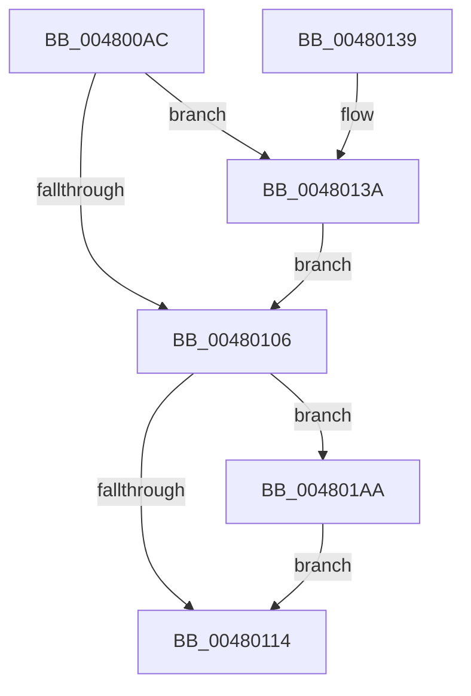

# PpmEventLegacyProcessorPerfStateChange

- RVA: `0x004800AC`–`0x004801DD` (길이 `305` bytes)
- VA: `0x00000001404800AC`
- 실행 섹션: `.text`
- PDB 이름 있음: `예`; PDB Function 태그: `아니요`
- unwind 정보 RVA: `0x000AE430`
- 디코드: `71`개 명령, `305/305` bytes 표시
- 미해석 바이트: `0` (있으면 어셈블리에 `.byte`로 보존)

> 이 문서는 커널 이미지의 기계어와 PDB 기호를 분석해 생성했습니다. 4번과 5번은 함수 원형과 자료형을 바이너리 사용 방식에서 추정한 C 해석이며 원본 소스 복구 결과는 아닙니다.

## 1. Dependencies

- 직접 호출 지점: **3**; 고유 호출 대상: **3**
- 직접 호출자로 확인된 함수: **1**
- RIP 상대 이미지 참조: **4**

### Outgoing calls
- `0x0048011B` → [_security_check_cookie](../6A/_security_check_cookie_function_006AC640.md) (function, `0x006AC640`)
- `0x004801A0` → [EtwTraceKernelEvent](../23/EtwTraceKernelEvent_function_00235350.md) (function, `0x00235350`)
- `0x004801D3` → [PpmFireWmiEvent](../5D/PpmFireWmiEvent_function_005D9678.md) (function, `0x005D9678`)

### Direct callers
- [PpmPerfApplyProcessorState](../2D/PpmPerfApplyProcessorState_function_002DA4BC.md) at `0x002DA5C4`

### Static image references
- `0x004800C6` → RVA `0x00E0A740` (`.data`; read)
- `0x004800DD` → RVA `0x00FC6B10` (`ALMOSTRO`; read)
- `0x00480106` → RVA `0x00E678D0` (`.data`; read)
- `0x004801C6` → RVA `0x00024C78` (`.rdata`; read)

## 2. Other-region calls and transfers

- 다른 실행 섹션으로 향하는 call: **0**
- 별도 외부 분기/꼬리 이동을 확인하지 못했습니다.

## 3. Assembly (complete function range)

```asm
004800AC  48 89 5C 24 10                  mov qword ptr [rsp + 0x10], rbx
004800B1  48 89 74 24 18                  mov qword ptr [rsp + 0x18], rsi
004800B6  48 89 7C 24 20                  mov qword ptr [rsp + 0x20], rdi
004800BB  55                              push rbp
004800BC  48 8B EC                        mov rbp, rsp
004800BF  48 81 EC 80 00 00 00            sub rsp, 0x80
004800C6  48 8B 05 73 A6 98 00            mov rax, qword ptr [rip + 0x98a673]
004800CD  48 33 C4                        xor rax, rsp
004800D0  48 89 45 F0                     mov qword ptr [rbp - 0x10], rax
004800D4  4C 8B 81 B8 89 00 00            mov r8, qword ptr [rcx + 0x89b8]
004800DB  33 C0                           xor eax, eax
004800DD  F7 05 29 6A B4 00 00 80 00 00   test dword ptr [rip + 0xb46a29], 0x8000
004800E7  0F 57 C0                        xorps xmm0, xmm0
004800EA  48 8B 91 B0 89 00 00            mov rdx, qword ptr [rcx + 0x89b0]
004800F1  48 8B D9                        mov rbx, rcx
004800F4  0F 11 45 C8                     movups xmmword ptr [rbp - 0x38], xmm0
004800F8  48 89 45 D8                     mov qword ptr [rbp - 0x28], rax
004800FC  41 8B 70 40                     mov esi, dword ptr [r8 + 0x40]
00480100  41 8B 78 54                     mov edi, dword ptr [r8 + 0x54]
00480104  75 34                           jne 0x14048013a
00480106  8B 05 C4 77 9E 00               mov eax, dword ptr [rip + 0x9e77c4]
0048010C  85 C0                           test eax, eax
0048010E  0F 85 96 00 00 00               jne 0x1404801aa
00480114  48 8B 4D F0                     mov rcx, qword ptr [rbp - 0x10]
00480118  48 33 CC                        xor rcx, rsp
0048011B  E8 20 C5 22 00                  call 0x1406ac640
00480120  4C 8D 9C 24 80 00 00 00         lea r11, [rsp + 0x80]
00480128  49 8B 5B 18                     mov rbx, qword ptr [r11 + 0x18]
0048012C  49 8B 73 20                     mov rsi, qword ptr [r11 + 0x20]
00480130  49 8B 7B 28                     mov rdi, qword ptr [r11 + 0x28]
00480134  49 8B E3                        mov rsp, r11
00480137  5D                              pop rbp
00480138  C3                              ret
00480139  CC                              int3
0048013A  21 45 D4                        and dword ptr [rbp - 0x2c], eax
0048013D  41 B9 33 12 00 00               mov r9d, 0x1233
00480143  8B 82 10 02 00 00               mov eax, dword ptr [rdx + 0x210]
00480149  41 8B 48 50                     mov ecx, dword ptr [r8 + 0x50]
0048014D  3B C8                           cmp ecx, eax
0048014F  C7 45 E8 18 00 00 00            mov dword ptr [rbp - 0x18], 0x18
00480156  0F 43 C8                        cmovae ecx, eax
00480159  C7 44 24 20 02 18 50 00         mov dword ptr [rsp + 0x20], 0x501802
00480161  3B 8A C8 01 00 00               cmp ecx, dword ptr [rdx + 0x1c8]
00480167  BA 01 00 00 00                  mov edx, 1
0048016C  89 7D CC                        mov dword ptr [rbp - 0x34], edi
0048016F  48 8D 4D E0                     lea rcx, [rbp - 0x20]
00480173  1B C0                           sbb eax, eax
00480175  83 65 EC 00                     and dword ptr [rbp - 0x14], 0
00480179  F7 D8                           neg eax
0048017B  03 C2                           add eax, edx
0048017D  89 45 C8                        mov dword ptr [rbp - 0x38], eax
00480180  41 8B 40 7C                     mov eax, dword ptr [r8 + 0x7c]
00480184  41 B8 00 80 00 80               mov r8d, 0x80008000
0048018A  89 45 D0                        mov dword ptr [rbp - 0x30], eax
0048018D  48 8B 83 C8 00 00 00            mov rax, qword ptr [rbx + 0xc8]
00480194  48 89 45 D8                     mov qword ptr [rbp - 0x28], rax
00480198  48 8D 45 C8                     lea rax, [rbp - 0x38]
0048019C  48 89 45 E0                     mov qword ptr [rbp - 0x20], rax
004801A0  E8 AB 51 DB FF                  call 0x140235350
004801A5  E9 5C FF FF FF                  jmp 0x140480106
004801AA  8B 43 24                        mov eax, dword ptr [rbx + 0x24]
004801AD  48 8D 8B 28 89 00 00            lea rcx, [rbx + 0x8928]
004801B4  48 83 65 B4 00                  and qword ptr [rbp - 0x4c], 0
004801B9  4C 8D 4D B0                     lea r9, [rbp - 0x50]
004801BD  41 B8 14 00 00 00               mov r8d, 0x14
004801C3  89 45 C0                        mov dword ptr [rbp - 0x40], eax
004801C6  48 8D 15 AB 4A BA FF            lea rdx, [rip - 0x45b555]
004801CD  89 75 B0                        mov dword ptr [rbp - 0x50], esi
004801D0  89 7D BC                        mov dword ptr [rbp - 0x44], edi
004801D3  E8 A0 94 15 00                  call 0x1405d9678
004801D8  E9 37 FF FF FF                  jmp 0x140480114
```

## 4. C-style interpretation (structured pseudocode)

```c
__int64 __fastcall PpmEventLegacyProcessorPerfStateChange(__int64 a1)
{
    __int64 result;
    __int64 v_rsp;
    unsigned __int64 v_stack_m18;
    unsigned int v_stack_m1C;
    unsigned int v_stack_m20;
    unsigned __int64 v_stack_m28;
    unsigned __int64 v_stack_m30;
    unsigned int v_stack_m34;
    unsigned int v_stack_m38;
    unsigned int v_stack_m3C;
    unsigned __int64 v_stack_m40;
    unsigned int v_stack_m48;
    unsigned int v_stack_m4C;
    unsigned __int64 v_stack_m54;
    unsigned __int64 v_stack_m58;
    unsigned int v_stack_m60;
    unsigned __int64 v_stack_m8;
    unsigned __int64 v_stack_p10;
    unsigned __int64 v_stack_p18;
    unsigned __int64 v_stack_p20;

    v_stack_p10 = v_rbx;
    v_stack_p18 = v_rsi;
    v_stack_p20 = v_rdi;
    v_rsp = (v_rsp) - (128);
    result = (*(unsigned __int64 *)(v_rip + 10004083)) ^ (v_rsp);
    v_stack_m18 = result;
    result = 0;
    v_stack_m40 = v_xmm0;
    v_stack_m30 = 0;
    if (((*(unsigned int *)(v_rip + 11823657)) & (0x8000ULL)) != 0) goto loc_0048013A;
loc_00480106:
    if ((unsigned int)((unsigned int)(*(unsigned int *)(v_rip + 10385348))) != 0) goto loc_004801AA;
loc_00480114:
    a1 = (v_stack_m18) ^ (v_rsp);
    result = _security_check_cookie(a1, *(unsigned __int64 *)(a1 + 35248), *(unsigned __int64 *)(a1 + 35256), a4);
    return result;
loc_0048013A:
    v_stack_m20 = 24;
    a1 = (unsigned int)(*(unsigned int *)(*(unsigned __int64 *)(a1 + 35256) + 80));
    if (((unsigned int)((unsigned int)(*(unsigned int *)(*(unsigned __int64 *)(a1 + 35256) + 80)))) >= ((unsigned int)((unsigned int)(*(unsigned int *)(*(unsigned __int64 *)(a1 + 35248) + 528))))) { a1 = (unsigned int)((unsigned int)(*(unsigned int *)(*(unsigned __int64 *)(a1 + 35248) + 528))); }
    v_stack_m60 = 0x501802ULL;
    v_stack_m3C = (unsigned int)(*(unsigned __int64 *)(v_stack_m8 + 40));
    result = (unsigned int)(-((unsigned int)(*(unsigned int *)(*(unsigned __int64 *)(a1 + 35248) + 528))));
    result = (unsigned int)((result) + (1));
    v_stack_m40 = (unsigned int)(result);
    v_stack_m38 = (unsigned int)((unsigned int)(*(unsigned int *)(*(unsigned __int64 *)(a1 + 35256) + 124)));
    v_stack_m30 = *(unsigned __int64 *)(*(unsigned __int64 *)(v_stack_m8 + 24) + 200);
    v_stack_m28 = v_stack_m40;
    result = EtwTraceKernelEvent(v_stack_m28, 1, (unsigned int)(0x80008000ULL), (unsigned int)(0x1233ULL));
    goto loc_00480106;
loc_004801AA:
    v_stack_m48 = (unsigned int)((unsigned int)(*(unsigned int *)(*(unsigned __int64 *)(v_stack_m8 + 24) + 36)));
    v_stack_m58 = (unsigned int)(*(unsigned __int64 *)(v_stack_m8 + 32));
    v_stack_m4C = (unsigned int)(*(unsigned __int64 *)(v_stack_m8 + 40));
    result = PpmFireWmiEvent(*(unsigned __int64 *)(v_stack_m8 + 24) + 35112, v_rip - 4568405, 20, v_stack_m58);
    goto loc_00480114;
}
```

## 5. (Beta) C Style

```c
int64_t PpmEventLegacyProcessorPerfStateChange(void *Arg1)
{
    uint8_t *arg1 = (uint8_t *)Arg1;

    int64_t result;
    int64_t local_rsp;
    uint64_t v_stack_m18;
    uint32_t v_stack_m1C;
    uint32_t v_stack_m20;
    uint64_t v_stack_m28;
    uint64_t v_stack_m30;
    uint32_t v_stack_m34;
    uint32_t v_stack_m38;
    uint32_t v_stack_m3C;
    uint64_t v_stack_m40;
    uint32_t v_stack_m48;
    uint32_t v_stack_m4C;
    uint64_t v_stack_m54;
    uint64_t v_stack_m58;
    uint32_t v_stack_m60;
    uint64_t v_stack_m8;
    uint64_t v_stack_p10;
    uint64_t v_stack_p18;
    uint64_t v_stack_p20;

    v_stack_p10 = local_rbx;
    v_stack_p18 = local_rsi;
    v_stack_p20 = local_rdi;
    local_rsp = (local_rsp) - (128);
    result = (*(uint64_t *)(v_rip + 0x98A673)) ^ (local_rsp);
    v_stack_m18 = result;
    result = 0;
    v_stack_m40 = v_xmm0;
    v_stack_m30 = 0;
    if (((*(uint32_t *)(v_rip + 0xB46A29)) & (0x8000ULL)) != 0) goto loc_0048013A;
loc_00480106:
    if ((uint32_t)((uint32_t)(*(uint32_t *)(v_rip + 0x9E77C4))) != 0) goto loc_004801AA;
loc_00480114:
    Arg1 = (v_stack_m18) ^ (local_rsp);
    result = _security_check_cookie(Arg1, *(uint64_t *)(arg1 + 0x89B0), *(uint64_t *)(arg1 + 0x89B8), a4);
    return result;
loc_0048013A:
    v_stack_m20 = 24;
    Arg1 = (uint32_t)(*(uint32_t *)(*(uint64_t *)(arg1 + 0x89B8) + 0x50));
    if (((uint32_t)((uint32_t)(*(uint32_t *)(*(uint64_t *)(arg1 + 0x89B8) + 0x50)))) >= ((uint32_t)((uint32_t)(*(uint32_t *)(*(uint64_t *)(arg1 + 0x89B0) + 0x210))))) { Arg1 = (uint32_t)((uint32_t)(*(uint32_t *)(*(uint64_t *)(arg1 + 0x89B0) + 0x210))); }
    v_stack_m60 = 0x501802ULL;
    v_stack_m3C = (uint32_t)(*(uint64_t *)(v_stack_m8 + 0x28));
    result = (uint32_t)(-((uint32_t)(*(uint32_t *)(*(uint64_t *)(arg1 + 0x89B0) + 0x210))));
    result = (uint32_t)((result) + (1));
    v_stack_m40 = (uint32_t)(result);
    v_stack_m38 = (uint32_t)((uint32_t)(*(uint32_t *)(*(uint64_t *)(arg1 + 0x89B8) + 0x7C)));
    v_stack_m30 = *(uint64_t *)(*(uint64_t *)(v_stack_m8 + 0x18) + 0xC8);
    v_stack_m28 = v_stack_m40;
    result = EtwTraceKernelEvent(v_stack_m28, 1, (uint32_t)(0x80008000ULL), (uint32_t)(0x1233ULL));
    goto loc_00480106;
loc_004801AA:
    v_stack_m48 = (uint32_t)((uint32_t)(*(uint32_t *)(*(uint64_t *)(v_stack_m8 + 0x18) + 0x24)));
    v_stack_m58 = (uint32_t)(*(uint64_t *)(v_stack_m8 + 0x20));
    v_stack_m4C = (uint32_t)(*(uint64_t *)(v_stack_m8 + 0x28));
    result = PpmFireWmiEvent(*(uint64_t *)(v_stack_m8 + 0x18) + 35112, v_rip - 4568405, 20, v_stack_m58);
    goto loc_00480114;
}
```

### 관측된 메모리 오프셋

구조체 형식이 확인되지 않은 접근은 인자 기준의 오프셋으로만 기록했습니다.

| 기준 인자 | 오프셋 표현 | 폭 (bit) | 접근 |
|---|---:|---:|---|
| `Arg1` | `+ 0x24` | `32` | `R` |
| `Arg1` | `+ 0xC8` | `64` | `R` |
| `Arg1` | `+ 0x8928` | `64` | `R` |
| `Arg1` | `+ 0x89B0` | `64` | `R` |
| `Arg1` | `+ 0x89B8` | `64` | `R` |

## 6. Execution-region graph

[열기: 2D/3D 그래프와 함수 탐색 컨트롤 패널](../../../control-panel.html?section=text&rva=0x004800AC&view=graph)

- 2D 그래프는 위에서 아래로 흐르고, 3D 그래프는 빈 공간을 드래그해 회전합니다. Shift+드래그는 이동, 휠은 확대·축소, 함수 노드 선택은 대상 보고서 이동입니다.

### Static fallback


