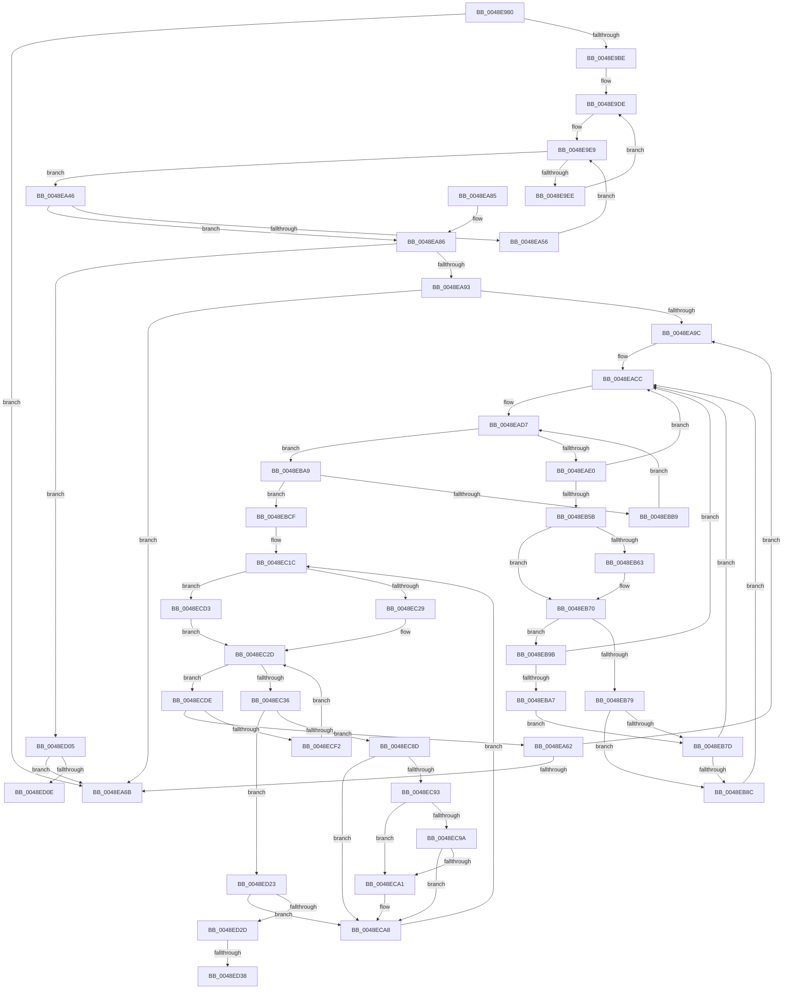

# PpmHeteroDetectHgsCores

- RVA: `0x0048E980`–`0x0048ED41` (길이 `961` bytes)
- VA: `0x000000014048E980`
- 실행 섹션: `.text`
- PDB 이름 있음: `예`; PDB Function 태그: `예`
- unwind 정보 RVA: `0x000B2924`
- 디코드: `249`개 명령, `961/961` bytes 표시
- 미해석 바이트: `0` (있으면 어셈블리에 `.byte`로 보존)

> 이 문서는 커널 이미지의 기계어와 PDB 기호를 분석해 생성했습니다. 4번과 5번은 함수 원형과 자료형을 바이너리 사용 방식에서 추정한 C 해석이며 원본 소스 복구 결과는 아닙니다.

## 1. Dependencies

- 직접 호출 지점: **3**; 고유 호출 대상: **1**
- 직접 호출자로 확인된 함수: **1**
- RIP 상대 이미지 참조: **7**

### Outgoing calls
- `0x0048EA12` → [KeGetPrcb](../2D/KeGetPrcb_function_002D85D0.md) (function, `0x002D85D0`)
- `0x0048EB05` → [KeGetPrcb](../2D/KeGetPrcb_function_002D85D0.md) (function, `0x002D85D0`)
- `0x0048EC60` → [KeGetPrcb](../2D/KeGetPrcb_function_002D85D0.md) (function, `0x002D85D0`)

### Direct callers
- [PopInitializeHeteroProcessors](../../page/A5/PopInitializeHeteroProcessors_function_00A53570.md) at `0x00A5365F`

### Static image references
- `0x0048E99C` → RVA `0x00FC6A94` (`ALMOSTRO`; read)
- `0x0048E9BE` → RVA `0x00E0B5A8` (`.data`; read)
- `0x0048E9C5` → RVA `0x00E0B5A0` (`.data`; read)
- `0x0048EA05` → RVA `0x00F231B8` (`.data`; read)
- `0x0048EA86` → RVA `0x00FC6AFC` (`ALMOSTRO`; read)
- `0x0048EB48` → RVA `0x00FC6AEF` (`ALMOSTRO`; read)
- `0x0048EB70` → RVA `0x00FC6D48` (`ALMOSTRO`; read)

## 2. Other-region calls and transfers

- 다른 실행 섹션으로 향하는 call: **0**
- call이 아닌 외부 분기/꼬리 이동: **3**
  - `0x0048ED1E` → [sub_006F6C54 + 0x62](../6F/Unknown_function_006F6C54.md) (`tail-transfer`)
  - `0x0048ED32` → [sub_006F6C54 + 0x78](../6F/Unknown_function_006F6C54.md) (`tail-transfer`)
  - `0x0048ED3C` → [sub_006F6C54 + 0x78](../6F/Unknown_function_006F6C54.md) (`tail-transfer`)

## 3. Assembly (complete function range)

```asm
0048E980  48 89 5C 24 08                  mov qword ptr [rsp + 8], rbx
0048E985  55                              push rbp
0048E986  56                              push rsi
0048E987  57                              push rdi
0048E988  41 54                           push r12
0048E98A  41 55                           push r13
0048E98C  41 56                           push r14
0048E98E  41 57                           push r15
0048E990  48 8B EC                        mov rbp, rsp
0048E993  48 83 EC 40                     sub rsp, 0x40
0048E997  45 33 DB                        xor r11d, r11d
0048E99A  33 C0                           xor eax, eax
0048E99C  44 38 1D F1 80 B3 00            cmp byte ptr [rip + 0xb380f1], r11b
0048E9A3  0F 57 C0                        xorps xmm0, xmm0
0048E9A6  48 8B F9                        mov rdi, rcx
0048E9A9  48 89 45 F8                     mov qword ptr [rbp - 8], rax
0048E9AD  0F 11 45 E8                     movups xmmword ptr [rbp - 0x18], xmm0
0048E9B1  44 89 5D 48                     mov dword ptr [rbp + 0x48], r11d
0048E9B5  41 8A DB                        mov bl, r11b
0048E9B8  0F 84 AD 00 00 00               je 0x14048ea6b
0048E9BE  48 8B 35 E3 CB 97 00            mov rsi, qword ptr [rip + 0x97cbe3]
0048E9C5  48 8D 15 D4 CB 97 00            lea rdx, [rip + 0x97cbd4]
0048E9CC  44 0F B7 75 F8                  movzx r14d, word ptr [rbp - 8]
0048E9D1  8D 58 01                        lea ebx, [rax + 1]
0048E9D4  48 89 55 E8                     mov qword ptr [rbp - 0x18], rdx
0048E9D8  45 8A FB                        mov r15b, r11b
0048E9DB  41 B4 FF                        mov r12b, 0xff
0048E9DE  0F B7 0D BB CB 97 00            movzx ecx, word ptr [rip + 0x97cbbb]
0048E9E5  44 89 5D 50                     mov dword ptr [rbp + 0x50], r11d
0048E9E9  48 85 F6                        test rsi, rsi
0048E9EC  74 58                           je 0x14048ea46
0048E9EE  48 0F BC D6                     bsf rdx, rsi
0048E9F2  41 0F B7 CE                     movzx ecx, r14w
0048E9F6  0F B6 C2                        movzx eax, dl
0048E9F9  48 0F B3 C6                     btr rsi, rax
0048E9FD  C1 E1 06                        shl ecx, 6
0048EA00  0F B6 C2                        movzx eax, dl
0048EA03  03 C8                           add ecx, eax
0048EA05  48 8B 05 AC 47 A9 00            mov rax, qword ptr [rip + 0xa947ac]
0048EA0C  8B 0C 88                        mov ecx, dword ptr [rax + rcx*4]
0048EA0F  89 4D 48                        mov dword ptr [rbp + 0x48], ecx
0048EA12  E8 B9 9B E4 FF                  call 0x1402d85d0
0048EA17  0F B6 90 4D 8A 00 00            movzx edx, byte ptr [rax + 0x8a4d]
0048EA1E  41 3A D7                        cmp dl, r15b
0048EA21  41 0F B6 C7                     movzx eax, r15b
0048EA25  8B CA                           mov ecx, edx
0048EA27  0F 46 C8                        cmovbe ecx, eax
0048EA2A  41 3A D4                        cmp dl, r12b
0048EA2D  41 0F B6 C4                     movzx eax, r12b
0048EA31  44 8A F9                        mov r15b, cl
0048EA34  0F 43 D0                        cmovae edx, eax
0048EA37  45 33 DB                        xor r11d, r11d
0048EA3A  44 8A E2                        mov r12b, dl
0048EA3D  48 8D 15 5C CB 97 00            lea rdx, [rip + 0x97cb5c]
0048EA44  EB 98                           jmp 0x14048e9de
0048EA46  66 44 03 F3                     add r14w, bx
0048EA4A  41 0F B7 C6                     movzx eax, r14w
0048EA4E  66 89 45 F8                     mov word ptr [rbp - 8], ax
0048EA52  3B C1                           cmp eax, ecx
0048EA54  73 30                           jae 0x14048ea86
0048EA56  48 8B 74 C2 08                  mov rsi, qword ptr [rdx + rax*8 + 8]
0048EA5B  44 0F B7 75 F8                  movzx r14d, word ptr [rbp - 8]
0048EA60  EB 87                           jmp 0x14048e9e9
0048EA62  44 03 EB                        add r13d, ebx
0048EA65  44 3B 6F 04                     cmp r13d, dword ptr [rdi + 4]
0048EA69  72 31                           jb 0x14048ea9c
0048EA6B  8A C3                           mov al, bl
0048EA6D  48 8B 9C 24 80 00 00 00         mov rbx, qword ptr [rsp + 0x80]
0048EA75  48 83 C4 40                     add rsp, 0x40
0048EA79  41 5F                           pop r15
0048EA7B  41 5E                           pop r14
0048EA7D  41 5D                           pop r13
0048EA7F  41 5C                           pop r12
0048EA81  5F                              pop rdi
0048EA82  5E                              pop rsi
0048EA83  5D                              pop rbp
0048EA84  C3                              ret
0048EA85  CC                              int3
0048EA86  44 38 1D 6F 80 B3 00            cmp byte ptr [rip + 0xb3806f], r11b
0048EA8D  0F 84 72 02 00 00               je 0x14048ed05
0048EA93  45 8B EB                        mov r13d, r11d
0048EA96  44 39 5F 04                     cmp dword ptr [rdi + 4], r11d
0048EA9A  76 CF                           jbe 0x14048ea6b
0048EA9C  48 8B 0D 05 CB 97 00            mov rcx, qword ptr [rip + 0x97cb05]
0048EAA3  44 8A FB                        mov r15b, bl
0048EAA6  44 89 7D 50                     mov dword ptr [rbp + 0x50], r15d
0048EAAA  45 8A C3                        mov r8b, r11b
0048EAAD  66 44 89 5D F8                  mov word ptr [rbp - 8], r11w
0048EAB2  45 8A CB                        mov r9b, r11b
0048EAB5  44 0F B7 75 F8                  movzx r14d, word ptr [rbp - 8]
0048EABA  45 8A D3                        mov r10b, r11b
0048EABD  44 88 5D 50                     mov byte ptr [rbp + 0x50], r11b
0048EAC1  44 88 5D 48                     mov byte ptr [rbp + 0x48], r11b
0048EAC5  44 88 5D 58                     mov byte ptr [rbp + 0x58], r11b
0048EAC9  41 8B F5                        mov esi, r13d
0048EACC  0F B7 15 CD CA 97 00            movzx edx, word ptr [rip + 0x97cacd]
0048EAD3  44 89 5D E0                     mov dword ptr [rbp - 0x20], r11d
0048EAD7  48 85 C9                        test rcx, rcx
0048EADA  0F 84 C9 00 00 00               je 0x14048eba9
0048EAE0  48 0F BC D1                     bsf rdx, rcx
0048EAE4  0F B6 C2                        movzx eax, dl
0048EAE7  48 0F B3 C1                     btr rcx, rax
0048EAEB  0F B6 C2                        movzx eax, dl
0048EAEE  48 89 4D E0                     mov qword ptr [rbp - 0x20], rcx
0048EAF2  41 0F B7 CE                     movzx ecx, r14w
0048EAF6  C1 E1 06                        shl ecx, 6
0048EAF9  03 C8                           add ecx, eax
0048EAFB  48 8B 05 B6 46 A9 00            mov rax, qword ptr [rip + 0xa946b6]
0048EB02  8B 0C 88                        mov ecx, dword ptr [rax + rcx*4]
0048EB05  E8 C6 9A E4 FF                  call 0x1402d85d0
0048EB0A  44 0F B6 45 50                  movzx r8d, byte ptr [rbp + 0x50]
0048EB0F  48 8B 90 50 8A 00 00            mov rdx, qword ptr [rax + 0x8a50]
0048EB16  41 8B C0                        mov eax, r8d
0048EB19  0F B6 4C B2 05                  movzx ecx, byte ptr [rdx + rsi*4 + 5]
0048EB1E  41 3A C8                        cmp cl, r8b
0048EB21  44 0F B6 45 58                  movzx r8d, byte ptr [rbp + 0x58]
0048EB26  0F 47 C1                        cmova eax, ecx
0048EB29  0F B6 4C B2 04                  movzx ecx, byte ptr [rdx + rsi*4 + 4]
0048EB2E  41 3A C8                        cmp cl, r8b
0048EB31  88 45 50                        mov byte ptr [rbp + 0x50], al
0048EB34  44 8A C8                        mov r9b, al
0048EB37  41 8B C0                        mov eax, r8d
0048EB3A  44 8A 45 48                     mov r8b, byte ptr [rbp + 0x48]
0048EB3E  0F 47 C1                        cmova eax, ecx
0048EB41  48 8B 4D E0                     mov rcx, qword ptr [rbp - 0x20]
0048EB45  45 33 DB                        xor r11d, r11d
0048EB48  44 38 1D A0 7F B3 00            cmp byte ptr [rip + 0xb37fa0], r11b
0048EB4F  44 8A D0                        mov r10b, al
0048EB52  88 45 58                        mov byte ptr [rbp + 0x58], al
0048EB55  0F 84 71 FF FF FF               je 0x14048eacc
0048EB5B  8A 44 B2 06                     mov al, byte ptr [rdx + rsi*4 + 6]
0048EB5F  84 C0                           test al, al
0048EB61  74 0D                           je 0x14048eb70
0048EB63  44 38 5C B2 07                  cmp byte ptr [rdx + rsi*4 + 7], r11b
0048EB68  45 0F B6 FF                     movzx r15d, r15b
0048EB6C  45 0F 45 FB                     cmovne r15d, r11d
0048EB70  44 39 1D D1 81 B3 00            cmp dword ptr [rip + 0xb381d1], r11d
0048EB77  75 22                           jne 0x14048eb9b
0048EB79  84 C0                           test al, al
0048EB7B  74 0F                           je 0x14048eb8c
0048EB7D  48 8B 4D E0                     mov rcx, qword ptr [rbp - 0x20]
0048EB81  44 38 5C B2 07                  cmp byte ptr [rdx + rsi*4 + 7], r11b
0048EB86  0F 85 40 FF FF FF               jne 0x14048eacc
0048EB8C  48 8B 4D E0                     mov rcx, qword ptr [rbp - 0x20]
0048EB90  44 8A C3                        mov r8b, bl
0048EB93  88 5D 48                        mov byte ptr [rbp + 0x48], bl
0048EB96  E9 31 FF FF FF                  jmp 0x14048eacc
0048EB9B  48 8B 4D E0                     mov rcx, qword ptr [rbp - 0x20]
0048EB9F  84 C0                           test al, al
0048EBA1  0F 85 25 FF FF FF               jne 0x14048eacc
0048EBA7  EB D4                           jmp 0x14048eb7d
0048EBA9  66 44 03 F3                     add r14w, bx
0048EBAD  41 0F B7 C6                     movzx eax, r14w
0048EBB1  66 89 45 F8                     mov word ptr [rbp - 8], ax
0048EBB5  3B C2                           cmp eax, edx
0048EBB7  73 16                           jae 0x14048ebcf
0048EBB9  48 8D 0D E0 C9 97 00            lea rcx, [rip + 0x97c9e0]
0048EBC0  48 8B 4C C1 08                  mov rcx, qword ptr [rcx + rax*8 + 8]
0048EBC5  44 0F B7 75 F8                  movzx r14d, word ptr [rbp - 8]
0048EBCA  E9 08 FF FF FF                  jmp 0x14048ead7
0048EBCF  48 8B 57 10                     mov rdx, qword ptr [rdi + 0x10]
0048EBD3  45 84 C0                        test r8b, r8b
0048EBD6  44 89 7D 50                     mov dword ptr [rbp + 0x50], r15d
0048EBDA  0F 95 C0                        setne al
0048EBDD  66 44 89 5D F8                  mov word ptr [rbp - 8], r11w
0048EBE2  02 C3                           add al, bl
0048EBE4  0F B6 C8                        movzx ecx, al
0048EBE7  41 3A C9                        cmp cl, r9b
0048EBEA  41 0F B6 C1                     movzx eax, r9b
0048EBEE  0F 42 C1                        cmovb eax, ecx
0048EBF1  41 3A CA                        cmp cl, r10b
0048EBF4  88 04 72                        mov byte ptr [rdx + rsi*2], al
0048EBF7  41 0F B6 C2                     movzx eax, r10b
0048EBFB  0F 42 C1                        cmovb eax, ecx
0048EBFE  88 44 72 01                     mov byte ptr [rdx + rsi*2 + 1], al
0048EC02  48 8D 05 97 C9 97 00            lea rax, [rip + 0x97c997]
0048EC09  4C 8B 05 98 C9 97 00            mov r8, qword ptr [rip + 0x97c998]
0048EC10  4C 8B F8                        mov r15, rax
0048EC13  44 0F B7 75 F8                  movzx r14d, word ptr [rbp - 8]
0048EC18  48 89 45 E8                     mov qword ptr [rbp - 0x18], rax
0048EC1C  44 89 5D 48                     mov dword ptr [rbp + 0x48], r11d
0048EC20  4D 85 FF                        test r15, r15
0048EC23  0F 84 AA 00 00 00               je 0x14048ecd3
0048EC29  41 0F B7 0F                     movzx ecx, word ptr [r15]
0048EC2D  4D 85 C0                        test r8, r8
0048EC30  0F 84 A8 00 00 00               je 0x14048ecde
0048EC36  49 0F BC D0                     bsf rdx, r8
0048EC3A  41 0F B7 CE                     movzx ecx, r14w
0048EC3E  0F B6 C2                        movzx eax, dl
0048EC41  49 0F B3 C0                     btr r8, rax
0048EC45  C1 E1 06                        shl ecx, 6
0048EC48  0F B6 C2                        movzx eax, dl
0048EC4B  03 C8                           add ecx, eax
0048EC4D  4C 89 45 58                     mov qword ptr [rbp + 0x58], r8
0048EC51  48 8B 05 60 45 A9 00            mov rax, qword ptr [rip + 0xa94560]
0048EC58  8B 04 88                        mov eax, dword ptr [rax + rcx*4]
0048EC5B  8B C8                           mov ecx, eax
0048EC5D  89 45 48                        mov dword ptr [rbp + 0x48], eax
0048EC60  E8 6B 99 E4 FF                  call 0x1402d85d0
0048EC65  44 8B 45 48                     mov r8d, dword ptr [rbp + 0x48]
0048EC69  45 33 DB                        xor r11d, r11d
0048EC6C  41 8B D0                        mov edx, r8d
0048EC6F  4C 8B C8                        mov r9, rax
0048EC72  0F AF 57 04                     imul edx, dword ptr [rdi + 4]
0048EC76  48 8B 88 50 8A 00 00            mov rcx, qword ptr [rax + 0x8a50]
0048EC7D  41 03 D5                        add edx, r13d
0048EC80  44 39 1D C1 80 B3 00            cmp dword ptr [rip + 0xb380c1], r11d
0048EC87  0F 85 96 00 00 00               jne 0x14048ed23
0048EC8D  44 38 5D 50                     cmp byte ptr [rbp + 0x50], r11b
0048EC91  75 15                           jne 0x14048eca8
0048EC93  44 38 5C B1 06                  cmp byte ptr [rcx + rsi*4 + 6], r11b
0048EC98  74 07                           je 0x14048eca1
0048EC9A  44 38 5C B1 07                  cmp byte ptr [rcx + rsi*4 + 7], r11b
0048EC9F  75 07                           jne 0x14048eca8
0048ECA1  66 C7 44 97 1A 01 01            mov word ptr [rdi + rdx*4 + 0x1a], 0x101
0048ECA8  8A 44 B1 04                     mov al, byte ptr [rcx + rsi*4 + 4]
0048ECAC  88 44 97 19                     mov byte ptr [rdi + rdx*4 + 0x19], al
0048ECB0  8A 44 B1 05                     mov al, byte ptr [rcx + rsi*4 + 5]
0048ECB4  88 44 97 18                     mov byte ptr [rdi + rdx*4 + 0x18], al
0048ECB8  45 38 A1 4D 8A 00 00            cmp byte ptr [r9 + 0x8a4d], r12b
0048ECBF  48 8B 47 08                     mov rax, qword ptr [rdi + 8]
0048ECC3  0F 95 C2                        setne dl
0048ECC6  41 88 14 00                     mov byte ptr [r8 + rax], dl
0048ECCA  4C 8B 45 58                     mov r8, qword ptr [rbp + 0x58]
0048ECCE  E9 49 FF FF FF                  jmp 0x14048ec1c
0048ECD3  41 0F B7 CE                     movzx ecx, r14w
0048ECD7  03 CB                           add ecx, ebx
0048ECD9  E9 4F FF FF FF                  jmp 0x14048ec2d
0048ECDE  66 44 03 F3                     add r14w, bx
0048ECE2  41 0F B7 C6                     movzx eax, r14w
0048ECE6  66 89 45 F8                     mov word ptr [rbp - 8], ax
0048ECEA  3B C1                           cmp eax, ecx
0048ECEC  0F 83 70 FD FF FF               jae 0x14048ea62
0048ECF2  4D 8B 44 C7 08                  mov r8, qword ptr [r15 + rax*8 + 8]
0048ECF7  44 0F B7 75 F8                  movzx r14d, word ptr [rbp - 8]
0048ECFC  4C 8B 7D E8                     mov r15, qword ptr [rbp - 0x18]
0048ED00  E9 28 FF FF FF                  jmp 0x14048ec2d
0048ED05  45 3A FC                        cmp r15b, r12b
0048ED08  0F 84 5D FD FF FF               je 0x14048ea6b
0048ED0E  48 8B 05 93 C8 97 00            mov rax, qword ptr [rip + 0x97c893]
0048ED15  48 89 45 F0                     mov qword ptr [rbp - 0x10], rax
0048ED19  66 44 89 5D F8                  mov word ptr [rbp - 8], r11w
0048ED1E  E9 93 7F 26 00                  jmp 0x1406f6cb6
0048ED23  44 38 5D 50                     cmp byte ptr [rbp + 0x50], r11b
0048ED27  0F 85 7B FF FF FF               jne 0x14048eca8
0048ED2D  44 38 5C B1 07                  cmp byte ptr [rcx + rsi*4 + 7], r11b
0048ED32  0F 85 94 7F 26 00               jne 0x1406f6ccc
0048ED38  88 5C 97 1A                     mov byte ptr [rdi + rdx*4 + 0x1a], bl
0048ED3C  E9 8B 7F 26 00                  jmp 0x1406f6ccc
```

## 4. C-style interpretation (structured pseudocode)

```c
__int64 __fastcall PpmHeteroDetectHgsCores(__int64 a1)
{
    __int64 result;
    __int64 v_r11;
    __int64 v_r13;
    __int64 v_r14;
    __int64 v_r15;
    __int64 v_rsp;
    unsigned __int64 v_stack_m40;
    unsigned __int64 v_stack_m48;
    unsigned __int64 v_stack_m50;
    unsigned int v_stack_m58;
    unsigned int v_stack_p10;
    unsigned int v_stack_p18;
    unsigned __int8 v_stack_p20;
    unsigned __int64 v_stack_p8;

    v_stack_p8 = v_rbx;
    v_rsp = (v_rsp) - (64);
    v_r11 = 0;
    result = 0;
    v_stack_m40 = 0;
    v_stack_m50 = v_xmm0;
    v_stack_p10 = 0;
    if ((*(unsigned __int8 *)(v_rip + 11763953)) == 0) goto loc_0048EA6B;
    v_stack_m50 = v_rip + 9948116;
loc_0048E9DE:
    v_stack_p18 = 0;
loc_0048E9E9:
    if (*(unsigned __int64 *)(v_rip + 9948131) == 0) goto loc_0048EA46;
    a1 = (unsigned int)(((unsigned __int16)(v_stack_m40)) << (6));
    a1 = (unsigned int)((a1) + ((unsigned int)((unsigned __int8)(v_rip + 9948116))));
    v_stack_p10 = (unsigned int)((unsigned int)(*(unsigned int *)(*(unsigned __int64 *)(v_rip + 11093932) + a1 * 4)));
    result = KeGetPrcb((unsigned int)(*(unsigned int *)(*(unsigned __int64 *)(v_rip + 11093932) + a1 * 4)), v_rip + 9948116, a3, a4);
    a1 = (unsigned int)((unsigned int)(*(unsigned __int8 *)(result + 35405)));
    if (((unsigned __int8)(*(unsigned __int8 *)(result + 35405))) <= 0) { a1 = 0; }
    a2 = *(unsigned __int8 *)(result + 35405);
    if (((unsigned __int8)(*(unsigned __int8 *)(result + 35405))) >= 255) { a2 = 255; }
    v_r11 = 0;
    goto loc_0048E9DE;
loc_0048EA46:
    v_r14 = (unsigned __int16)((v_stack_m40) + ((unsigned __int16)(result + 1)));
    v_stack_m40 = (unsigned __int16)((unsigned __int16)(v_r14));
    if (((unsigned int)((unsigned __int16)(v_r14))) >= ((unsigned int)(a1))) goto loc_0048EA86;
    goto loc_0048E9E9;
loc_0048EA62:
    v_r13 = (unsigned int)((v_r13) + ((unsigned int)(result + 1)));
    if (((unsigned int)(v_r13)) < (*(unsigned int *)(a1 + 4))) goto loc_0048EA9C;
loc_0048EA6B:
    v_rsp = (v_rsp) + (64);
    return (unsigned __int8)(result + 1);
loc_0048EA86:
    if ((*(unsigned __int8 *)(v_rip + 11763823)) == 0) goto loc_0048ED05;
    if ((*(unsigned int *)(a1 + 4)) <= 0) goto loc_0048EA6B;
loc_0048EA9C:
    v_stack_p18 = (unsigned int)((unsigned __int8)(v_stack_p8));
    v_stack_m40 = 0;
    v_stack_p18 = 0;
    v_stack_p10 = 0;
    v_stack_p20 = 0;
loc_0048EACC:
    v_stack_m58 = 0;
loc_0048EAD7:
    if (*(unsigned __int64 *)(v_rip + 9947909) == 0) goto loc_0048EBA9;
    v_stack_m58 = *(unsigned __int64 *)(v_rip + 9947909);
    a1 = (unsigned int)(((unsigned __int16)(v_stack_m40)) << (6));
    a1 = (unsigned int)((a1) + ((unsigned int)((unsigned __int8)(*(unsigned __int16 *)(v_rip + 9947853)))));
    result = KeGetPrcb((unsigned int)(*(unsigned int *)(*(unsigned __int64 *)(v_rip + 11093686) + a1 * 4)), *(unsigned __int16 *)(v_rip + 9947853), 0, 0);
    result = (unsigned int)((unsigned int)(v_stack_p18));
    if (((unsigned __int8)(*(unsigned __int8 *)(*(unsigned __int64 *)(result + 35408) + 0 * 4 + 5))) > ((unsigned __int8)(v_stack_p18))) { result = (unsigned int)(*(unsigned __int8 *)(*(unsigned __int64 *)(result + 35408) + 0 * 4 + 5)); }
    v_stack_p18 = (unsigned __int8)(result);
    result = (unsigned int)((unsigned int)(v_stack_p20));
    if (((unsigned __int8)(*(unsigned __int8 *)(*(unsigned __int64 *)(result + 35408) + 0 * 4 + 4))) > ((unsigned __int8)(v_stack_p20))) { result = (unsigned int)(*(unsigned __int8 *)(*(unsigned __int64 *)(result + 35408) + 0 * 4 + 4)); }
    v_r11 = 0;
    v_stack_p20 = (unsigned __int8)(result);
    if ((*(unsigned __int8 *)(v_rip + 11763616)) == 0) goto loc_0048EACC;
    v_r15 = (unsigned __int8)(v_stack_p8);
    if ((unsigned __int8)(*(unsigned __int8 *)(*(unsigned __int64 *)(result + 35408) + 0 * 4 + 6)) != 0) {
        v_r15 = (unsigned __int8)((unsigned __int8)(v_stack_p8));
        if ((*(unsigned __int8 *)(*(unsigned __int64 *)(result + 35408) + 0 * 4 + 7)) != 0) { v_r15 = 0; }
    }
    if ((*(unsigned int *)(v_rip + 11764177)) != 0) goto loc_0048EB9B;
    if ((unsigned __int8)(*(unsigned __int8 *)(*(unsigned __int64 *)(result + 35408) + 0 * 4 + 6)) == 0) goto loc_0048EB8C;
loc_0048EB7D:
    if ((*(unsigned __int8 *)(*(unsigned __int64 *)(result + 35408) + 0 * 4 + 7)) != 0) goto loc_0048EACC;
loc_0048EB8C:
    v_stack_p10 = (unsigned __int8)(v_stack_p8);
    goto loc_0048EACC;
loc_0048EB9B:
    if ((unsigned __int8)(*(unsigned __int8 *)(*(unsigned __int64 *)(result + 35408) + 0 * 4 + 6)) != 0) goto loc_0048EACC;
    goto loc_0048EB7D;
loc_0048EBA9:
    v_r14 = (unsigned __int16)((v_stack_m40) + ((unsigned __int16)(v_stack_p8)));
    v_stack_m40 = (unsigned __int16)((unsigned __int16)(v_r14));
    if (((unsigned int)((unsigned __int16)(v_r14))) >= ((unsigned int)(*(unsigned __int64 *)(result + 35408)))) goto loc_0048EBCF;
    goto loc_0048EAD7;
loc_0048EBCF:
    v_stack_p18 = (unsigned int)(v_r15);
    result = ((unsigned __int8)((unsigned __int8)(v_stack_p8)) != 0) ? 1 : 0;
    v_stack_m40 = 0;
    result = (unsigned __int8)((result) + ((unsigned __int8)(v_stack_p8)));
    result = (unsigned __int8)((unsigned __int8)(result));
    if (((unsigned __int8)((unsigned __int8)(result))) < ((unsigned __int8)((unsigned __int8)(result)))) { result = (unsigned int)((unsigned __int8)(result)); }
    *(unsigned __int8 *)(*(unsigned __int64 *)(a1 + 16) + 0 * 2) = (unsigned __int8)(result);
    result = (unsigned __int8)((unsigned __int8)(result));
    if (((unsigned __int8)((unsigned __int8)(result))) < ((unsigned __int8)((unsigned __int8)(result)))) { result = (unsigned int)((unsigned __int8)(result)); }
    *(unsigned __int8 *)(*(unsigned __int64 *)(a1 + 16) + 0 * 2 + 1) = (unsigned __int8)(result);
    v_stack_m50 = v_rip + 9947543;
loc_0048EC1C:
    v_stack_p10 = 0;
    if (v_rip + 9947543 == 0) goto loc_0048ECD3;
loc_0048EC2D:
    if (*(unsigned __int64 *)(v_rip + 9947544) == 0) goto loc_0048ECDE;
    a1 = (unsigned int)(((unsigned __int16)(v_stack_m40)) << (6));
    a1 = (unsigned int)((a1) + ((unsigned int)((unsigned __int8)(*(unsigned __int64 *)(a1 + 16)))));
    v_stack_p20 = *(unsigned __int64 *)(v_rip + 9947544);
    v_stack_p10 = (unsigned int)((unsigned int)(*(unsigned int *)(*(unsigned __int64 *)(v_rip + 11093344) + a1 * 4)));
    result = KeGetPrcb((unsigned int)((unsigned int)((unsigned int)(*(unsigned int *)(*(unsigned __int64 *)(v_rip + 11093344) + a1 * 4)))), *(unsigned __int64 *)(a1 + 16), *(unsigned __int64 *)(v_rip + 9947544), (unsigned __int8)(result));
    v_r11 = 0;
    a2 = (unsigned int)(((unsigned int)((unsigned int)((unsigned int)(v_stack_p10)))) * (*(unsigned int *)(a1 + 4)));
    a2 = (unsigned int)((a2) + (0));
    if ((*(unsigned int *)(v_rip + 11763905)) != 0) goto loc_0048ED23;
    if (v_stack_p18 != 0) goto loc_0048ECA8;
    if ((*(unsigned __int8 *)(*(unsigned __int64 *)(result + 35408) + 0 * 4 + 6)) == 0) goto loc_0048ECA1;
    if ((*(unsigned __int8 *)(*(unsigned __int64 *)(result + 35408) + 0 * 4 + 7)) == 0) {
        *(unsigned __int16 *)(a1 + a2 * 4 + 26) = 257;
    }
    *(unsigned __int8 *)(a1 + a2 * 4 + 25) = (unsigned __int8)(*(unsigned __int8 *)(*(unsigned __int64 *)(result + 35408) + 0 * 4 + 4));
    *(unsigned __int8 *)(a1 + a2 * 4 + 24) = (unsigned __int8)(*(unsigned __int8 *)(*(unsigned __int64 *)(result + 35408) + 0 * 4 + 5));
    a2 = ((*(unsigned __int8 *)(result + 35405)) != ((unsigned __int8)((unsigned __int8)(a2)))) ? 1 : 0;
    *(unsigned __int8 *)((unsigned int)(v_stack_p10) + *(unsigned __int64 *)(a1 + 8) * 1) = (unsigned __int8)(a2);
    goto loc_0048EC1C;
loc_0048ECD3:
    a1 = (unsigned int)(((unsigned __int16)(v_stack_m40)) + ((unsigned int)(v_stack_p8)));
    goto loc_0048EC2D;
loc_0048ECDE:
    v_r14 = (unsigned __int16)((v_stack_m40) + ((unsigned __int16)(v_stack_p8)));
    v_stack_m40 = (unsigned __int16)((unsigned __int16)(v_r14));
    if (((unsigned int)((unsigned __int16)(v_r14))) >= ((unsigned int)(a1))) goto loc_0048EA62;
    goto loc_0048EC2D;
loc_0048ED05:
    if (((unsigned __int8)(v_stack_m50)) == ((unsigned __int8)((unsigned __int8)(a2)))) goto loc_0048EA6B;
    v_stack_m48 = *(unsigned __int64 *)(v_rip + 9947283);
    v_stack_m40 = 0;
loc_0048ED23:
    if (v_stack_p18 != 0) goto loc_0048ECA8;
    *(unsigned __int8 *)(a1 + a2 * 4 + 26) = (unsigned __int8)(v_stack_p8);
}
```

## 5. (Beta) C Style

```c
int64_t PpmHeteroDetectHgsCores(void *Arg1)
{
    uint8_t *arg1 = (uint8_t *)Arg1;

    int64_t result;
    int64_t local_r11;
    int64_t local_r13;
    int64_t local_r14;
    int64_t local_r15;
    int64_t local_rsp;
    uint64_t v_stack_m40;
    uint64_t v_stack_m48;
    uint64_t v_stack_m50;
    uint32_t v_stack_m58;
    uint32_t v_stack_p10;
    uint32_t v_stack_p18;
    uint8_t v_stack_p20;
    uint64_t v_stack_p8;

    v_stack_p8 = local_rbx;
    local_rsp = (local_rsp) - (64);
    local_r11 = 0;
    result = 0;
    v_stack_m40 = 0;
    v_stack_m50 = v_xmm0;
    v_stack_p10 = 0;
    if ((*(uint8_t *)(v_rip + 0xB380F1)) == 0) goto loc_0048EA6B;
    v_stack_m50 = v_rip + 9948116;
loc_0048E9DE:
    v_stack_p18 = 0;
loc_0048E9E9:
    if (*(uint64_t *)(v_rip + 0x97CBE3) == 0) goto loc_0048EA46;
    Arg1 = (uint32_t)(((uint16_t)(v_stack_m40)) << (6));
    Arg1 = (uint32_t)((Arg1) + ((uint32_t)((uint8_t)(v_rip + 9948116))));
    v_stack_p10 = (uint32_t)((uint32_t)(*(uint32_t *)(*(uint64_t *)(v_rip + 0xA947AC) + arg1 * 4)));
    result = KeGetPrcb((uint32_t)(*(uint32_t *)(*(uint64_t *)(v_rip + 0xA947AC) + arg1 * 4)), v_rip + 9948116, a3, a4);
    Arg1 = (uint32_t)((uint32_t)(*(uint8_t *)(result + 0x8A4D)));
    if (((uint8_t)(*(uint8_t *)(result + 0x8A4D))) <= 0) { Arg1 = 0; }
    a2 = *(uint8_t *)(result + 0x8A4D);
    if (((uint8_t)(*(uint8_t *)(result + 0x8A4D))) >= 255) { a2 = 255; }
    local_r11 = 0;
    goto loc_0048E9DE;
loc_0048EA46:
    local_r14 = (uint16_t)((v_stack_m40) + ((uint16_t)(result + 1)));
    v_stack_m40 = (uint16_t)((uint16_t)(local_r14));
    if (((uint32_t)((uint16_t)(local_r14))) >= ((uint32_t)(Arg1))) goto loc_0048EA86;
    goto loc_0048E9E9;
loc_0048EA62:
    local_r13 = (uint32_t)((local_r13) + ((uint32_t)(result + 1)));
    if (((uint32_t)(local_r13)) < (*(uint32_t *)(arg1 + 0x4))) goto loc_0048EA9C;
loc_0048EA6B:
    local_rsp = (local_rsp) + (64);
    return (uint8_t)(result + 1);
loc_0048EA86:
    if ((*(uint8_t *)(v_rip + 0xB3806F)) == 0) goto loc_0048ED05;
    if ((*(uint32_t *)(arg1 + 0x4)) <= 0) goto loc_0048EA6B;
loc_0048EA9C:
    v_stack_p18 = (uint32_t)((uint8_t)(v_stack_p8));
    v_stack_m40 = 0;
    v_stack_p18 = 0;
    v_stack_p10 = 0;
    v_stack_p20 = 0;
loc_0048EACC:
    v_stack_m58 = 0;
loc_0048EAD7:
    if (*(uint64_t *)(v_rip + 0x97CB05) == 0) goto loc_0048EBA9;
    v_stack_m58 = *(uint64_t *)(v_rip + 0x97CB05);
    Arg1 = (uint32_t)(((uint16_t)(v_stack_m40)) << (6));
    Arg1 = (uint32_t)((Arg1) + ((uint32_t)((uint8_t)(*(uint16_t *)(v_rip + 0x97CACD)))));
    result = KeGetPrcb((uint32_t)(*(uint32_t *)(*(uint64_t *)(v_rip + 0xA946B6) + arg1 * 4)), *(uint16_t *)(v_rip + 0x97CACD), 0, 0);
    result = (uint32_t)((uint32_t)(v_stack_p18));
    if (((uint8_t)(*(uint8_t *)(*(uint64_t *)(result + 0x8A50) + 0x0 * 4 + 0x5))) > ((uint8_t)(v_stack_p18))) { result = (uint32_t)(*(uint8_t *)(*(uint64_t *)(result + 0x8A50) + 0x0 * 4 + 0x5)); }
    v_stack_p18 = (uint8_t)(result);
    result = (uint32_t)((uint32_t)(v_stack_p20));
    if (((uint8_t)(*(uint8_t *)(*(uint64_t *)(result + 0x8A50) + 0x0 * 4 + 0x4))) > ((uint8_t)(v_stack_p20))) { result = (uint32_t)(*(uint8_t *)(*(uint64_t *)(result + 0x8A50) + 0x0 * 4 + 0x4)); }
    local_r11 = 0;
    v_stack_p20 = (uint8_t)(result);
    if ((*(uint8_t *)(v_rip + 0xB37FA0)) == 0) goto loc_0048EACC;
    local_r15 = (uint8_t)(v_stack_p8);
    if ((uint8_t)(*(uint8_t *)(*(uint64_t *)(result + 0x8A50) + 0x0 * 4 + 0x6)) != 0) {
        local_r15 = (uint8_t)((uint8_t)(v_stack_p8));
        if ((*(uint8_t *)(*(uint64_t *)(result + 0x8A50) + 0x0 * 4 + 0x7)) != 0) { local_r15 = 0; }
    }
    if ((*(uint32_t *)(v_rip + 0xB381D1)) != 0) goto loc_0048EB9B;
    if ((uint8_t)(*(uint8_t *)(*(uint64_t *)(result + 0x8A50) + 0x0 * 4 + 0x6)) == 0) goto loc_0048EB8C;
loc_0048EB7D:
    if ((*(uint8_t *)(*(uint64_t *)(result + 0x8A50) + 0x0 * 4 + 0x7)) != 0) goto loc_0048EACC;
loc_0048EB8C:
    v_stack_p10 = (uint8_t)(v_stack_p8);
    goto loc_0048EACC;
loc_0048EB9B:
    if ((uint8_t)(*(uint8_t *)(*(uint64_t *)(result + 0x8A50) + 0x0 * 4 + 0x6)) != 0) goto loc_0048EACC;
    goto loc_0048EB7D;
loc_0048EBA9:
    local_r14 = (uint16_t)((v_stack_m40) + ((uint16_t)(v_stack_p8)));
    v_stack_m40 = (uint16_t)((uint16_t)(local_r14));
    if (((uint32_t)((uint16_t)(local_r14))) >= ((uint32_t)(*(uint64_t *)(result + 0x8A50)))) goto loc_0048EBCF;
    goto loc_0048EAD7;
loc_0048EBCF:
    v_stack_p18 = (uint32_t)(local_r15);
    result = ((uint8_t)((uint8_t)(v_stack_p8)) != 0) ? 1 : 0;
    v_stack_m40 = 0;
    result = (uint8_t)((result) + ((uint8_t)(v_stack_p8)));
    result = (uint8_t)((uint8_t)(result));
    if (((uint8_t)((uint8_t)(result))) < ((uint8_t)((uint8_t)(result)))) { result = (uint32_t)((uint8_t)(result)); }
    *(uint8_t *)(*(uint64_t *)(arg1 + 0x10) + 0x0 * 2) = (uint8_t)(result);
    result = (uint8_t)((uint8_t)(result));
    if (((uint8_t)((uint8_t)(result))) < ((uint8_t)((uint8_t)(result)))) { result = (uint32_t)((uint8_t)(result)); }
    *(uint8_t *)(*(uint64_t *)(arg1 + 0x10) + 0x0 * 2 + 0x1) = (uint8_t)(result);
    v_stack_m50 = v_rip + 9947543;
loc_0048EC1C:
    v_stack_p10 = 0;
    if (v_rip + 9947543 == 0) goto loc_0048ECD3;
loc_0048EC2D:
    if (*(uint64_t *)(v_rip + 0x97C998) == 0) goto loc_0048ECDE;
    Arg1 = (uint32_t)(((uint16_t)(v_stack_m40)) << (6));
    Arg1 = (uint32_t)((Arg1) + ((uint32_t)((uint8_t)(*(uint64_t *)(arg1 + 0x10)))));
    v_stack_p20 = *(uint64_t *)(v_rip + 0x97C998);
    v_stack_p10 = (uint32_t)((uint32_t)(*(uint32_t *)(*(uint64_t *)(v_rip + 0xA94560) + arg1 * 4)));
    result = KeGetPrcb((uint32_t)((uint32_t)((uint32_t)(*(uint32_t *)(*(uint64_t *)(v_rip + 0xA94560) + arg1 * 4)))), *(uint64_t *)(arg1 + 0x10), *(uint64_t *)(v_rip + 0x97C998), (uint8_t)(result));
    local_r11 = 0;
    a2 = (uint32_t)(((uint32_t)((uint32_t)((uint32_t)(v_stack_p10)))) * (*(uint32_t *)(arg1 + 0x4)));
    a2 = (uint32_t)((a2) + (0));
    if ((*(uint32_t *)(v_rip + 0xB380C1)) != 0) goto loc_0048ED23;
    if (v_stack_p18 != 0) goto loc_0048ECA8;
    if ((*(uint8_t *)(*(uint64_t *)(result + 0x8A50) + 0x0 * 4 + 0x6)) == 0) goto loc_0048ECA1;
    if ((*(uint8_t *)(*(uint64_t *)(result + 0x8A50) + 0x0 * 4 + 0x7)) == 0) {
        *(uint16_t *)(arg1 + a2 * 4 + 0x1A) = 257;
    }
    *(uint8_t *)(arg1 + a2 * 4 + 0x19) = (uint8_t)(*(uint8_t *)(*(uint64_t *)(result + 0x8A50) + 0x0 * 4 + 0x4));
    *(uint8_t *)(arg1 + a2 * 4 + 0x18) = (uint8_t)(*(uint8_t *)(*(uint64_t *)(result + 0x8A50) + 0x0 * 4 + 0x5));
    a2 = ((*(uint8_t *)(result + 0x8A4D)) != ((uint8_t)((uint8_t)(a2)))) ? 1 : 0;
    *(uint8_t *)((uint32_t)(v_stack_p10) + *(uint64_t *)(arg1 + 0x8) * 1) = (uint8_t)(a2);
    goto loc_0048EC1C;
loc_0048ECD3:
    Arg1 = (uint32_t)(((uint16_t)(v_stack_m40)) + ((uint32_t)(v_stack_p8)));
    goto loc_0048EC2D;
loc_0048ECDE:
    local_r14 = (uint16_t)((v_stack_m40) + ((uint16_t)(v_stack_p8)));
    v_stack_m40 = (uint16_t)((uint16_t)(local_r14));
    if (((uint32_t)((uint16_t)(local_r14))) >= ((uint32_t)(Arg1))) goto loc_0048EA62;
    goto loc_0048EC2D;
loc_0048ED05:
    if (((uint8_t)(v_stack_m50)) == ((uint8_t)((uint8_t)(a2)))) goto loc_0048EA6B;
    v_stack_m48 = *(uint64_t *)(v_rip + 0x97C893);
    v_stack_m40 = 0;
loc_0048ED23:
    if (v_stack_p18 != 0) goto loc_0048ECA8;
    *(uint8_t *)(arg1 + a2 * 4 + 0x1A) = (uint8_t)(v_stack_p8);
}
```

### 관측된 메모리 오프셋

구조체 형식이 확인되지 않은 접근은 인자 기준의 오프셋으로만 기록했습니다.

| 기준 인자 | 오프셋 표현 | 폭 (bit) | 접근 |
|---|---:|---:|---|
| `Arg1` | `+ 0x4` | `32` | `R` |
| `Arg1` | `+ 0x8` | `64` | `R` |
| `Arg1` | `+ 0x10` | `64` | `R` |
| `Arg1` | `+ 0x18 + rdx*4` | `8` | `W` |
| `Arg1` | `+ 0x19 + rdx*4` | `8` | `W` |
| `Arg1` | `+ 0x1A + rdx*4` | `8` | `W` |
| `Arg1` | `+ 0x1A + rdx*4` | `16` | `W` |

## 6. Execution-region graph

[열기: 2D/3D 그래프와 함수 탐색 컨트롤 패널](../../../control-panel.html?section=text&rva=0x0048E980&view=graph)

- 2D 그래프는 위에서 아래로 흐르고, 3D 그래프는 빈 공간을 드래그해 회전합니다. Shift+드래그는 이동, 휠은 확대·축소, 함수 노드 선택은 대상 보고서 이동입니다.

### Static fallback


