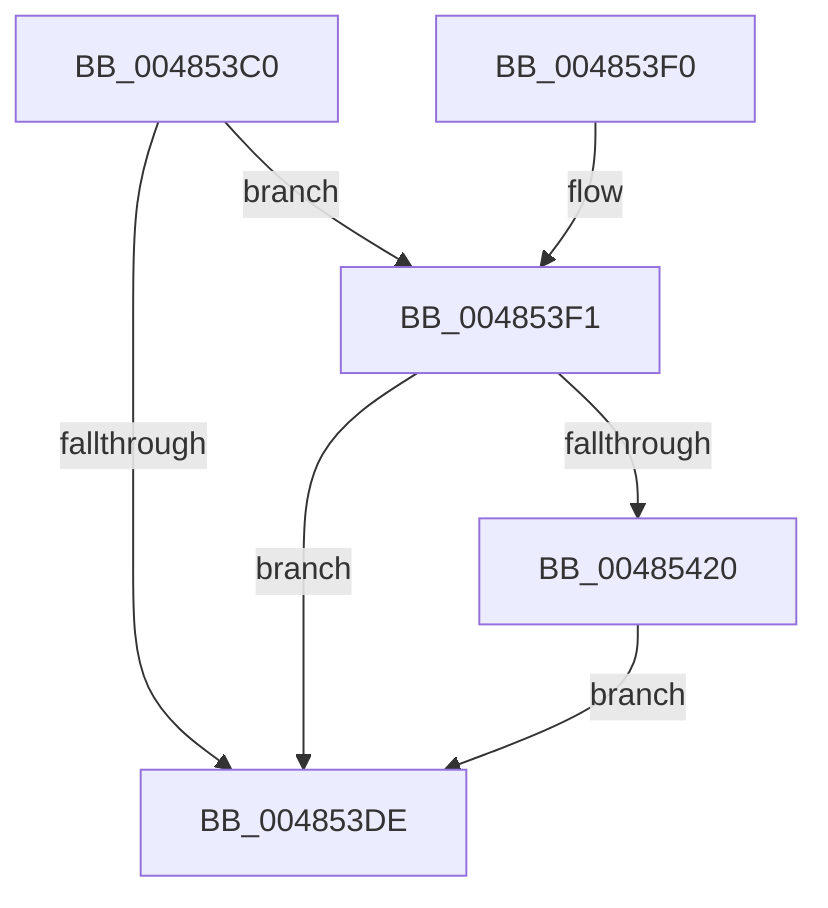

# PpmIdleRemoveConcurrency

- RVA: `0x004853C0`–`0x00485438` (길이 `120` bytes)
- VA: `0x00000001404853C0`
- 실행 섹션: `.text`
- PDB 이름 있음: `예`; PDB Function 태그: `아니요`
- unwind 정보 RVA: `0x000734C4`
- 디코드: `33`개 명령, `120/120` bytes 표시
- 미해석 바이트: `0` (있으면 어셈블리에 `.byte`로 보존)

> 이 문서는 커널 이미지의 기계어와 PDB 기호를 분석해 생성했습니다. 4번과 5번은 함수 원형과 자료형을 바이너리 사용 방식에서 추정한 C 해석이며 원본 소스 복구 결과는 아닙니다.

## 1. Dependencies

- 직접 호출 지점: **3**; 고유 호출 대상: **2**
- 직접 호출자로 확인된 함수: **0**
- RIP 상대 이미지 참조: **0**

### Outgoing calls
- `0x004853F3` → [KeQueryPerformanceCounter](../37/KeQueryPerformanceCounter_function_0037E7E0.md) (function, `0x0037E7E0`)
- `0x00485407` → [PpmIdleUpdateConcurrency](PpmIdleUpdateConcurrency_function_004854C0.md) (function, `0x004854C0`)
- `0x00485429` → [PpmIdleUpdateConcurrency](PpmIdleUpdateConcurrency_function_004854C0.md) (function, `0x004854C0`)

### Direct callers
- 이 함수 시작 RVA로 연결되는 직접 call은 확인되지 않았습니다. 간접 호출은 완전히 역산할 수 없습니다.

### Static image references
- 디코드된 RIP-relative 메모리 참조가 없습니다.

## 2. Other-region calls and transfers

- 다른 실행 섹션으로 향하는 call: **0**
- 별도 외부 분기/꼬리 이동을 확인하지 못했습니다.

## 3. Assembly (complete function range)

```asm
004853C0  48 89 5C 24 08                  mov qword ptr [rsp + 8], rbx
004853C5  48 89 74 24 10                  mov qword ptr [rsp + 0x10], rsi
004853CA  57                              push rdi
004853CB  48 83 EC 20                     sub rsp, 0x20
004853CF  48 8B B9 F8 89 00 00            mov rdi, qword ptr [rcx + 0x89f8]
004853D6  48 8B D9                        mov rbx, rcx
004853D9  48 85 FF                        test rdi, rdi
004853DC  75 13                           jne 0x1404853f1
004853DE  48 8B 5C 24 30                  mov rbx, qword ptr [rsp + 0x30]
004853E3  33 C0                           xor eax, eax
004853E5  48 8B 74 24 38                  mov rsi, qword ptr [rsp + 0x38]
004853EA  48 83 C4 20                     add rsp, 0x20
004853EE  5F                              pop rdi
004853EF  C3                              ret
004853F0  CC                              int3
004853F1  33 C9                           xor ecx, ecx
004853F3  E8 E8 93 EF FF                  call 0x14037e7e0
004853F8  45 33 C9                        xor r9d, r9d
004853FB  41 B0 01                        mov r8b, 1
004853FE  48 8B D0                        mov rdx, rax
00485401  48 8B CF                        mov rcx, rdi
00485404  48 8B F0                        mov rsi, rax
00485407  E8 B4 00 00 00                  call 0x1404854c0
0048540C  48 8B 8B 00 8A 00 00            mov rcx, qword ptr [rbx + 0x8a00]
00485413  48 83 A3 F8 89 00 00 00         and qword ptr [rbx + 0x89f8], 0
0048541B  48 85 C9                        test rcx, rcx
0048541E  74 BE                           je 0x1404853de
00485420  45 33 C9                        xor r9d, r9d
00485423  41 B0 01                        mov r8b, 1
00485426  48 8B D6                        mov rdx, rsi
00485429  E8 92 00 00 00                  call 0x1404854c0
0048542E  48 83 A3 00 8A 00 00 00         and qword ptr [rbx + 0x8a00], 0
00485436  EB A6                           jmp 0x1404853de
```

## 4. C-style interpretation (structured pseudocode)

```c
__int64 __fastcall PpmIdleRemoveConcurrency(__int64 a1, __int64 a2, __int64 a3, int a4)
{
    __int64 result;
    __int64 v_rsp;
    unsigned __int64 v_stack_p10;
    unsigned __int64 v_stack_p8;

    v_stack_p8 = v_rbx;
    v_stack_p10 = v_rsi;
    v_rsp = (v_rsp) - (32);
    if (*(unsigned __int64 *)(a1 + 35320) != 0) goto loc_004853F1;
loc_004853DE:
    result = 0;
    v_rsp = (v_rsp) + (32);
    return result;
loc_004853F1:
    a1 = 0;
    result = KeQueryPerformanceCounter(a1, a2, a3, a4);
    a4 = 0;
    result = PpmIdleUpdateConcurrency(*(unsigned __int64 *)(a1 + 35320), result, 1, a4);
    if (*(unsigned __int64 *)(v_stack_p8 + 35328) == 0) goto loc_004853DE;
    a4 = 0;
    result = PpmIdleUpdateConcurrency(*(unsigned __int64 *)(v_stack_p8 + 35328), result, 1, a4);
    goto loc_004853DE;
}
```

## 5. (Beta) C Style

```c
int64_t PpmIdleRemoveConcurrency(void *Arg1, int64_t Arg2, int64_t Arg3, int32_t Arg4)
{
    uint8_t *arg1 = (uint8_t *)Arg1;

    int64_t result;
    int64_t local_rsp;
    uint64_t v_stack_p10;
    uint64_t v_stack_p8;

    v_stack_p8 = local_rbx;
    v_stack_p10 = local_rsi;
    local_rsp = (local_rsp) - (32);
    if (*(uint64_t *)(arg1 + 0x89F8) != 0) goto loc_004853F1;
loc_004853DE:
    result = 0;
    local_rsp = (local_rsp) + (32);
    return result;
loc_004853F1:
    Arg1 = 0;
    result = KeQueryPerformanceCounter(Arg1, Arg2, Arg3, Arg4);
    Arg4 = 0;
    result = PpmIdleUpdateConcurrency(*(uint64_t *)(arg1 + 0x89F8), result, 1, Arg4);
    if (*(uint64_t *)(v_stack_p8 + 0x8A00) == 0) goto loc_004853DE;
    Arg4 = 0;
    result = PpmIdleUpdateConcurrency(*(uint64_t *)(v_stack_p8 + 0x8A00), result, 1, Arg4);
    goto loc_004853DE;
}
```

### 관측된 메모리 오프셋

구조체 형식이 확인되지 않은 접근은 인자 기준의 오프셋으로만 기록했습니다.

| 기준 인자 | 오프셋 표현 | 폭 (bit) | 접근 |
|---|---:|---:|---|
| `Arg1` | `+ 0x89F8` | `64` | `R` |
| `Arg1` | `+ 0x89F8` | `64` | `R/W` |
| `Arg1` | `+ 0x8A00` | `64` | `R` |
| `Arg1` | `+ 0x8A00` | `64` | `R/W` |

## 6. Execution-region graph

[열기: 2D/3D 그래프와 함수 탐색 컨트롤 패널](../../../control-panel.html?section=text&rva=0x004853C0&view=graph)

- 2D 그래프는 위에서 아래로 흐르고, 3D 그래프는 빈 공간을 드래그해 회전합니다. Shift+드래그는 이동, 휠은 확대·축소, 함수 노드 선택은 대상 보고서 이동입니다.

### Static fallback


