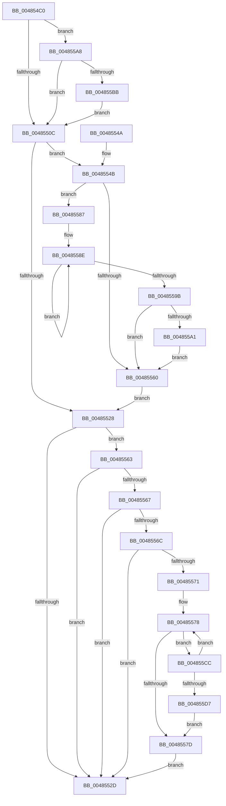

# PpmIdleUpdateConcurrency

- RVA: `0x004854C0`–`0x004855D9` (길이 `281` bytes)
- VA: `0x00000001404854C0`
- 실행 섹션: `.text`
- PDB 이름 있음: `예`; PDB Function 태그: `아니요`
- unwind 정보 RVA: `0x000AF500`
- 디코드: `86`개 명령, `281/281` bytes 표시
- 미해석 바이트: `0` (있으면 어셈블리에 `.byte`로 보존)

> 이 문서는 커널 이미지의 기계어와 PDB 기호를 분석해 생성했습니다. 4번과 5번은 함수 원형과 자료형을 바이너리 사용 방식에서 추정한 C 해석이며 원본 소스 복구 결과는 아닙니다.

## 1. Dependencies

- 직접 호출 지점: **4**; 고유 호출 대상: **4**
- 직접 호출자로 확인된 함수: **3**
- RIP 상대 이미지 참조: **1**

### Outgoing calls
- `0x004854EC` → [KeDisableInterrupts](../21/KeDisableInterrupts_function_00217BE0.md) (function, `0x00217BE0`)
- `0x004854F7` → [KeAcquireSpinLockAtDpcLevel](../20/KeAcquireSpinLockAtDpcLevel_function_00208430.md) (function, `0x00208430`)
- `0x0048551E` → [KxReleaseSpinLock](../20/KxReleaseSpinLock_function_00206670.md) (function, `0x00206670`)
- `0x004855A1` → [KiRemoveSystemWorkPriorityKick](../26/KiRemoveSystemWorkPriorityKick_function_002631D0.md) (function, `0x002631D0`)

### Direct callers
- [PpmIdleExecuteTransition](../2D/PpmIdleExecuteTransition_function_002D0A1C.md) at `0x002D0E62`
- [PpmIdleExecuteTransition](../2D/PpmIdleExecuteTransition_function_002D0A1C.md) at `0x002D0E84`
- [PpmIdleExecuteTransition](../2D/PpmIdleExecuteTransition_function_002D0A1C.md) at `0x002D107B`
- [PpmIdleExecuteTransition](../2D/PpmIdleExecuteTransition_function_002D0A1C.md) at `0x002D1099`
- [PpmIdleRemoveConcurrency](PpmIdleRemoveConcurrency_function_004853C0.md) at `0x00485407`
- [PpmIdleRemoveConcurrency](PpmIdleRemoveConcurrency_function_004853C0.md) at `0x00485429`
- [PpmIdleInstallConcurrency](PpmIdleInstallConcurrency_function_00485440.md) at `0x00485473`
- [PpmIdleInstallConcurrency](PpmIdleInstallConcurrency_function_00485440.md) at `0x004854A8`

### Static image references
- `0x00485571` → RVA `0x00FC5BD0` (`ALMOSTRO`; read)

## 2. Other-region calls and transfers

- 다른 실행 섹션으로 향하는 call: **0**
- 별도 외부 분기/꼬리 이동을 확인하지 못했습니다.

## 3. Assembly (complete function range)

```asm
004854C0  48 89 5C 24 08                  mov qword ptr [rsp + 8], rbx
004854C5  48 89 6C 24 10                  mov qword ptr [rsp + 0x10], rbp
004854CA  48 89 74 24 18                  mov qword ptr [rsp + 0x18], rsi
004854CF  57                              push rdi
004854D0  41 54                           push r12
004854D2  41 55                           push r13
004854D4  41 56                           push r14
004854D6  41 57                           push r15
004854D8  48 83 EC 20                     sub rsp, 0x20
004854DC  33 DB                           xor ebx, ebx
004854DE  45 8A F9                        mov r15b, r9b
004854E1  8B F3                           mov esi, ebx
004854E3  45 8A E0                        mov r12b, r8b
004854E6  4C 8B F2                        mov r14, rdx
004854E9  48 8B F9                        mov rdi, rcx
004854EC  E8 EF 26 D9 FF                  call 0x140217be0
004854F1  48 8B CF                        mov rcx, rdi
004854F4  44 8A E8                        mov r13b, al
004854F7  E8 34 2F D8 FF                  call 0x140208430
004854FC  48 8B 4F 10                     mov rcx, qword ptr [rdi + 0x10]
00485500  8B 6F 0C                        mov ebp, dword ptr [rdi + 0xc]
00485503  4C 3B F1                        cmp r14, rcx
00485506  0F 87 9C 00 00 00               ja 0x1404855a8
0048550C  8D 45 FF                        lea eax, [rbp - 1]
0048550F  45 84 E4                        test r12b, r12b
00485512  8D 4D 01                        lea ecx, [rbp + 1]
00485515  0F 45 C8                        cmovne ecx, eax
00485518  89 4F 0C                        mov dword ptr [rdi + 0xc], ecx
0048551B  48 8B CF                        mov rcx, rdi
0048551E  E8 4D 11 D8 FF                  call 0x140206670
00485523  45 84 ED                        test r13b, r13b
00485526  75 23                           jne 0x14048554b
00485528  45 84 E4                        test r12b, r12b
0048552B  74 36                           je 0x140485563
0048552D  48 8B 5C 24 50                  mov rbx, qword ptr [rsp + 0x50]
00485532  48 8B 6C 24 58                  mov rbp, qword ptr [rsp + 0x58]
00485537  48 8B 74 24 60                  mov rsi, qword ptr [rsp + 0x60]
0048553C  48 83 C4 20                     add rsp, 0x20
00485540  41 5F                           pop r15
00485542  41 5E                           pop r14
00485544  41 5D                           pop r13
00485546  41 5C                           pop r12
00485548  5F                              pop rdi
00485549  C3                              ret
0048554A  CC                              int3
0048554B  65 48 8B 0C 25 20 00 00 00      mov rcx, qword ptr gs:[0x20]
00485554  4C 8B 81 B8 8E 00 00            mov r8, qword ptr [rcx + 0x8eb8]
0048555B  4D 85 C0                        test r8, r8
0048555E  75 27                           jne 0x140485587
00485560  FB                              sti
00485561  EB C5                           jmp 0x140485528
00485563  85 ED                           test ebp, ebp
00485565  75 C6                           jne 0x14048552d
00485567  48 85 F6                        test rsi, rsi
0048556A  74 C1                           je 0x14048552d
0048556C  45 84 FF                        test r15b, r15b
0048556F  74 BC                           je 0x14048552d
00485571  48 8D 05 58 06 B4 00            lea rax, [rip + 0xb40658]
00485578  48 3B 30                        cmp rsi, qword ptr [rax]
0048557B  73 4F                           jae 0x1404855cc
0048557D  8B C3                           mov eax, ebx
0048557F  F0 48 01 74 C7 20               lock add qword ptr [rdi + rax*8 + 0x20], rsi
00485585  EB A6                           jmp 0x14048552d
00485587  41 0F 0D 08                     prefetchw byte ptr [r8]
0048558B  41 8B 00                        mov eax, dword ptr [r8]
0048558E  8B D0                           mov edx, eax
00485590  0F BA F2 15                     btr edx, 0x15
00485594  F0 41 0F B1 10                  lock cmpxchg dword ptr [r8], edx
00485599  75 F3                           jne 0x14048558e
0048559B  0F BA E0 15                     bt eax, 0x15
0048559F  73 BF                           jae 0x140485560
004855A1  E8 2A DC DD FF                  call 0x1402631d0
004855A6  EB B8                           jmp 0x140485560
004855A8  49 8B F6                        mov rsi, r14
004855AB  4C 89 77 10                     mov qword ptr [rdi + 0x10], r14
004855AF  48 2B F1                        sub rsi, rcx
004855B2  45 84 FF                        test r15b, r15b
004855B5  0F 84 51 FF FF FF               je 0x14048550c
004855BB  48 01 77 18                     add qword ptr [rdi + 0x18], rsi
004855BF  48 01 B4 EF 48 01 00 00         add qword ptr [rdi + rbp*8 + 0x148], rsi
004855C7  E9 40 FF FF FF                  jmp 0x14048550c
004855CC  FF C3                           inc ebx
004855CE  48 83 C0 18                     add rax, 0x18
004855D2  83 FB 24                        cmp ebx, 0x24
004855D5  72 A1                           jb 0x140485578
004855D7  EB A4                           jmp 0x14048557d
```

## 4. C-style interpretation (structured pseudocode)

```c
__int64 __fastcall PpmIdleUpdateConcurrency(__int64 a1, __int64 a2, unsigned __int8 a3, unsigned __int8 a4)
{
    __int64 result;
    __int64 v_rbx;
    __int64 v_rsi;
    __int64 v_rsp;
    unsigned __int64 v_stack_p10;
    unsigned __int64 v_stack_p18;
    unsigned __int64 v_stack_p8;

    v_stack_p8 = v_rbx;
    v_stack_p10 = v_rbp;
    v_stack_p18 = v_rsi;
    v_rsp = (v_rsp) - (32);
    v_rbx = 0;
    result = KeDisableInterrupts(a1, a2, a3, a4);
    result = KeAcquireSpinLockAtDpcLevel(a1, a2, a3, a4);
    if (a2 > (*(unsigned __int64 *)(a1 + 16))) goto loc_004855A8;
loc_0048550C:
    a1 = (unsigned int)(*(unsigned int *)(a1 + 12)) + 1;
    if (a3 != 0) { a1 = (unsigned int)((unsigned int)(*(unsigned int *)(a1 + 12)) - 1); }
    *(unsigned int *)(a1 + 12) = (unsigned int)(a1);
    result = KxReleaseSpinLock(a1, a2, a3, a4);
    if ((unsigned __int8)((unsigned __int8)(result)) != 0) goto loc_0048554B;
loc_00485528:
    if (a3 == 0) goto loc_00485563;
loc_0048552D:
    v_rsp = (v_rsp) + (32);
    return result;
loc_0048554B:
    if (*(unsigned __int64 *)(*(unsigned __int64 *)(gs_base + (0 + 32)) + 36536) != 0) goto loc_00485587;
loc_00485560:
    goto loc_00485528;
loc_00485563:
    if ((unsigned int)(v_stack_p10) != 0) goto loc_0048552D;
    if (v_stack_p18 == 0) goto loc_0048552D;
    if (a4 == 0) goto loc_0048552D;
loc_00485578:
    if (v_stack_p18 >= (*(unsigned __int64 *)(v_rip + 11798104))) goto loc_004855CC;
loc_0048557D:
    goto loc_0048552D;
loc_00485587:
loc_0048558E:
    if (v_stack_p18 != (*(unsigned __int64 *)(v_rip + 11798104))) goto loc_0048558E;
    if (v_stack_p18 >= (*(unsigned __int64 *)(v_rip + 11798104))) goto loc_00485560;
    result = KiRemoveSystemWorkPriorityKick(*(unsigned __int64 *)(gs_base + (0 + 32)), (unsigned int)((unsigned int)((unsigned int)(*(unsigned int *)(*(unsigned __int64 *)(*(unsigned __int64 *)(gs_base + (0 + 32)) + 36536))))), *(unsigned __int64 *)(*(unsigned __int64 *)(gs_base + (0 + 32)) + 36536), a4);
    goto loc_00485560;
loc_004855A8:
    *(unsigned __int64 *)(a1 + 16) = a2;
    v_rsi = (a2) - (*(unsigned __int64 *)(gs_base + (0 + 32)));
    if (a4 == 0) goto loc_0048550C;
    goto loc_0048550C;
loc_004855CC:
    v_rbx = (unsigned int)((v_stack_p8) + 1);
    result = (result) + (24);
    if (((unsigned int)(v_rbx)) < 36) goto loc_00485578;
    goto loc_0048557D;
}
```

## 5. (Beta) C Style

```c
int64_t PpmIdleUpdateConcurrency(void *Arg1, int64_t Arg2, uint8_t Arg3, uint8_t Arg4)
{
    uint8_t *arg1 = (uint8_t *)Arg1;

    int64_t result;
    int64_t local_rbx;
    int64_t local_rsi;
    int64_t local_rsp;
    uint64_t v_stack_p10;
    uint64_t v_stack_p18;
    uint64_t v_stack_p8;

    v_stack_p8 = local_rbx;
    v_stack_p10 = local_rbp;
    v_stack_p18 = local_rsi;
    local_rsp = (local_rsp) - (32);
    local_rbx = 0;
    result = KeDisableInterrupts(Arg1, Arg2, Arg3, Arg4);
    result = KeAcquireSpinLockAtDpcLevel(Arg1, Arg2, Arg3, Arg4);
    if (Arg2 > (*(uint64_t *)(arg1 + 0x10))) goto loc_004855A8;
loc_0048550C:
    Arg1 = (uint32_t)(*(uint32_t *)(arg1 + 0xC)) + 1;
    if (Arg3 != 0) { Arg1 = (uint32_t)((uint32_t)(*(uint32_t *)(arg1 + 0xC)) - 1); }
    *(uint32_t *)(arg1 + 0xC) = (uint32_t)(Arg1);
    result = KxReleaseSpinLock(Arg1, Arg2, Arg3, Arg4);
    if ((uint8_t)((uint8_t)(result)) != 0) goto loc_0048554B;
loc_00485528:
    if (Arg3 == 0) goto loc_00485563;
loc_0048552D:
    local_rsp = (local_rsp) + (32);
    return result;
loc_0048554B:
    if (*(uint64_t *)(*(uint64_t *)(gs_base + (0 + 0x20)) + 0x8EB8) != 0) goto loc_00485587;
loc_00485560:
    goto loc_00485528;
loc_00485563:
    if ((uint32_t)(v_stack_p10) != 0) goto loc_0048552D;
    if (v_stack_p18 == 0) goto loc_0048552D;
    if (Arg4 == 0) goto loc_0048552D;
loc_00485578:
    if (v_stack_p18 >= (*(uint64_t *)(v_rip + 0xB40658))) goto loc_004855CC;
loc_0048557D:
    goto loc_0048552D;
loc_00485587:
loc_0048558E:
    if (v_stack_p18 != (*(uint64_t *)(v_rip + 0xB40658))) goto loc_0048558E;
    if (v_stack_p18 >= (*(uint64_t *)(v_rip + 0xB40658))) goto loc_00485560;
    result = KiRemoveSystemWorkPriorityKick(*(uint64_t *)(gs_base + (0 + 0x20)), (uint32_t)((uint32_t)((uint32_t)(*(uint32_t *)(*(uint64_t *)(*(uint64_t *)(gs_base + (0 + 0x20)) + 0x8EB8))))), *(uint64_t *)(*(uint64_t *)(gs_base + (0 + 0x20)) + 0x8EB8), Arg4);
    goto loc_00485560;
loc_004855A8:
    *(uint64_t *)(arg1 + 0x10) = Arg2;
    local_rsi = (Arg2) - (*(uint64_t *)(gs_base + (0 + 0x20)));
    if (Arg4 == 0) goto loc_0048550C;
    goto loc_0048550C;
loc_004855CC:
    local_rbx = (uint32_t)((v_stack_p8) + 1);
    result = (result) + (24);
    if (((uint32_t)(local_rbx)) < 36) goto loc_00485578;
    goto loc_0048557D;
}
```

### 관측된 메모리 오프셋

구조체 형식이 확인되지 않은 접근은 인자 기준의 오프셋으로만 기록했습니다.

| 기준 인자 | 오프셋 표현 | 폭 (bit) | 접근 |
|---|---:|---:|---|
| `Arg1` | `+ 0xC` | `32` | `R` |
| `Arg1` | `+ 0xC` | `32` | `W` |
| `Arg1` | `+ 0x10` | `64` | `R` |
| `Arg1` | `+ 0x10` | `64` | `W` |
| `Arg1` | `+ 0x18` | `64` | `R/W` |
| `Arg1` | `+ 0x20 + rax*8` | `64` | `R/W` |
| `Arg1` | `+ 0x148 + rbp*8` | `64` | `R/W` |

## 6. Execution-region graph

[열기: 2D/3D 그래프와 함수 탐색 컨트롤 패널](../../../control-panel.html?section=text&rva=0x004854C0&view=graph)

- 2D 그래프는 위에서 아래로 흐르고, 3D 그래프는 빈 공간을 드래그해 회전합니다. Shift+드래그는 이동, 휠은 확대·축소, 함수 노드 선택은 대상 보고서 이동입니다.

### Static fallback


