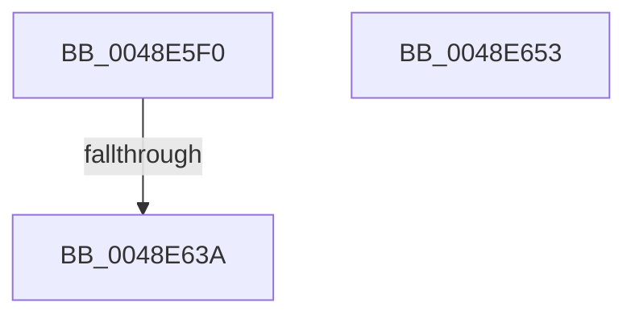

# PpmParkCalculateCoreParkingMask

- RVA: `0x0048E5F0`–`0x0048E654` (길이 `100` bytes)
- VA: `0x000000014048E5F0`
- 실행 섹션: `.text`
- PDB 이름 있음: `예`; PDB Function 태그: `예`
- unwind 정보 RVA: `0x000B1698`
- 디코드: `35`개 명령, `100/100` bytes 표시
- 미해석 바이트: `0` (있으면 어셈블리에 `.byte`로 보존)

> 이 문서는 커널 이미지의 기계어와 PDB 기호를 분석해 생성했습니다. 4번과 5번은 함수 원형과 자료형을 바이너리 사용 방식에서 추정한 C 해석이며 원본 소스 복구 결과는 아닙니다.

## 1. Dependencies

- 직접 호출 지점: **2**; 고유 호출 대상: **2**
- 직접 호출자로 확인된 함수: **0**
- RIP 상대 이미지 참조: **0**

### Outgoing calls
- `0x0048E62D` → [Feature_PpmParkEx__private_IsEnabledDeviceUsageNoInline](../4F/Feature_PpmParkEx__private_IsEnabledDeviceUsageNoInline_function_004F135C.md) (function, `0x004F135C`)
- `0x0048E63A` → [PpmParkCalculateCoreParkingMaskEx](../5D/PpmParkCalculateCoreParkingMaskEx_function_005DFBE0.md) (function, `0x005DFBE0`)

### Direct callers
- 이 함수 시작 RVA로 연결되는 직접 call은 확인되지 않았습니다. 간접 호출은 완전히 역산할 수 없습니다.

### Static image references
- 디코드된 RIP-relative 메모리 참조가 없습니다.

## 2. Other-region calls and transfers

- 다른 실행 섹션으로 향하는 call: **0**
- call이 아닌 외부 분기/꼬리 이동: **1**
  - `0x0048E634` → [sub_006F6620](../6F/Unknown_function_006F6620.md) (`tail-transfer`)

## 3. Assembly (complete function range)

```asm
0048E5F0  40 55                           push rbp
0048E5F2  53                              push rbx
0048E5F3  56                              push rsi
0048E5F4  57                              push rdi
0048E5F5  41 54                           push r12
0048E5F7  41 55                           push r13
0048E5F9  41 56                           push r14
0048E5FB  41 57                           push r15
0048E5FD  48 8D 6C 24 E1                  lea rbp, [rsp - 0x1f]
0048E602  48 81 EC F8 00 00 00            sub rsp, 0xf8
0048E609  33 C0                           xor eax, eax
0048E60B  0F 57 C0                        xorps xmm0, xmm0
0048E60E  45 33 E4                        xor r12d, r12d
0048E611  48 89 45 BF                     mov qword ptr [rbp - 0x41], rax
0048E615  44 89 65 77                     mov dword ptr [rbp + 0x77], r12d
0048E619  4C 89 65 CF                     mov qword ptr [rbp - 0x31], r12
0048E61D  4C 89 65 F7                     mov qword ptr [rbp - 9], r12
0048E621  44 89 65 6F                     mov dword ptr [rbp + 0x6f], r12d
0048E625  4C 89 65 E7                     mov qword ptr [rbp - 0x19], r12
0048E629  0F 11 45 AF                     movups xmmword ptr [rbp - 0x51], xmm0
0048E62D  E8 2A 2D 06 00                  call 0x1404f135c
0048E632  85 C0                           test eax, eax
0048E634  0F 84 E6 7F 26 00               je 0x1406f6620
0048E63A  E8 A1 15 15 00                  call 0x1405dfbe0
0048E63F  48 81 C4 F8 00 00 00            add rsp, 0xf8
0048E646  41 5F                           pop r15
0048E648  41 5E                           pop r14
0048E64A  41 5D                           pop r13
0048E64C  41 5C                           pop r12
0048E64E  5F                              pop rdi
0048E64F  5E                              pop rsi
0048E650  5B                              pop rbx
0048E651  5D                              pop rbp
0048E652  C3                              ret
0048E653  CC                              int3
```

## 4. C-style interpretation (structured pseudocode)

```c
__int64 __fastcall PpmParkCalculateCoreParkingMask(void)
{
    __int64 result;
    __int64 v_r12;
    __int64 v_rsp;
    unsigned __int64 v_stack_m5F;
    unsigned __int64 v_stack_m68;
    unsigned __int64 v_stack_m78;
    unsigned __int64 v_stack_m90;
    unsigned __int64 v_stack_mA0;
    unsigned __int64 v_stack_mB0;
    unsigned int v_stack_p10;
    unsigned int v_stack_p18;

    v_rsp = (v_rsp) - (248);
    result = 0;
    v_r12 = 0;
    v_stack_mA0 = 0;
    v_stack_p18 = 0;
    v_stack_m90 = 0;
    v_stack_m68 = 0;
    v_stack_p10 = 0;
    v_stack_m78 = 0;
    v_stack_mB0 = v_xmm0;
    result = Feature_PpmParkEx__private_IsEnabledDeviceUsageNoInline(a1, a2, a3, a4);
    result = PpmParkCalculateCoreParkingMaskEx(a1, a2, a3, a4);
    v_rsp = (v_rsp) + (248);
    return result;
}
```

## 5. (Beta) C Style

```c
void PpmParkCalculateCoreParkingMask(void)
{
    int64_t result;
    int64_t local_r12;
    int64_t local_rsp;
    uint64_t v_stack_m5F;
    uint64_t v_stack_m68;
    uint64_t v_stack_m78;
    uint64_t v_stack_m90;
    uint64_t v_stack_mA0;
    uint64_t v_stack_mB0;
    uint32_t v_stack_p10;
    uint32_t v_stack_p18;

    local_rsp = (local_rsp) - (248);
    result = 0;
    local_r12 = 0;
    v_stack_mA0 = 0;
    v_stack_p18 = 0;
    v_stack_m90 = 0;
    v_stack_m68 = 0;
    v_stack_p10 = 0;
    v_stack_m78 = 0;
    v_stack_mB0 = v_xmm0;
    result = Feature_PpmParkEx__private_IsEnabledDeviceUsageNoInline(a1, a2, a3, a4);
    result = PpmParkCalculateCoreParkingMaskEx(a1, a2, a3, a4);
    local_rsp = (local_rsp) + (248);
    return result;
}
```

## 6. Execution-region graph

[열기: 2D/3D 그래프와 함수 탐색 컨트롤 패널](../../../control-panel.html?section=text&rva=0x0048E5F0&view=graph)

- 2D 그래프는 위에서 아래로 흐르고, 3D 그래프는 빈 공간을 드래그해 회전합니다. Shift+드래그는 이동, 휠은 확대·축소, 함수 노드 선택은 대상 보고서 이동입니다.

### Static fallback


