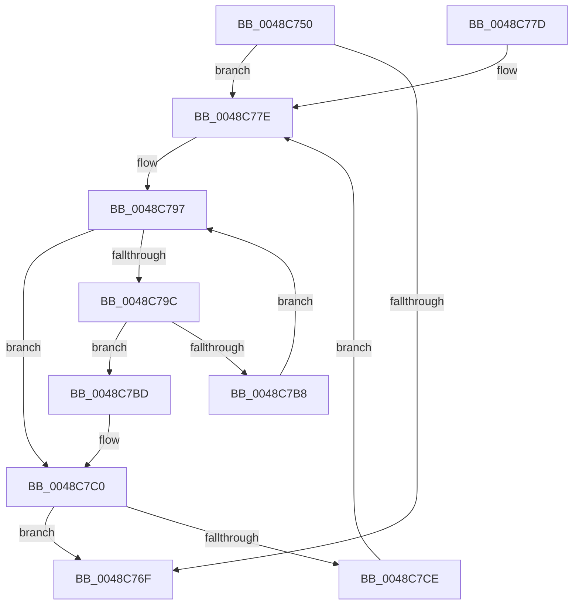

# PpmParkMaximumCoresParked

- RVA: `0x0048C750`–`0x0048C7D0` (길이 `128` bytes)
- VA: `0x000000014048C750`
- 실행 섹션: `.text`
- PDB 이름 있음: `예`; PDB Function 태그: `아니요`
- unwind 정보 RVA: `0x000B1214`
- 디코드: `35`개 명령, `128/128` bytes 표시
- 미해석 바이트: `0` (있으면 어셈블리에 `.byte`로 보존)

> 이 문서는 커널 이미지의 기계어와 PDB 기호를 분석해 생성했습니다. 4번과 5번은 함수 원형과 자료형을 바이너리 사용 방식에서 추정한 C 해석이며 원본 소스 복구 결과는 아닙니다.

## 1. Dependencies

- 직접 호출 지점: **0**; 고유 호출 대상: **0**
- 직접 호출자로 확인된 함수: **1**
- RIP 상대 이미지 참조: **2**

### Outgoing calls
- 직접 디코드된 call 명령이 없습니다.

### Direct callers
- [PpmCheckMakeupSkippedChecks](../2D/PpmCheckMakeupSkippedChecks_function_002DA1D0.md) at `0x002DA20C`

### Static image references
- `0x0048C761` → RVA `0x00F083E0` (`.data`; read)
- `0x0048C78B` → RVA `0x00F083D8` (`.data`; read)

## 2. Other-region calls and transfers

- 다른 실행 섹션으로 향하는 call: **0**
- 별도 외부 분기/꼬리 이동을 확인하지 못했습니다.

## 3. Assembly (complete function range)

```asm
0048C750  48 89 5C 24 08                  mov qword ptr [rsp + 8], rbx
0048C755  48 89 7C 24 10                  mov qword ptr [rsp + 0x10], rdi
0048C75A  33 DB                           xor ebx, ebx
0048C75C  BF 01 00 00 00                  mov edi, 1
0048C761  39 1D 79 BC A7 00               cmp dword ptr [rip + 0xa7bc79], ebx
0048C767  44 8A CF                        mov r9b, dil
0048C76A  0F B7 D3                        movzx edx, bx
0048C76D  75 0F                           jne 0x14048c77e
0048C76F  48 8B 5C 24 08                  mov rbx, qword ptr [rsp + 8]
0048C774  41 8A C1                        mov al, r9b
0048C777  48 8B 7C 24 10                  mov rdi, qword ptr [rsp + 0x10]
0048C77C  C3                              ret
0048C77D  CC                              int3
0048C77E  0F B7 C2                        movzx eax, dx
0048C781  44 8B C3                        mov r8d, ebx
0048C784  4C 69 D0 10 05 00 00            imul r10, rax, 0x510
0048C78B  4C 03 15 46 BC A7 00            add r10, qword ptr [rip + 0xa7bc46]
0048C792  45 0F B6 5A 0C                  movzx r11d, byte ptr [r10 + 0xc]
0048C797  45 3B C3                        cmp r8d, r11d
0048C79A  73 24                           jae 0x14048c7c0
0048C79C  41 8B C0                        mov eax, r8d
0048C79F  48 8D 0C 80                     lea rcx, [rax + rax*4]
0048C7A3  48 C1 E1 07                     shl rcx, 7
0048C7A7  49 03 8A 08 05 00 00            add rcx, qword ptr [r10 + 0x508]
0048C7AE  0F B7 41 02                     movzx eax, word ptr [rcx + 2]
0048C7B2  66 39 41 0A                     cmp word ptr [rcx + 0xa], ax
0048C7B6  77 05                           ja 0x14048c7bd
0048C7B8  44 03 C7                        add r8d, edi
0048C7BB  EB DA                           jmp 0x14048c797
0048C7BD  44 8A CB                        mov r9b, bl
0048C7C0  66 03 D7                        add dx, di
0048C7C3  0F B7 CA                        movzx ecx, dx
0048C7C6  3B 0D 14 BC A7 00               cmp ecx, dword ptr [rip + 0xa7bc14]
0048C7CC  73 A1                           jae 0x14048c76f
0048C7CE  EB AE                           jmp 0x14048c77e
```

## 4. C-style interpretation (structured pseudocode)

```c
__int64 __fastcall PpmParkMaximumCoresParked(void)
{
    __int64 v_r10;
    __int64 v_rbx;
    unsigned __int64 v_stack_p10;
    unsigned __int64 v_stack_p8;

    v_stack_p8 = v_rbx;
    v_stack_p10 = v_rdi;
    v_rbx = 0;
    if ((*(unsigned int *)(v_rip + 10992761)) != 0) goto loc_0048C77E;
loc_0048C76F:
    return 1;
loc_0048C77E:
    v_r10 = (v_r10) * (0);
    v_r10 = (v_r10) + (*(unsigned __int64 *)(v_rip + 10992710));
loc_0048C797:
    if (((unsigned int)((unsigned int)((unsigned int)(v_stack_p8)))) >= ((unsigned int)(*(unsigned __int8 *)(v_r10 + 12)))) goto loc_0048C7C0;
    a1 = ((unsigned int)((unsigned int)((unsigned int)((unsigned int)(v_stack_p8)))) + (unsigned int)((unsigned int)((unsigned int)((unsigned int)(v_stack_p8)))) * 4) << (7);
    a1 = (a1) + (*(unsigned __int64 *)(v_r10 + 1288));
    if ((*(unsigned __int16 *)(a1 + 10)) > ((unsigned __int16)(*(unsigned __int16 *)(a1 + 2)))) goto loc_0048C7BD;
    a3 = (unsigned int)(((unsigned int)((unsigned int)(v_stack_p8))) + ((unsigned int)(v_stack_p10)));
    goto loc_0048C797;
loc_0048C7BD:
loc_0048C7C0:
    a2 = (unsigned __int16)((0) + ((unsigned __int16)(v_stack_p10)));
    if (((unsigned int)((unsigned __int16)(a2))) >= (*(unsigned int *)(v_rip + 10992660))) goto loc_0048C76F;
    goto loc_0048C77E;
}
```

## 5. (Beta) C Style

```c
void PpmParkMaximumCoresParked(void)
{
    int64_t local_r10;
    int64_t local_rbx;
    uint64_t v_stack_p10;
    uint64_t v_stack_p8;

    v_stack_p8 = local_rbx;
    v_stack_p10 = local_rdi;
    local_rbx = 0;
    if ((*(uint32_t *)(v_rip + 0xA7BC79)) != 0) goto loc_0048C77E;
loc_0048C76F:
    return 1;
loc_0048C77E:
    local_r10 = (local_r10) * (0);
    local_r10 = (local_r10) + (*(uint64_t *)(v_rip + 0xA7BC46));
loc_0048C797:
    if (((uint32_t)((uint32_t)((uint32_t)(v_stack_p8)))) >= ((uint32_t)(*(uint8_t *)(local_r10 + 0xC)))) goto loc_0048C7C0;
    a1 = ((uint32_t)((uint32_t)((uint32_t)((uint32_t)(v_stack_p8)))) + (uint32_t)((uint32_t)((uint32_t)((uint32_t)(v_stack_p8)))) * 4) << (7);
    a1 = (a1) + (*(uint64_t *)(local_r10 + 0x508));
    if ((*(uint16_t *)(a1 + 0xA)) > ((uint16_t)(*(uint16_t *)(a1 + 0x2)))) goto loc_0048C7BD;
    a3 = (uint32_t)(((uint32_t)((uint32_t)(v_stack_p8))) + ((uint32_t)(v_stack_p10)));
    goto loc_0048C797;
loc_0048C7BD:
loc_0048C7C0:
    a2 = (uint16_t)((0) + ((uint16_t)(v_stack_p10)));
    if (((uint32_t)((uint16_t)(a2))) >= (*(uint32_t *)(v_rip + 0xA7BC14))) goto loc_0048C76F;
    goto loc_0048C77E;
}
```

## 6. Execution-region graph

[열기: 2D/3D 그래프와 함수 탐색 컨트롤 패널](../../../control-panel.html?section=text&rva=0x0048C750&view=graph)

- 2D 그래프는 위에서 아래로 흐르고, 3D 그래프는 빈 공간을 드래그해 회전합니다. Shift+드래그는 이동, 휠은 확대·축소, 함수 노드 선택은 대상 보고서 이동입니다.

### Static fallback


