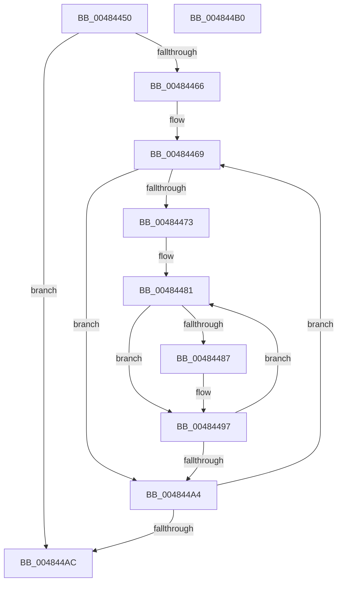

# PpmPerfMinimumPerfReached

- RVA: `0x00484450`–`0x004844B1` (길이 `97` bytes)
- VA: `0x0000000140484450`
- 실행 섹션: `.text`
- PDB 이름 있음: `예`; PDB Function 태그: `아니요`
- unwind 정보 RVA: `0x000DB714`
- 디코드: `27`개 명령, `97/97` bytes 표시
- 미해석 바이트: `0` (있으면 어셈블리에 `.byte`로 보존)

> 이 문서는 커널 이미지의 기계어와 PDB 기호를 분석해 생성했습니다. 4번과 5번은 함수 원형과 자료형을 바이너리 사용 방식에서 추정한 C 해석이며 원본 소스 복구 결과는 아닙니다.

## 1. Dependencies

- 직접 호출 지점: **0**; 고유 호출 대상: **0**
- 직접 호출자로 확인된 함수: **1**
- RIP 상대 이미지 참조: **1**

### Outgoing calls
- 직접 디코드된 call 명령이 없습니다.

### Direct callers
- [PpmCheckMakeupSkippedChecks](../2D/PpmCheckMakeupSkippedChecks_function_002DA1D0.md) at `0x002DA22C`

### Static image references
- `0x00484450` → RVA `0x00FC6BA8` (`ALMOSTRO`; read)

## 2. Other-region calls and transfers

- 다른 실행 섹션으로 향하는 call: **0**
- 별도 외부 분기/꼬리 이동을 확인하지 못했습니다.

## 3. Assembly (complete function range)

```asm
00484450  48 8B 0D 51 27 B4 00            mov rcx, qword ptr [rip + 0xb42751]
00484457  4C 8D 15 4A 27 B4 00            lea r10, [rip + 0xb4274a]
0048445E  41 B0 01                        mov r8b, 1
00484461  49 3B CA                        cmp rcx, r10
00484464  74 46                           je 0x1404844ac
00484466  45 33 DB                        xor r11d, r11d
00484469  8B 81 28 01 00 00               mov eax, dword ptr [rcx + 0x128]
0048446F  85 C0                           test eax, eax
00484471  74 31                           je 0x1404844a4
00484473  48 8B 91 38 01 00 00            mov rdx, qword ptr [rcx + 0x138]
0048447A  44 8B C8                        mov r9d, eax
0048447D  48 83 C2 38                     add rdx, 0x38
00484481  83 7A D8 02                     cmp dword ptr [rdx - 0x28], 2
00484485  74 10                           je 0x140484497
00484487  8B 81 40 03 00 00               mov eax, dword ptr [rcx + 0x340]
0048448D  39 02                           cmp dword ptr [rdx], eax
0048448F  45 0F B6 C0                     movzx r8d, r8b
00484493  45 0F 47 C3                     cmova r8d, r11d
00484497  48 81 C2 A8 04 00 00            add rdx, 0x4a8
0048449E  49 83 E9 01                     sub r9, 1
004844A2  75 DD                           jne 0x140484481
004844A4  48 8B 09                        mov rcx, qword ptr [rcx]
004844A7  49 3B CA                        cmp rcx, r10
004844AA  75 BD                           jne 0x140484469
004844AC  41 8A C0                        mov al, r8b
004844AF  C3                              ret
004844B0  CC                              int3
```

## 4. C-style interpretation (structured pseudocode)

```c
__int64 __fastcall PpmPerfMinimumPerfReached(void)
{
    __int64 result;
    __int64 v_r11;

    if ((*(unsigned __int64 *)(v_rip + 11806545)) == (v_rip + 11806538)) goto loc_004844AC;
    v_r11 = 0;
loc_00484469:
    if ((unsigned int)((unsigned int)(*(unsigned int *)(*(unsigned __int64 *)(v_rip + 11806545) + 296))) == 0) goto loc_004844A4;
    a2 = (*(unsigned __int64 *)(*(unsigned __int64 *)(v_rip + 11806545) + 312)) + (56);
loc_00484481:
    result = (unsigned int)(*(unsigned int *)(*(unsigned __int64 *)(v_rip + 11806545) + 296));
    if ((*(unsigned int *)(a2 - 40)) != 2) {
        result = *(unsigned int *)(*(unsigned __int64 *)(v_rip + 11806545) + 832);
        a3 = 1;
        if ((*(unsigned int *)(a2)) > ((unsigned int)(result))) { a3 = 0; }
    }
    a2 = (a2) + (0x4A8ULL);
    a4 = ((unsigned int)((unsigned int)((unsigned int)(*(unsigned int *)(*(unsigned __int64 *)(v_rip + 11806545) + 296))))) - (1);
    if (condition_is_not_equal) goto loc_00484481;
loc_004844A4:
    if ((*(unsigned __int64 *)(*(unsigned __int64 *)(v_rip + 11806545))) != (v_rip + 11806538)) goto loc_00484469;
loc_004844AC:
    return (unsigned __int8)(a3);
}
```

## 5. (Beta) C Style

```c
void PpmPerfMinimumPerfReached(void)
{
    int64_t result;
    int64_t local_r11;

    if ((*(uint64_t *)(v_rip + 0xB42751)) == (v_rip + 11806538)) goto loc_004844AC;
    local_r11 = 0;
loc_00484469:
    if ((uint32_t)((uint32_t)(*(uint32_t *)(*(uint64_t *)(v_rip + 0xB42751) + 0x128))) == 0) goto loc_004844A4;
    a2 = (*(uint64_t *)(*(uint64_t *)(v_rip + 0xB42751) + 0x138)) + (56);
loc_00484481:
    result = (uint32_t)(*(uint32_t *)(*(uint64_t *)(v_rip + 0xB42751) + 0x128));
    if ((*(uint32_t *)(a2 - 0x28)) != 2) {
        result = *(uint32_t *)(*(uint64_t *)(v_rip + 0xB42751) + 0x340);
        a3 = 1;
        if ((*(uint32_t *)(a2)) > ((uint32_t)(result))) { a3 = 0; }
    }
    a2 = (a2) + (0x4A8ULL);
    a4 = ((uint32_t)((uint32_t)((uint32_t)(*(uint32_t *)(*(uint64_t *)(v_rip + 0xB42751) + 0x128))))) - (1);
    if (condition_is_not_equal) goto loc_00484481;
loc_004844A4:
    if ((*(uint64_t *)(*(uint64_t *)(v_rip + 0xB42751))) != (v_rip + 11806538)) goto loc_00484469;
loc_004844AC:
    return (uint8_t)(a3);
}
```

## 6. Execution-region graph

[열기: 2D/3D 그래프와 함수 탐색 컨트롤 패널](../../../control-panel.html?section=text&rva=0x00484450&view=graph)

- 2D 그래프는 위에서 아래로 흐르고, 3D 그래프는 빈 공간을 드래그해 회전합니다. Shift+드래그는 이동, 휠은 확대·축소, 함수 노드 선택은 대상 보고서 이동입니다.

### Static fallback


