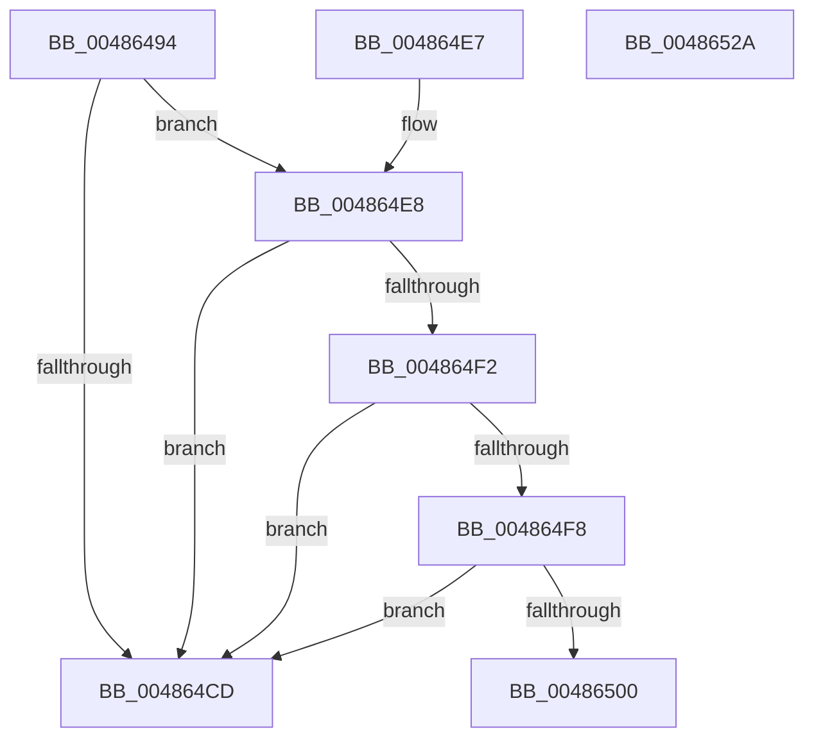

# PspIsProcessReadyForRemoteThread

- RVA: `0x00486494`–`0x00486533` (길이 `159` bytes)
- VA: `0x0000000140486494`
- 실행 섹션: `.text`
- PDB 이름 있음: `예`; PDB Function 태그: `예`
- unwind 정보 RVA: `0x000AF7C8`
- 디코드: `42`개 명령, `159/159` bytes 표시
- 미해석 바이트: `0` (있으면 어셈블리에 `.byte`로 보존)

> 이 문서는 커널 이미지의 기계어와 PDB 기호를 분석해 생성했습니다. 4번과 5번은 함수 원형과 자료형을 바이너리 사용 방식에서 추정한 C 해석이며 원본 소스 복구 결과는 아닙니다.

## 1. Dependencies

- 직접 호출 지점: **2**; 고유 호출 대상: **2**
- 직접 호출자로 확인된 함수: **1**
- RIP 상대 이미지 참조: **2**

### Outgoing calls
- `0x004864D7` → [_security_check_cookie](../6A/_security_check_cookie_function_006AC640.md) (function, `0x006AC640`)
- `0x0048650C` → [KiStackAttachProcess](../21/KiStackAttachProcess_function_00216820.md) (function, `0x00216820`)

### Direct callers
- [PspCreateThread](../../page/9E/PspCreateThread_function_009EF034.md) at `0x009EF37D`

### Static image references
- `0x0048649E` → RVA `0x00E0A740` (`.data`; read)
- `0x004864C4` → RVA `0x00FD9E30` (`PAGEDATA`; read)

## 2. Other-region calls and transfers

- 다른 실행 섹션으로 향하는 call: **0**
- call이 아닌 외부 분기/꼬리 이동: **2**
  - `0x00486525` → [sub_006F5684](../6F/Unknown_function_006F5684.md) (`tail-transfer`)
  - `0x0048652E` → [sub_006F5684](../6F/Unknown_function_006F5684.md) (`tail-transfer`)

## 3. Assembly (complete function range)

```asm
00486494  48 89 5C 24 10                  mov qword ptr [rsp + 0x10], rbx
00486499  57                              push rdi
0048649A  48 83 EC 60                     sub rsp, 0x60
0048649E  48 8B 05 9B 42 98 00            mov rax, qword ptr [rip + 0x98429b]
004864A5  48 33 C4                        xor rax, rsp
004864A8  48 89 44 24 58                  mov qword ptr [rsp + 0x58], rax
004864AD  48 8B F9                        mov rdi, rcx
004864B0  0F 57 C0                        xorps xmm0, xmm0
004864B3  0F 11 44 24 28                  movups xmmword ptr [rsp + 0x28], xmm0
004864B8  0F 11 44 24 38                  movups xmmword ptr [rsp + 0x38], xmm0
004864BD  0F 11 44 24 48                  movups xmmword ptr [rsp + 0x48], xmm0
004864C2  B3 01                           mov bl, 1
004864C4  83 3D 65 39 B5 00 00            cmp dword ptr [rip + 0xb53965], 0
004864CB  75 1B                           jne 0x1404864e8
004864CD  8A C3                           mov al, bl
004864CF  48 8B 4C 24 58                  mov rcx, qword ptr [rsp + 0x58]
004864D4  48 33 CC                        xor rcx, rsp
004864D7  E8 64 61 22 00                  call 0x1406ac640
004864DC  48 8B 5C 24 78                  mov rbx, qword ptr [rsp + 0x78]
004864E1  48 83 C4 60                     add rsp, 0x60
004864E5  5F                              pop rdi
004864E6  C3                              ret
004864E7  CC                              int3
004864E8  8B 81 FC 05 00 00               mov eax, dword ptr [rcx + 0x5fc]
004864EE  84 C3                           test bl, al
004864F0  75 DB                           jne 0x1404864cd
004864F2  0F BA E0 0C                     bt eax, 0xc
004864F6  72 D5                           jb 0x1404864cd
004864F8  84 99 70 01 00 00               test byte ptr [rcx + 0x170], bl
004864FE  75 CD                           jne 0x1404864cd
00486500  C6 44 24 20 00                  mov byte ptr [rsp + 0x20], 0
00486505  4C 8D 44 24 28                  lea r8, [rsp + 0x28]
0048650A  33 D2                           xor edx, edx
0048650C  E8 0F 03 D9 FF                  call 0x140216820
00486511  90                              nop
00486512  48 8B 87 E0 02 00 00            mov rax, qword ptr [rdi + 0x2e0]
00486519  48 83 78 18 00                  cmp qword ptr [rax + 0x18], 0
0048651E  0F 95 C3                        setne bl
00486521  88 5C 24 20                     mov byte ptr [rsp + 0x20], bl
00486525  E9 5A F1 26 00                  jmp 0x1406f5684
0048652A  8A 5C 24 20                     mov bl, byte ptr [rsp + 0x20]
0048652E  E9 51 F1 26 00                  jmp 0x1406f5684
```

## 4. C-style interpretation (structured pseudocode)

```c
__int64 __fastcall PspIsProcessReadyForRemoteThread(__int64 a1, int a2)
{
    __int64 result;
    __int64 v_rbx;
    __int64 v_rsp;
    unsigned __int64 v_stack_m10;
    unsigned __int64 v_stack_m20;
    unsigned __int64 v_stack_m30;
    unsigned __int64 v_stack_m40;
    unsigned __int64 v_stack_p10;
    unsigned __int8 v_stack_p20;
    unsigned __int64 v_stack_p28;

    v_stack_p10 = v_rbx;
    v_rsp = (v_rsp) - (96);
    result = (*(unsigned __int64 *)(v_rip + 9978523)) ^ (v_rsp);
    v_stack_m10 = result;
    v_stack_m40 = v_xmm0;
    v_stack_m30 = v_xmm0;
    v_stack_m20 = v_xmm0;
    if ((*(unsigned int *)(v_rip + 11876709)) != 0) goto loc_004864E8;
loc_004864CD:
    a1 = (v_stack_m10) ^ (v_rsp);
    result = _security_check_cookie(a1, a2, a3, a4);
    v_rsp = (v_rsp) + (96);
    return result;
loc_004864E8:
    if ((((unsigned __int8)(v_stack_p10)) & ((unsigned __int8)((unsigned int)(*(unsigned int *)(a1 + 1532))))) != 0) goto loc_004864CD;
    if (condition_is_below) goto loc_004864CD;
    if (((*(unsigned __int8 *)(a1 + 368)) & ((unsigned __int8)(v_stack_p10))) != 0) goto loc_004864CD;
    v_stack_p20 = 0;
    a2 = 0;
    result = KiStackAttachProcess(a1, a2, v_stack_p28, a4);
    v_rbx = ((*(unsigned __int64 *)(*(unsigned __int64 *)(a1 + 736) + 24)) != 0) ? 1 : 0;
    v_stack_p20 = (unsigned __int8)(v_rbx);
}
```

## 5. (Beta) C Style

```c
int64_t PspIsProcessReadyForRemoteThread(void *Arg1, int32_t Arg2)
{
    uint8_t *arg1 = (uint8_t *)Arg1;

    int64_t result;
    int64_t local_rbx;
    int64_t local_rsp;
    uint64_t v_stack_m10;
    uint64_t v_stack_m20;
    uint64_t v_stack_m30;
    uint64_t v_stack_m40;
    uint64_t v_stack_p10;
    uint8_t v_stack_p20;
    uint64_t v_stack_p28;

    v_stack_p10 = local_rbx;
    local_rsp = (local_rsp) - (96);
    result = (*(uint64_t *)(v_rip + 0x98429B)) ^ (local_rsp);
    v_stack_m10 = result;
    v_stack_m40 = v_xmm0;
    v_stack_m30 = v_xmm0;
    v_stack_m20 = v_xmm0;
    if ((*(uint32_t *)(v_rip + 0xB53965)) != 0) goto loc_004864E8;
loc_004864CD:
    Arg1 = (v_stack_m10) ^ (local_rsp);
    result = _security_check_cookie(Arg1, Arg2, a3, a4);
    local_rsp = (local_rsp) + (96);
    return result;
loc_004864E8:
    if ((((uint8_t)(v_stack_p10)) & ((uint8_t)((uint32_t)(*(uint32_t *)(arg1 + 0x5FC))))) != 0) goto loc_004864CD;
    if (condition_is_below) goto loc_004864CD;
    if (((*(uint8_t *)(arg1 + 0x170)) & ((uint8_t)(v_stack_p10))) != 0) goto loc_004864CD;
    v_stack_p20 = 0;
    Arg2 = 0;
    result = KiStackAttachProcess(Arg1, Arg2, v_stack_p28, a4);
    local_rbx = ((*(uint64_t *)(*(uint64_t *)(arg1 + 0x2E0) + 0x18)) != 0) ? 1 : 0;
    v_stack_p20 = (uint8_t)(local_rbx);
}
```

### 관측된 메모리 오프셋

구조체 형식이 확인되지 않은 접근은 인자 기준의 오프셋으로만 기록했습니다.

| 기준 인자 | 오프셋 표현 | 폭 (bit) | 접근 |
|---|---:|---:|---|
| `Arg1` | `+ 0x170` | `8` | `R` |
| `Arg1` | `+ 0x2E0` | `64` | `R` |
| `Arg1` | `+ 0x5FC` | `32` | `R` |

## 6. Execution-region graph

[열기: 2D/3D 그래프와 함수 탐색 컨트롤 패널](../../../control-panel.html?section=text&rva=0x00486494&view=graph)

- 2D 그래프는 위에서 아래로 흐르고, 3D 그래프는 빈 공간을 드래그해 회전합니다. Shift+드래그는 이동, 휠은 확대·축소, 함수 노드 선택은 대상 보고서 이동입니다.

### Static fallback


