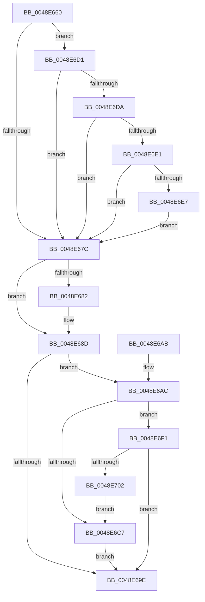

# RawCompletionRoutine

- RVA: `0x0048E660`–`0x0048E704` (길이 `164` bytes)
- VA: `0x000000014048E660`
- 실행 섹션: `.text`
- PDB 이름 있음: `예`; PDB Function 태그: `아니요`
- unwind 정보 RVA: `0x000B16C4`
- 디코드: `51`개 명령, `164/164` bytes 표시
- 미해석 바이트: `0` (있으면 어셈블리에 `.byte`로 보존)

> 이 문서는 커널 이미지의 기계어와 PDB 기호를 분석해 생성했습니다. 4번과 5번은 함수 원형과 자료형을 바이너리 사용 방식에서 추정한 C 해석이며 원본 소스 복구 결과는 아닙니다.

## 1. Dependencies

- 직접 호출 지점: **4**; 고유 호출 대상: **4**
- 직접 호출자로 확인된 함수: **0**
- RIP 상대 이미지 참조: **0**

### Outgoing calls
- `0x0048E694` → [RawEndOperation](RawEndOperation_function_0048E70C.md) (function, `0x0048E70C`)
- `0x0048E6B6` → [ExAcquireFastMutex](../20/ExAcquireFastMutex_function_0020E5A0.md) (function, `0x0020E5A0`)
- `0x0048E6CA` → [ExReleaseFastMutex](../25/ExReleaseFastMutex_function_002519C0.md) (function, `0x002519C0`)
- `0x0048E6F9` → [RawInitiateDeleteVolume](RawInitiateDeleteVolume_function_0048FDFC.md) (function, `0x0048FDFC`)

### Direct callers
- 이 함수 시작 RVA로 연결되는 직접 call은 확인되지 않았습니다. 간접 호출은 완전히 역산할 수 없습니다.

### Static image references
- 디코드된 RIP-relative 메모리 참조가 없습니다.

## 2. Other-region calls and transfers

- 다른 실행 섹션으로 향하는 call: **0**
- 별도 외부 분기/꼬리 이동을 확인하지 못했습니다.

## 3. Assembly (complete function range)

```asm
0048E660  48 89 5C 24 08                  mov qword ptr [rsp + 8], rbx
0048E665  57                              push rdi
0048E666  48 83 EC 20                     sub rsp, 0x20
0048E66A  48 8B BA B8 00 00 00            mov rdi, qword ptr [rdx + 0xb8]
0048E671  49 8B D8                        mov rbx, r8
0048E674  8A 07                           mov al, byte ptr [rdi]
0048E676  2C 03                           sub al, 3
0048E678  3C 01                           cmp al, 1
0048E67A  76 55                           jbe 0x14048e6d1
0048E67C  80 7A 41 00                     cmp byte ptr [rdx + 0x41], 0
0048E680  74 0B                           je 0x14048e68d
0048E682  48 8B 82 B8 00 00 00            mov rax, qword ptr [rdx + 0xb8]
0048E689  80 48 03 01                     or byte ptr [rax + 3], 1
0048E68D  48 8B 57 30                     mov rdx, qword ptr [rdi + 0x30]
0048E691  48 8B CB                        mov rcx, rbx
0048E694  E8 73 00 00 00                  call 0x14048e70c
0048E699  80 3F 1B                        cmp byte ptr [rdi], 0x1b
0048E69C  74 0E                           je 0x14048e6ac
0048E69E  48 8B 5C 24 30                  mov rbx, qword ptr [rsp + 0x30]
0048E6A3  33 C0                           xor eax, eax
0048E6A5  48 83 C4 20                     add rsp, 0x20
0048E6A9  5F                              pop rdi
0048E6AA  C3                              ret
0048E6AB  CC                              int3
0048E6AC  48 8D BB F0 00 00 00            lea rdi, [rbx + 0xf0]
0048E6B3  48 8B CF                        mov rcx, rdi
0048E6B6  E8 E5 FE D7 FF                  call 0x14020e5a0
0048E6BB  FF 8B 80 00 00 00               dec dword ptr [rbx + 0x80]
0048E6C1  83 7B 7C 00                     cmp dword ptr [rbx + 0x7c], 0
0048E6C5  74 2A                           je 0x14048e6f1
0048E6C7  48 8B CF                        mov rcx, rdi
0048E6CA  E8 F1 32 DC FF                  call 0x1402519c0
0048E6CF  EB CD                           jmp 0x14048e69e
0048E6D1  48 8B 4F 30                     mov rcx, qword ptr [rdi + 0x30]
0048E6D5  48 85 C9                        test rcx, rcx
0048E6D8  74 A2                           je 0x14048e67c
0048E6DA  8B 41 50                        mov eax, dword ptr [rcx + 0x50]
0048E6DD  A8 02                           test al, 2
0048E6DF  74 9B                           je 0x14048e67c
0048E6E1  83 7A 30 00                     cmp dword ptr [rdx + 0x30], 0
0048E6E5  7C 95                           jl 0x14048e67c
0048E6E7  48 8B 42 38                     mov rax, qword ptr [rdx + 0x38]
0048E6EB  48 01 41 68                     add qword ptr [rcx + 0x68], rax
0048E6EF  EB 8B                           jmp 0x14048e67c
0048E6F1  45 33 C0                        xor r8d, r8d
0048E6F4  33 D2                           xor edx, edx
0048E6F6  48 8B CB                        mov rcx, rbx
0048E6F9  E8 FE 16 00 00                  call 0x14048fdfc
0048E6FE  84 C0                           test al, al
0048E700  75 9C                           jne 0x14048e69e
0048E702  EB C3                           jmp 0x14048e6c7
```

## 4. C-style interpretation (structured pseudocode)

```c
__int64 __fastcall RawCompletionRoutine(__int64 a1, __int64 a2, __int64 a3)
{
    __int64 result;
    __int64 v_rsp;
    unsigned __int64 v_stack_p8;

    v_stack_p8 = v_rbx;
    v_rsp = (v_rsp) - (32);
    result = (unsigned __int8)((*(unsigned __int8 *)(*(unsigned __int64 *)(a2 + 184))) - (3));
    if (((unsigned __int8)(result)) <= 1) goto loc_0048E6D1;
loc_0048E67C:
    if ((*(unsigned __int8 *)(a2 + 65)) != 0) {
        result = *(unsigned __int64 *)(a2 + 184);
    }
    result = RawEndOperation(a3, *(unsigned __int64 *)(*(unsigned __int64 *)(a2 + 184) + 48), a3, a4);
    if ((*(unsigned __int8 *)(*(unsigned __int64 *)(a2 + 184))) == 27) goto loc_0048E6AC;
loc_0048E69E:
    result = 0;
    v_rsp = (v_rsp) + (32);
    return result;
loc_0048E6AC:
    result = ExAcquireFastMutex(v_stack_p8 + 240, *(unsigned __int64 *)(*(unsigned __int64 *)(a2 + 184) + 48), a3, a4);
    if ((*(unsigned int *)(v_stack_p8 + 124)) == 0) goto loc_0048E6F1;
loc_0048E6C7:
    result = ExReleaseFastMutex(v_stack_p8 + 240, *(unsigned __int64 *)(*(unsigned __int64 *)(a2 + 184) + 48), a3, a4);
    goto loc_0048E69E;
loc_0048E6D1:
    if (*(unsigned __int64 *)(v_stack_p8 + 240 + 48) == 0) goto loc_0048E67C;
    if ((((unsigned __int8)((unsigned int)(*(unsigned int *)(*(unsigned __int64 *)(v_stack_p8 + 240 + 48) + 80)))) & (2)) == 0) goto loc_0048E67C;
    if ((*(unsigned int *)(*(unsigned __int64 *)(*(unsigned __int64 *)(a2 + 184) + 48) + 48)) < 0) goto loc_0048E67C;
    goto loc_0048E67C;
loc_0048E6F1:
    a3 = 0;
    a2 = 0;
    result = RawInitiateDeleteVolume(v_stack_p8, a2, a3, a4);
    if ((unsigned __int8)(result) != 0) goto loc_0048E69E;
    goto loc_0048E6C7;
}
```

## 5. (Beta) C Style

```c
int64_t RawCompletionRoutine(int64_t Arg1, void *Arg2, void *Arg3)
{
    uint8_t *arg2 = (uint8_t *)Arg2;
    uint8_t *arg3 = (uint8_t *)Arg3;

    int64_t result;
    int64_t local_rsp;
    uint64_t v_stack_p8;

    v_stack_p8 = local_rbx;
    local_rsp = (local_rsp) - (32);
    result = (uint8_t)((*(uint8_t *)(*(uint64_t *)(arg2 + 0xB8))) - (3));
    if (((uint8_t)(result)) <= 1) goto loc_0048E6D1;
loc_0048E67C:
    if ((*(uint8_t *)(arg2 + 0x41)) != 0) {
        result = *(uint64_t *)(arg2 + 0xB8);
    }
    result = RawEndOperation(Arg3, *(uint64_t *)(*(uint64_t *)(arg2 + 0xB8) + 0x30), Arg3, a4);
    if ((*(uint8_t *)(*(uint64_t *)(arg2 + 0xB8))) == 27) goto loc_0048E6AC;
loc_0048E69E:
    result = 0;
    local_rsp = (local_rsp) + (32);
    return result;
loc_0048E6AC:
    result = ExAcquireFastMutex(v_stack_p8 + 240, *(uint64_t *)(*(uint64_t *)(arg2 + 0xB8) + 0x30), Arg3, a4);
    if ((*(uint32_t *)(v_stack_p8 + 0x7C)) == 0) goto loc_0048E6F1;
loc_0048E6C7:
    result = ExReleaseFastMutex(v_stack_p8 + 240, *(uint64_t *)(*(uint64_t *)(arg2 + 0xB8) + 0x30), Arg3, a4);
    goto loc_0048E69E;
loc_0048E6D1:
    if (*(uint64_t *)(v_stack_p8 + 0xF0 + 0x30) == 0) goto loc_0048E67C;
    if ((((uint8_t)((uint32_t)(*(uint32_t *)(*(uint64_t *)(v_stack_p8 + 0xF0 + 0x30) + 0x50)))) & (2)) == 0) goto loc_0048E67C;
    if ((*(uint32_t *)(*(uint64_t *)(*(uint64_t *)(arg2 + 0xB8) + 0x30) + 0x30)) < 0) goto loc_0048E67C;
    goto loc_0048E67C;
loc_0048E6F1:
    Arg3 = 0;
    Arg2 = 0;
    result = RawInitiateDeleteVolume(v_stack_p8, Arg2, Arg3, a4);
    if ((uint8_t)(result) != 0) goto loc_0048E69E;
    goto loc_0048E6C7;
}
```

### 관측된 메모리 오프셋

구조체 형식이 확인되지 않은 접근은 인자 기준의 오프셋으로만 기록했습니다.

| 기준 인자 | 오프셋 표현 | 폭 (bit) | 접근 |
|---|---:|---:|---|
| `Arg2` | `+ 0x30` | `32` | `R` |
| `Arg2` | `+ 0x38` | `64` | `R` |
| `Arg2` | `+ 0x41` | `8` | `R` |
| `Arg2` | `+ 0xB8` | `64` | `R` |
| `Arg3` | `+ 0x7C` | `32` | `R` |
| `Arg3` | `+ 0x80` | `32` | `R/W` |
| `Arg3` | `+ 0xF0` | `64` | `R` |

## 6. Execution-region graph

[열기: 2D/3D 그래프와 함수 탐색 컨트롤 패널](../../../control-panel.html?section=text&rva=0x0048E660&view=graph)

- 2D 그래프는 위에서 아래로 흐르고, 3D 그래프는 빈 공간을 드래그해 회전합니다. Shift+드래그는 이동, 휠은 확대·축소, 함수 노드 선택은 대상 보고서 이동입니다.

### Static fallback


