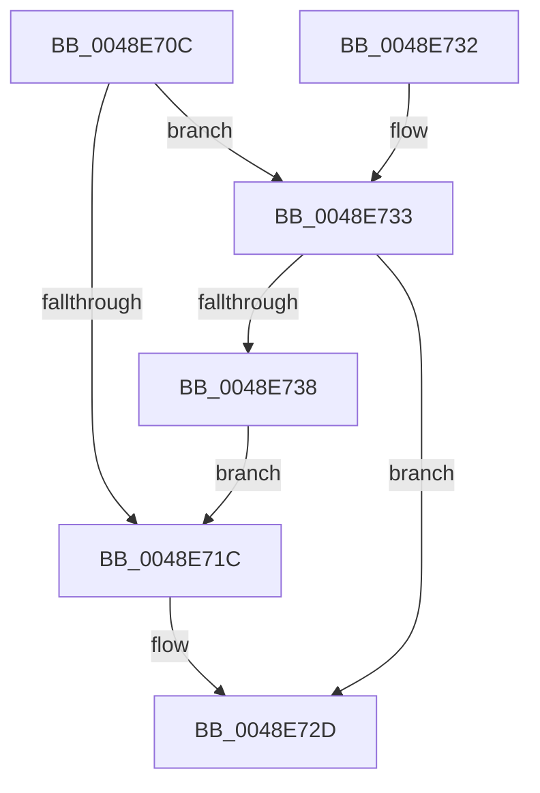

# RawEndOperation

- RVA: `0x0048E70C`–`0x0048E73A` (길이 `46` bytes)
- VA: `0x000000014048E70C`
- 실행 섹션: `.text`
- PDB 이름 있음: `예`; PDB Function 태그: `아니요`
- unwind 정보 RVA: `0x0005CEE8`
- 디코드: `13`개 명령, `46/46` bytes 표시
- 미해석 바이트: `0` (있으면 어셈블리에 `.byte`로 보존)

> 이 문서는 커널 이미지의 기계어와 PDB 기호를 분석해 생성했습니다. 4번과 5번은 함수 원형과 자료형을 바이너리 사용 방식에서 추정한 C 해석이며 원본 소스 복구 결과는 아닙니다.

## 1. Dependencies

- 직접 호출 지점: **1**; 고유 호출 대상: **1**
- 직접 호출자로 확인된 함수: **8**
- RIP 상대 이미지 참조: **0**

### Outgoing calls
- `0x0048E728` → [ExReleaseRundownProtectionCacheAwareEx](../25/ExReleaseRundownProtectionCacheAwareEx_function_0025F050.md) (function, `0x0025F050`)

### Direct callers
- [RawCompletionRoutine](RawCompletionRoutine_function_0048E660.md) at `0x0048E694`
- [RawQueryFsDeviceInfo](../../page/78/RawQueryFsDeviceInfo_function_0078A224.md) at `0x0078A282`
- [RawSetInformation](../../page/78/RawSetInformation_function_0078A2A8.md) at `0x0078A31C`
- [RawQueryInformation](../../page/9A/RawQueryInformation_function_009A361C.md) at `0x009A365A`
- [RawReadWriteDeviceControl](../../page/9A/RawReadWriteDeviceControl_function_009A3D50.md) at `0x009A3E09`
- [RawQueryFsVolumeInfo](../../page/9A/RawQueryFsVolumeInfo_function_009A4510.md) at `0x009A455B`
- [RawUserFsCtrl](../../page/9A/RawUserFsCtrl_function_009A45F4.md) at `0x009A47F8`
- [RawQueryFsSizeInfo](../../page/AA/RawQueryFsSizeInfo_function_00AA1DC8.md) at `0x00AA1EFE`

### Static image references
- 디코드된 RIP-relative 메모리 참조가 없습니다.

## 2. Other-region calls and transfers

- 다른 실행 섹션으로 향하는 call: **0**
- 별도 외부 분기/꼬리 이동을 확인하지 못했습니다.

## 3. Assembly (complete function range)

```asm
0048E70C  48 83 EC 28                     sub rsp, 0x28
0048E710  48 8B 81 D8 00 00 00            mov rax, qword ptr [rcx + 0xd8]
0048E717  48 85 C0                        test rax, rax
0048E71A  75 17                           jne 0x14048e733
0048E71C  48 8B 89 E8 00 00 00            mov rcx, qword ptr [rcx + 0xe8]
0048E723  BA 01 00 00 00                  mov edx, 1
0048E728  E8 23 09 DD FF                  call 0x14025f050
0048E72D  48 83 C4 28                     add rsp, 0x28
0048E731  C3                              ret
0048E732  CC                              int3
0048E733  48 3B D0                        cmp rdx, rax
0048E736  74 F5                           je 0x14048e72d
0048E738  EB E2                           jmp 0x14048e71c
```

## 4. C-style interpretation (structured pseudocode)

```c
__int64 __fastcall RawEndOperation(__int64 a1)
{
    __int64 result;
    __int64 v_rsp;

    v_rsp = (v_rsp) - (40);
    if (*(unsigned __int64 *)(a1 + 216) != 0) goto loc_0048E733;
loc_0048E71C:
    result = ExReleaseRundownProtectionCacheAwareEx(*(unsigned __int64 *)(a1 + 232), 1, a3, a4);
loc_0048E72D:
    v_rsp = (v_rsp) + (40);
    return result;
loc_0048E733:
    if (1 == result) goto loc_0048E72D;
    goto loc_0048E71C;
}
```

## 5. (Beta) C Style

```c
int64_t RawEndOperation(void *Arg1)
{
    uint8_t *arg1 = (uint8_t *)Arg1;

    int64_t result;
    int64_t local_rsp;

    local_rsp = (local_rsp) - (40);
    if (*(uint64_t *)(arg1 + 0xD8) != 0) goto loc_0048E733;
loc_0048E71C:
    result = ExReleaseRundownProtectionCacheAwareEx(*(uint64_t *)(arg1 + 0xE8), 1, a3, a4);
loc_0048E72D:
    local_rsp = (local_rsp) + (40);
    return result;
loc_0048E733:
    if (1 == result) goto loc_0048E72D;
    goto loc_0048E71C;
}
```

### 관측된 메모리 오프셋

구조체 형식이 확인되지 않은 접근은 인자 기준의 오프셋으로만 기록했습니다.

| 기준 인자 | 오프셋 표현 | 폭 (bit) | 접근 |
|---|---:|---:|---|
| `Arg1` | `+ 0xD8` | `64` | `R` |
| `Arg1` | `+ 0xE8` | `64` | `R` |

## 6. Execution-region graph

[열기: 2D/3D 그래프와 함수 탐색 컨트롤 패널](../../../control-panel.html?section=text&rva=0x0048E70C&view=graph)

- 2D 그래프는 위에서 아래로 흐르고, 3D 그래프는 빈 공간을 드래그해 회전합니다. Shift+드래그는 이동, 휠은 확대·축소, 함수 노드 선택은 대상 보고서 이동입니다.

### Static fallback


