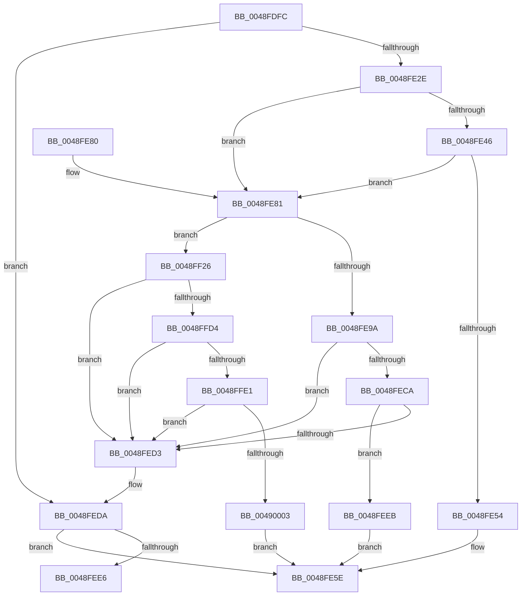

# RawInitiateDeleteVolume

- RVA: `0x0048FDFC`–`0x00490025` (길이 `553` bytes)
- VA: `0x000000014048FDFC`
- 실행 섹션: `.text`
- PDB 이름 있음: `예`; PDB Function 태그: `예`
- unwind 정보 RVA: `0x000B2B14`
- 디코드: `134`개 명령, `553/553` bytes 표시
- 미해석 바이트: `0` (있으면 어셈블리에 `.byte`로 보존)

> 이 문서는 커널 이미지의 기계어와 PDB 기호를 분석해 생성했습니다. 4번과 5번은 함수 원형과 자료형을 바이너리 사용 방식에서 추정한 C 해석이며 원본 소스 복구 결과는 아닙니다.

## 1. Dependencies

- 직접 호출 지점: **12**; 고유 호출 대상: **7**
- 직접 호출자로 확인된 함수: **6**
- RIP 상대 이미지 참조: **4**

### Outgoing calls
- `0x0048FE33` → [KeAcquireQueuedSpinLock](../27/KeAcquireQueuedSpinLock_function_00273D80.md) (function, `0x00273D80`)
- `0x0048FE59` → [KeReleaseQueuedSpinLock](../27/KeReleaseQueuedSpinLock_function_00272540.md) (function, `0x00272540`)
- `0x0048FEB0` → [KeReleaseQueuedSpinLock](../27/KeReleaseQueuedSpinLock_function_00272540.md) (function, `0x00272540`)
- `0x0048FEBC` → [ExAcquireFastMutex](../20/ExAcquireFastMutex_function_0020E5A0.md) (function, `0x0020E5A0`)
- `0x0048FEF9` → [ExReleaseFastMutex](../25/ExReleaseFastMutex_function_002519C0.md) (function, `0x002519C0`)
- `0x0048FF09` → [ExReleaseFastMutex](../25/ExReleaseFastMutex_function_002519C0.md) (function, `0x002519C0`)
- `0x0048FF11` → [RawCleanupVcb](../../page/9A/RawCleanupVcb_function_009A5C44.md) (function, `0x009A5C44`)
- `0x0048FF19` → [RawDeleteVcb](../../page/A8/RawDeleteVcb_function_00A87C14.md) (function, `0x00A87C14`)
- `0x0048FF38` → [memset](../6C/memset_function_006C6C40.md) (function, `0x006C6C40`)
- `0x0048FFB6` → [KeReleaseQueuedSpinLock](../27/KeReleaseQueuedSpinLock_function_00272540.md) (function, `0x00272540`)
- `0x0048FFC2` → [ExAcquireFastMutex](../20/ExAcquireFastMutex_function_0020E5A0.md) (function, `0x0020E5A0`)
- `0x0049001B` → [ExReleaseFastMutex](../25/ExReleaseFastMutex_function_002519C0.md) (function, `0x002519C0`)

### Direct callers
- [RawCompletionRoutine](RawCompletionRoutine_function_0048E660.md) at `0x0048E6F9`
- [RawVerifyVolume](../5E/RawVerifyVolume_function_005E5120.md) at `0x005E51E3`
- [RawCleanup](../../page/9A/RawCleanup_function_009A3B38.md) at `0x009A3BF8`
- [RawClose](../../page/9A/RawClose_function_009A3CCC.md) at `0x009A3D17`
- [RawReadWriteDeviceControl](../../page/9A/RawReadWriteDeviceControl_function_009A3D50.md) at `0x009A3E43`
- [RawCreate](../../page/9A/RawCreate_function_009A3E5C.md) at `0x009A3F82`

### Static image references
- `0x0048FEB5` → RVA `0x00F05CC0` (`.data`; read)
- `0x0048FFE8` → RVA `0x00F05CA0` (`.data`; read)
- `0x0048FFF3` → RVA `0x00F05CA8` (`.data`; read)
- `0x00490014` → RVA `0x00F05CA8` (`.data`; write)

## 2. Other-region calls and transfers

- 다른 실행 섹션으로 향하는 call: **2**
  - `0x0048FF11` → [RawCleanupVcb](../../page/9A/RawCleanupVcb_function_009A5C44.md) (`.text` → `PAGE`)
  - `0x0048FF19` → [RawDeleteVcb](../../page/A8/RawDeleteVcb_function_00A87C14.md) (`.text` → `PAGE`)
- call이 아닌 외부 분기/꼬리 이동: **1**
  - `0x0048FEE6` → [sub_006F6F06](../6F/Unknown_function_006F6F06.md) (`tail-transfer`)

## 3. Assembly (complete function range)

```asm
0048FDFC  48 8B C4                        mov rax, rsp
0048FDFF  48 89 58 08                     mov qword ptr [rax + 8], rbx
0048FE03  48 89 68 10                     mov qword ptr [rax + 0x10], rbp
0048FE07  48 89 70 18                     mov qword ptr [rax + 0x18], rsi
0048FE0B  48 89 78 20                     mov qword ptr [rax + 0x20], rdi
0048FE0F  41 54                           push r12
0048FE11  41 56                           push r14
0048FE13  41 57                           push r15
0048FE15  48 83 EC 20                     sub rsp, 0x20
0048FE19  8B 41 78                        mov eax, dword ptr [rcx + 0x78]
0048FE1C  33 F6                           xor esi, esi
0048FE1E  45 8B E0                        mov r12d, r8d
0048FE21  8B FA                           mov edi, edx
0048FE23  48 8B D9                        mov rbx, rcx
0048FE26  A8 04                           test al, 4
0048FE28  0F 85 AC 00 00 00               jne 0x14048feda
0048FE2E  8D 6E 09                        lea ebp, [rsi + 9]
0048FE31  8B CD                           mov ecx, ebp
0048FE33  E8 48 3F DE FF                  call 0x140273d80
0048FE38  4C 8D B3 C8 00 00 00            lea r14, [rbx + 0xc8]
0048FE3F  44 8A F8                        mov r15b, al
0048FE42  85 FF                           test edi, edi
0048FE44  75 3B                           jne 0x14048fe81
0048FE46  49 8B 06                        mov rax, qword ptr [r14]
0048FE49  8B 53 7C                        mov edx, dword ptr [rbx + 0x7c]
0048FE4C  03 50 1C                        add edx, dword ptr [rax + 0x1c]
0048FE4F  41 3B D4                        cmp edx, r12d
0048FE52  74 2D                           je 0x14048fe81
0048FE54  41 8A D7                        mov dl, r15b
0048FE57  8B CD                           mov ecx, ebp
0048FE59  E8 E2 26 DE FF                  call 0x140272540
0048FE5E  48 8B 5C 24 40                  mov rbx, qword ptr [rsp + 0x40]
0048FE63  40 8A C6                        mov al, sil
0048FE66  48 8B 74 24 50                  mov rsi, qword ptr [rsp + 0x50]
0048FE6B  48 8B 6C 24 48                  mov rbp, qword ptr [rsp + 0x48]
0048FE70  48 8B 7C 24 58                  mov rdi, qword ptr [rsp + 0x58]
0048FE75  48 83 C4 20                     add rsp, 0x20
0048FE79  41 5F                           pop r15
0048FE7B  41 5E                           pop r14
0048FE7D  41 5C                           pop r12
0048FE7F  C3                              ret
0048FE80  CC                              int3
0048FE81  49 8B 0E                        mov rcx, qword ptr [r14]
0048FE84  48 8D BB B0 00 00 00            lea rdi, [rbx + 0xb0]
0048FE8B  8B 41 1C                        mov eax, dword ptr [rcx + 0x1c]
0048FE8E  03 83 80 00 00 00               add eax, dword ptr [rbx + 0x80]
0048FE94  0F 85 8C 00 00 00               jne 0x14048ff26
0048FE9A  B8 FE FF 00 00                  mov eax, 0xfffe
0048FE9F  41 8A D7                        mov dl, r15b
0048FEA2  66 21 41 04                     and word ptr [rcx + 4], ax
0048FEA6  48 8B CD                        mov rcx, rbp
0048FEA9  49 8B 06                        mov rax, qword ptr [r14]
0048FEAC  48 89 70 08                     mov qword ptr [rax + 8], rsi
0048FEB0  E8 8B 26 DE FF                  call 0x140272540
0048FEB5  48 8D 0D 04 5E A7 00            lea rcx, [rip + 0xa75e04]
0048FEBC  E8 DF E6 D7 FF                  call 0x14020e5a0
0048FEC1  48 8B 0F                        mov rcx, qword ptr [rdi]
0048FEC4  48 39 79 08                     cmp qword ptr [rcx + 8], rdi
0048FEC8  75 09                           jne 0x14048fed3
0048FECA  48 8B 47 08                     mov rax, qword ptr [rdi + 8]
0048FECE  48 39 38                        cmp qword ptr [rax], rdi
0048FED1  74 18                           je 0x14048feeb
0048FED3  B9 03 00 00 00                  mov ecx, 3
0048FED8  CD 29                           int 0x29
0048FEDA  39 B1 80 00 00 00               cmp dword ptr [rcx + 0x80], esi
0048FEE0  0F 85 78 FF FF FF               jne 0x14048fe5e
0048FEE6  E9 1B 70 26 00                  jmp 0x1406f6f06
0048FEEB  48 89 08                        mov qword ptr [rax], rcx
0048FEEE  48 89 41 08                     mov qword ptr [rcx + 8], rax
0048FEF2  48 8D 0D C7 5D A7 00            lea rcx, [rip + 0xa75dc7]
0048FEF9  E8 C2 1A DC FF                  call 0x1402519c0
0048FEFE  83 4B 78 02                     or dword ptr [rbx + 0x78], 2
0048FF02  48 8D 8B F0 00 00 00            lea rcx, [rbx + 0xf0]
0048FF09  E8 B2 1A DC FF                  call 0x1402519c0
0048FF0E  48 8B CB                        mov rcx, rbx
0048FF11  E8 2E 5D 51 00                  call 0x1409a5c44
0048FF16  48 8B CB                        mov rcx, rbx
0048FF19  E8 F6 7C 5F 00                  call 0x140a87c14
0048FF1E  40 B6 01                        mov sil, 1
0048FF21  E9 38 FF FF FF                  jmp 0x14048fe5e
0048FF26  48 8B 8B D0 00 00 00            mov rcx, qword ptr [rbx + 0xd0]
0048FF2D  41 BC 60 00 00 00               mov r12d, 0x60
0048FF33  45 8B C4                        mov r8d, r12d
0048FF36  33 D2                           xor edx, edx
0048FF38  E8 03 6D 23 00                  call 0x1406c6c40
0048FF3D  48 8B 83 D0 00 00 00            mov rax, qword ptr [rbx + 0xd0]
0048FF44  41 8D 54 24 A8                  lea edx, [r12 - 0x58]
0048FF49  66 C7 00 0A 00                  mov word ptr [rax], 0xa
0048FF4E  48 8B 83 D0 00 00 00            mov rax, qword ptr [rbx + 0xd0]
0048FF55  66 44 89 60 02                  mov word ptr [rax + 2], r12w
0048FF5A  48 8B 8B D0 00 00 00            mov rcx, qword ptr [rbx + 0xd0]
0048FF61  49 8B 06                        mov rax, qword ptr [r14]
0048FF64  48 8B 40 10                     mov rax, qword ptr [rax + 0x10]
0048FF68  48 89 41 10                     mov qword ptr [rcx + 0x10], rax
0048FF6C  48 8B 83 D0 00 00 00            mov rax, qword ptr [rbx + 0xd0]
0048FF73  48 89 70 08                     mov qword ptr [rax + 8], rsi
0048FF77  49 8B 06                        mov rax, qword ptr [r14]
0048FF7A  0F B7 48 04                     movzx ecx, word ptr [rax + 4]
0048FF7E  48 8B 83 D0 00 00 00            mov rax, qword ptr [rbx + 0xd0]
0048FF85  66 23 CA                        and cx, dx
0048FF88  66 89 48 04                     mov word ptr [rax + 4], cx
0048FF8C  49 8B 06                        mov rax, qword ptr [r14]
0048FF8F  48 8B 48 10                     mov rcx, qword ptr [rax + 0x10]
0048FF93  48 8B 83 D0 00 00 00            mov rax, qword ptr [rbx + 0xd0]
0048FF9A  48 89 41 38                     mov qword ptr [rcx + 0x38], rax
0048FF9E  48 8B CD                        mov rcx, rbp
0048FFA1  49 8B 06                        mov rax, qword ptr [r14]
0048FFA4  48 89 B3 D0 00 00 00            mov qword ptr [rbx + 0xd0], rsi
0048FFAB  66 83 48 04 04                  or word ptr [rax + 4], 4
0048FFB0  09 53 78                        or dword ptr [rbx + 0x78], edx
0048FFB3  41 8A D7                        mov dl, r15b
0048FFB6  E8 85 25 DE FF                  call 0x140272540
0048FFBB  48 8D 0D FE 5C A7 00            lea rcx, [rip + 0xa75cfe]
0048FFC2  E8 D9 E5 D7 FF                  call 0x14020e5a0
0048FFC7  48 8B 0F                        mov rcx, qword ptr [rdi]
0048FFCA  48 39 79 08                     cmp qword ptr [rcx + 8], rdi
0048FFCE  0F 85 FF FE FF FF               jne 0x14048fed3
0048FFD4  48 8B 47 08                     mov rax, qword ptr [rdi + 8]
0048FFD8  48 39 38                        cmp qword ptr [rax], rdi
0048FFDB  0F 85 F2 FE FF FF               jne 0x14048fed3
0048FFE1  48 89 08                        mov qword ptr [rax], rcx
0048FFE4  48 89 41 08                     mov qword ptr [rcx + 8], rax
0048FFE8  48 8D 0D B1 5C A7 00            lea rcx, [rip + 0xa75cb1]
0048FFEF  83 4B 78 06                     or dword ptr [rbx + 0x78], 6
0048FFF3  48 8B 05 AE 5C A7 00            mov rax, qword ptr [rip + 0xa75cae]
0048FFFA  48 39 08                        cmp qword ptr [rax], rcx
0048FFFD  0F 85 D0 FE FF FF               jne 0x14048fed3
00490003  48 89 0F                        mov qword ptr [rdi], rcx
00490006  48 8D 0D B3 5C A7 00            lea rcx, [rip + 0xa75cb3]
0049000D  48 89 47 08                     mov qword ptr [rdi + 8], rax
00490011  48 89 38                        mov qword ptr [rax], rdi
00490014  48 89 3D 8D 5C A7 00            mov qword ptr [rip + 0xa75c8d], rdi
0049001B  E8 A0 19 DC FF                  call 0x1402519c0
00490020  E9 39 FE FF FF                  jmp 0x14048fe5e
```

## 4. C-style interpretation (structured pseudocode)

```c
__int64 __fastcall RawInitiateDeleteVolume(__int64 a1, int a2, int a3)
{
    __int64 result;
    __int64 v_rsi;
    __int64 v_rsp;
    unsigned __int64 v_stack_p10;
    unsigned __int64 v_stack_p18;
    unsigned __int64 v_stack_p20;
    unsigned __int64 v_stack_p8;

    *(unsigned __int64 *)(v_rsp + 8) = v_rbx;
    *(unsigned __int64 *)(v_rsp + 16) = v_rbp;
    *(unsigned __int64 *)(v_rsp + 24) = v_rsi;
    *(unsigned __int64 *)(v_rsp + 32) = v_rdi;
    v_rsp = (v_rsp) - (32);
    v_rsi = 0;
    if ((((unsigned __int8)((unsigned int)(*(unsigned int *)(a1 + 120)))) & (4)) != 0) goto loc_0048FEDA;
    result = KeAcquireQueuedSpinLock((unsigned int)((unsigned int)(v_rsi + 9)), a2, a3, a4);
    if ((unsigned int)((unsigned int)(a2)) != 0) goto loc_0048FE81;
    a2 = (unsigned int)(((unsigned int)(*(unsigned int *)(a1 + 124))) + (*(unsigned int *)(*(unsigned __int64 *)(a1 + 200) + 28)));
    if (a2 == ((unsigned int)((unsigned int)(a3)))) goto loc_0048FE81;
    result = KeReleaseQueuedSpinLock((unsigned int)((unsigned int)(v_rsi + 9)), (unsigned __int8)((unsigned __int8)(result)), a3, a4);
loc_0048FE5E:
    v_rsp = (v_rsp) + (32);
    return 0;
loc_0048FE81:
    result = (unsigned int)(((unsigned int)(*(unsigned int *)(*(unsigned __int64 *)(a1 + 200) + 28))) + (*(unsigned int *)(v_stack_p8 + 128)));
    if (condition_is_not_equal) goto loc_0048FF26;
    *(unsigned __int64 *)(*(unsigned __int64 *)(a1 + 200) + 8) = v_stack_p18;
    result = KeReleaseQueuedSpinLock(v_stack_p10, (unsigned __int8)((unsigned __int8)(result)), a3, a4);
    result = ExAcquireFastMutex(v_rip + 10968580, (unsigned __int8)((unsigned __int8)(result)), a3, a4);
    if ((*(unsigned __int64 *)(*(unsigned __int64 *)(v_stack_p8 + 176) + 8)) != (v_stack_p8 + 176)) goto loc_0048FED3;
    if ((*(unsigned __int64 *)(*(unsigned __int64 *)(v_stack_p8 + 176 + 8))) == (v_stack_p8 + 176)) goto loc_0048FEEB;
loc_0048FED3:
loc_0048FEDA:
    if ((*(unsigned int *)(3 + 128)) != ((unsigned int)(v_stack_p18))) goto loc_0048FE5E;
loc_0048FEEB:
    *(unsigned __int64 *)(*(unsigned __int64 *)(v_stack_p8 + 176 + 8)) = 3;
    *(unsigned __int64 *)(3 + 8) = *(unsigned __int64 *)(v_stack_p8 + 176 + 8);
    result = ExReleaseFastMutex(v_rip + 10968519, (unsigned __int8)((unsigned __int8)(result)), a3, a4);
    result = ExReleaseFastMutex(v_stack_p8 + 240, (unsigned __int8)((unsigned __int8)(result)), a3, a4);
    result = RawCleanupVcb(v_stack_p8, (unsigned __int8)((unsigned __int8)(result)), a3, a4);
    result = RawDeleteVcb(v_stack_p8, (unsigned __int8)((unsigned __int8)(result)), a3, a4);
    goto loc_0048FE5E;
loc_0048FF26:
    a2 = 0;
    result = memset(*(unsigned __int64 *)(v_stack_p8 + 208), a2, 96, a4);
    *(unsigned __int16 *)(*(unsigned __int64 *)(v_stack_p8 + 208)) = 10;
    *(unsigned __int16 *)(*(unsigned __int64 *)(v_stack_p8 + 208) + 2) = 96;
    *(unsigned __int64 *)(*(unsigned __int64 *)(v_stack_p8 + 208) + 16) = *(unsigned __int64 *)(*(unsigned __int64 *)(a1 + 200) + 16);
    *(unsigned __int64 *)(*(unsigned __int64 *)(v_stack_p8 + 208) + 8) = 1;
    a1 = (unsigned __int16)((*(unsigned __int16 *)(*(unsigned __int64 *)(a1 + 200) + 4)) & ((unsigned __int16)(96 - 88)));
    *(unsigned __int16 *)(*(unsigned __int64 *)(v_stack_p8 + 208) + 4) = (unsigned __int16)(a1);
    *(unsigned __int64 *)(*(unsigned __int64 *)(*(unsigned __int64 *)(a1 + 200) + 16) + 56) = *(unsigned __int64 *)(v_stack_p8 + 208);
    *(unsigned __int64 *)(v_stack_p8 + 208) = 1;
    result = KeReleaseQueuedSpinLock(v_stack_p10, (unsigned __int8)((unsigned __int8)(result)), 96, a4);
    result = ExAcquireFastMutex(v_rip + 10968318, (unsigned __int8)((unsigned __int8)(result)), 96, a4);
    if ((*(unsigned __int64 *)(*(unsigned __int64 *)(v_stack_p8 + 176) + 8)) != (v_stack_p8 + 176)) goto loc_0048FED3;
    if ((*(unsigned __int64 *)(*(unsigned __int64 *)(v_stack_p8 + 176 + 8))) != (v_stack_p8 + 176)) goto loc_0048FED3;
    *(unsigned __int64 *)(*(unsigned __int64 *)(v_stack_p8 + 176 + 8)) = *(unsigned __int64 *)(v_stack_p8 + 176);
    *(unsigned __int64 *)(*(unsigned __int64 *)(v_stack_p8 + 176) + 8) = *(unsigned __int64 *)(v_stack_p8 + 176 + 8);
    if ((*(unsigned __int64 *)(*(unsigned __int64 *)(v_rip + 10968238))) != (v_rip + 10968241)) goto loc_0048FED3;
    *(unsigned __int64 *)(v_stack_p8 + 176) = v_rip + 10968241;
    *(unsigned __int64 *)(v_stack_p8 + 176 + 8) = *(unsigned __int64 *)(v_rip + 10968238);
    *(unsigned __int64 *)(*(unsigned __int64 *)(v_rip + 10968238)) = v_stack_p8 + 176;
    *(unsigned __int64 *)(v_rip + 10968205) = v_stack_p8 + 176;
    result = ExReleaseFastMutex(v_rip + 10968243, (unsigned __int8)((unsigned __int8)(result)), 96, a4);
    goto loc_0048FE5E;
}
```

## 5. (Beta) C Style

```c
int64_t RawInitiateDeleteVolume(void *Arg1, int32_t Arg2, int32_t Arg3)
{
    uint8_t *arg1 = (uint8_t *)Arg1;

    int64_t result;
    int64_t local_rsi;
    int64_t local_rsp;
    uint64_t v_stack_p10;
    uint64_t v_stack_p18;
    uint64_t v_stack_p20;
    uint64_t v_stack_p8;

    *(uint64_t *)(local_rsp + 0x8) = local_rbx;
    *(uint64_t *)(local_rsp + 0x10) = local_rbp;
    *(uint64_t *)(local_rsp + 0x18) = local_rsi;
    *(uint64_t *)(local_rsp + 0x20) = local_rdi;
    local_rsp = (local_rsp) - (32);
    local_rsi = 0;
    if ((((uint8_t)((uint32_t)(*(uint32_t *)(arg1 + 0x78)))) & (4)) != 0) goto loc_0048FEDA;
    result = KeAcquireQueuedSpinLock((uint32_t)((uint32_t)(local_rsi + 9)), Arg2, Arg3, a4);
    if ((uint32_t)((uint32_t)(Arg2)) != 0) goto loc_0048FE81;
    Arg2 = (uint32_t)(((uint32_t)(*(uint32_t *)(arg1 + 0x7C))) + (*(uint32_t *)(*(uint64_t *)(arg1 + 0xC8) + 0x1C)));
    if (Arg2 == ((uint32_t)((uint32_t)(Arg3)))) goto loc_0048FE81;
    result = KeReleaseQueuedSpinLock((uint32_t)((uint32_t)(local_rsi + 9)), (uint8_t)((uint8_t)(result)), Arg3, a4);
loc_0048FE5E:
    local_rsp = (local_rsp) + (32);
    return 0;
loc_0048FE81:
    result = (uint32_t)(((uint32_t)(*(uint32_t *)(*(uint64_t *)(arg1 + 0xC8) + 0x1C))) + (*(uint32_t *)(v_stack_p8 + 0x80)));
    if (condition_is_not_equal) goto loc_0048FF26;
    *(uint64_t *)(*(uint64_t *)(arg1 + 0xC8) + 0x8) = v_stack_p18;
    result = KeReleaseQueuedSpinLock(v_stack_p10, (uint8_t)((uint8_t)(result)), Arg3, a4);
    result = ExAcquireFastMutex(v_rip + 10968580, (uint8_t)((uint8_t)(result)), Arg3, a4);
    if ((*(uint64_t *)(*(uint64_t *)(v_stack_p8 + 0xB0) + 0x8)) != (v_stack_p8 + 176)) goto loc_0048FED3;
    if ((*(uint64_t *)(*(uint64_t *)(v_stack_p8 + 0xB0 + 0x8))) == (v_stack_p8 + 176)) goto loc_0048FEEB;
loc_0048FED3:
loc_0048FEDA:
    if ((*(uint32_t *)(3 + 0x80)) != ((uint32_t)(v_stack_p18))) goto loc_0048FE5E;
loc_0048FEEB:
    *(uint64_t *)(*(uint64_t *)(v_stack_p8 + 0xB0 + 0x8)) = 3;
    *(uint64_t *)(3 + 0x8) = *(uint64_t *)(v_stack_p8 + 0xB0 + 0x8);
    result = ExReleaseFastMutex(v_rip + 10968519, (uint8_t)((uint8_t)(result)), Arg3, a4);
    result = ExReleaseFastMutex(v_stack_p8 + 240, (uint8_t)((uint8_t)(result)), Arg3, a4);
    result = RawCleanupVcb(v_stack_p8, (uint8_t)((uint8_t)(result)), Arg3, a4);
    result = RawDeleteVcb(v_stack_p8, (uint8_t)((uint8_t)(result)), Arg3, a4);
    goto loc_0048FE5E;
loc_0048FF26:
    Arg2 = 0;
    result = memset(*(uint64_t *)(v_stack_p8 + 0xD0), Arg2, 96, a4);
    *(uint16_t *)(*(uint64_t *)(v_stack_p8 + 0xD0)) = 10;
    *(uint16_t *)(*(uint64_t *)(v_stack_p8 + 0xD0) + 0x2) = 96;
    *(uint64_t *)(*(uint64_t *)(v_stack_p8 + 0xD0) + 0x10) = *(uint64_t *)(*(uint64_t *)(arg1 + 0xC8) + 0x10);
    *(uint64_t *)(*(uint64_t *)(v_stack_p8 + 0xD0) + 0x8) = 1;
    Arg1 = (uint16_t)((*(uint16_t *)(*(uint64_t *)(arg1 + 0xC8) + 0x4)) & ((uint16_t)(96 - 88)));
    *(uint16_t *)(*(uint64_t *)(v_stack_p8 + 0xD0) + 0x4) = (uint16_t)(Arg1);
    *(uint64_t *)(*(uint64_t *)(*(uint64_t *)(arg1 + 0xC8) + 0x10) + 0x38) = *(uint64_t *)(v_stack_p8 + 0xD0);
    *(uint64_t *)(v_stack_p8 + 0xD0) = 1;
    result = KeReleaseQueuedSpinLock(v_stack_p10, (uint8_t)((uint8_t)(result)), 96, a4);
    result = ExAcquireFastMutex(v_rip + 10968318, (uint8_t)((uint8_t)(result)), 96, a4);
    if ((*(uint64_t *)(*(uint64_t *)(v_stack_p8 + 0xB0) + 0x8)) != (v_stack_p8 + 176)) goto loc_0048FED3;
    if ((*(uint64_t *)(*(uint64_t *)(v_stack_p8 + 0xB0 + 0x8))) != (v_stack_p8 + 176)) goto loc_0048FED3;
    *(uint64_t *)(*(uint64_t *)(v_stack_p8 + 0xB0 + 0x8)) = *(uint64_t *)(v_stack_p8 + 0xB0);
    *(uint64_t *)(*(uint64_t *)(v_stack_p8 + 0xB0) + 0x8) = *(uint64_t *)(v_stack_p8 + 0xB0 + 0x8);
    if ((*(uint64_t *)(*(uint64_t *)(v_rip + 0xA75CAE))) != (v_rip + 10968241)) goto loc_0048FED3;
    *(uint64_t *)(v_stack_p8 + 0xB0) = v_rip + 10968241;
    *(uint64_t *)(v_stack_p8 + 0xB0 + 0x8) = *(uint64_t *)(v_rip + 0xA75CAE);
    *(uint64_t *)(*(uint64_t *)(v_rip + 0xA75CAE)) = v_stack_p8 + 176;
    *(uint64_t *)(v_rip + 0xA75C8D) = v_stack_p8 + 176;
    result = ExReleaseFastMutex(v_rip + 10968243, (uint8_t)((uint8_t)(result)), 96, a4);
    goto loc_0048FE5E;
}
```

### 관측된 메모리 오프셋

구조체 형식이 확인되지 않은 접근은 인자 기준의 오프셋으로만 기록했습니다.

| 기준 인자 | 오프셋 표현 | 폭 (bit) | 접근 |
|---|---:|---:|---|
| `Arg1` | `+ 0x0` | `64` | `R` |
| `Arg1` | `+ 0x0` | `64` | `W` |
| `Arg1` | `+ 0x8` | `64` | `R` |
| `Arg1` | `+ 0x8` | `64` | `W` |
| `Arg1` | `+ 0x78` | `32` | `R` |
| `Arg1` | `+ 0x78` | `32` | `R/W` |
| `Arg1` | `+ 0x7C` | `32` | `R` |
| `Arg1` | `+ 0x80` | `32` | `R` |
| `Arg1` | `+ 0xB0` | `64` | `R` |
| `Arg1` | `+ 0xC8` | `64` | `R` |
| `Arg1` | `+ 0xD0` | `64` | `R` |
| `Arg1` | `+ 0xD0` | `64` | `W` |
| `Arg1` | `+ 0xF0` | `64` | `R` |

## 6. Execution-region graph

[열기: 2D/3D 그래프와 함수 탐색 컨트롤 패널](../../../control-panel.html?section=text&rva=0x0048FDFC&view=graph)

- 2D 그래프는 위에서 아래로 흐르고, 3D 그래프는 빈 공간을 드래그해 회전합니다. Shift+드래그는 이동, 휠은 확대·축소, 함수 노드 선택은 대상 보고서 이동입니다.

### Static fallback


