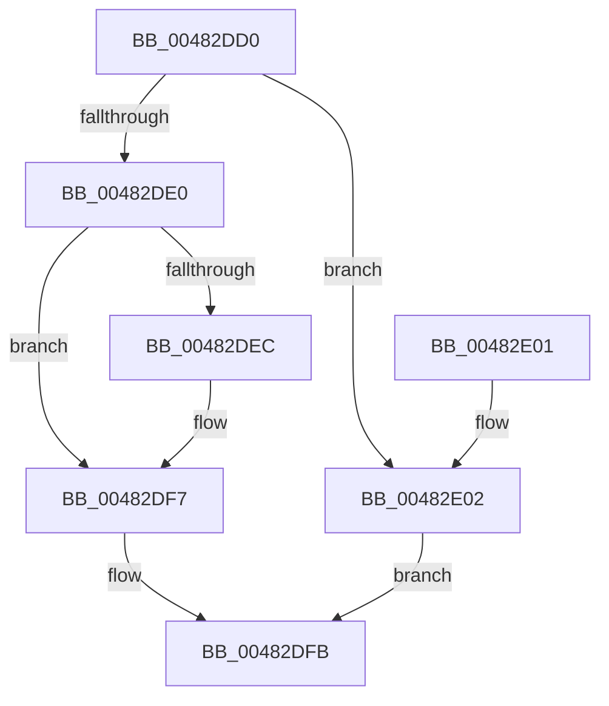

# RtlCSparseBitmapLeaveLockingRegion

- RVA: `0x00482DD0`–`0x00482E09` (길이 `57` bytes)
- VA: `0x0000000140482DD0`
- 실행 섹션: `.text`
- PDB 이름 있음: `예`; PDB Function 태그: `아니요`
- unwind 정보 RVA: `0x0005DAC8`
- 디코드: `18`개 명령, `57/57` bytes 표시
- 미해석 바이트: `0` (있으면 어셈블리에 `.byte`로 보존)

> 이 문서는 커널 이미지의 기계어와 PDB 기호를 분석해 생성했습니다. 4번과 5번은 함수 원형과 자료형을 바이너리 사용 방식에서 추정한 C 해석이며 원본 소스 복구 결과는 아닙니다.

## 1. Dependencies

- 직접 호출 지점: **2**; 고유 호출 대상: **2**
- 직접 호출자로 확인된 함수: **1**
- RIP 상대 이미지 참조: **1**

### Outgoing calls
- `0x00482DF2` → [KiLowerIrqlProcessIrqlFlags](../4F/KiLowerIrqlProcessIrqlFlags_function_004F5698.md) (function, `0x004F5698`)
- `0x00482E02` → [KeLeaveGuardedRegion](../2E/KeLeaveGuardedRegion_function_002E2C40.md) (function, `0x002E2C40`)

### Direct callers
- [RtlpCSparseBitmapPageCommit](../2F/RtlpCSparseBitmapPageCommit_function_002F0B98.md) at `0x002F0D32`

### Static image references
- `0x00482DE0` → RVA `0x00FC6D20` (`ALMOSTRO`; read)

## 2. Other-region calls and transfers

- 다른 실행 섹션으로 향하는 call: **0**
- 별도 외부 분기/꼬리 이동을 확인하지 못했습니다.

## 3. Assembly (complete function range)

```asm
00482DD0  40 53                           push rbx
00482DD2  48 83 EC 20                     sub rsp, 0x20
00482DD6  48 8B 41 08                     mov rax, qword ptr [rcx + 8]
00482DDA  80 78 30 00                     cmp byte ptr [rax + 0x30], 0
00482DDE  74 22                           je 0x140482e02
00482DE0  83 3D 39 3F B4 00 00            cmp dword ptr [rip + 0xb43f39], 0
00482DE7  0F B6 19                        movzx ebx, byte ptr [rcx]
00482DEA  74 0B                           je 0x140482df7
00482DEC  44 0F 20 C1                     mov rcx, cr8
00482DF0  8A D3                           mov dl, bl
00482DF2  E8 A1 28 07 00                  call 0x1404f5698
00482DF7  44 0F 22 C3                     mov cr8, rbx
00482DFB  48 83 C4 20                     add rsp, 0x20
00482DFF  5B                              pop rbx
00482E00  C3                              ret
00482E01  CC                              int3
00482E02  E8 39 FE E5 FF                  call 0x1402e2c40
00482E07  EB F2                           jmp 0x140482dfb
```

## 4. C-style interpretation (structured pseudocode)

```c
__int64 __fastcall RtlCSparseBitmapLeaveLockingRegion(__int64 a1)
{
    __int64 result;
    __int64 v_rsp;

    v_rsp = (v_rsp) - (32);
    if ((*(unsigned __int8 *)(*(unsigned __int64 *)(a1 + 8) + 48)) == 0) goto loc_00482E02;
    result = *(unsigned __int64 *)(a1 + 8);
    if ((*(unsigned int *)(v_rip + 11812665)) != 0) {
        a1 = v_cr8;
        a2 = (unsigned __int8)(*(unsigned __int8 *)(a1));
        result = KiLowerIrqlProcessIrqlFlags(a1, a2, a3, a4);
    }
loc_00482DFB:
    v_rsp = (v_rsp) + (32);
    return result;
loc_00482E02:
    result = KeLeaveGuardedRegion(a1, a2, a3, a4);
    goto loc_00482DFB;
}
```

## 5. (Beta) C Style

```c
int64_t RtlCSparseBitmapLeaveLockingRegion(void *Arg1)
{
    uint8_t *arg1 = (uint8_t *)Arg1;

    int64_t result;
    int64_t local_rsp;

    local_rsp = (local_rsp) - (32);
    if ((*(uint8_t *)(*(uint64_t *)(arg1 + 0x8) + 0x30)) == 0) goto loc_00482E02;
    result = *(uint64_t *)(arg1 + 0x8);
    if ((*(uint32_t *)(v_rip + 0xB43F39)) != 0) {
        Arg1 = v_cr8;
        a2 = (uint8_t)(*(uint8_t *)(arg1));
        result = KiLowerIrqlProcessIrqlFlags(Arg1, a2, a3, a4);
    }
loc_00482DFB:
    local_rsp = (local_rsp) + (32);
    return result;
loc_00482E02:
    result = KeLeaveGuardedRegion(Arg1, a2, a3, a4);
    goto loc_00482DFB;
}
```

### 관측된 메모리 오프셋

구조체 형식이 확인되지 않은 접근은 인자 기준의 오프셋으로만 기록했습니다.

| 기준 인자 | 오프셋 표현 | 폭 (bit) | 접근 |
|---|---:|---:|---|
| `Arg1` | `+ 0x0` | `8` | `R` |
| `Arg1` | `+ 0x8` | `64` | `R` |

## 6. Execution-region graph

[열기: 2D/3D 그래프와 함수 탐색 컨트롤 패널](../../../control-panel.html?section=text&rva=0x00482DD0&view=graph)

- 2D 그래프는 위에서 아래로 흐르고, 3D 그래프는 빈 공간을 드래그해 회전합니다. Shift+드래그는 이동, 휠은 확대·축소, 함수 노드 선택은 대상 보고서 이동입니다.

### Static fallback


