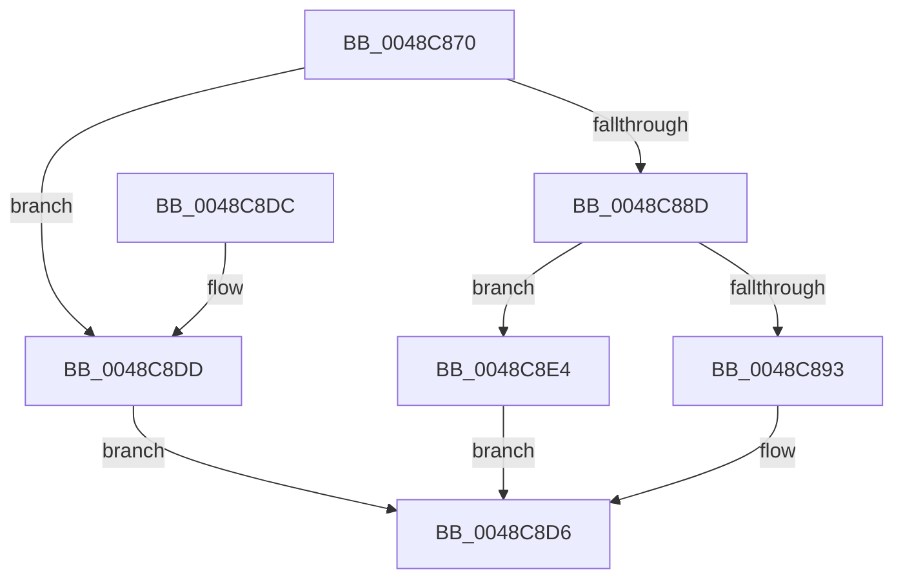

# RtlDecompressBufferEx2

- RVA: `0x0048C870`–`0x0048C8EB` (길이 `123` bytes)
- VA: `0x000000014048C870`
- 실행 섹션: `.text`
- PDB 이름 있음: `예`; PDB Function 태그: `아니요`
- unwind 정보 RVA: `0x000B12F8`
- 디코드: `33`개 명령, `123/123` bytes 표시
- 미해석 바이트: `0` (있으면 어셈블리에 `.byte`로 보존)

> 이 문서는 커널 이미지의 기계어와 PDB 기호를 분석해 생성했습니다. 4번과 5번은 함수 원형과 자료형을 바이너리 사용 방식에서 추정한 C 해석이며 원본 소스 복구 결과는 아닙니다.

## 1. Dependencies

- 직접 호출 지점: **1**; 고유 호출 대상: **1**
- 직접 호출자로 확인된 함수: **0**
- RIP 상대 이미지 참조: **1**

### Outgoing calls
- `0x0048C8D1` → [guard_dispatch_icall](../6B/guard_dispatch_icall_function_006BAAD0.md) (function, `0x006BAAD0`)

### Direct callers
- 이 함수 시작 RVA로 연결되는 직접 call은 확인되지 않았습니다. 간접 호출은 완전히 역산할 수 없습니다.

### Static image references
- `0x0048C8A1` → RVA `0x00001FB0` (`.rdata`; read)

## 2. Other-region calls and transfers

- 다른 실행 섹션으로 향하는 call: **0**
- 별도 외부 분기/꼬리 이동을 확인하지 못했습니다.

## 3. Assembly (complete function range)

```asm
0048C870  40 53                           push rbx
0048C872  48 83 EC 40                     sub rsp, 0x40
0048C876  B8 FF 00 00 00                  mov eax, 0xff
0048C87B  4D 8B D1                        mov r10, r9
0048C87E  66 23 C8                        and cx, ax
0048C881  45 8B D8                        mov r11d, r8d
0048C884  48 8B DA                        mov rbx, rdx
0048C887  66 83 F9 02                     cmp cx, 2
0048C88B  72 50                           jb 0x14048c8dd
0048C88D  66 83 F9 08                     cmp cx, 8
0048C891  77 51                           ja 0x14048c8e4
0048C893  44 8B 4C 24 70                  mov r9d, dword ptr [rsp + 0x70]
0048C898  4D 8B C2                        mov r8, r10
0048C89B  0F B7 C1                        movzx eax, cx
0048C89E  41 8B D3                        mov edx, r11d
0048C8A1  48 8D 0D 08 57 B7 FF            lea rcx, [rip - 0x48a8f8]
0048C8A8  48 8B 04 C1                     mov rax, qword ptr [rcx + rax*8]
0048C8AC  48 8B 8C 24 88 00 00 00         mov rcx, qword ptr [rsp + 0x88]
0048C8B4  48 89 4C 24 30                  mov qword ptr [rsp + 0x30], rcx
0048C8B9  48 8B 8C 24 80 00 00 00         mov rcx, qword ptr [rsp + 0x80]
0048C8C1  48 89 4C 24 28                  mov qword ptr [rsp + 0x28], rcx
0048C8C6  8B 4C 24 78                     mov ecx, dword ptr [rsp + 0x78]
0048C8CA  89 4C 24 20                     mov dword ptr [rsp + 0x20], ecx
0048C8CE  48 8B CB                        mov rcx, rbx
0048C8D1  E8 FA E1 22 00                  call 0x1406baad0
0048C8D6  48 83 C4 40                     add rsp, 0x40
0048C8DA  5B                              pop rbx
0048C8DB  C3                              ret
0048C8DC  CC                              int3
0048C8DD  B8 0D 00 00 C0                  mov eax, 0xc000000d
0048C8E2  EB F2                           jmp 0x14048c8d6
0048C8E4  B8 5F 02 00 C0                  mov eax, 0xc000025f
0048C8E9  EB EB                           jmp 0x14048c8d6
```

## 4. C-style interpretation (structured pseudocode)

```c
__int64 __fastcall RtlDecompressBufferEx2(unsigned __int16 a1, __int64 a2, int a3, __int64 a4, unsigned int a5, unsigned int a6, __int64 a7, __int64 a8)
{
    __int64 result;
    __int64 v_rsp;
    unsigned __int64 v_stack_m18;
    unsigned __int64 v_stack_m20;
    unsigned int v_stack_m28;

    v_rsp = (v_rsp) - (64);
    a1 = (unsigned __int16)((a1) & (255));
    if (a1 < 2) goto loc_0048C8DD;
    if (a1 > 8) goto loc_0048C8E4;
    v_stack_m18 = a8;
    v_stack_m20 = a7;
    v_stack_m28 = (unsigned int)((unsigned int)(a6));
    result = guard_dispatch_icall(a2, (unsigned int)((unsigned int)((unsigned int)(a3))), a4, (unsigned int)(a5));
loc_0048C8D6:
    v_rsp = (v_rsp) + (64);
    return result;
loc_0048C8DD:
    goto loc_0048C8D6;
loc_0048C8E4:
    goto loc_0048C8D6;
}
```

## 5. (Beta) C Style

```c
int64_t RtlDecompressBufferEx2(uint16_t Arg1, int64_t Arg2, int32_t Arg3, int64_t Arg4, uint32_t Arg5, uint32_t Arg6, int64_t Arg7, int64_t Arg8)
{
    int64_t result;
    int64_t local_rsp;
    uint64_t v_stack_m18;
    uint64_t v_stack_m20;
    uint32_t v_stack_m28;

    local_rsp = (local_rsp) - (64);
    Arg1 = (uint16_t)((Arg1) & (255));
    if (Arg1 < 2) goto loc_0048C8DD;
    if (Arg1 > 8) goto loc_0048C8E4;
    v_stack_m18 = Arg8;
    v_stack_m20 = Arg7;
    v_stack_m28 = (uint32_t)((uint32_t)(Arg6));
    result = guard_dispatch_icall(Arg2, (uint32_t)((uint32_t)((uint32_t)(Arg3))), Arg4, (uint32_t)(Arg5));
loc_0048C8D6:
    local_rsp = (local_rsp) + (64);
    return result;
loc_0048C8DD:
    goto loc_0048C8D6;
loc_0048C8E4:
    goto loc_0048C8D6;
}
```

## 6. Execution-region graph

[열기: 2D/3D 그래프와 함수 탐색 컨트롤 패널](../../../control-panel.html?section=text&rva=0x0048C870&view=graph)

- 2D 그래프는 위에서 아래로 흐르고, 3D 그래프는 빈 공간을 드래그해 회전합니다. Shift+드래그는 이동, 휠은 확대·축소, 함수 노드 선택은 대상 보고서 이동입니다.

### Static fallback


