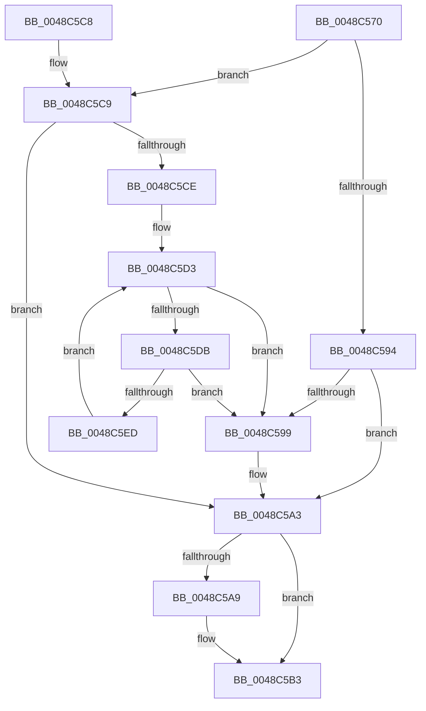

# RtlDeleteHashTable

- RVA: `0x0048C570`–`0x0048C5EF` (길이 `127` bytes)
- VA: `0x000000014048C570`
- 실행 섹션: `.text`
- PDB 이름 있음: `예`; PDB Function 태그: `아니요`
- unwind 정보 RVA: `0x000B0E8C`
- 디코드: `41`개 명령, `127/127` bytes 표시
- 미해석 바이트: `0` (있으면 어셈블리에 `.byte`로 보존)

> 이 문서는 커널 이미지의 기계어와 PDB 기호를 분석해 생성했습니다. 4번과 5번은 함수 원형과 자료형을 바이너리 사용 방식에서 추정한 C 해석이며 원본 소스 복구 결과는 아닙니다.

## 1. Dependencies

- 직접 호출 지점: **3**; 고유 호출 대상: **1**
- 직접 호출자로 확인된 함수: **7**
- RIP 상대 이미지 참조: **0**

### Outgoing calls
- `0x0048C59E` → [ExFreePoolWithTag](../../poolcode/B8/ExFreePoolWithTag_function_00B82870.md) (function, `0x00B82870`)
- `0x0048C5AE` → [ExFreePoolWithTag](../../poolcode/B8/ExFreePoolWithTag_function_00B82870.md) (function, `0x00B82870`)
- `0x0048C5DD` → [ExFreePoolWithTag](../../poolcode/B8/ExFreePoolWithTag_function_00B82870.md) (function, `0x00B82870`)

### Direct callers
- [SepDeleteSessionLowboxEntries](SepDeleteSessionLowboxEntries_function_0048C188.md) at `0x0048C336`
- [RtlpCreateHashTable](RtlpCreateHashTable_function_0048C400.md) at `0x0048C4B1`
- [SepDeleteSessionAntiTamperEntries](../60/SepDeleteSessionAntiTamperEntries_function_0060AAF8.md) at `0x0060AC9B`
- [SepInitializeAntiTamperTable](../60/SepInitializeAntiTamperTable_function_0060B1EC.md) at `0x0060B263`
- [SepInitializeLowBoxNumberTable](../../page/7A/SepInitializeLowBoxNumberTable_function_007A31E4.md) at `0x007A324D`
- [SepRmDestroyCapTable](../../page/7A/SepRmDestroyCapTable_function_007A4894.md) at `0x007A4903`
- [SepDeleteCachedHandlesTable](../../page/AC/SepDeleteCachedHandlesTable_function_00ACCE28.md) at `0x00ACCF07`

### Static image references
- 디코드된 RIP-relative 메모리 참조가 없습니다.

## 2. Other-region calls and transfers

- 다른 실행 섹션으로 향하는 call: **3**
  - `0x0048C59E` → [ExFreePoolWithTag](../../poolcode/B8/ExFreePoolWithTag_function_00B82870.md) (`.text` → `POOLCODE`)
  - `0x0048C5AE` → [ExFreePoolWithTag](../../poolcode/B8/ExFreePoolWithTag_function_00B82870.md) (`.text` → `POOLCODE`)
  - `0x0048C5DD` → [ExFreePoolWithTag](../../poolcode/B8/ExFreePoolWithTag_function_00B82870.md) (`.text` → `POOLCODE`)
- 별도 외부 분기/꼬리 이동을 확인하지 못했습니다.

## 3. Assembly (complete function range)

```asm
0048C570  48 89 5C 24 10                  mov qword ptr [rsp + 0x10], rbx
0048C575  48 89 6C 24 18                  mov qword ptr [rsp + 0x18], rbp
0048C57A  48 89 74 24 20                  mov qword ptr [rsp + 0x20], rsi
0048C57F  57                              push rdi
0048C580  48 83 EC 20                     sub rsp, 0x20
0048C584  81 79 08 80 00 00 00            cmp dword ptr [rcx + 8], 0x80
0048C58B  48 8B F9                        mov rdi, rcx
0048C58E  48 8B 59 20                     mov rbx, qword ptr [rcx + 0x20]
0048C592  77 35                           ja 0x14048c5c9
0048C594  48 85 DB                        test rbx, rbx
0048C597  74 0A                           je 0x14048c5a3
0048C599  33 D2                           xor edx, edx
0048C59B  48 8B CB                        mov rcx, rbx
0048C59E  E8 CD 62 6F 00                  call 0x140b82870
0048C5A3  8B 07                           mov eax, dword ptr [rdi]
0048C5A5  A8 01                           test al, 1
0048C5A7  74 0A                           je 0x14048c5b3
0048C5A9  33 D2                           xor edx, edx
0048C5AB  48 8B CF                        mov rcx, rdi
0048C5AE  E8 BD 62 6F 00                  call 0x140b82870
0048C5B3  48 8B 5C 24 38                  mov rbx, qword ptr [rsp + 0x38]
0048C5B8  48 8B 6C 24 40                  mov rbp, qword ptr [rsp + 0x40]
0048C5BD  48 8B 74 24 48                  mov rsi, qword ptr [rsp + 0x48]
0048C5C2  48 83 C4 20                     add rsp, 0x20
0048C5C6  5F                              pop rdi
0048C5C7  C3                              ret
0048C5C8  CC                              int3
0048C5C9  48 85 DB                        test rbx, rbx
0048C5CC  74 D5                           je 0x14048c5a3
0048C5CE  33 ED                           xor ebp, ebp
0048C5D0  48 8B F3                        mov rsi, rbx
0048C5D3  48 8B 0E                        mov rcx, qword ptr [rsi]
0048C5D6  48 85 C9                        test rcx, rcx
0048C5D9  74 BE                           je 0x14048c599
0048C5DB  33 D2                           xor edx, edx
0048C5DD  E8 8E 62 6F 00                  call 0x140b82870
0048C5E2  FF C5                           inc ebp
0048C5E4  48 83 C6 08                     add rsi, 8
0048C5E8  83 FD 10                        cmp ebp, 0x10
0048C5EB  73 AC                           jae 0x14048c599
0048C5ED  EB E4                           jmp 0x14048c5d3
```

## 4. C-style interpretation (structured pseudocode)

```c
__int64 __fastcall RtlDeleteHashTable(__int64 a1, int a2)
{
    __int64 result;
    __int64 v_rbp;
    __int64 v_rsi;
    __int64 v_rsp;
    unsigned __int64 v_stack_p10;
    unsigned __int64 v_stack_p18;
    unsigned __int64 v_stack_p20;

    v_stack_p10 = v_rbx;
    v_stack_p18 = v_rbp;
    v_stack_p20 = v_rsi;
    v_rsp = (v_rsp) - (32);
    if ((*(unsigned int *)(a1 + 8)) > 128) goto loc_0048C5C9;
    if (*(unsigned __int64 *)(a1 + 32) != 0) {
        a2 = 0;
        a1 = *(unsigned __int64 *)(a1 + 32);
        result = ExFreePoolWithTag(a1, a2, a3, a4);
    }
    result = (unsigned int)(*(unsigned int *)(a1));
    if ((((unsigned __int8)((unsigned int)(*(unsigned int *)(a1)))) & (1)) != 0) {
        a2 = 0;
        a1 = a1;
        result = ExFreePoolWithTag(a1, a2, a3, a4);
    }
    v_rsp = (v_rsp) + (32);
    return result;
loc_0048C5C9:
    if (v_stack_p10 == 0) goto loc_0048C5A3;
    v_rbp = 0;
loc_0048C5D3:
    if (*(unsigned __int64 *)(v_stack_p10) == 0) goto loc_0048C599;
    a2 = 0;
    result = ExFreePoolWithTag(*(unsigned __int64 *)(v_stack_p10), a2, a3, a4);
    v_rbp = (unsigned int)((v_rbp) + 1);
    v_rsi = (v_stack_p10) + (8);
    if (((unsigned int)(v_rbp)) >= 16) goto loc_0048C599;
    goto loc_0048C5D3;
}
```

## 5. (Beta) C Style

```c
int64_t RtlDeleteHashTable(void *Arg1, int32_t Arg2)
{
    uint8_t *arg1 = (uint8_t *)Arg1;

    int64_t result;
    int64_t local_rbp;
    int64_t local_rsi;
    int64_t local_rsp;
    uint64_t v_stack_p10;
    uint64_t v_stack_p18;
    uint64_t v_stack_p20;

    v_stack_p10 = local_rbx;
    v_stack_p18 = local_rbp;
    v_stack_p20 = local_rsi;
    local_rsp = (local_rsp) - (32);
    if ((*(uint32_t *)(arg1 + 0x8)) > 128) goto loc_0048C5C9;
    if (*(uint64_t *)(arg1 + 0x20) != 0) {
        Arg2 = 0;
        Arg1 = *(uint64_t *)(arg1 + 0x20);
        result = ExFreePoolWithTag(Arg1, Arg2, a3, a4);
    }
    result = (uint32_t)(*(uint32_t *)(arg1));
    if ((((uint8_t)((uint32_t)(*(uint32_t *)(arg1)))) & (1)) != 0) {
        Arg2 = 0;
        Arg1 = Arg1;
        result = ExFreePoolWithTag(Arg1, Arg2, a3, a4);
    }
    local_rsp = (local_rsp) + (32);
    return result;
loc_0048C5C9:
    if (v_stack_p10 == 0) goto loc_0048C5A3;
    local_rbp = 0;
loc_0048C5D3:
    if (*(uint64_t *)(v_stack_p10) == 0) goto loc_0048C599;
    Arg2 = 0;
    result = ExFreePoolWithTag(*(uint64_t *)(v_stack_p10), Arg2, a3, a4);
    local_rbp = (uint32_t)((local_rbp) + 1);
    local_rsi = (v_stack_p10) + (8);
    if (((uint32_t)(local_rbp)) >= 16) goto loc_0048C599;
    goto loc_0048C5D3;
}
```

### 관측된 메모리 오프셋

구조체 형식이 확인되지 않은 접근은 인자 기준의 오프셋으로만 기록했습니다.

| 기준 인자 | 오프셋 표현 | 폭 (bit) | 접근 |
|---|---:|---:|---|
| `Arg1` | `+ 0x0` | `32` | `R` |
| `Arg1` | `+ 0x8` | `32` | `R` |
| `Arg1` | `+ 0x20` | `64` | `R` |

## 6. Execution-region graph

[열기: 2D/3D 그래프와 함수 탐색 컨트롤 패널](../../../control-panel.html?section=text&rva=0x0048C570&view=graph)

- 2D 그래프는 위에서 아래로 흐르고, 3D 그래프는 빈 공간을 드래그해 회전합니다. Shift+드래그는 이동, 휠은 확대·축소, 함수 노드 선택은 대상 보고서 이동입니다.

### Static fallback


