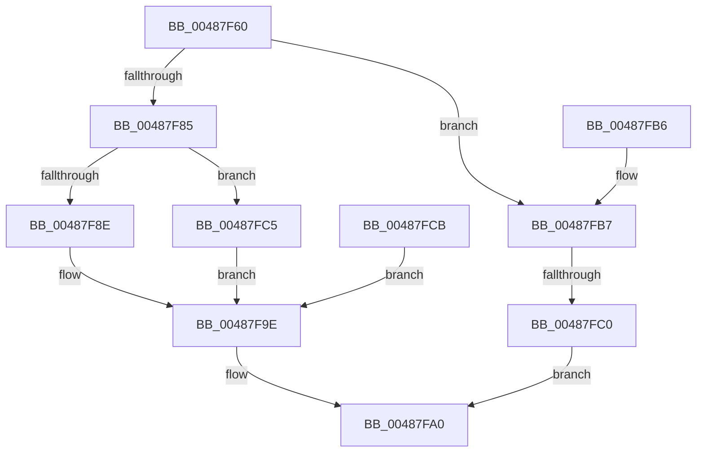

# RtlFreeHeap

- RVA: `0x00487F60`–`0x00487FD3` (길이 `115` bytes)
- VA: `0x0000000140487F60`
- 실행 섹션: `.text`
- PDB 이름 있음: `예`; PDB Function 태그: `예`
- unwind 정보 RVA: `0x000AFC08`
- 디코드: `35`개 명령, `115/115` bytes 표시
- 미해석 바이트: `0` (있으면 어셈블리에 `.byte`로 보존)

> 이 문서는 커널 이미지의 기계어와 PDB 기호를 분석해 생성했습니다. 4번과 5번은 함수 원형과 자료형을 바이너리 사용 방식에서 추정한 C 해석이며 원본 소스 복구 결과는 아닙니다.

## 1. Dependencies

- 직접 호출 지점: **1**; 고유 호출 대상: **1**
- 직접 호출자로 확인된 함수: **1**
- RIP 상대 이미지 참조: **0**

### Outgoing calls
- `0x00487F97` → [RtlpFreeNTHeapInternal](RtlpFreeNTHeapInternal_function_00487FDC.md) (function, `0x00487FDC`)

### Direct callers
- [sub_006DE680](../6D/Unknown_function_006DE680.md) at `0x006DE7EE`

### Static image references
- 디코드된 RIP-relative 메모리 참조가 없습니다.

## 2. Other-region calls and transfers

- 다른 실행 섹션으로 향하는 call: **0**
- call이 아닌 외부 분기/꼬리 이동: **1**
  - `0x00487FBA` → [sub_006F57B4](../6F/Unknown_function_006F57B4.md) (`tail-transfer`)

## 3. Assembly (complete function range)

```asm
00487F60  48 89 5C 24 08                  mov qword ptr [rsp + 8], rbx
00487F65  48 89 74 24 10                  mov qword ptr [rsp + 0x10], rsi
00487F6A  48 89 7C 24 18                  mov qword ptr [rsp + 0x18], rdi
00487F6F  41 56                           push r14
00487F71  48 83 EC 40                     sub rsp, 0x40
00487F75  49 8B F0                        mov rsi, r8
00487F78  44 8B F2                        mov r14d, edx
00487F7B  48 8B F9                        mov rdi, rcx
00487F7E  33 DB                           xor ebx, ebx
00487F80  49 85 C8                        test r8, rcx
00487F83  74 32                           je 0x140487fb7
00487F85  81 7F 10 EE DD EE DD            cmp dword ptr [rdi + 0x10], 0xddeeddee
00487F8C  74 37                           je 0x140487fc5
00487F8E  45 8B C6                        mov r8d, r14d
00487F91  48 8B D6                        mov rdx, rsi
00487F94  48 8B CF                        mov rcx, rdi
00487F97  E8 40 00 00 00                  call 0x140487fdc
00487F9C  8B D8                           mov ebx, eax
00487F9E  8B C3                           mov eax, ebx
00487FA0  48 8B 5C 24 50                  mov rbx, qword ptr [rsp + 0x50]
00487FA5  48 8B 74 24 58                  mov rsi, qword ptr [rsp + 0x58]
00487FAA  48 8B 7C 24 60                  mov rdi, qword ptr [rsp + 0x60]
00487FAF  48 83 C4 40                     add rsp, 0x40
00487FB3  41 5E                           pop r14
00487FB5  C3                              ret
00487FB6  CC                              int3
00487FB7  48 85 F6                        test rsi, rsi
00487FBA  0F 85 F4 D7 26 00               jne 0x1406f57b4
00487FC0  8D 46 01                        lea eax, [rsi + 1]
00487FC3  EB DB                           jmp 0x140487fa0
00487FC5  89 5C 24 30                     mov dword ptr [rsp + 0x30], ebx
00487FC9  EB D3                           jmp 0x140487f9e
00487FCB  33 DB                           xor ebx, ebx
00487FCD  89 5C 24 30                     mov dword ptr [rsp + 0x30], ebx
00487FD1  EB CB                           jmp 0x140487f9e
```

## 4. C-style interpretation (structured pseudocode)

```c
__int64 __fastcall RtlFreeHeap(__int64 a1, int a2, __int64 a3)
{
    __int64 result;
    __int64 v_rbx;
    __int64 v_rsp;
    unsigned __int64 v_stack_p10;
    unsigned __int64 v_stack_p18;
    unsigned int v_stack_p30;
    unsigned __int64 v_stack_p8;

    v_stack_p8 = v_rbx;
    v_stack_p10 = v_rsi;
    v_stack_p18 = v_rdi;
    v_rsp = (v_rsp) - (64);
    v_rbx = 0;
    if (((a3) & (a1)) == 0) goto loc_00487FB7;
    if ((*(unsigned int *)(a1 + 16)) == 0xDDEEDDEEULL) goto loc_00487FC5;
    result = RtlpFreeNTHeapInternal(a1, a3, (unsigned int)((unsigned int)((unsigned int)(a2))), a4);
loc_00487F9E:
loc_00487FA0:
    v_rsp = (v_rsp) + (64);
    return (unsigned int)((unsigned int)((unsigned int)((unsigned int)(result))));
loc_00487FB7:
    goto loc_00487FA0;
loc_00487FC5:
    v_stack_p30 = (unsigned int)(v_stack_p8);
    goto loc_00487F9E;
}
```

## 5. (Beta) C Style

```c
int64_t RtlFreeHeap(void *Arg1, int32_t Arg2, int64_t Arg3)
{
    uint8_t *arg1 = (uint8_t *)Arg1;

    int64_t result;
    int64_t local_rbx;
    int64_t local_rsp;
    uint64_t v_stack_p10;
    uint64_t v_stack_p18;
    uint32_t v_stack_p30;
    uint64_t v_stack_p8;

    v_stack_p8 = local_rbx;
    v_stack_p10 = local_rsi;
    v_stack_p18 = local_rdi;
    local_rsp = (local_rsp) - (64);
    local_rbx = 0;
    if (((Arg3) & (Arg1)) == 0) goto loc_00487FB7;
    if ((*(uint32_t *)(arg1 + 0x10)) == 0xDDEEDDEEULL) goto loc_00487FC5;
    result = RtlpFreeNTHeapInternal(Arg1, Arg3, (uint32_t)((uint32_t)((uint32_t)(Arg2))), a4);
loc_00487F9E:
loc_00487FA0:
    local_rsp = (local_rsp) + (64);
    return (uint32_t)((uint32_t)((uint32_t)((uint32_t)(result))));
loc_00487FB7:
    goto loc_00487FA0;
loc_00487FC5:
    v_stack_p30 = (uint32_t)(v_stack_p8);
    goto loc_00487F9E;
}
```

### 관측된 메모리 오프셋

구조체 형식이 확인되지 않은 접근은 인자 기준의 오프셋으로만 기록했습니다.

| 기준 인자 | 오프셋 표현 | 폭 (bit) | 접근 |
|---|---:|---:|---|
| `Arg1` | `+ 0x10` | `32` | `R` |

## 6. Execution-region graph

[열기: 2D/3D 그래프와 함수 탐색 컨트롤 패널](../../../control-panel.html?section=text&rva=0x00487F60&view=graph)

- 2D 그래프는 위에서 아래로 흐르고, 3D 그래프는 빈 공간을 드래그해 회전합니다. Shift+드래그는 이동, 휠은 확대·축소, 함수 노드 선택은 대상 보고서 이동입니다.

### Static fallback


