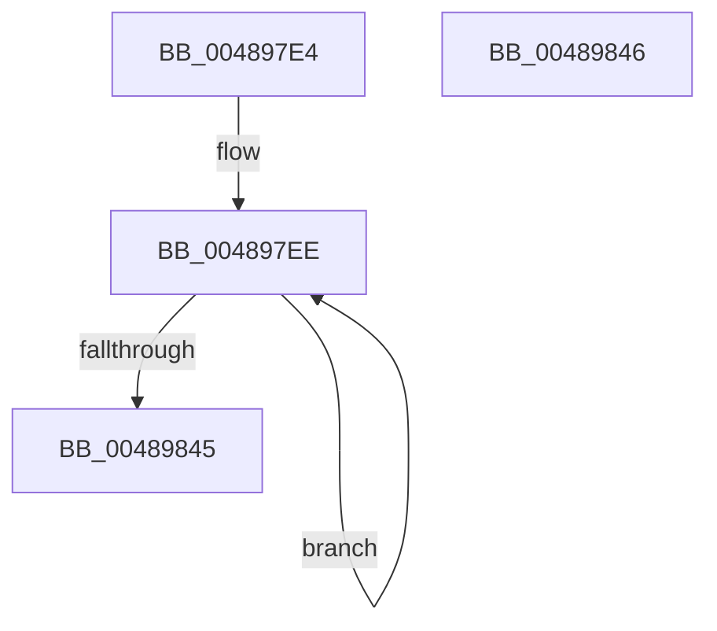

# RtlInitializeTRng

- RVA: `0x004897E4`–`0x00489847` (길이 `99` bytes)
- VA: `0x00000001404897E4`
- 실행 섹션: `.text`
- PDB 이름 있음: `예`; PDB Function 태그: `아니요`
- unwind 정보 RVA: `0x000DB714`
- 디코드: `25`개 명령, `99/99` bytes 표시
- 미해석 바이트: `0` (있으면 어셈블리에 `.byte`로 보존)

> 이 문서는 커널 이미지의 기계어와 PDB 기호를 분석해 생성했습니다. 4번과 5번은 함수 원형과 자료형을 바이너리 사용 방식에서 추정한 C 해석이며 원본 소스 복구 결과는 아닙니다.

## 1. Dependencies

- 직접 호출 지점: **0**; 고유 호출 대상: **0**
- 직접 호출자로 확인된 함수: **1**
- RIP 상대 이미지 참조: **0**

### Outgoing calls
- 직접 디코드된 call 명령이 없습니다.

### Direct callers
- [PsInitializeThreadRngState](PsInitializeThreadRngState_function_0048975C.md) at `0x004897CC`

### Static image references
- 디코드된 RIP-relative 메모리 참조가 없습니다.

## 2. Other-region calls and transfers

- 다른 실행 섹션으로 향하는 call: **0**
- 별도 외부 분기/꼬리 이동을 확인하지 못했습니다.

## 3. Assembly (complete function range)

```asm
004897E4  45 33 C9                        xor r9d, r9d
004897E7  4C 8B C1                        mov r8, rcx
004897EA  4C 89 49 08                     mov qword ptr [rcx + 8], r9
004897EE  48 B8 EB 83 B5 80 46 86 C8 61   movabs rax, 0x61c8864680b583eb
004897F8  48 B9 B9 E5 E4 1C 6D 47 58 BF   movabs rcx, 0xbf58476d1ce4e5b9
00489802  48 2B D0                        sub rdx, rax
00489805  41 FF C1                        inc r9d
00489808  48 8B C2                        mov rax, rdx
0048980B  48 C1 E8 1E                     shr rax, 0x1e
0048980F  48 33 C2                        xor rax, rdx
00489812  48 0F AF C1                     imul rax, rcx
00489816  48 8B C8                        mov rcx, rax
00489819  48 C1 E9 1B                     shr rcx, 0x1b
0048981D  48 33 C8                        xor rcx, rax
00489820  48 B8 EB 11 31 13 BB 49 D0 94   movabs rax, 0x94d049bb133111eb
0048982A  48 0F AF C8                     imul rcx, rax
0048982E  48 8B C1                        mov rax, rcx
00489831  48 C1 E8 1F                     shr rax, 0x1f
00489835  48 33 C1                        xor rax, rcx
00489838  49 89 00                        mov qword ptr [r8], rax
0048983B  4D 8D 40 08                     lea r8, [r8 + 8]
0048983F  41 83 F9 02                     cmp r9d, 2
00489843  72 A9                           jb 0x1404897ee
00489845  C3                              ret
00489846  CC                              int3
```

## 4. C-style interpretation (structured pseudocode)

```c
__int64 __fastcall RtlInitializeTRng(__int64 a1, __int64 a2, __int64 a3, int a4)
{
    __int64 result;

    a4 = 0;
    *(unsigned __int64 *)(a1 + 8) = 0;
loc_004897EE:
    a2 = (a2) - (result);
    a4 = (unsigned int)((a4) + 1);
    result = (a2) >> (30);
    result = (result) ^ (a2);
    result = (result) * (a1);
    a1 = (result) >> (27);
    a1 = (a1) ^ (result);
    a1 = (a1) * (result);
    result = (a1) >> (31);
    result = (result) ^ (a1);
    *(unsigned __int64 *)(a1) = result;
    if (a4 < 2) goto loc_004897EE;
    return result;
}
```

## 5. (Beta) C Style

```c
int64_t RtlInitializeTRng(void *TRng, int64_t Arg2, int64_t Arg3, int32_t Arg4)
{
    uint8_t *tRng = (uint8_t *)TRng;

    int64_t result;

    Arg4 = 0;
    *(uint64_t *)(tRng + 0x8) = 0;
loc_004897EE:
    Arg2 = (Arg2) - (result);
    Arg4 = (uint32_t)((Arg4) + 1);
    result = (Arg2) >> (30);
    result = (result) ^ (Arg2);
    result = (result) * (TRng);
    TRng = (result) >> (27);
    TRng = (TRng) ^ (result);
    TRng = (TRng) * (result);
    result = (TRng) >> (31);
    result = (result) ^ (TRng);
    *(uint64_t *)(tRng) = result;
    if (Arg4 < 2) goto loc_004897EE;
    return result;
}
```

### 관측된 메모리 오프셋

구조체 형식이 확인되지 않은 접근은 인자 기준의 오프셋으로만 기록했습니다.

| 기준 인자 | 오프셋 표현 | 폭 (bit) | 접근 |
|---|---:|---:|---|
| `TRng` | `+ 0x0` | `64` | `W` |
| `TRng` | `+ 0x8` | `64` | `R` |
| `TRng` | `+ 0x8` | `64` | `W` |

## 6. Execution-region graph

[열기: 2D/3D 그래프와 함수 탐색 컨트롤 패널](../../../control-panel.html?section=text&rva=0x004897E4&view=graph)

- 2D 그래프는 위에서 아래로 흐르고, 3D 그래프는 빈 공간을 드래그해 회전합니다. Shift+드래그는 이동, 휠은 확대·축소, 함수 노드 선택은 대상 보고서 이동입니다.

### Static fallback


