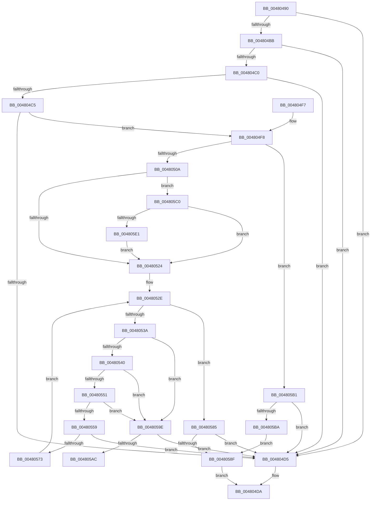

# RtlIpv4StringToAddressExW

- RVA: `0x00480490`–`0x004805ED` (길이 `349` bytes)
- VA: `0x0000000140480490`
- 실행 섹션: `.text`
- PDB 이름 있음: `예`; PDB Function 태그: `예`
- unwind 정보 RVA: `0x000AEACC`
- 디코드: `100`개 명령, `349/349` bytes 표시
- 미해석 바이트: `0` (있으면 어셈블리에 `.byte`로 보존)

> 이 문서는 커널 이미지의 기계어와 PDB 기호를 분석해 생성했습니다. 4번과 5번은 함수 원형과 자료형을 바이너리 사용 방식에서 추정한 C 해석이며 원본 소스 복구 결과는 아닙니다.

## 1. Dependencies

- 직접 호출 지점: **2**; 고유 호출 대상: **2**
- 직접 호출자로 확인된 함수: **0**
- RIP 상대 이미지 참조: **0**

### Outgoing calls
- `0x004804CC` → [RtlIpv4StringToAddressW](RtlIpv4StringToAddressW_function_00480600.md) (function, `0x00480600`)
- `0x00480548` → [iswctype](../50/iswctype_function_00502900.md) (function, `0x00502900`)

### Direct callers
- 이 함수 시작 RVA로 연결되는 직접 call은 확인되지 않았습니다. 간접 호출은 완전히 역산할 수 없습니다.

### Static image references
- 디코드된 RIP-relative 메모리 참조가 없습니다.

## 2. Other-region calls and transfers

- 다른 실행 섹션으로 향하는 call: **0**
- call이 아닌 외부 분기/꼬리 이동: **1**
  - `0x004805AC` → [sub_006F4F1E](../6F/Unknown_function_006F4F1E.md) (`tail-transfer`)

## 3. Assembly (complete function range)

```asm
00480490  48 8B C4                        mov rax, rsp
00480493  48 89 58 10                     mov qword ptr [rax + 0x10], rbx
00480497  48 89 68 18                     mov qword ptr [rax + 0x18], rbp
0048049B  48 89 70 20                     mov qword ptr [rax + 0x20], rsi
0048049F  57                              push rdi
004804A0  41 54                           push r12
004804A2  41 55                           push r13
004804A4  41 56                           push r14
004804A6  41 57                           push r15
004804A8  48 83 EC 20                     sub rsp, 0x20
004804AC  45 33 E4                        xor r12d, r12d
004804AF  4D 8B F1                        mov r14, r9
004804B2  4C 89 60 08                     mov qword ptr [rax + 8], r12
004804B6  48 85 C9                        test rcx, rcx
004804B9  74 1A                           je 0x1404804d5
004804BB  4D 85 C0                        test r8, r8
004804BE  74 15                           je 0x1404804d5
004804C0  4D 85 C9                        test r9, r9
004804C3  74 10                           je 0x1404804d5
004804C5  4D 8B C8                        mov r9, r8
004804C8  4C 8D 40 08                     lea r8, [rax + 8]
004804CC  E8 2F 01 00 00                  call 0x140480600
004804D1  85 C0                           test eax, eax
004804D3  79 23                           jns 0x1404804f8
004804D5  B8 0D 00 00 C0                  mov eax, 0xc000000d
004804DA  48 8B 5C 24 58                  mov rbx, qword ptr [rsp + 0x58]
004804DF  48 8B 6C 24 60                  mov rbp, qword ptr [rsp + 0x60]
004804E4  48 8B 74 24 68                  mov rsi, qword ptr [rsp + 0x68]
004804E9  48 83 C4 20                     add rsp, 0x20
004804ED  41 5F                           pop r15
004804EF  41 5E                           pop r14
004804F1  41 5D                           pop r13
004804F3  41 5C                           pop r12
004804F5  5F                              pop rdi
004804F6  C3                              ret
004804F7  CC                              int3
004804F8  48 8B 74 24 50                  mov rsi, qword ptr [rsp + 0x50]
004804FD  0F B7 06                        movzx eax, word ptr [rsi]
00480500  66 83 F8 3A                     cmp ax, 0x3a
00480504  0F 85 A7 00 00 00               jne 0x1404805b1
0048050A  48 83 C6 02                     add rsi, 2
0048050E  BD 0A 00 00 00                  mov ebp, 0xa
00480513  41 0F B7 DC                     movzx ebx, r12w
00480517  66 83 3E 30                     cmp word ptr [rsi], 0x30
0048051B  8D 7D 06                        lea edi, [rbp + 6]
0048051E  0F 84 9C 00 00 00               je 0x1404805c0
00480524  44 0F B7 3E                     movzx r15d, word ptr [rsi]
00480528  41 BD 80 00 00 00               mov r13d, 0x80
0048052E  0F B7 3E                        movzx edi, word ptr [rsi]
00480531  48 8D 76 02                     lea rsi, [rsi + 2]
00480535  66 85 FF                        test di, di
00480538  74 4B                           je 0x140480585
0048053A  66 41 3B FD                     cmp di, r13w
0048053E  73 5E                           jae 0x14048059e
00480540  BA 04 00 00 00                  mov edx, 4
00480545  0F B7 CF                        movzx ecx, di
00480548  E8 B3 23 08 00                  call 0x140502900
0048054D  85 C0                           test eax, eax
0048054F  74 4D                           je 0x14048059e
00480551  8D 47 D0                        lea eax, [rdi - 0x30]
00480554  66 3B C5                        cmp ax, bp
00480557  73 45                           jae 0x14048059e
00480559  0F B7 CD                        movzx ecx, bp
0048055C  0F B7 C3                        movzx eax, bx
0048055F  0F AF C8                        imul ecx, eax
00480562  83 C1 D0                        add ecx, -0x30
00480565  03 CF                           add ecx, edi
00480567  81 F9 FF FF 00 00               cmp ecx, 0xffff
0048056D  0F 87 62 FF FF FF               ja 0x1404804d5
00480573  0F B7 C3                        movzx eax, bx
00480576  0F B7 DD                        movzx ebx, bp
00480579  0F AF D8                        imul ebx, eax
0048057C  66 83 EB 30                     sub bx, 0x30
00480580  66 03 DF                        add bx, di
00480583  EB A9                           jmp 0x14048052e
00480585  66 45 85 FF                     test r15w, r15w
00480589  0F 84 46 FF FF FF               je 0x1404804d5
0048058F  66 C1 CB 08                     ror bx, 8
00480593  66 41 89 1E                     mov word ptr [r14], bx
00480597  33 C0                           xor eax, eax
00480599  E9 3C FF FF FF                  jmp 0x1404804da
0048059E  B8 10 00 00 00                  mov eax, 0x10
004805A3  66 3B E8                        cmp bp, ax
004805A6  0F 85 29 FF FF FF               jne 0x1404804d5
004805AC  E9 6D 49 27 00                  jmp 0x1406f4f1e
004805B1  66 85 C0                        test ax, ax
004805B4  0F 85 1B FF FF FF               jne 0x1404804d5
004805BA  41 0F B7 DC                     movzx ebx, r12w
004805BE  EB CF                           jmp 0x14048058f
004805C0  48 8D 4E 02                     lea rcx, [rsi + 2]
004805C4  BA DF FF 00 00                  mov edx, 0xffdf
004805C9  0F B7 01                        movzx eax, word ptr [rcx]
004805CC  BD 08 00 00 00                  mov ebp, 8
004805D1  66 83 E8 58                     sub ax, 0x58
004805D5  48 8B F1                        mov rsi, rcx
004805D8  66 85 C2                        test dx, ax
004805DB  0F 85 43 FF FF FF               jne 0x140480524
004805E1  0F B7 EF                        movzx ebp, di
004805E4  48 8D 71 02                     lea rsi, [rcx + 2]
004805E8  E9 37 FF FF FF                  jmp 0x140480524
```

## 4. C-style interpretation (structured pseudocode)

```c
__int64 __fastcall RtlIpv4StringToAddressExW(__int64 a1, __int64 a2, __int64 a3, __int64 a4)
{
    __int64 result;
    __int64 v_r12;
    __int64 v_rbx;
    __int64 v_rsi;
    __int64 v_rsp;
    unsigned __int64 v_stack_p10;
    unsigned __int64 v_stack_p18;
    unsigned __int64 v_stack_p20;
    unsigned __int64 v_stack_p50;

    *(unsigned __int64 *)(v_rsp + 16) = v_rbx;
    *(unsigned __int64 *)(v_rsp + 24) = v_rbp;
    *(unsigned __int64 *)(v_rsp + 32) = v_rsi;
    v_rsp = (v_rsp) - (32);
    v_r12 = 0;
    *(unsigned __int64 *)(v_rsp + 8) = 0;
    if (a1 == 0) goto loc_004804D5;
    if (a3 == 0) goto loc_004804D5;
    if (a4 == 0) goto loc_004804D5;
    result = RtlIpv4StringToAddressW(a1, a2, v_rsp + 8, a3);
    if (!sign_flag) goto loc_004804F8;
loc_004804D5:
loc_004804DA:
    v_rsp = (v_rsp) + (32);
    return (unsigned int)(0xC000000DULL);
loc_004804F8:
    if (((unsigned __int16)(*(unsigned __int16 *)(v_stack_p50))) != 58) goto loc_004805B1;
    v_rsi = (v_stack_p50) + (2);
    if ((*(unsigned __int16 *)(v_rsi)) == 48) goto loc_004805C0;
loc_00480524:
loc_0048052E:
    if ((unsigned __int16)(*(unsigned __int16 *)(v_rsi)) == 0) goto loc_00480585;
    if (((unsigned __int16)(*(unsigned __int16 *)(v_rsi))) >= 128) goto loc_0048059E;
    result = iswctype((unsigned __int16)(*(unsigned __int16 *)(v_rsi)), 4, v_rsp + 8, a3);
    if ((unsigned int)(result) == 0) goto loc_0048059E;
    if (((unsigned __int16)(*(unsigned __int16 *)(v_rsi) - 48)) >= 10) goto loc_0048059E;
    a1 = (unsigned int)((10) * (0));
    a1 = (unsigned int)((a1) + (-48));
    a1 = (unsigned int)((a1) + ((unsigned int)(*(unsigned __int16 *)(v_rsi))));
    if (((unsigned int)(a1)) > 0xFFFFULL) goto loc_004804D5;
    v_rbx = (unsigned int)((10) * (0));
    v_rbx = (unsigned __int16)((v_rbx) - (48));
    v_rbx = (unsigned __int16)((v_rbx) + ((unsigned __int16)(*(unsigned __int16 *)(v_rsi))));
    goto loc_0048052E;
loc_00480585:
    if ((unsigned __int16)(*(unsigned __int16 *)(v_rsi)) == 0) goto loc_004804D5;
loc_0048058F:
    *(unsigned __int16 *)(a4) = (unsigned __int16)(v_rbx);
    result = 0;
    goto loc_004804DA;
loc_0048059E:
    if (10 != 16) goto loc_004804D5;
loc_004805B1:
    if (16 != 0) goto loc_004804D5;
    goto loc_0048058F;
loc_004805C0:
    result = (unsigned __int16)((*(unsigned __int16 *)(v_rsi + 2 + 2)) - (88));
    if ((((unsigned __int16)((unsigned int)(0xFFDFULL))) & ((unsigned __int16)(result))) != 0) goto loc_00480524;
    goto loc_00480524;
}
```

## 5. (Beta) C Style

```c
int64_t RtlIpv4StringToAddressExW(int64_t Arg1, int64_t Arg2, int64_t Arg3, void *Arg4)
{
    uint8_t *arg4 = (uint8_t *)Arg4;

    int64_t result;
    int64_t local_r12;
    int64_t local_rbx;
    int64_t local_rsi;
    int64_t local_rsp;
    uint64_t v_stack_p10;
    uint64_t v_stack_p18;
    uint64_t v_stack_p20;
    uint64_t v_stack_p50;

    *(uint64_t *)(local_rsp + 0x10) = local_rbx;
    *(uint64_t *)(local_rsp + 0x18) = local_rbp;
    *(uint64_t *)(local_rsp + 0x20) = local_rsi;
    local_rsp = (local_rsp) - (32);
    local_r12 = 0;
    *(uint64_t *)(local_rsp + 0x8) = 0;
    if (Arg1 == 0) goto loc_004804D5;
    if (Arg3 == 0) goto loc_004804D5;
    if (Arg4 == NULL) goto loc_004804D5;
    result = RtlIpv4StringToAddressW(Arg1, Arg2, local_rsp + 8, Arg3);
    if (!sign_flag) goto loc_004804F8;
loc_004804D5:
loc_004804DA:
    local_rsp = (local_rsp) + (32);
    return (uint32_t)(0xC000000DULL);
loc_004804F8:
    if (((uint16_t)(*(uint16_t *)(v_stack_p50))) != 58) goto loc_004805B1;
    local_rsi = (v_stack_p50) + (2);
    if ((*(uint16_t *)(local_rsi)) == 48) goto loc_004805C0;
loc_00480524:
loc_0048052E:
    if ((uint16_t)(*(uint16_t *)(local_rsi)) == 0) goto loc_00480585;
    if (((uint16_t)(*(uint16_t *)(local_rsi))) >= 128) goto loc_0048059E;
    result = iswctype((uint16_t)(*(uint16_t *)(local_rsi)), 4, local_rsp + 8, Arg3);
    if ((uint32_t)(result) == 0) goto loc_0048059E;
    if (((uint16_t)(*(uint16_t *)(local_rsi) - 48)) >= 10) goto loc_0048059E;
    Arg1 = (uint32_t)((10) * (0));
    Arg1 = (uint32_t)((Arg1) + (-48));
    Arg1 = (uint32_t)((Arg1) + ((uint32_t)(*(uint16_t *)(local_rsi))));
    if (((uint32_t)(Arg1)) > 0xFFFFULL) goto loc_004804D5;
    local_rbx = (uint32_t)((10) * (0));
    local_rbx = (uint16_t)((local_rbx) - (48));
    local_rbx = (uint16_t)((local_rbx) + ((uint16_t)(*(uint16_t *)(local_rsi))));
    goto loc_0048052E;
loc_00480585:
    if ((uint16_t)(*(uint16_t *)(local_rsi)) == 0) goto loc_004804D5;
loc_0048058F:
    *(uint16_t *)(arg4) = (uint16_t)(local_rbx);
    result = 0;
    goto loc_004804DA;
loc_0048059E:
    if (10 != 16) goto loc_004804D5;
loc_004805B1:
    if (16 != 0) goto loc_004804D5;
    goto loc_0048058F;
loc_004805C0:
    result = (uint16_t)((*(uint16_t *)(local_rsi + 0x2 + 0x2)) - (88));
    if ((((uint16_t)((uint32_t)(0xFFDFULL))) & ((uint16_t)(result))) != 0) goto loc_00480524;
    goto loc_00480524;
}
```

### 관측된 메모리 오프셋

구조체 형식이 확인되지 않은 접근은 인자 기준의 오프셋으로만 기록했습니다.

| 기준 인자 | 오프셋 표현 | 폭 (bit) | 접근 |
|---|---:|---:|---|
| `Arg4` | `+ 0x0` | `16` | `W` |

## 6. Execution-region graph

[열기: 2D/3D 그래프와 함수 탐색 컨트롤 패널](../../../control-panel.html?section=text&rva=0x00480490&view=graph)

- 2D 그래프는 위에서 아래로 흐르고, 3D 그래프는 빈 공간을 드래그해 회전합니다. Shift+드래그는 이동, 휠은 확대·축소, 함수 노드 선택은 대상 보고서 이동입니다.

### Static fallback


