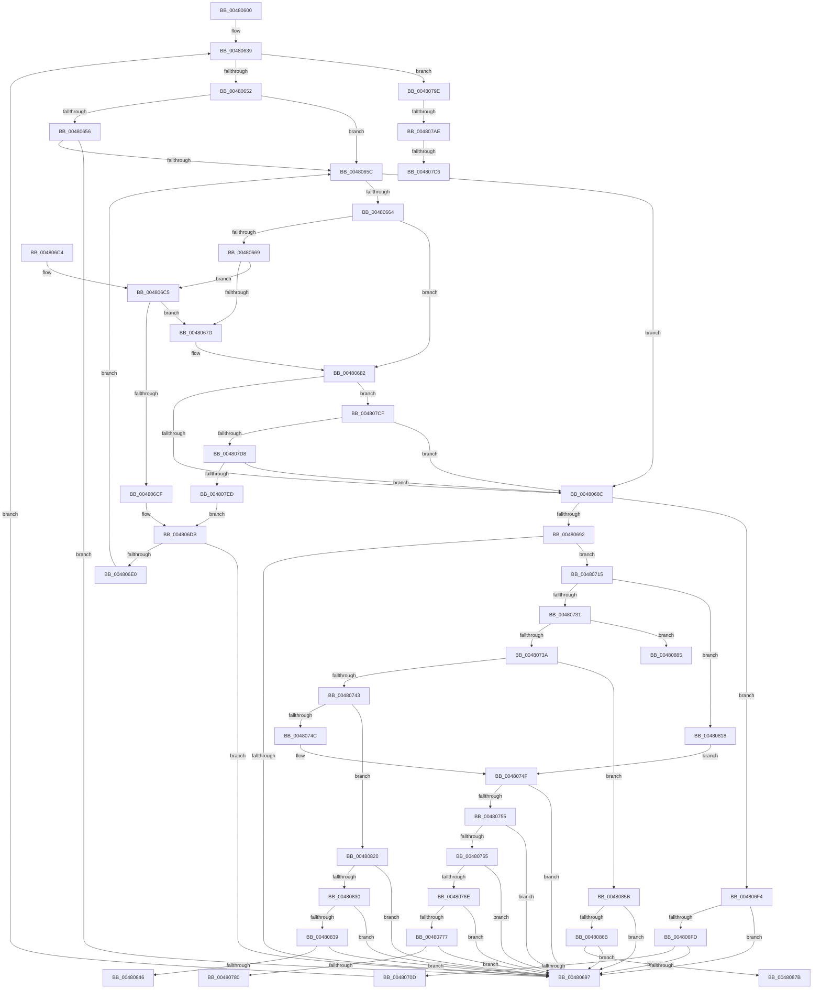

# RtlIpv4StringToAddressW

- RVA: `0x00480600`–`0x0048088D` (길이 `653` bytes)
- VA: `0x0000000140480600`
- 실행 섹션: `.text`
- PDB 이름 있음: `예`; PDB Function 태그: `예`
- unwind 정보 RVA: `0x000AEAFC`
- 디코드: `185`개 명령, `653/653` bytes 표시
- 미해석 바이트: `0` (있으면 어셈블리에 `.byte`로 보존)

> 이 문서는 커널 이미지의 기계어와 PDB 기호를 분석해 생성했습니다. 4번과 5번은 함수 원형과 자료형을 바이너리 사용 방식에서 추정한 C 해석이며 원본 소스 복구 결과는 아닙니다.

## 1. Dependencies

- 직접 호출 지점: **5**; 고유 호출 대상: **2**
- 직접 호출자로 확인된 함수: **1**
- RIP 상대 이미지 참조: **1**

### Outgoing calls
- `0x00480671` → [iswctype](../50/iswctype_function_00502900.md) (function, `0x00502900`)
- `0x004806A7` → [_security_check_cookie](../6A/_security_check_cookie_function_006AC640.md) (function, `0x006AC640`)
- `0x004807B3` → [iswctype](../50/iswctype_function_00502900.md) (function, `0x00502900`)
- `0x004807DD` → [iswctype](../50/iswctype_function_00502900.md) (function, `0x00502900`)
- `0x004807F4` → [iswctype](../50/iswctype_function_00502900.md) (function, `0x00502900`)

### Direct callers
- [RtlIpv4StringToAddressExW](RtlIpv4StringToAddressExW_function_00480490.md) at `0x004804CC`

### Static image references
- `0x00480617` → RVA `0x00E0A740` (`.data`; read)

## 2. Other-region calls and transfers

- 다른 실행 섹션으로 향하는 call: **0**
- call이 아닌 외부 분기/꼬리 이동: **7**
  - `0x00480799` → [sub_006F4F96 + 0x2A](../6F/Unknown_function_006F4F96.md) (`tail-transfer`)
  - `0x004807A8` → [sub_006F4F96](../6F/Unknown_function_006F4F96.md) (`tail-transfer`)
  - `0x004807C0` → [sub_006F4F96](../6F/Unknown_function_006F4F96.md) (`tail-transfer`)
  - `0x004807CA` → [sub_006F4F96 + 0x20](../6F/Unknown_function_006F4F96.md) (`tail-transfer`)
  - `0x00480856` → [sub_006F4F96 + 0x2A](../6F/Unknown_function_006F4F96.md) (`tail-transfer`)
  - `0x00480880` → [sub_006F4F96 + 0x2A](../6F/Unknown_function_006F4F96.md) (`tail-transfer`)
  - `0x00480888` → [sub_006F4F96 + 0x2C](../6F/Unknown_function_006F4F96.md) (`tail-transfer`)

## 3. Assembly (complete function range)

```asm
00480600  48 89 5C 24 10                  mov qword ptr [rsp + 0x10], rbx
00480605  55                              push rbp
00480606  56                              push rsi
00480607  57                              push rdi
00480608  41 54                           push r12
0048060A  41 55                           push r13
0048060C  41 56                           push r14
0048060E  41 57                           push r15
00480610  48 8B EC                        mov rbp, rsp
00480613  48 83 EC 50                     sub rsp, 0x50
00480617  48 8B 05 22 A1 98 00            mov rax, qword ptr [rip + 0x98a122]
0048061E  48 33 C4                        xor rax, rsp
00480621  48 89 45 F0                     mov qword ptr [rbp - 0x10], rax
00480625  4D 8B E0                        mov r12, r8
00480628  4C 89 4D D8                     mov qword ptr [rbp - 0x28], r9
0048062C  45 33 C0                        xor r8d, r8d
0048062F  88 55 D0                        mov byte ptr [rbp - 0x30], dl
00480632  48 8B F9                        mov rdi, rcx
00480635  48 8D 5D E0                     lea rbx, [rbp - 0x20]
00480639  B8 80 00 00 00                  mov eax, 0x80
0048063E  66 83 3F 30                     cmp word ptr [rdi], 0x30
00480642  44 8D 70 8A                     lea r14d, [rax - 0x76]
00480646  45 8A E8                        mov r13b, r8b
00480649  45 8B F8                        mov r15d, r8d
0048064C  0F 84 4C 01 00 00               je 0x14048079e
00480652  84 D2                           test dl, dl
00480654  74 06                           je 0x14048065c
00480656  41 83 FE 0A                     cmp r14d, 0xa
0048065A  75 3B                           jne 0x140480697
0048065C  0F B7 37                        movzx esi, word ptr [rdi]
0048065F  66 85 F6                        test si, si
00480662  74 28                           je 0x14048068c
00480664  66 3B F0                        cmp si, ax
00480667  73 19                           jae 0x140480682
00480669  BA 04 00 00 00                  mov edx, 4
0048066E  0F B7 CE                        movzx ecx, si
00480671  E8 8A 22 08 00                  call 0x140502900
00480676  45 33 C0                        xor r8d, r8d
00480679  85 C0                           test eax, eax
0048067B  75 48                           jne 0x1404806c5
0048067D  B8 80 00 00 00                  mov eax, 0x80
00480682  41 83 FE 10                     cmp r14d, 0x10
00480686  0F 84 43 01 00 00               je 0x1404807cf
0048068C  66 83 3F 2E                     cmp word ptr [rdi], 0x2e
00480690  74 62                           je 0x1404806f4
00480692  45 84 ED                        test r13b, r13b
00480695  75 7E                           jne 0x140480715
00480697  49 89 3C 24                     mov qword ptr [r12], rdi
0048069B  B8 0D 00 00 C0                  mov eax, 0xc000000d
004806A0  48 8B 4D F0                     mov rcx, qword ptr [rbp - 0x10]
004806A4  48 33 CC                        xor rcx, rsp
004806A7  E8 94 BF 22 00                  call 0x1406ac640
004806AC  48 8B 9C 24 98 00 00 00         mov rbx, qword ptr [rsp + 0x98]
004806B4  48 83 C4 50                     add rsp, 0x50
004806B8  41 5F                           pop r15
004806BA  41 5E                           pop r14
004806BC  41 5D                           pop r13
004806BE  41 5C                           pop r12
004806C0  5F                              pop rdi
004806C1  5E                              pop rsi
004806C2  5D                              pop rbp
004806C3  C3                              ret
004806C4  CC                              int3
004806C5  8D 46 D0                        lea eax, [rsi - 0x30]
004806C8  8B CE                           mov ecx, esi
004806CA  41 3B C6                        cmp eax, r14d
004806CD  7D AE                           jge 0x14048067d
004806CF  41 8B C6                        mov eax, r14d
004806D2  83 C1 D0                        add ecx, -0x30
004806D5  41 0F AF C7                     imul eax, r15d
004806D9  03 C8                           add ecx, eax
004806DB  41 3B CF                        cmp ecx, r15d
004806DE  72 B7                           jb 0x140480697
004806E0  48 83 C7 02                     add rdi, 2
004806E4  41 B5 01                        mov r13b, 1
004806E7  44 8B F9                        mov r15d, ecx
004806EA  B8 80 00 00 00                  mov eax, 0x80
004806EF  E9 68 FF FF FF                  jmp 0x14048065c
004806F4  48 8D 45 EC                     lea rax, [rbp - 0x14]
004806F8  48 3B D8                        cmp rbx, rax
004806FB  73 9A                           jae 0x140480697
004806FD  44 89 3B                        mov dword ptr [rbx], r15d
00480700  48 83 C7 02                     add rdi, 2
00480704  48 83 C3 04                     add rbx, 4
00480708  45 84 ED                        test r13b, r13b
0048070B  74 8A                           je 0x140480697
0048070D  8A 55 D0                        mov dl, byte ptr [rbp - 0x30]
00480710  E9 24 FF FF FF                  jmp 0x140480639
00480715  44 89 3B                        mov dword ptr [rbx], r15d
00480718  48 8D 45 E0                     lea rax, [rbp - 0x20]
0048071C  48 2B D8                        sub rbx, rax
0048071F  48 83 C3 04                     add rbx, 4
00480723  48 C1 FB 02                     sar rbx, 2
00480727  44 38 45 D0                     cmp byte ptr [rbp - 0x30], r8b
0048072B  0F 85 E7 00 00 00               jne 0x140480818
00480731  83 EB 01                        sub ebx, 1
00480734  0F 84 4B 01 00 00               je 0x140480885
0048073A  83 EB 01                        sub ebx, 1
0048073D  0F 84 18 01 00 00               je 0x14048085b
00480743  83 EB 01                        sub ebx, 1
00480746  0F 84 D4 00 00 00               je 0x140480820
0048074C  83 FB 01                        cmp ebx, 1
0048074F  0F 85 42 FF FF FF               jne 0x140480697
00480755  8B 55 E0                        mov edx, dword ptr [rbp - 0x20]
00480758  B8 FF 00 00 00                  mov eax, 0xff
0048075D  3B D0                           cmp edx, eax
0048075F  0F 87 32 FF FF FF               ja 0x140480697
00480765  39 45 E4                        cmp dword ptr [rbp - 0x1c], eax
00480768  0F 87 29 FF FF FF               ja 0x140480697
0048076E  39 45 E8                        cmp dword ptr [rbp - 0x18], eax
00480771  0F 87 20 FF FF FF               ja 0x140480697
00480777  39 45 EC                        cmp dword ptr [rbp - 0x14], eax
0048077A  0F 87 17 FF FF FF               ja 0x140480697
00480780  0F B6 45 E8                     movzx eax, byte ptr [rbp - 0x18]
00480784  0F B6 4D E4                     movzx ecx, byte ptr [rbp - 0x1c]
00480788  C1 E2 08                        shl edx, 8
0048078B  0B CA                           or ecx, edx
0048078D  C1 E1 08                        shl ecx, 8
00480790  0B C8                           or ecx, eax
00480792  0F B6 45 EC                     movzx eax, byte ptr [rbp - 0x14]
00480796  C1 E1 08                        shl ecx, 8
00480799  E9 22 48 27 00                  jmp 0x1406f4fc0
0048079E  48 83 C7 02                     add rdi, 2
004807A2  0F B7 0F                        movzx ecx, word ptr [rdi]
004807A5  66 3B C8                        cmp cx, ax
004807A8  0F 83 E8 47 27 00               jae 0x1406f4f96
004807AE  BA 04 00 00 00                  mov edx, 4
004807B3  E8 48 21 08 00                  call 0x140502900
004807B8  8A 55 D0                        mov dl, byte ptr [rbp - 0x30]
004807BB  45 33 C0                        xor r8d, r8d
004807BE  85 C0                           test eax, eax
004807C0  0F 84 D0 47 27 00               je 0x1406f4f96
004807C6  45 8D 70 08                     lea r14d, [r8 + 8]
004807CA  E9 E7 47 27 00                  jmp 0x1406f4fb6
004807CF  66 3B F0                        cmp si, ax
004807D2  0F 83 B4 FE FF FF               jae 0x14048068c
004807D8  8B D0                           mov edx, eax
004807DA  0F B7 CE                        movzx ecx, si
004807DD  E8 1E 21 08 00                  call 0x140502900
004807E2  45 33 C0                        xor r8d, r8d
004807E5  85 C0                           test eax, eax
004807E7  0F 84 9F FE FF FF               je 0x14048068c
004807ED  41 8D 50 02                     lea edx, [r8 + 2]
004807F1  0F B7 CE                        movzx ecx, si
004807F4  E8 07 21 08 00                  call 0x140502900
004807F9  F7 D8                           neg eax
004807FB  41 8B CF                        mov ecx, r15d
004807FE  1B D2                           sbb edx, edx
00480800  C1 E1 04                        shl ecx, 4
00480803  83 E2 20                        and edx, 0x20
00480806  83 C2 41                        add edx, 0x41
00480809  2B CA                           sub ecx, edx
0048080B  83 C1 0A                        add ecx, 0xa
0048080E  03 CE                           add ecx, esi
00480810  45 33 C0                        xor r8d, r8d
00480813  E9 C3 FE FF FF                  jmp 0x1404806db
00480818  83 FB 04                        cmp ebx, 4
0048081B  E9 2F FF FF FF                  jmp 0x14048074f
00480820  8B 55 E0                        mov edx, dword ptr [rbp - 0x20]
00480823  B8 FF 00 00 00                  mov eax, 0xff
00480828  3B D0                           cmp edx, eax
0048082A  0F 87 67 FE FF FF               ja 0x140480697
00480830  39 45 E4                        cmp dword ptr [rbp - 0x1c], eax
00480833  0F 87 5E FE FF FF               ja 0x140480697
00480839  81 7D E8 FF FF 00 00            cmp dword ptr [rbp - 0x18], 0xffff
00480840  0F 87 51 FE FF FF               ja 0x140480697
00480846  0F B6 4D E4                     movzx ecx, byte ptr [rbp - 0x1c]
0048084A  0F B7 45 E8                     movzx eax, word ptr [rbp - 0x18]
0048084E  C1 E2 08                        shl edx, 8
00480851  0B CA                           or ecx, edx
00480853  C1 E1 10                        shl ecx, 0x10
00480856  E9 65 47 27 00                  jmp 0x1406f4fc0
0048085B  8B 4D E0                        mov ecx, dword ptr [rbp - 0x20]
0048085E  B8 FF 00 00 00                  mov eax, 0xff
00480863  3B C8                           cmp ecx, eax
00480865  0F 87 2C FE FF FF               ja 0x140480697
0048086B  8B 45 E4                        mov eax, dword ptr [rbp - 0x1c]
0048086E  BA FF FF FF 00                  mov edx, 0xffffff
00480873  3B C2                           cmp eax, edx
00480875  0F 87 1C FE FF FF               ja 0x140480697
0048087B  C1 E1 18                        shl ecx, 0x18
0048087E  23 C2                           and eax, edx
00480880  E9 3B 47 27 00                  jmp 0x1406f4fc0
00480885  8B 4D E0                        mov ecx, dword ptr [rbp - 0x20]
00480888  E9 35 47 27 00                  jmp 0x1406f4fc2
```

## 4. C-style interpretation (structured pseudocode)

```c
__int64 __fastcall RtlIpv4StringToAddressW(__int64 a1, unsigned __int8 a2, __int64 a3, __int64 a4)
{
    __int64 result;
    __int64 v_rbx;
    __int64 v_rdi;
    __int64 v_rsp;
    unsigned __int64 v_stack_m48;
    unsigned __int64 v_stack_m4C;
    unsigned int v_stack_m50;
    unsigned int v_stack_m54;
    unsigned __int64 v_stack_m58;
    unsigned __int64 v_stack_m60;
    unsigned __int8 v_stack_m68;
    unsigned __int64 v_stack_p10;

    v_stack_p10 = v_rbx;
    v_rsp = (v_rsp) - (80);
    result = (*(unsigned __int64 *)(v_rip + 10002722)) ^ (v_rsp);
    v_stack_m48 = result;
    v_stack_m60 = a4;
    a3 = 0;
    v_stack_m68 = a2;
loc_00480639:
    if ((*(unsigned __int16 *)(a1)) == 48) goto loc_0048079E;
    if (a2 == 0) goto loc_0048065C;
    if (((unsigned int)(128 - 118)) != 10) goto loc_00480697;
loc_0048065C:
    if ((unsigned __int16)(*(unsigned __int16 *)(a1)) == 0) goto loc_0048068C;
    if (((unsigned __int16)(*(unsigned __int16 *)(a1))) >= 128) goto loc_00480682;
    result = iswctype((unsigned __int16)(*(unsigned __int16 *)(a1)), 4, a3, a4);
    a3 = 0;
    if ((unsigned int)(result) != 0) goto loc_004806C5;
loc_0048067D:
loc_00480682:
    if (((unsigned int)(128 - 118)) == 16) goto loc_004807CF;
loc_0048068C:
    if ((*(unsigned __int16 *)(a1)) == 46) goto loc_004806F4;
    if (0 != 0) goto loc_00480715;
loc_00480697:
    *(unsigned __int64 *)(a3) = a1;
    a1 = (v_stack_m48) ^ (v_rsp);
    result = _security_check_cookie(a1, 4, a3, a4);
    v_rsp = (v_rsp) + (80);
    return result;
loc_004806C5:
    if (((unsigned int)(*(unsigned __int16 *)(a1) - 48)) >= ((unsigned int)(128 - 118))) goto loc_0048067D;
    a1 = (unsigned int)(((unsigned int)((unsigned int)(*(unsigned __int16 *)(a1)))) + (-48));
    result = (unsigned int)(((unsigned int)((unsigned int)(128 - 118))) * (0));
    a1 = (unsigned int)((a1) + ((unsigned int)(result)));
loc_004806DB:
    if (((unsigned int)(a1)) < 0) goto loc_00480697;
    v_rdi = (a1) + (2);
    goto loc_0048065C;
loc_004806F4:
    if (v_stack_p10 >= v_stack_m4C) goto loc_00480697;
    *(unsigned int *)(v_stack_p10) = (unsigned int)((unsigned int)((unsigned int)(a1)));
    v_rdi = (v_rdi) + (2);
    v_rbx = (v_stack_p10) + (4);
    if (1 == 0) goto loc_00480697;
    goto loc_00480639;
loc_00480715:
    *(unsigned int *)(v_rbx) = (unsigned int)((unsigned int)((unsigned int)(a1)));
    v_rbx = (v_rbx) - (v_stack_m58);
    v_rbx = (v_rbx) + (4);
    v_rbx = (v_rbx) >> (2);
    if (v_stack_m68 != 0) goto loc_00480818;
    v_rbx = (unsigned int)((v_rbx) - (1));
    if (condition_is_equal) goto loc_00480885;
    v_rbx = (unsigned int)((v_rbx) - (1));
    if (condition_is_equal) goto loc_0048085B;
    v_rbx = (unsigned int)((v_rbx) - (1));
    if (condition_is_equal) goto loc_00480820;
loc_0048074F:
    if (((unsigned int)(v_rbx)) != 1) goto loc_00480697;
    if (((unsigned int)((unsigned int)(v_stack_m58))) > 255) goto loc_00480697;
    if (v_stack_m54 > 255) goto loc_00480697;
    if (v_stack_m50 > 255) goto loc_00480697;
    if (v_stack_m4C > 255) goto loc_00480697;
    a2 = (unsigned int)(((unsigned int)(v_stack_m58)) << (8));
    a1 = (unsigned int)((v_stack_m54) | (a2));
    a1 = (unsigned int)((a1) << (8));
    a1 = (unsigned int)((a1) | ((unsigned int)(v_stack_m50)));
    a1 = (unsigned int)((a1) << (8));
loc_0048079E:
    v_rdi = (v_rdi) + (2);
    result = iswctype(*(unsigned __int16 *)(v_rdi), 4, a3, a4);
    a3 = 0;
loc_004807CF:
    if (((unsigned __int16)(*(unsigned __int16 *)(a1))) >= ((unsigned __int16)(result))) goto loc_0048068C;
    result = iswctype((unsigned __int16)(*(unsigned __int16 *)(a1)), (unsigned int)((unsigned int)(result)), a3, a4);
    a3 = 0;
    if ((unsigned int)(result) == 0) goto loc_0048068C;
    result = iswctype((unsigned __int16)(*(unsigned __int16 *)(a1)), a3 + 2, a3, a4);
    result = (unsigned int)(-(result));
    a1 = (unsigned int)(((unsigned int)((unsigned int)((unsigned int)((unsigned int)(a1))))) << (4));
    a2 = (unsigned int)((a3 + 2) & (32));
    a2 = (unsigned int)((a2) + (65));
    a1 = (unsigned int)((a1) - (a2));
    a1 = (unsigned int)((a1) + (10));
    a1 = (unsigned int)((a1) + ((unsigned int)(*(unsigned __int16 *)(a1))));
    a3 = 0;
    goto loc_004806DB;
loc_00480818:
    goto loc_0048074F;
loc_00480820:
    if (((unsigned int)((unsigned int)(v_stack_m58))) > 255) goto loc_00480697;
    if (v_stack_m54 > 255) goto loc_00480697;
    if (v_stack_m50 > 0xFFFFULL) goto loc_00480697;
    a2 = (unsigned int)(((unsigned int)(v_stack_m58)) << (8));
    a1 = (unsigned int)((v_stack_m54) | (a2));
    a1 = (unsigned int)((a1) << (16));
loc_0048085B:
    if (((unsigned int)((unsigned int)(v_stack_m58))) > 255) goto loc_00480697;
    if (((unsigned int)((unsigned int)(v_stack_m54))) > ((unsigned int)((unsigned int)(0xFFFFFFULL)))) goto loc_00480697;
    a1 = (unsigned int)(((unsigned int)(v_stack_m58)) << (24));
    result = (unsigned int)(((unsigned int)(v_stack_m54)) & ((unsigned int)((unsigned int)(0xFFFFFFULL))));
loc_00480885:
}
```

## 5. (Beta) C Style

```c
int64_t RtlIpv4StringToAddressW(void *Arg1, uint8_t Arg2, void *Arg3, int64_t Arg4)
{
    uint8_t *arg1 = (uint8_t *)Arg1;
    uint8_t *arg3 = (uint8_t *)Arg3;

    int64_t result;
    int64_t local_rbx;
    int64_t local_rdi;
    int64_t local_rsp;
    uint64_t v_stack_m48;
    uint64_t v_stack_m4C;
    uint32_t v_stack_m50;
    uint32_t v_stack_m54;
    uint64_t v_stack_m58;
    uint64_t v_stack_m60;
    uint8_t v_stack_m68;
    uint64_t v_stack_p10;

    v_stack_p10 = local_rbx;
    local_rsp = (local_rsp) - (80);
    result = (*(uint64_t *)(v_rip + 0x98A122)) ^ (local_rsp);
    v_stack_m48 = result;
    v_stack_m60 = Arg4;
    Arg3 = 0;
    v_stack_m68 = Arg2;
loc_00480639:
    if ((*(uint16_t *)(arg1)) == 48) goto loc_0048079E;
    if (Arg2 == 0) goto loc_0048065C;
    if (((uint32_t)(128 - 118)) != 10) goto loc_00480697;
loc_0048065C:
    if ((uint16_t)(*(uint16_t *)(arg1)) == 0) goto loc_0048068C;
    if (((uint16_t)(*(uint16_t *)(arg1))) >= 128) goto loc_00480682;
    result = iswctype((uint16_t)(*(uint16_t *)(arg1)), 4, Arg3, Arg4);
    Arg3 = 0;
    if ((uint32_t)(result) != 0) goto loc_004806C5;
loc_0048067D:
loc_00480682:
    if (((uint32_t)(128 - 118)) == 16) goto loc_004807CF;
loc_0048068C:
    if ((*(uint16_t *)(arg1)) == 46) goto loc_004806F4;
    if (0 != 0) goto loc_00480715;
loc_00480697:
    *(void **)(arg3) = Arg1;
    Arg1 = (v_stack_m48) ^ (local_rsp);
    result = _security_check_cookie(Arg1, 4, Arg3, Arg4);
    local_rsp = (local_rsp) + (80);
    return result;
loc_004806C5:
    if (((uint32_t)(*(uint16_t *)(arg1) - 48)) >= ((uint32_t)(128 - 118))) goto loc_0048067D;
    Arg1 = (uint32_t)(((uint32_t)((uint32_t)(*(uint16_t *)(arg1)))) + (-48));
    result = (uint32_t)(((uint32_t)((uint32_t)(128 - 118))) * (0));
    Arg1 = (uint32_t)((Arg1) + ((uint32_t)(result)));
loc_004806DB:
    if (((uint32_t)(Arg1)) < 0) goto loc_00480697;
    local_rdi = (Arg1) + (2);
    goto loc_0048065C;
loc_004806F4:
    if (v_stack_p10 >= v_stack_m4C) goto loc_00480697;
    *(uint32_t *)(v_stack_p10) = (uint32_t)((uint32_t)((uint32_t)(Arg1)));
    local_rdi = (local_rdi) + (2);
    local_rbx = (v_stack_p10) + (4);
    if (1 == 0) goto loc_00480697;
    goto loc_00480639;
loc_00480715:
    *(uint32_t *)(local_rbx) = (uint32_t)((uint32_t)((uint32_t)(Arg1)));
    local_rbx = (local_rbx) - (v_stack_m58);
    local_rbx = (local_rbx) + (4);
    local_rbx = (local_rbx) >> (2);
    if (v_stack_m68 != 0) goto loc_00480818;
    local_rbx = (uint32_t)((local_rbx) - (1));
    if (condition_is_equal) goto loc_00480885;
    local_rbx = (uint32_t)((local_rbx) - (1));
    if (condition_is_equal) goto loc_0048085B;
    local_rbx = (uint32_t)((local_rbx) - (1));
    if (condition_is_equal) goto loc_00480820;
loc_0048074F:
    if (((uint32_t)(local_rbx)) != 1) goto loc_00480697;
    if (((uint32_t)((uint32_t)(v_stack_m58))) > 255) goto loc_00480697;
    if (v_stack_m54 > 255) goto loc_00480697;
    if (v_stack_m50 > 255) goto loc_00480697;
    if (v_stack_m4C > 255) goto loc_00480697;
    Arg2 = (uint32_t)(((uint32_t)(v_stack_m58)) << (8));
    Arg1 = (uint32_t)((v_stack_m54) | (Arg2));
    Arg1 = (uint32_t)((Arg1) << (8));
    Arg1 = (uint32_t)((Arg1) | ((uint32_t)(v_stack_m50)));
    Arg1 = (uint32_t)((Arg1) << (8));
loc_0048079E:
    local_rdi = (local_rdi) + (2);
    result = iswctype(*(uint16_t *)(local_rdi), 4, Arg3, Arg4);
    Arg3 = 0;
loc_004807CF:
    if (((uint16_t)(*(uint16_t *)(arg1))) >= ((uint16_t)(result))) goto loc_0048068C;
    result = iswctype((uint16_t)(*(uint16_t *)(arg1)), (uint32_t)((uint32_t)(result)), Arg3, Arg4);
    Arg3 = 0;
    if ((uint32_t)(result) == 0) goto loc_0048068C;
    result = iswctype((uint16_t)(*(uint16_t *)(arg1)), Arg3 + 2, Arg3, Arg4);
    result = (uint32_t)(-(result));
    Arg1 = (uint32_t)(((uint32_t)((uint32_t)((uint32_t)((uint32_t)(Arg1))))) << (4));
    Arg2 = (uint32_t)((Arg3 + 2) & (32));
    Arg2 = (uint32_t)((Arg2) + (65));
    Arg1 = (uint32_t)((Arg1) - (Arg2));
    Arg1 = (uint32_t)((Arg1) + (10));
    Arg1 = (uint32_t)((Arg1) + ((uint32_t)(*(uint16_t *)(arg1))));
    Arg3 = 0;
    goto loc_004806DB;
loc_00480818:
    goto loc_0048074F;
loc_00480820:
    if (((uint32_t)((uint32_t)(v_stack_m58))) > 255) goto loc_00480697;
    if (v_stack_m54 > 255) goto loc_00480697;
    if (v_stack_m50 > 0xFFFFULL) goto loc_00480697;
    Arg2 = (uint32_t)(((uint32_t)(v_stack_m58)) << (8));
    Arg1 = (uint32_t)((v_stack_m54) | (Arg2));
    Arg1 = (uint32_t)((Arg1) << (16));
loc_0048085B:
    if (((uint32_t)((uint32_t)(v_stack_m58))) > 255) goto loc_00480697;
    if (((uint32_t)((uint32_t)(v_stack_m54))) > ((uint32_t)((uint32_t)(0xFFFFFFULL)))) goto loc_00480697;
    Arg1 = (uint32_t)(((uint32_t)(v_stack_m58)) << (24));
    result = (uint32_t)(((uint32_t)(v_stack_m54)) & ((uint32_t)((uint32_t)(0xFFFFFFULL))));
loc_00480885:
}
```

### 관측된 메모리 오프셋

구조체 형식이 확인되지 않은 접근은 인자 기준의 오프셋으로만 기록했습니다.

| 기준 인자 | 오프셋 표현 | 폭 (bit) | 접근 |
|---|---:|---:|---|
| `Arg1` | `+ 0x0` | `16` | `R` |
| `Arg3` | `+ 0x0` | `64` | `W` |

## 6. Execution-region graph

[열기: 2D/3D 그래프와 함수 탐색 컨트롤 패널](../../../control-panel.html?section=text&rva=0x00480600&view=graph)

- 2D 그래프는 위에서 아래로 흐르고, 3D 그래프는 빈 공간을 드래그해 회전합니다. Shift+드래그는 이동, 휠은 확대·축소, 함수 노드 선택은 대상 보고서 이동입니다.

### Static fallback


