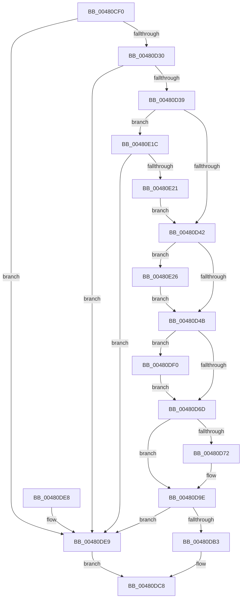

# RtlIpv6AddressToStringExW

- RVA: `0x00480CF0`–`0x00480E35` (길이 `325` bytes)
- VA: `0x0000000140480CF0`
- 실행 섹션: `.text`
- PDB 이름 있음: `예`; PDB Function 태그: `아니요`
- unwind 정보 RVA: `0x000AEBAC`
- 디코드: `87`개 명령, `325/325` bytes 표시
- 미해석 바이트: `0` (있으면 어셈블리에 `.byte`로 보존)

> 이 문서는 커널 이미지의 기계어와 PDB 기호를 분석해 생성했습니다. 4번과 5번은 함수 원형과 자료형을 바이너리 사용 방식에서 추정한 C 해석이며 원본 소스 복구 결과는 아닙니다.

## 1. Dependencies

- 직접 호출 지점: **5**; 고유 호출 대상: **4**
- 직접 호출자로 확인된 함수: **0**
- RIP 상대 이미지 참조: **3**

### Outgoing calls
- `0x00480D5C` → [RtlIpv6AddressToStringW](RtlIpv6AddressToStringW_function_00480E40.md) (function, `0x00480E40`)
- `0x00480D92` → [swprintf_s](../50/swprintf_s_function_00504B20.md) (function, `0x00504B20`)
- `0x00480DC1` → [memcpy](../6C/memcpy_function_006C6840.md) (function, `0x006C6840`)
- `0x00480DD3` → [_security_check_cookie](../6A/_security_check_cookie_function_006AC640.md) (function, `0x006AC640`)
- `0x00480E0B` → [swprintf_s](../50/swprintf_s_function_00504B20.md) (function, `0x00504B20`)

### Direct callers
- 이 함수 시작 RVA로 연결되는 직접 call은 확인되지 않았습니다. 간접 호출은 완전히 역산할 수 없습니다.

### Static image references
- `0x00480D00` → RVA `0x00E0A740` (`.data`; read)
- `0x00480D88` → RVA `0x006CCD30` (` ?? ::FNODOBFM::`string'`; read)
- `0x00480DFE` → RVA `0x006CCC70` (` ?? ::FNODOBFM::`string'`; read)

## 2. Other-region calls and transfers

- 다른 실행 섹션으로 향하는 call: **0**
- 별도 외부 분기/꼬리 이동을 확인하지 못했습니다.

## 3. Assembly (complete function range)

```asm
00480CF0  40 53                           push rbx
00480CF2  55                              push rbp
00480CF3  56                              push rsi
00480CF4  57                              push rdi
00480CF5  41 56                           push r14
00480CF7  41 57                           push r15
00480CF9  48 81 EC C8 00 00 00            sub rsp, 0xc8
00480D00  48 8B 05 39 9A 98 00            mov rax, qword ptr [rip + 0x989a39]
00480D07  48 33 C4                        xor rax, rsp
00480D0A  48 89 84 24 B0 00 00 00         mov qword ptr [rsp + 0xb0], rax
00480D12  48 8B B4 24 20 01 00 00         mov rsi, qword ptr [rsp + 0x120]
00480D1A  45 33 FF                        xor r15d, r15d
00480D1D  49 8B E9                        mov rbp, r9
00480D20  41 0F B7 F8                     movzx edi, r8w
00480D24  44 8B F2                        mov r14d, edx
00480D27  48 85 C9                        test rcx, rcx
00480D2A  0F 84 B9 00 00 00               je 0x140480de9
00480D30  48 85 F6                        test rsi, rsi
00480D33  0F 84 B0 00 00 00               je 0x140480de9
00480D39  4D 85 C9                        test r9, r9
00480D3C  0F 84 DA 00 00 00               je 0x140480e1c
00480D42  66 85 FF                        test di, di
00480D45  0F 85 DB 00 00 00               jne 0x140480e26
00480D4B  48 8D 44 24 22                  lea rax, [rsp + 0x22]
00480D50  66 85 FF                        test di, di
00480D53  48 8D 54 24 20                  lea rdx, [rsp + 0x20]
00480D58  48 0F 45 D0                     cmovne rdx, rax
00480D5C  E8 DF 00 00 00                  call 0x140480e40
00480D61  48 8B D8                        mov rbx, rax
00480D64  45 85 F6                        test r14d, r14d
00480D67  0F 85 83 00 00 00               jne 0x140480df0
00480D6D  66 85 FF                        test di, di
00480D70  74 2C                           je 0x140480d9e
00480D72  66 C1 CF 08                     ror di, 8
00480D76  48 8D 94 24 A2 00 00 00         lea rdx, [rsp + 0xa2]
00480D7E  48 2B D3                        sub rdx, rbx
00480D81  44 0F B7 CF                     movzx r9d, di
00480D85  48 D1 FA                        sar rdx, 1
00480D88  4C 8D 05 A1 BF 24 00            lea r8, [rip + 0x24bfa1]
00480D8F  48 8B CB                        mov rcx, rbx
00480D92  E8 89 3D 08 00                  call 0x140504b20
00480D97  48 63 C8                        movsxd rcx, eax
00480D9A  48 8D 1C 4B                     lea rbx, [rbx + rcx*2]
00480D9E  48 8D 44 24 20                  lea rax, [rsp + 0x20]
00480DA3  48 2B D8                        sub rbx, rax
00480DA6  8B 06                           mov eax, dword ptr [rsi]
00480DA8  48 D1 FB                        sar rbx, 1
00480DAB  FF C3                           inc ebx
00480DAD  89 1E                           mov dword ptr [rsi], ebx
00480DAF  3B C3                           cmp eax, ebx
00480DB1  72 36                           jb 0x140480de9
00480DB3  44 8B C3                        mov r8d, ebx
00480DB6  48 8D 54 24 20                  lea rdx, [rsp + 0x20]
00480DBB  4D 03 C0                        add r8, r8
00480DBE  48 8B CD                        mov rcx, rbp
00480DC1  E8 7A 5A 24 00                  call 0x1406c6840
00480DC6  33 C0                           xor eax, eax
00480DC8  48 8B 8C 24 B0 00 00 00         mov rcx, qword ptr [rsp + 0xb0]
00480DD0  48 33 CC                        xor rcx, rsp
00480DD3  E8 68 B8 22 00                  call 0x1406ac640
00480DD8  48 81 C4 C8 00 00 00            add rsp, 0xc8
00480DDF  41 5F                           pop r15
00480DE1  41 5E                           pop r14
00480DE3  5F                              pop rdi
00480DE4  5E                              pop rsi
00480DE5  5D                              pop rbp
00480DE6  5B                              pop rbx
00480DE7  C3                              ret
00480DE8  CC                              int3
00480DE9  B8 0D 00 00 C0                  mov eax, 0xc000000d
00480DEE  EB D8                           jmp 0x140480dc8
00480DF0  48 8D 94 24 A2 00 00 00         lea rdx, [rsp + 0xa2]
00480DF8  45 8B CE                        mov r9d, r14d
00480DFB  48 2B D3                        sub rdx, rbx
00480DFE  4C 8D 05 6B BE 24 00            lea r8, [rip + 0x24be6b]
00480E05  48 D1 FA                        sar rdx, 1
00480E08  48 8B CB                        mov rcx, rbx
00480E0B  E8 10 3D 08 00                  call 0x140504b20
00480E10  48 63 C8                        movsxd rcx, eax
00480E13  48 8D 1C 4B                     lea rbx, [rbx + rcx*2]
00480E17  E9 51 FF FF FF                  jmp 0x140480d6d
00480E1C  44 39 3E                        cmp dword ptr [rsi], r15d
00480E1F  75 C8                           jne 0x140480de9
00480E21  E9 1C FF FF FF                  jmp 0x140480d42
00480E26  B8 5B 00 00 00                  mov eax, 0x5b
00480E2B  66 89 44 24 20                  mov word ptr [rsp + 0x20], ax
00480E30  E9 16 FF FF FF                  jmp 0x140480d4b
```

## 4. C-style interpretation (structured pseudocode)

```c
__int64 __fastcall RtlIpv6AddressToStringExW(__int64 a1, int a2, unsigned __int16 a3, __int64 a4, __int64 a5)
{
    __int64 result;
    __int64 v_r15;
    __int64 v_rbx;
    __int64 v_rsp;
    unsigned __int64 v_stack_m48;
    unsigned __int64 v_stack_m56;
    unsigned __int64 v_stack_mD6;
    unsigned __int64 v_stack_mD8;
    unsigned __int16 v_stack_p20;
    unsigned __int64 v_stack_pA2;

    v_rsp = (v_rsp) - (200);
    result = (*(unsigned __int64 *)(v_rip + 10000953)) ^ (v_rsp);
    v_stack_m48 = result;
    v_r15 = 0;
    if (a1 == 0) goto loc_00480DE9;
    if (a5 == 0) goto loc_00480DE9;
    if (a4 == 0) goto loc_00480E1C;
loc_00480D42:
    if (a3 != 0) goto loc_00480E26;
loc_00480D4B:
    a2 = v_stack_mD8;
    if (a3 != 0) { a2 = v_stack_mD6; }
    result = RtlIpv6AddressToStringW(a1, a2, a3, a4);
    if ((unsigned int)((unsigned int)(a2)) != 0) goto loc_00480DF0;
loc_00480D6D:
    v_rbx = result;
    if (a3 != 0) {
        a2 = v_stack_m56;
        a2 = (a2) - (result);
        a4 = a3;
        a2 = (a2) >> (1);
        a3 = v_rip + 2408353;
        a1 = result;
        result = swprintf_s(a1, a2, a3, a4);
        a1 = (int)((unsigned int)(result));
        v_rbx = result + a1 * 2;
    }
    v_rbx = (v_rbx) - (v_stack_mD8);
    v_rbx = (v_rbx) >> (1);
    v_rbx = (unsigned int)((v_rbx) + 1);
    *(unsigned int *)(a5) = (unsigned int)(v_rbx);
    if (((unsigned int)((unsigned int)(*(unsigned int *)(a5)))) < ((unsigned int)(v_rbx))) goto loc_00480DE9;
    a3 = ((unsigned int)((unsigned int)(v_rbx))) + ((unsigned int)((unsigned int)(v_rbx)));
    result = memcpy(a4, v_stack_mD8, a3, a4);
    result = 0;
loc_00480DC8:
    a1 = (v_stack_m48) ^ (v_rsp);
    result = _security_check_cookie(a1, v_stack_mD8, a3, a4);
    v_rsp = (v_rsp) + (200);
    return result;
loc_00480DE9:
    goto loc_00480DC8;
loc_00480DF0:
    a2 = (v_stack_pA2) - (v_rbx);
    a2 = (a2) >> (1);
    result = swprintf_s(v_rbx, a2, v_rip + 2408043, (unsigned int)((unsigned int)((unsigned int)(a2))));
    goto loc_00480D6D;
loc_00480E1C:
    if ((*(unsigned int *)(a5)) != 0) goto loc_00480DE9;
    goto loc_00480D42;
loc_00480E26:
    v_stack_p20 = 91;
    goto loc_00480D4B;
}
```

## 5. (Beta) C Style

```c
int64_t RtlIpv6AddressToStringExW(int64_t Arg1, int32_t Arg2, uint16_t Arg3, int64_t Arg4, int64_t Arg5)
{
    int64_t result;
    int64_t local_r15;
    int64_t local_rbx;
    int64_t local_rsp;
    uint64_t v_stack_m48;
    uint64_t v_stack_m56;
    uint64_t v_stack_mD6;
    uint64_t v_stack_mD8;
    uint16_t v_stack_p20;
    uint64_t v_stack_pA2;

    local_rsp = (local_rsp) - (200);
    result = (*(uint64_t *)(v_rip + 0x989A39)) ^ (local_rsp);
    v_stack_m48 = result;
    local_r15 = 0;
    if (Arg1 == 0) goto loc_00480DE9;
    if (Arg5 == 0) goto loc_00480DE9;
    if (Arg4 == 0) goto loc_00480E1C;
loc_00480D42:
    if (Arg3 != 0) goto loc_00480E26;
loc_00480D4B:
    Arg2 = v_stack_mD8;
    if (Arg3 != 0) { Arg2 = v_stack_mD6; }
    result = RtlIpv6AddressToStringW(Arg1, Arg2, Arg3, Arg4);
    if ((uint32_t)((uint32_t)(Arg2)) != 0) goto loc_00480DF0;
loc_00480D6D:
    local_rbx = result;
    if (Arg3 != 0) {
        Arg2 = v_stack_m56;
        Arg2 = (Arg2) - (result);
        Arg4 = Arg3;
        Arg2 = (Arg2) >> (1);
        Arg3 = v_rip + 2408353;
        Arg1 = result;
        result = swprintf_s(Arg1, Arg2, Arg3, Arg4);
        Arg1 = (int32_t)((uint32_t)(result));
        local_rbx = result + Arg1 * 2;
    }
    local_rbx = (local_rbx) - (v_stack_mD8);
    local_rbx = (local_rbx) >> (1);
    local_rbx = (uint32_t)((local_rbx) + 1);
    *(uint32_t *)(Arg5) = (uint32_t)(local_rbx);
    if (((uint32_t)((uint32_t)(*(uint32_t *)(Arg5)))) < ((uint32_t)(local_rbx))) goto loc_00480DE9;
    Arg3 = ((uint32_t)((uint32_t)(local_rbx))) + ((uint32_t)((uint32_t)(local_rbx)));
    result = memcpy(Arg4, v_stack_mD8, Arg3, Arg4);
    result = 0;
loc_00480DC8:
    Arg1 = (v_stack_m48) ^ (local_rsp);
    result = _security_check_cookie(Arg1, v_stack_mD8, Arg3, Arg4);
    local_rsp = (local_rsp) + (200);
    return result;
loc_00480DE9:
    goto loc_00480DC8;
loc_00480DF0:
    Arg2 = (v_stack_pA2) - (local_rbx);
    Arg2 = (Arg2) >> (1);
    result = swprintf_s(local_rbx, Arg2, v_rip + 2408043, (uint32_t)((uint32_t)((uint32_t)(Arg2))));
    goto loc_00480D6D;
loc_00480E1C:
    if ((*(uint32_t *)(Arg5)) != 0) goto loc_00480DE9;
    goto loc_00480D42;
loc_00480E26:
    v_stack_p20 = 91;
    goto loc_00480D4B;
}
```

## 6. Execution-region graph

[열기: 2D/3D 그래프와 함수 탐색 컨트롤 패널](../../../control-panel.html?section=text&rva=0x00480CF0&view=graph)

- 2D 그래프는 위에서 아래로 흐르고, 3D 그래프는 빈 공간을 드래그해 회전합니다. Shift+드래그는 이동, 휠은 확대·축소, 함수 노드 선택은 대상 보고서 이동입니다.

### Static fallback


