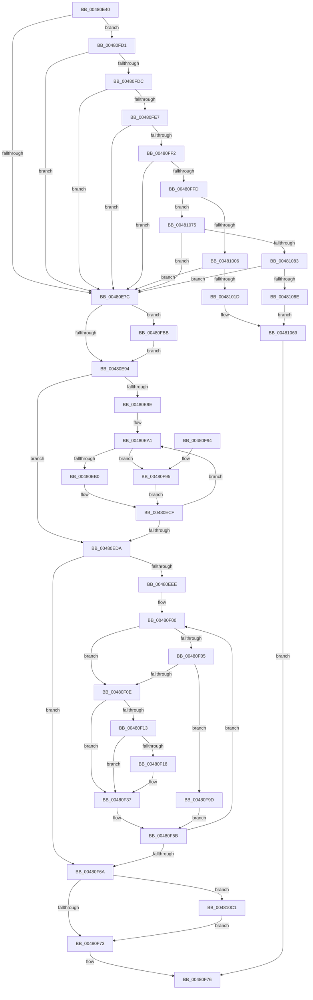

# RtlIpv6AddressToStringW

- RVA: `0x00480E40`–`0x00481104` (길이 `708` bytes)
- VA: `0x0000000140480E40`
- 실행 섹션: `.text`
- PDB 이름 있음: `예`; PDB Function 태그: `아니요`
- unwind 정보 RVA: `0x000AEBCC`
- 디코드: `187`개 명령, `708/708` bytes 표시
- 미해석 바이트: `0` (있으면 어셈블리에 `.byte`로 보존)

> 이 문서는 커널 이미지의 기계어와 PDB 기호를 분석해 생성했습니다. 4번과 5번은 함수 원형과 자료형을 바이너리 사용 방식에서 추정한 C 해석이며 원본 소스 복구 결과는 아닙니다.

## 1. Dependencies

- 직접 호출 지점: **6**; 고유 호출 대상: **1**
- 직접 호출자로 확인된 함수: **2**
- RIP 상대 이미지 참조: **8**

### Outgoing calls
- `0x00480F2B` → [swprintf_s](../50/swprintf_s_function_00504B20.md) (function, `0x00504B20`)
- `0x00480F56` → [swprintf_s](../50/swprintf_s_function_00504B20.md) (function, `0x00504B20`)
- `0x00480FB0` → [swprintf_s](../50/swprintf_s_function_00504B20.md) (function, `0x00504B20`)
- `0x00481064` → [swprintf_s](../50/swprintf_s_function_00504B20.md) (function, `0x00504B20`)
- `0x004810BA` → [swprintf_s](../50/swprintf_s_function_00504B20.md) (function, `0x00504B20`)
- `0x004810F3` → [swprintf_s](../50/swprintf_s_function_00504B20.md) (function, `0x00504B20`)

### Direct callers
- [RtlIpv6AddressToStringExW](RtlIpv6AddressToStringExW_function_00480CF0.md) at `0x00480D5C`
- [AdtpBuildIPv6Strings](../../page/A2/AdtpBuildIPv6Strings_function_00A2B720.md) at `0x00A2B830`

### Static image references
- `0x00480F1B` → RVA `0x006CCCB0` (` ?? ::FNODOBFM::`string'`; read)
- `0x00480F3B` → RVA `0x006CCCA0` (` ?? ::FNODOBFM::`string'`; read)
- `0x00480FA0` → RVA `0x006CCC00` (` ?? ::FNODOBFM::`string'`; read)
- `0x00481021` → RVA `0x006CCB10` (` ?? ::FNODOBFM::`string'`; read)
- `0x0048102C` → RVA `0x006C7800` (` ?? ::FNODOBFM::`string'`; read)
- `0x0048105D` → RVA `0x006CCC40` (` ?? ::FNODOBFM::`string'`; read)
- `0x00481092` → RVA `0x006CCC10` (` ?? ::FNODOBFM::`string'`; read)
- `0x004810EC` → RVA `0x006CCC80` (` ?? ::FNODOBFM::`string'`; read)

## 2. Other-region calls and transfers

- 다른 실행 섹션으로 향하는 call: **0**
- 별도 외부 분기/꼬리 이동을 확인하지 못했습니다.

## 3. Assembly (complete function range)

```asm
00480E40  48 89 5C 24 08                  mov qword ptr [rsp + 8], rbx
00480E45  48 89 6C 24 10                  mov qword ptr [rsp + 0x10], rbp
00480E4A  48 89 74 24 18                  mov qword ptr [rsp + 0x18], rsi
00480E4F  57                              push rdi
00480E50  41 54                           push r12
00480E52  41 55                           push r13
00480E54  41 56                           push r14
00480E56  41 57                           push r15
00480E58  48 83 EC 40                     sub rsp, 0x40
00480E5C  BD 08 00 00 00                  mov ebp, 8
00480E61  4C 8D 72 5C                     lea r14, [rdx + 0x5c]
00480E65  45 33 E4                        xor r12d, r12d
00480E68  48 8B FA                        mov rdi, rdx
00480E6B  48 8B D9                        mov rbx, rcx
00480E6E  44 8D 6D F9                     lea r13d, [rbp - 7]
00480E72  66 44 39 21                     cmp word ptr [rcx], r12w
00480E76  0F 84 55 01 00 00               je 0x140480fd1
00480E7C  B9 FD FF 00 00                  mov ecx, 0xfffd
00480E81  45 8B D4                        mov r10d, r12d
00480E84  45 8B DC                        mov r11d, r12d
00480E87  41 8B F4                        mov esi, r12d
00480E8A  66 85 4B 08                     test word ptr [rbx + 8], cx
00480E8E  0F 84 27 01 00 00               je 0x140480fbb
00480E94  44 8B FD                        mov r15d, ebp
00480E97  41 8B D4                        mov edx, r12d
00480E9A  85 ED                           test ebp, ebp
00480E9C  74 3C                           je 0x140480eda
00480E9E  4D 8B C4                        mov r8, r12
00480EA1  44 8D 4A 01                     lea r9d, [rdx + 1]
00480EA5  66 46 39 24 43                  cmp word ptr [rbx + r8*2], r12w
00480EAA  0F 85 E5 00 00 00               jne 0x140480f95
00480EB0  2B D6                           sub edx, esi
00480EB2  41 8B CA                        mov ecx, r10d
00480EB5  41 2B CB                        sub ecx, r11d
00480EB8  FF C2                           inc edx
00480EBA  3B D1                           cmp edx, ecx
00480EBC  8B C6                           mov eax, esi
00480EBE  41 0F 4E C3                     cmovle eax, r11d
00480EC2  44 8B D8                        mov r11d, eax
00480EC5  41 8B C1                        mov eax, r9d
00480EC8  41 0F 4E C2                     cmovle eax, r10d
00480ECC  44 8B D0                        mov r10d, eax
00480ECF  4D 03 C5                        add r8, r13
00480ED2  41 8B D1                        mov edx, r9d
00480ED5  4D 3B C7                        cmp r8, r15
00480ED8  7C C7                           jl 0x140480ea1
00480EDA  41 8B CA                        mov ecx, r10d
00480EDD  41 8B C4                        mov eax, r12d
00480EE0  41 2B CB                        sub ecx, r11d
00480EE3  41 3B CD                        cmp ecx, r13d
00480EE6  41 0F 4F C2                     cmovg eax, r10d
00480EEA  85 ED                           test ebp, ebp
00480EEC  74 7C                           je 0x140480f6a
00480EEE  4C 63 E8                        movsxd r13, eax
00480EF1  83 F9 01                        cmp ecx, 1
00480EF4  41 8B C4                        mov eax, r12d
00480EF7  41 0F 4F C3                     cmovg eax, r11d
00480EFB  33 F6                           xor esi, esi
00480EFD  4C 63 E0                        movsxd r12, eax
00480F00  49 3B F5                        cmp rsi, r13
00480F03  7D 09                           jge 0x140480f0e
00480F05  4C 3B E6                        cmp r12, rsi
00480F08  0F 8E 8F 00 00 00               jle 0x140480f9d
00480F0E  48 85 F6                        test rsi, rsi
00480F11  74 24                           je 0x140480f37
00480F13  49 3B F5                        cmp rsi, r13
00480F16  74 1F                           je 0x140480f37
00480F18  49 8B D6                        mov rdx, r14
00480F1B  4C 8D 05 8E BD 24 00            lea r8, [rip + 0x24bd8e]
00480F22  48 2B D7                        sub rdx, rdi
00480F25  48 8B CF                        mov rcx, rdi
00480F28  48 D1 FA                        sar rdx, 1
00480F2B  E8 F0 3B 08 00                  call 0x140504b20
00480F30  48 63 C8                        movsxd rcx, eax
00480F33  48 8D 3C 4F                     lea rdi, [rdi + rcx*2]
00480F37  0F B7 04 73                     movzx eax, word ptr [rbx + rsi*2]
00480F3B  4C 8D 05 5E BD 24 00            lea r8, [rip + 0x24bd5e]
00480F42  66 C1 C8 08                     ror ax, 8
00480F46  49 8B D6                        mov rdx, r14
00480F49  48 2B D7                        sub rdx, rdi
00480F4C  44 0F B7 C8                     movzx r9d, ax
00480F50  48 D1 FA                        sar rdx, 1
00480F53  48 8B CF                        mov rcx, rdi
00480F56  E8 C5 3B 08 00                  call 0x140504b20
00480F5B  48 63 C8                        movsxd rcx, eax
00480F5E  48 FF C6                        inc rsi
00480F61  48 8D 3C 4F                     lea rdi, [rdi + rcx*2]
00480F65  49 3B F7                        cmp rsi, r15
00480F68  7C 96                           jl 0x140480f00
00480F6A  83 FD 08                        cmp ebp, 8
00480F6D  0F 82 4E 01 00 00               jb 0x1404810c1
00480F73  48 8B C7                        mov rax, rdi
00480F76  4C 8D 5C 24 40                  lea r11, [rsp + 0x40]
00480F7B  49 8B 5B 30                     mov rbx, qword ptr [r11 + 0x30]
00480F7F  49 8B 6B 38                     mov rbp, qword ptr [r11 + 0x38]
00480F83  49 8B 73 40                     mov rsi, qword ptr [r11 + 0x40]
00480F87  49 8B E3                        mov rsp, r11
00480F8A  41 5F                           pop r15
00480F8C  41 5E                           pop r14
00480F8E  41 5D                           pop r13
00480F90  41 5C                           pop r12
00480F92  5F                              pop rdi
00480F93  C3                              ret
00480F94  CC                              int3
00480F95  41 8B F1                        mov esi, r9d
00480F98  E9 32 FF FF FF                  jmp 0x140480ecf
00480F9D  49 8B D6                        mov rdx, r14
00480FA0  4C 8D 05 59 BC 24 00            lea r8, [rip + 0x24bc59]
00480FA7  48 2B D7                        sub rdx, rdi
00480FAA  48 8B CF                        mov rcx, rdi
00480FAD  48 D1 FA                        sar rdx, 1
00480FB0  E8 6B 3B 08 00                  call 0x140504b20
00480FB5  49 8D 75 FF                     lea rsi, [r13 - 1]
00480FB9  EB A0                           jmp 0x140480f5b
00480FBB  B8 5E FE 00 00                  mov eax, 0xfe5e
00480FC0  B9 06 00 00 00                  mov ecx, 6
00480FC5  66 39 43 0A                     cmp word ptr [rbx + 0xa], ax
00480FC9  0F 44 E9                        cmove ebp, ecx
00480FCC  E9 C3 FE FF FF                  jmp 0x140480e94
00480FD1  66 44 39 61 02                  cmp word ptr [rcx + 2], r12w
00480FD6  0F 85 A0 FE FF FF               jne 0x140480e7c
00480FDC  66 44 39 61 04                  cmp word ptr [rcx + 4], r12w
00480FE1  0F 85 95 FE FF FF               jne 0x140480e7c
00480FE7  66 44 39 61 06                  cmp word ptr [rcx + 6], r12w
00480FEC  0F 85 8A FE FF FF               jne 0x140480e7c
00480FF2  66 44 39 61 0C                  cmp word ptr [rcx + 0xc], r12w
00480FF7  0F 84 7F FE FF FF               je 0x140480e7c
00480FFD  0F B7 41 08                     movzx eax, word ptr [rcx + 8]
00481001  66 85 C0                        test ax, ax
00481004  75 6F                           jne 0x140481075
00481006  44 0F B7 51 0A                  movzx r10d, word ptr [rcx + 0xa]
0048100B  B9 FE FF 00 00                  mov ecx, 0xfffe
00481010  43 8D 04 2A                     lea eax, [r10 + r13]
00481014  66 85 C1                        test cx, ax
00481017  0F 85 5F FE FF FF               jne 0x140480e7c
0048101D  0F B6 4B 0E                     movzx ecx, byte ptr [rbx + 0xe]
00481021  4C 8D 1D E8 BA 24 00            lea r11, [rip + 0x24bae8]
00481028  0F B6 53 0D                     movzx edx, byte ptr [rbx + 0xd]
0048102C  4C 8D 0D CD 67 24 00            lea r9, [rip + 0x2467cd]
00481033  44 0F B6 43 0C                  movzx r8d, byte ptr [rbx + 0xc]
00481038  66 45 85 D2                     test r10w, r10w
0048103C  0F B6 43 0F                     movzx eax, byte ptr [rbx + 0xf]
00481040  89 44 24 38                     mov dword ptr [rsp + 0x38], eax
00481044  4D 0F 45 CB                     cmovne r9, r11
00481048  89 4C 24 30                     mov dword ptr [rsp + 0x30], ecx
0048104C  48 8B CF                        mov rcx, rdi
0048104F  89 54 24 28                     mov dword ptr [rsp + 0x28], edx
00481053  BA 2E 00 00 00                  mov edx, 0x2e
00481058  44 89 44 24 20                  mov dword ptr [rsp + 0x20], r8d
0048105D  4C 8D 05 DC BB 24 00            lea r8, [rip + 0x24bbdc]
00481064  E8 B7 3A 08 00                  call 0x140504b20
00481069  48 63 C8                        movsxd rcx, eax
0048106C  48 8D 04 4F                     lea rax, [rdi + rcx*2]
00481070  E9 01 FF FF FF                  jmp 0x140480f76
00481075  B9 FF FF 00 00                  mov ecx, 0xffff
0048107A  66 3B C1                        cmp ax, cx
0048107D  0F 85 F9 FD FF FF               jne 0x140480e7c
00481083  66 44 39 63 0A                  cmp word ptr [rbx + 0xa], r12w
00481088  0F 85 EE FD FF FF               jne 0x140480e7c
0048108E  0F B6 4B 0E                     movzx ecx, byte ptr [rbx + 0xe]
00481092  4C 8D 05 77 BB 24 00            lea r8, [rip + 0x24bb77]
00481099  0F B6 53 0D                     movzx edx, byte ptr [rbx + 0xd]
0048109D  0F B6 43 0F                     movzx eax, byte ptr [rbx + 0xf]
004810A1  44 0F B6 4B 0C                  movzx r9d, byte ptr [rbx + 0xc]
004810A6  89 44 24 30                     mov dword ptr [rsp + 0x30], eax
004810AA  89 4C 24 28                     mov dword ptr [rsp + 0x28], ecx
004810AE  48 8B CF                        mov rcx, rdi
004810B1  89 54 24 20                     mov dword ptr [rsp + 0x20], edx
004810B5  BA 2E 00 00 00                  mov edx, 0x2e
004810BA  E8 61 3A 08 00                  call 0x140504b20
004810BF  EB A8                           jmp 0x140481069
004810C1  0F B6 4B 0E                     movzx ecx, byte ptr [rbx + 0xe]
004810C5  4C 2B F7                        sub r14, rdi
004810C8  44 0F B6 43 0D                  movzx r8d, byte ptr [rbx + 0xd]
004810CD  0F B6 43 0F                     movzx eax, byte ptr [rbx + 0xf]
004810D1  44 0F B6 4B 0C                  movzx r9d, byte ptr [rbx + 0xc]
004810D6  89 44 24 30                     mov dword ptr [rsp + 0x30], eax
004810DA  89 4C 24 28                     mov dword ptr [rsp + 0x28], ecx
004810DE  48 8B CF                        mov rcx, rdi
004810E1  49 D1 FE                        sar r14, 1
004810E4  44 89 44 24 20                  mov dword ptr [rsp + 0x20], r8d
004810E9  49 8B D6                        mov rdx, r14
004810EC  4C 8D 05 8D BB 24 00            lea r8, [rip + 0x24bb8d]
004810F3  E8 28 3A 08 00                  call 0x140504b20
004810F8  48 63 C8                        movsxd rcx, eax
004810FB  48 8D 3C 4F                     lea rdi, [rdi + rcx*2]
004810FF  E9 6F FE FF FF                  jmp 0x140480f73
```

## 4. C-style interpretation (structured pseudocode)

```c
__int64 __fastcall RtlIpv6AddressToStringW(__int64 a1, __int64 a2)
{
    __int64 result;
    __int64 v_r12;
    __int64 v_r14;
    __int64 v_rbp;
    __int64 v_rdi;
    __int64 v_rsi;
    __int64 v_rsp;
    unsigned int v_stack_m10;
    unsigned int v_stack_m18;
    unsigned int v_stack_m20;
    unsigned __int64 v_stack_m28;
    unsigned int v_stack_m8;
    unsigned __int64 v_stack_p10;
    unsigned __int64 v_stack_p18;
    unsigned __int64 v_stack_p8;

    v_stack_p8 = v_rbx;
    v_stack_p10 = v_rbp;
    v_stack_p18 = v_rsi;
    v_rsp = (v_rsp) - (64);
    v_r12 = 0;
    if ((*(unsigned __int16 *)(a1)) == 0) goto loc_00480FD1;
loc_00480E7C:
    if (((*(unsigned __int16 *)(a1 + 8)) & ((unsigned __int16)((unsigned int)(0xFFFDULL)))) == 0) goto loc_00480FBB;
loc_00480E94:
    if (8 == 0) goto loc_00480EDA;
loc_00480EA1:
    if ((*(unsigned __int16 *)(a1 + 0 * 2)) != 0) goto loc_00480F95;
    a2 = (unsigned int)((0) - (0));
    a1 = (unsigned int)((0) - (0));
    a2 = (unsigned int)((a2) + 1);
    result = 0;
    if (((unsigned int)(a2)) <= ((unsigned int)(a1))) { result = 0; }
    result = (unsigned int)((unsigned int)(0 + 1));
    if (((unsigned int)(a2)) <= ((unsigned int)(a1))) { result = 0; }
loc_00480ECF:
    a3 = (0) + (8 - 7);
    if (a3 < 8) goto loc_00480EA1;
loc_00480EDA:
    a1 = (unsigned int)(((unsigned int)((unsigned int)((unsigned int)((unsigned int)(result))))) - ((unsigned int)((unsigned int)((unsigned int)(result)))));
    result = 0;
    if (((unsigned int)(a1)) > ((unsigned int)(8 - 7))) { result = (unsigned int)((unsigned int)((unsigned int)(result))); }
    if (8 == 0) goto loc_00480F6A;
    result = 0;
    if (((unsigned int)(a1)) > 1) { result = (unsigned int)((unsigned int)((unsigned int)(result))); }
    v_rsi = 0;
loc_00480F00:
    if (0 >= ((int)((unsigned int)(result)))) goto loc_00480F0E;
    if (((int)((unsigned int)(result))) <= 0) goto loc_00480F9D;
loc_00480F0E:
    if (0 == 0) goto loc_00480F37;
    v_rdi = a2;
    if (0 != ((int)((unsigned int)(result)))) {
        a2 = a2 + 92;
        a3 = v_rip + 2407822;
        a2 = (a2) - (a2);
        a1 = a2;
        a2 = (a2) >> (1);
        result = swprintf_s(a1, a2, a3, 0 + 1);
        a1 = (int)((unsigned int)(result));
        v_rdi = a2 + a1 * 2;
    }
    a2 = (a2 + 92) - (v_rdi);
    a2 = (a2) >> (1);
    result = swprintf_s(v_rdi, a2, v_rip + 2407774, (unsigned __int16)(*(unsigned __int16 *)(a1 + v_rsi * 2)));
loc_00480F5B:
    v_rsi = (v_rsi) + 1;
    if (v_rsi < 8) goto loc_00480F00;
loc_00480F6A:
    if (8 < 8) goto loc_004810C1;
loc_00480F73:
loc_00480F76:
    return v_rdi + (int)((unsigned int)(result)) * 2;
loc_00480F95:
    goto loc_00480ECF;
loc_00480F9D:
    a2 = (a2 + 92) - (v_rdi + (int)((unsigned int)(result)) * 2);
    a2 = (a2) >> (1);
    result = swprintf_s(v_rdi + (int)((unsigned int)(result)) * 2, a2, v_rip + 2407513, (unsigned __int16)(*(unsigned __int16 *)(a1 + v_rsi * 2)));
    goto loc_00480F5B;
loc_00480FBB:
    v_rbp = *(unsigned __int64 *)(v_stack_m28 + 56);
    if ((*(unsigned __int16 *)(*(unsigned __int64 *)(v_stack_m28 + 48) + 10)) == ((unsigned __int16)((unsigned int)(0xFE5EULL)))) { v_rbp = 6; }
    goto loc_00480E94;
loc_00480FD1:
    if ((*(unsigned __int16 *)(6 + 2)) != ((unsigned __int16)((int)((unsigned int)(result))))) goto loc_00480E7C;
    if ((*(unsigned __int16 *)(6 + 4)) != ((unsigned __int16)((int)((unsigned int)(result))))) goto loc_00480E7C;
    if ((*(unsigned __int16 *)(6 + 6)) != ((unsigned __int16)((int)((unsigned int)(result))))) goto loc_00480E7C;
    if ((*(unsigned __int16 *)(6 + 12)) == ((unsigned __int16)((int)((unsigned int)(result))))) goto loc_00480E7C;
    if ((unsigned __int16)(*(unsigned __int16 *)(6 + 8)) != 0) goto loc_00481075;
    if ((((unsigned __int16)((unsigned int)(0xFFFEULL))) & ((unsigned __int16)(*(unsigned __int16 *)(6 + 10) + (int)((unsigned int)(result)) * 1))) != 0) goto loc_00480E7C;
    v_stack_m8 = (unsigned int)(*(unsigned __int8 *)(*(unsigned __int64 *)(v_stack_m28 + 48) + 15));
    a4 = v_rip + 2385869;
    if ((unsigned __int16)(*(unsigned __int16 *)(6 + 10)) != 0) { a4 = v_rip + 2407144; }
    v_stack_m10 = (unsigned int)(*(unsigned __int8 *)(*(unsigned __int64 *)(v_stack_m28 + 48) + 14));
    v_stack_m18 = (unsigned int)(*(unsigned __int8 *)(*(unsigned __int64 *)(v_stack_m28 + 48) + 13));
    v_stack_m20 = (unsigned int)(*(unsigned __int8 *)(*(unsigned __int64 *)(v_stack_m28 + 48) + 12));
    result = swprintf_s(v_rdi + (int)((unsigned int)(result)) * 2, 46, v_rip + 2407388, a4);
loc_00481069:
    goto loc_00480F76;
loc_00481075:
    if (((unsigned __int16)(v_rdi + (int)((unsigned int)(result)) * 2 + (int)((unsigned int)(result)) * 2)) != ((unsigned __int16)((unsigned int)(0xFFFFULL)))) goto loc_00480E7C;
    if ((*(unsigned __int16 *)(*(unsigned __int64 *)(v_stack_m28 + 48) + 10)) != ((unsigned __int16)((int)((unsigned int)(result))))) goto loc_00480E7C;
    v_stack_m10 = (unsigned int)(*(unsigned __int8 *)(*(unsigned __int64 *)(v_stack_m28 + 48) + 15));
    v_stack_m18 = (unsigned int)(*(unsigned __int8 *)(*(unsigned __int64 *)(v_stack_m28 + 48) + 14));
    v_stack_m20 = (unsigned int)(*(unsigned __int8 *)(*(unsigned __int64 *)(v_stack_m28 + 48) + 13));
    result = swprintf_s(v_rdi + (int)((unsigned int)(result)) * 2, 46, v_rip + 2407287, *(unsigned __int8 *)(*(unsigned __int64 *)(v_stack_m28 + 48) + 12));
    goto loc_00481069;
loc_004810C1:
    v_r14 = (a2 + 92) - (v_rdi + (int)((unsigned int)(result)) * 2);
    v_stack_m10 = (unsigned int)(*(unsigned __int8 *)(*(unsigned __int64 *)(v_stack_m28 + 48) + 15));
    v_stack_m18 = (unsigned int)(*(unsigned __int8 *)(*(unsigned __int64 *)(v_stack_m28 + 48) + 14));
    v_r14 = (v_r14) >> (1);
    v_stack_m20 = (unsigned int)(*(unsigned __int8 *)(*(unsigned __int64 *)(v_stack_m28 + 48) + 13));
    result = swprintf_s(v_rdi + (int)((unsigned int)(result)) * 2, v_r14, v_rip + 2407309, *(unsigned __int8 *)(*(unsigned __int64 *)(v_stack_m28 + 48) + 12));
    goto loc_00480F73;
}
```

## 5. (Beta) C Style

```c
int64_t RtlIpv6AddressToStringW(void *Arg1, void *Arg2)
{
    uint8_t *arg1 = (uint8_t *)Arg1;
    uint8_t *arg2 = (uint8_t *)Arg2;

    int64_t result;
    int64_t local_r12;
    int64_t local_r14;
    int64_t local_rbp;
    int64_t local_rdi;
    int64_t local_rsi;
    int64_t local_rsp;
    uint32_t v_stack_m10;
    uint32_t v_stack_m18;
    uint32_t v_stack_m20;
    uint64_t v_stack_m28;
    uint32_t v_stack_m8;
    uint64_t v_stack_p10;
    uint64_t v_stack_p18;
    uint64_t v_stack_p8;

    v_stack_p8 = local_rbx;
    v_stack_p10 = local_rbp;
    v_stack_p18 = local_rsi;
    local_rsp = (local_rsp) - (64);
    local_r12 = 0;
    if ((*(uint16_t *)(arg1)) == 0) goto loc_00480FD1;
loc_00480E7C:
    if (((*(uint16_t *)(arg1 + 0x8)) & ((uint16_t)((uint32_t)(0xFFFDULL)))) == 0) goto loc_00480FBB;
loc_00480E94:
    if (8 == 0) goto loc_00480EDA;
loc_00480EA1:
    if ((*(uint16_t *)(arg1 + 0x0 * 2)) != 0) goto loc_00480F95;
    Arg2 = (uint32_t)((0) - (0));
    Arg1 = (uint32_t)((0) - (0));
    Arg2 = (uint32_t)((Arg2) + 1);
    result = 0;
    if (((uint32_t)(Arg2)) <= ((uint32_t)(Arg1))) { result = 0; }
    result = (uint32_t)((uint32_t)(0 + 1));
    if (((uint32_t)(Arg2)) <= ((uint32_t)(Arg1))) { result = 0; }
loc_00480ECF:
    a3 = (0) + (8 - 7);
    if (a3 < 8) goto loc_00480EA1;
loc_00480EDA:
    Arg1 = (uint32_t)(((uint32_t)((uint32_t)((uint32_t)((uint32_t)(result))))) - ((uint32_t)((uint32_t)((uint32_t)(result)))));
    result = 0;
    if (((uint32_t)(Arg1)) > ((uint32_t)(8 - 7))) { result = (uint32_t)((uint32_t)((uint32_t)(result))); }
    if (8 == 0) goto loc_00480F6A;
    result = 0;
    if (((uint32_t)(Arg1)) > 1) { result = (uint32_t)((uint32_t)((uint32_t)(result))); }
    local_rsi = 0;
loc_00480F00:
    if (0 >= ((int32_t)((uint32_t)(result)))) goto loc_00480F0E;
    if (((int32_t)((uint32_t)(result))) <= 0) goto loc_00480F9D;
loc_00480F0E:
    if (0 == 0) goto loc_00480F37;
    local_rdi = Arg2;
    if (0 != ((int32_t)((uint32_t)(result)))) {
        Arg2 = Arg2 + 92;
        a3 = v_rip + 2407822;
        Arg2 = (Arg2) - (Arg2);
        Arg1 = Arg2;
        Arg2 = (Arg2) >> (1);
        result = swprintf_s(Arg1, Arg2, a3, 0 + 1);
        Arg1 = (int32_t)((uint32_t)(result));
        local_rdi = Arg2 + Arg1 * 2;
    }
    Arg2 = (Arg2 + 92) - (local_rdi);
    Arg2 = (Arg2) >> (1);
    result = swprintf_s(local_rdi, Arg2, v_rip + 2407774, (uint16_t)(*(uint16_t *)(arg1 + local_rsi * 2)));
loc_00480F5B:
    local_rsi = (local_rsi) + 1;
    if (local_rsi < 8) goto loc_00480F00;
loc_00480F6A:
    if (8 < 8) goto loc_004810C1;
loc_00480F73:
loc_00480F76:
    return local_rdi + (int32_t)((uint32_t)(result)) * 2;
loc_00480F95:
    goto loc_00480ECF;
loc_00480F9D:
    Arg2 = (Arg2 + 92) - (local_rdi + (int32_t)((uint32_t)(result)) * 2);
    Arg2 = (Arg2) >> (1);
    result = swprintf_s(local_rdi + (int32_t)((uint32_t)(result)) * 2, Arg2, v_rip + 2407513, (uint16_t)(*(uint16_t *)(arg1 + local_rsi * 2)));
    goto loc_00480F5B;
loc_00480FBB:
    local_rbp = *(uint64_t *)(v_stack_m28 + 0x38);
    if ((*(uint16_t *)(*(uint64_t *)(v_stack_m28 + 0x30) + 0xA)) == ((uint16_t)((uint32_t)(0xFE5EULL)))) { local_rbp = 6; }
    goto loc_00480E94;
loc_00480FD1:
    if ((*(uint16_t *)(6 + 0x2)) != ((uint16_t)((int32_t)((uint32_t)(result))))) goto loc_00480E7C;
    if ((*(uint16_t *)(6 + 0x4)) != ((uint16_t)((int32_t)((uint32_t)(result))))) goto loc_00480E7C;
    if ((*(uint16_t *)(6 + 0x6)) != ((uint16_t)((int32_t)((uint32_t)(result))))) goto loc_00480E7C;
    if ((*(uint16_t *)(6 + 0xC)) == ((uint16_t)((int32_t)((uint32_t)(result))))) goto loc_00480E7C;
    if ((uint16_t)(*(uint16_t *)(6 + 0x8)) != 0) goto loc_00481075;
    if ((((uint16_t)((uint32_t)(0xFFFEULL))) & ((uint16_t)(*(uint16_t *)(6 + 0xA) + (int32_t)((uint32_t)(result)) * 1))) != 0) goto loc_00480E7C;
    v_stack_m8 = (uint32_t)(*(uint8_t *)(*(uint64_t *)(v_stack_m28 + 0x30) + 0xF));
    a4 = v_rip + 2385869;
    if ((uint16_t)(*(uint16_t *)(6 + 0xA)) != 0) { a4 = v_rip + 2407144; }
    v_stack_m10 = (uint32_t)(*(uint8_t *)(*(uint64_t *)(v_stack_m28 + 0x30) + 0xE));
    v_stack_m18 = (uint32_t)(*(uint8_t *)(*(uint64_t *)(v_stack_m28 + 0x30) + 0xD));
    v_stack_m20 = (uint32_t)(*(uint8_t *)(*(uint64_t *)(v_stack_m28 + 0x30) + 0xC));
    result = swprintf_s(local_rdi + (int32_t)((uint32_t)(result)) * 2, 46, v_rip + 2407388, a4);
loc_00481069:
    goto loc_00480F76;
loc_00481075:
    if (((uint16_t)(local_rdi + (int32_t)((uint32_t)(result)) * 2 + (int32_t)((uint32_t)(result)) * 2)) != ((uint16_t)((uint32_t)(0xFFFFULL)))) goto loc_00480E7C;
    if ((*(uint16_t *)(*(uint64_t *)(v_stack_m28 + 0x30) + 0xA)) != ((uint16_t)((int32_t)((uint32_t)(result))))) goto loc_00480E7C;
    v_stack_m10 = (uint32_t)(*(uint8_t *)(*(uint64_t *)(v_stack_m28 + 0x30) + 0xF));
    v_stack_m18 = (uint32_t)(*(uint8_t *)(*(uint64_t *)(v_stack_m28 + 0x30) + 0xE));
    v_stack_m20 = (uint32_t)(*(uint8_t *)(*(uint64_t *)(v_stack_m28 + 0x30) + 0xD));
    result = swprintf_s(local_rdi + (int32_t)((uint32_t)(result)) * 2, 46, v_rip + 2407287, *(uint8_t *)(*(uint64_t *)(v_stack_m28 + 0x30) + 0xC));
    goto loc_00481069;
loc_004810C1:
    local_r14 = (Arg2 + 92) - (local_rdi + (int32_t)((uint32_t)(result)) * 2);
    v_stack_m10 = (uint32_t)(*(uint8_t *)(*(uint64_t *)(v_stack_m28 + 0x30) + 0xF));
    v_stack_m18 = (uint32_t)(*(uint8_t *)(*(uint64_t *)(v_stack_m28 + 0x30) + 0xE));
    local_r14 = (local_r14) >> (1);
    v_stack_m20 = (uint32_t)(*(uint8_t *)(*(uint64_t *)(v_stack_m28 + 0x30) + 0xD));
    result = swprintf_s(local_rdi + (int32_t)((uint32_t)(result)) * 2, local_r14, v_rip + 2407309, *(uint8_t *)(*(uint64_t *)(v_stack_m28 + 0x30) + 0xC));
    goto loc_00480F73;
}
```

### 관측된 메모리 오프셋

구조체 형식이 확인되지 않은 접근은 인자 기준의 오프셋으로만 기록했습니다.

| 기준 인자 | 오프셋 표현 | 폭 (bit) | 접근 |
|---|---:|---:|---|
| `Arg1` | `+ 0x0` | `16` | `R` |
| `Arg1` | `+ 0x0 + r8*2` | `16` | `R` |
| `Arg1` | `+ 0x0 + rsi*2` | `16` | `R` |
| `Arg1` | `+ 0x2` | `16` | `R` |
| `Arg1` | `+ 0x4` | `16` | `R` |
| `Arg1` | `+ 0x6` | `16` | `R` |
| `Arg1` | `+ 0x8` | `16` | `R` |
| `Arg1` | `+ 0xA` | `16` | `R` |
| `Arg1` | `+ 0xC` | `8` | `R` |
| `Arg1` | `+ 0xC` | `16` | `R` |
| `Arg1` | `+ 0xD` | `8` | `R` |
| `Arg1` | `+ 0xE` | `8` | `R` |
| `Arg1` | `+ 0xF` | `8` | `R` |
| `Arg2` | `+ 0x0 + rcx*2` | `64` | `R` |
| `Arg2` | `+ 0x5C` | `64` | `R` |

## 6. Execution-region graph

[열기: 2D/3D 그래프와 함수 탐색 컨트롤 패널](../../../control-panel.html?section=text&rva=0x00480E40&view=graph)

- 2D 그래프는 위에서 아래로 흐르고, 3D 그래프는 빈 공간을 드래그해 회전합니다. Shift+드래그는 이동, 휠은 확대·축소, 함수 노드 선택은 대상 보고서 이동입니다.

### Static fallback


