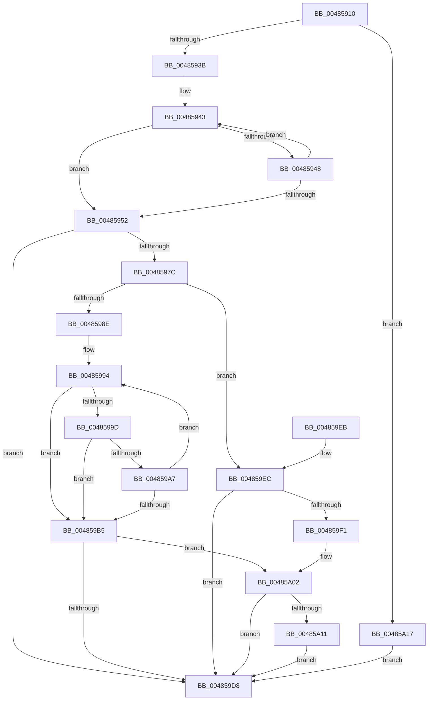

# RtlStringCchCatExW

- RVA: `0x00485910`–`0x00485A1E` (길이 `270` bytes)
- VA: `0x0000000140485910`
- 실행 섹션: `.text`
- PDB 이름 있음: `예`; PDB Function 태그: `아니요`
- unwind 정보 RVA: `0x000AF5BC`
- 디코드: `83`개 명령, `270/270` bytes 표시
- 미해석 바이트: `0` (있으면 어셈블리에 `.byte`로 보존)

> 이 문서는 커널 이미지의 기계어와 PDB 기호를 분석해 생성했습니다. 4번과 5번은 함수 원형과 자료형을 바이너리 사용 방식에서 추정한 C 해석이며 원본 소스 복구 결과는 아닙니다.

## 1. Dependencies

- 직접 호출 지점: **0**; 고유 호출 대상: **0**
- 직접 호출자로 확인된 함수: **2**
- RIP 상대 이미지 참조: **0**

### Outgoing calls
- 직접 디코드된 call 명령이 없습니다.

### Direct callers
- [PiCMGenerateDeviceInstance](../../page/73/PiCMGenerateDeviceInstance_function_0073B69C.md) at `0x0073B79B`
- [PiCMGenerateDeviceInstance](../../page/73/PiCMGenerateDeviceInstance_function_0073B69C.md) at `0x0073B7B3`
- [sub_008F246A](../../page/8F/Unknown_function_008F246A.md) at `0x008F26C9`
- [sub_008F246A](../../page/8F/Unknown_function_008F246A.md) at `0x008F26E5`

### Static image references
- 디코드된 RIP-relative 메모리 참조가 없습니다.

## 2. Other-region calls and transfers

- 다른 실행 섹션으로 향하는 call: **0**
- 별도 외부 분기/꼬리 이동을 확인하지 못했습니다.

## 3. Assembly (complete function range)

```asm
00485910  48 89 5C 24 08                  mov qword ptr [rsp + 8], rbx
00485915  48 89 6C 24 10                  mov qword ptr [rsp + 0x10], rbp
0048591A  48 89 74 24 18                  mov qword ptr [rsp + 0x18], rsi
0048591F  57                              push rdi
00485920  48 8D 42 FF                     lea rax, [rdx - 1]
00485924  BE FE FF FF 7F                  mov esi, 0x7ffffffe
00485929  49 8B F8                        mov rdi, r8
0048592C  4C 8B CA                        mov r9, rdx
0048592F  4C 8B D9                        mov r11, rcx
00485932  48 3B C6                        cmp rax, rsi
00485935  0F 87 DC 00 00 00               ja 0x140485a17
0048593B  48 8B DA                        mov rbx, rdx
0048593E  48 8B C1                        mov rax, rcx
00485941  33 ED                           xor ebp, ebp
00485943  66 39 28                        cmp word ptr [rax], bp
00485946  74 0A                           je 0x140485952
00485948  48 83 C0 02                     add rax, 2
0048594C  48 83 EB 01                     sub rbx, 1
00485950  75 F1                           jne 0x140485943
00485952  48 8B C3                        mov rax, rbx
00485955  41 BA 0D 00 00 C0               mov r10d, 0xc000000d
0048595B  48 F7 D8                        neg rax
0048595E  49 8B C9                        mov rcx, r9
00485961  48 8B C3                        mov rax, rbx
00485964  1B D2                           sbb edx, edx
00485966  48 2B CB                        sub rcx, rbx
00485969  F7 D2                           not edx
0048596B  41 23 D2                        and edx, r10d
0048596E  48 F7 D8                        neg rax
00485971  48 1B C0                        sbb rax, rax
00485974  48 23 C1                        and rax, rcx
00485977  48 85 DB                        test rbx, rbx
0048597A  74 5C                           je 0x1404859d8
0048597C  49 8B C9                        mov rcx, r9
0048597F  4D 8D 04 43                     lea r8, [r11 + rax*2]
00485983  48 2B C8                        sub rcx, rax
00485986  8B D5                           mov edx, ebp
00485988  48 83 F9 01                     cmp rcx, 1
0048598C  76 5E                           jbe 0x1404859ec
0048598E  48 2B F1                        sub rsi, rcx
00485991  49 2B F8                        sub rdi, r8
00485994  48 8D 04 0E                     lea rax, [rsi + rcx]
00485998  48 85 C0                        test rax, rax
0048599B  74 18                           je 0x1404859b5
0048599D  42 0F B7 04 07                  movzx eax, word ptr [rdi + r8]
004859A2  66 85 C0                        test ax, ax
004859A5  74 0E                           je 0x1404859b5
004859A7  66 41 89 00                     mov word ptr [r8], ax
004859AB  49 83 C0 02                     add r8, 2
004859AF  48 83 E9 01                     sub rcx, 1
004859B3  75 DF                           jne 0x140485994
004859B5  48 85 C9                        test rcx, rcx
004859B8  49 8D 40 FE                     lea rax, [r8 - 2]
004859BC  49 0F 45 C0                     cmovne rax, r8
004859C0  66 89 28                        mov word ptr [rax], bp
004859C3  48 8B C1                        mov rax, rcx
004859C6  48 F7 D8                        neg rax
004859C9  1B D2                           sbb edx, edx
004859CB  F7 D2                           not edx
004859CD  81 E2 05 00 00 80               and edx, 0x80000005
004859D3  48 85 C9                        test rcx, rcx
004859D6  74 2A                           je 0x140485a02
004859D8  48 8B 5C 24 10                  mov rbx, qword ptr [rsp + 0x10]
004859DD  8B C2                           mov eax, edx
004859DF  48 8B 6C 24 18                  mov rbp, qword ptr [rsp + 0x18]
004859E4  48 8B 74 24 20                  mov rsi, qword ptr [rsp + 0x20]
004859E9  5F                              pop rdi
004859EA  C3                              ret
004859EB  CC                              int3
004859EC  66 39 2F                        cmp word ptr [rdi], bp
004859EF  74 E7                           je 0x1404859d8
004859F1  49 8B C3                        mov rax, r11
004859F4  48 F7 D8                        neg rax
004859F7  1B D2                           sbb edx, edx
004859F9  81 E2 F8 FF FF BF               and edx, 0xbffffff8
004859FF  41 03 D2                        add edx, r10d
00485A02  48 B8 FF FF FF FF FF FF FF 7F   movabs rax, 0x7fffffffffffffff
00485A0C  4C 85 C8                        test rax, r9
00485A0F  76 C7                           jbe 0x1404859d8
00485A11  66 41 89 2B                     mov word ptr [r11], bp
00485A15  EB C1                           jmp 0x1404859d8
00485A17  BA 0D 00 00 C0                  mov edx, 0xc000000d
00485A1C  EB BA                           jmp 0x1404859d8
```

## 4. C-style interpretation (structured pseudocode)

```c
__int64 __fastcall RtlStringCchCatExW(__int64 a1, __int64 a2, __int64 a3)
{
    __int64 result;
    __int64 v_rbp;
    __int64 v_rbx;
    __int64 v_rdi;
    __int64 v_rsi;
    unsigned __int64 v_stack_p10;
    unsigned __int64 v_stack_p18;
    unsigned __int64 v_stack_p8;

    v_stack_p8 = v_rbx;
    v_stack_p10 = v_rbp;
    v_stack_p18 = v_rsi;
    if ((a2 - 1) > ((unsigned int)(0x7FFFFFFEULL))) goto loc_00485A17;
    v_rbp = 0;
loc_00485943:
    if ((*(unsigned __int16 *)(a1)) == 0) goto loc_00485952;
    result = (a1) + (2);
    v_rbx = (a2) - (1);
    if (condition_is_not_equal) goto loc_00485943;
loc_00485952:
    result = -(v_rbx);
    a1 = (a2) - (v_rbx);
    a2 = (unsigned int)(~(a2));
    a2 = (unsigned int)((a2) & ((unsigned int)((unsigned int)(0xC000000DULL))));
    result = -(v_rbx);
    result = (result) & (a1);
    if (v_rbx == 0) goto loc_004859D8;
    a1 = (a2) - (result);
    if (a1 <= 1) goto loc_004859EC;
    v_rsi = ((unsigned int)(0x7FFFFFFEULL)) - (a1);
    v_rdi = (a3) - (a1 + result * 2);
loc_00485994:
    if (v_rsi + a1 * 1 == 0) goto loc_004859B5;
    if ((unsigned __int16)(*(unsigned __int16 *)(v_rdi + a1 + result * 2 * 1)) == 0) goto loc_004859B5;
    *(unsigned __int16 *)(a1 + result * 2) = (unsigned __int16)(*(unsigned __int16 *)(v_rdi + a1 + result * 2 * 1));
    a3 = (a1 + result * 2) + (2);
    a1 = (a1) - (1);
    if (condition_is_not_equal) goto loc_00485994;
loc_004859B5:
    result = a3 - 2;
    if (a1 != 0) { result = a3; }
    *(unsigned __int16 *)(result) = 0;
    result = -(a1);
    a2 = (unsigned int)(~(0));
    a2 = (unsigned int)((a2) & (0x80000005ULL));
    if (a1 == 0) goto loc_00485A02;
loc_004859D8:
    return (unsigned int)((unsigned int)(a2));
loc_004859EC:
    if ((*(unsigned __int16 *)(v_rdi)) == ((unsigned __int16)(v_stack_p10))) goto loc_004859D8;
    result = -(a1);
    a2 = (unsigned int)((a2) & (0xBFFFFFF8ULL));
    a2 = (unsigned int)((a2) + ((unsigned int)((unsigned int)(0xC000000DULL))));
loc_00485A02:
    if (condition_is_below_or_equal) goto loc_004859D8;
    *(unsigned __int16 *)(a1) = (unsigned __int16)(v_stack_p10);
    goto loc_004859D8;
loc_00485A17:
    goto loc_004859D8;
}
```

## 5. (Beta) C Style

```c
int64_t RtlStringCchCatExW(void *Arg1, void *Arg2, void *Arg3)
{
    uint8_t *arg1 = (uint8_t *)Arg1;
    uint8_t *arg2 = (uint8_t *)Arg2;
    uint8_t *arg3 = (uint8_t *)Arg3;

    int64_t result;
    int64_t local_rbp;
    int64_t local_rbx;
    int64_t local_rdi;
    int64_t local_rsi;
    uint64_t v_stack_p10;
    uint64_t v_stack_p18;
    uint64_t v_stack_p8;

    v_stack_p8 = local_rbx;
    v_stack_p10 = local_rbp;
    v_stack_p18 = local_rsi;
    if ((Arg2 - 1) > ((uint32_t)(0x7FFFFFFEULL))) goto loc_00485A17;
    local_rbp = 0;
loc_00485943:
    if ((*(uint16_t *)(arg1)) == 0) goto loc_00485952;
    result = (Arg1) + (2);
    local_rbx = (Arg2) - (1);
    if (condition_is_not_equal) goto loc_00485943;
loc_00485952:
    result = -(local_rbx);
    Arg1 = (Arg2) - (local_rbx);
    Arg2 = (uint32_t)(~(Arg2));
    Arg2 = (uint32_t)((Arg2) & ((uint32_t)((uint32_t)(0xC000000DULL))));
    result = -(local_rbx);
    result = (result) & (Arg1);
    if (local_rbx == 0) goto loc_004859D8;
    Arg1 = (Arg2) - (result);
    if (Arg1 <= 1) goto loc_004859EC;
    local_rsi = ((uint32_t)(0x7FFFFFFEULL)) - (Arg1);
    local_rdi = (Arg3) - (Arg1 + result * 2);
loc_00485994:
    if (local_rsi + Arg1 * 1 == 0) goto loc_004859B5;
    if ((uint16_t)(*(uint16_t *)(local_rdi + arg1 + result * 2 * 1)) == 0) goto loc_004859B5;
    *(uint16_t *)(arg1 + result * 2) = (uint16_t)(*(uint16_t *)(local_rdi + arg1 + result * 2 * 1));
    Arg3 = (Arg1 + result * 2) + (2);
    Arg1 = (Arg1) - (1);
    if (condition_is_not_equal) goto loc_00485994;
loc_004859B5:
    result = Arg3 - 2;
    if (Arg1 != NULL) { result = Arg3; }
    *(uint16_t *)(result) = 0;
    result = -(Arg1);
    Arg2 = (uint32_t)(~(0));
    Arg2 = (uint32_t)((Arg2) & (0x80000005ULL));
    if (Arg1 == NULL) goto loc_00485A02;
loc_004859D8:
    return (uint32_t)((uint32_t)(Arg2));
loc_004859EC:
    if ((*(uint16_t *)(local_rdi)) == ((uint16_t)(v_stack_p10))) goto loc_004859D8;
    result = -(Arg1);
    Arg2 = (uint32_t)((Arg2) & (0xBFFFFFF8ULL));
    Arg2 = (uint32_t)((Arg2) + ((uint32_t)((uint32_t)(0xC000000DULL))));
loc_00485A02:
    if (condition_is_below_or_equal) goto loc_004859D8;
    *(uint16_t *)(arg1) = (uint16_t)(v_stack_p10);
    goto loc_004859D8;
loc_00485A17:
    goto loc_004859D8;
}
```

### 관측된 메모리 오프셋

구조체 형식이 확인되지 않은 접근은 인자 기준의 오프셋으로만 기록했습니다.

| 기준 인자 | 오프셋 표현 | 폭 (bit) | 접근 |
|---|---:|---:|---|
| `Arg1` | `- 0x2` | `64` | `R` |
| `Arg1` | `+ 0x0` | `16` | `R` |
| `Arg1` | `+ 0x0` | `16` | `W` |
| `Arg1` | `+ 0x0 + rax*2` | `64` | `R` |
| `Arg2` | `- 0x1` | `64` | `R` |
| `Arg3` | `+ 0x0` | `16` | `R` |
| `Arg3` | `+ 0x0 + r8*1` | `16` | `R` |

## 6. Execution-region graph

[열기: 2D/3D 그래프와 함수 탐색 컨트롤 패널](../../../control-panel.html?section=text&rva=0x00485910&view=graph)

- 2D 그래프는 위에서 아래로 흐르고, 3D 그래프는 빈 공간을 드래그해 회전합니다. Shift+드래그는 이동, 휠은 확대·축소, 함수 노드 선택은 대상 보고서 이동입니다.

### Static fallback


