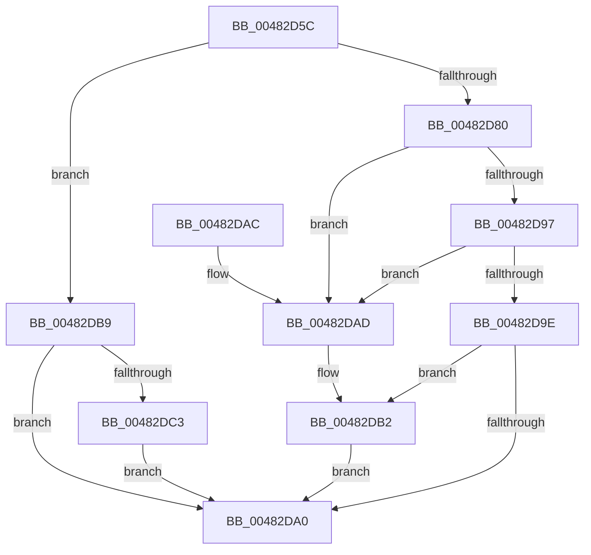

# RtlStringCchPrintfW

- RVA: `0x00482D5C`–`0x00482DC8` (길이 `108` bytes)
- VA: `0x0000000140482D5C`
- 실행 섹션: `.text`
- PDB 이름 있음: `예`; PDB Function 태그: `아니요`
- unwind 정보 RVA: `0x0009BB9C`
- 디코드: `39`개 명령, `108/108` bytes 표시
- 미해석 바이트: `0` (있으면 어셈블리에 `.byte`로 보존)

> 이 문서는 커널 이미지의 기계어와 PDB 기호를 분석해 생성했습니다. 4번과 5번은 함수 원형과 자료형을 바이너리 사용 방식에서 추정한 C 해석이며 원본 소스 복구 결과는 아닙니다.

## 1. Dependencies

- 직접 호출 지점: **1**; 고유 호출 대상: **1**
- 직접 호출자로 확인된 함수: **45**
- RIP 상대 이미지 참조: **0**

### Outgoing calls
- `0x00482D8E` → [vsnwprintf](../4F/vsnwprintf_function_004FEF30.md) (function, `0x004FEF30`)

### Direct callers
- [RtlpEtcGetDwordFromPersistedState](../5E/RtlpEtcGetDwordFromPersistedState_function_005ED38C.md) at `0x005ED400`
- [RtlpEtcIsValidFeatureId](../5E/RtlpEtcIsValidFeatureId_function_005ED4D4.md) at `0x005ED546`
- [RtlpEtcIsValidFeatureId](../5E/RtlpEtcIsValidFeatureId_function_005ED4D4.md) at `0x005ED561`
- [CarLiveDumpCallBack](../61/CarLiveDumpCallBack_function_0061BC20.md) at `0x0061BCB0`
- [DrvDbGetConfigurationSubKeyCallback](../6A/DrvDbGetConfigurationSubKeyCallback_function_006A2E40.md) at `0x006A2FA7`
- [IopCopyBootLogRegistryToFile](../../page/71/IopCopyBootLogRegistryToFile_function_0071B19C.md) at `0x0071B334`
- [PiDevCfgResolveVariableFormatString](../../page/73/PiDevCfgResolveVariableFormatString_function_00735AB0.md) at `0x00735D3B`
- [PiDevCfgResolveVariableFormatString](../../page/73/PiDevCfgResolveVariableFormatString_function_00735AB0.md) at `0x00735E99`
- [PiDevCfgResolveVariableSwitchCase](../../page/73/PiDevCfgResolveVariableSwitchCase_function_00736390.md) at `0x00736509`
- [IopCreateLegacyDeviceIds](../../page/73/IopCreateLegacyDeviceIds_function_0073D3E4.md) at `0x0073D512`
- [PiDrvDbRegisterNode](../../page/74/PiDrvDbRegisterNode_function_00742658.md) at `0x00742758`
- [PiDrvDbRegisterNodeCallback](../../page/74/PiDrvDbRegisterNodeCallback_function_00742B00.md) at `0x00742B9E`
- [PopAdaptiveStandbyTraceBatteryUpdate](../../page/76/PopAdaptiveStandbyTraceBatteryUpdate_function_0076EF7C.md) at `0x0076F055`
- [PopAdaptiveStandbyTraceBatteryUpdate](../../page/76/PopAdaptiveStandbyTraceBatteryUpdate_function_0076EF7C.md) at `0x0076F0AA`
- [PopAdaptiveStandbyTraceBatteryUpdate](../../page/76/PopAdaptiveStandbyTraceBatteryUpdate_function_0076EF7C.md) at `0x0076F0C8`
- [PopAdaptiveStandbyTraceBatteryUpdate](../../page/76/PopAdaptiveStandbyTraceBatteryUpdate_function_0076EF7C.md) at `0x0076F0E2`
- [PopAdaptiveStandbyTraceBatteryUpdate](../../page/76/PopAdaptiveStandbyTraceBatteryUpdate_function_0076EF7C.md) at `0x0076F100`
- [PopAdaptiveStandbyTraceBatteryUpdate](../../page/76/PopAdaptiveStandbyTraceBatteryUpdate_function_0076EF7C.md) at `0x0076F11A`
- [PopAdaptiveStandbyTraceBatteryUpdate](../../page/76/PopAdaptiveStandbyTraceBatteryUpdate_function_0076EF7C.md) at `0x0076F138`
- [PopAdaptiveStandbyTraceBatteryUpdate](../../page/76/PopAdaptiveStandbyTraceBatteryUpdate_function_0076EF7C.md) at `0x0076F152`
- [PopAdaptiveStandbyTraceBatteryUpdate](../../page/76/PopAdaptiveStandbyTraceBatteryUpdate_function_0076EF7C.md) at `0x0076F175`
- [PopAdaptiveStandbyTraceBatteryUpdate](../../page/76/PopAdaptiveStandbyTraceBatteryUpdate_function_0076EF7C.md) at `0x0076F1BE`
- [PopAdaptiveStandbyTraceBatteryUpdate](../../page/76/PopAdaptiveStandbyTraceBatteryUpdate_function_0076EF7C.md) at `0x0076F1E6`
- [PopAdaptiveStandbyTraceBatteryUpdate](../../page/76/PopAdaptiveStandbyTraceBatteryUpdate_function_0076EF7C.md) at `0x0076F203`
- [PopAdaptiveStandbyTraceBatteryUpdate](../../page/76/PopAdaptiveStandbyTraceBatteryUpdate_function_0076EF7C.md) at `0x0076F22B`
- [PopAdaptiveStandbyTraceSessionSettings](../../page/76/PopAdaptiveStandbyTraceSessionSettings_function_0076F428.md) at `0x0076F565`
- [PopAdaptiveStandbyTraceSessionSettings](../../page/76/PopAdaptiveStandbyTraceSessionSettings_function_0076F428.md) at `0x0076F588`
- [PopAdaptiveStandbyTraceSessionSettings](../../page/76/PopAdaptiveStandbyTraceSessionSettings_function_0076F428.md) at `0x0076F5AF`
- [PopAdaptiveStandbyTraceSessionSettings](../../page/76/PopAdaptiveStandbyTraceSessionSettings_function_0076F428.md) at `0x0076F5F6`
- [PopAdaptiveStandbyTraceSessionSettings](../../page/76/PopAdaptiveStandbyTraceSessionSettings_function_0076F428.md) at `0x0076F60F`
- [PopAdaptiveStandbyTraceSessionSettings](../../page/76/PopAdaptiveStandbyTraceSessionSettings_function_0076F428.md) at `0x0076F63D`
- [PopAdaptiveStandbyTraceSessionSettings](../../page/76/PopAdaptiveStandbyTraceSessionSettings_function_0076F428.md) at `0x0076F656`
- [PopAdaptiveStandbyTraceSessionSettings](../../page/76/PopAdaptiveStandbyTraceSessionSettings_function_0076F428.md) at `0x0076F684`
- [PopAdaptiveStandbyTraceSessionSettings](../../page/76/PopAdaptiveStandbyTraceSessionSettings_function_0076F428.md) at `0x0076F69D`
- [PopAdaptiveStandbyTraceSessionSettings](../../page/76/PopAdaptiveStandbyTraceSessionSettings_function_0076F428.md) at `0x0076F6CB`
- [PopAdaptiveStandbyTraceSessionSettings](../../page/76/PopAdaptiveStandbyTraceSessionSettings_function_0076F428.md) at `0x0076F6E4`
- [PopAdaptiveStandbyTraceSessionSettings](../../page/76/PopAdaptiveStandbyTraceSessionSettings_function_0076F428.md) at `0x0076F72A`
- [PopAdaptiveStandbyTraceSessionSettings](../../page/76/PopAdaptiveStandbyTraceSessionSettings_function_0076F428.md) at `0x0076F74D`
- [PopAdaptiveStandbyTraceSessionSettings](../../page/76/PopAdaptiveStandbyTraceSessionSettings_function_0076F428.md) at `0x0076F770`
- [PopAdaptiveStandbyTraceSessionSettings](../../page/76/PopAdaptiveStandbyTraceSessionSettings_function_0076F428.md) at `0x0076F797`
- [PopAdaptiveStandbyTraceSessionSettings](../../page/76/PopAdaptiveStandbyTraceSessionSettings_function_0076F428.md) at `0x0076F7BE`
- [PopAdaptiveStandbyTraceSessionSettings](../../page/76/PopAdaptiveStandbyTraceSessionSettings_function_0076F428.md) at `0x0076F7E5`
- [PspShutdownCsrProcess](../../page/78/PspShutdownCsrProcess_function_00780214.md) at `0x00780290`
- [PspShutdownCsrProcess](../../page/78/PspShutdownCsrProcess_function_00780214.md) at `0x007802F5`
- [PspSessionObjectCreate](../../page/78/PspSessionObjectCreate_function_007892A8.md) at `0x0078941F`
- [RtlpGetTokenNamedObjectPath](../../page/78/RtlpGetTokenNamedObjectPath_function_0078ED40.md) at `0x0078F0AF`
- [RtlpGetTokenNamedObjectPath](../../page/78/RtlpGetTokenNamedObjectPath_function_0078ED40.md) at `0x0078F136`
- [RtlpGetTokenNamedObjectPath](../../page/78/RtlpGetTokenNamedObjectPath_function_0078ED40.md) at `0x0078F173`
- [SepReadAndInsertCaps](../../page/7A/SepReadAndInsertCaps_function_007A3960.md) at `0x007A3B1B`
- [CMFFlushHitsFile](../../page/7D/CMFFlushHitsFile_function_007D3140.md) at `0x007D3234`
- [CMFSystemThreadRoutine](../../page/7D/CMFSystemThreadRoutine_function_007D3A70.md) at `0x007D3B84`
- [CMFSystemThreadRoutine](../../page/7D/CMFSystemThreadRoutine_function_007D3A70.md) at `0x007D3BC7`
- [SdbpCheckMatchingRegistryEntry](../../page/81/SdbpCheckMatchingRegistryEntry_function_0081444C.md) at `0x008144D0`
- [AslGuidToString_UStr](../../page/81/AslGuidToString_UStr_function_008196DC.md) at `0x008197BB`
- [AslpFileQueryVersionString](../../page/82/AslpFileQueryVersionString_function_0082113C.md) at `0x00821284`
- [SysCtxOpenControlSet](../../page/83/SysCtxOpenControlSet_function_00831B00.md) at `0x00831C80`
- [EtwpPsProvTraceProcess](../../page/8A/EtwpPsProvTraceProcess_function_008A3954.md) at `0x008A3FDF`
- [SepValidateReferencedCachedHandles](../../page/8F/SepValidateReferencedCachedHandles_function_008F4BB0.md) at `0x008F4EE5`
- [IoCreateDevice](../../page/9A/IoCreateDevice_function_009A4B00.md) at `0x009A4BC1`
- [IoWMIOpenBlock](../../page/9D/IoWMIOpenBlock_function_009DFF20.md) at `0x009E001C`
- [LocalpGetStringForCondition](../../page/A0/LocalpGetStringForCondition_function_00A0122C.md) at `0x00A015EA`
- [RtlpInitNlsSectionName](../../page/A1/RtlpInitNlsSectionName_function_00A19AD0.md) at `0x00A19B6A`
- [RtlpInitNlsFileName](../../page/A1/RtlpInitNlsFileName_function_00A19B9C.md) at `0x00A19CEF`
- [RtlpInitNlsFileName](../../page/A1/RtlpInitNlsFileName_function_00A19B9C.md) at `0x00A19D40`
- [PipMakeGloballyUniqueId](../../page/A6/PipMakeGloballyUniqueId_function_00A6F428.md) at `0x00A6F6AE`
- [PiDevCfgResolveVariableExpression](../../page/AA/PiDevCfgResolveVariableExpression_function_00AA8C00.md) at `0x00AA8EC5`
- [AslGuidToString](../../page/AB/AslGuidToString_function_00ABD4AC.md) at `0x00ABD52F`
- [IoCreateDriver](../../page/AC/IoCreateDriver_function_00AC9D70.md) at `0x00AC9DF6`
- [PiDevCfgLogDeviceConfigured](../../page/AD/PiDevCfgLogDeviceConfigured_function_00ADCDD4.md) at `0x00ADD0C7`
- [PiDevCfgLogDeviceConfigured](../../page/AD/PiDevCfgLogDeviceConfigured_function_00ADCDD4.md) at `0x00ADD10F`
- [ConvertDevpropcompkeyToString](../../page/AF/ConvertDevpropcompkeyToString_function_00AFA604.md) at `0x00AFA695`
- [sub_00B1E93A](../../page/B1/Unknown_function_00B1E93A.md) at `0x00B1E957`
- [sub_00B1E93A](../../page/B1/Unknown_function_00B1E93A.md) at `0x00B1EA12`
- [sub_00B32900](../../page/B3/Unknown_function_00B32900.md) at `0x00B32A33`
- [sub_00B32AA2](../../page/B3/Unknown_function_00B32AA2.md) at `0x00B32B79`
- [sub_00B32AA2](../../page/B3/Unknown_function_00B32AA2.md) at `0x00B32CFB`
- [sub_00B32AA2](../../page/B3/Unknown_function_00B32AA2.md) at `0x00B32EB0`
- [sub_00B32F2A](../../page/B3/Unknown_function_00B32F2A.md) at `0x00B32F73`
- [sub_00B3665A](../../page/B3/Unknown_function_00B3665A.md) at `0x00B366AB`
- [sub_00B46364](../../page/B4/Unknown_function_00B46364.md) at `0x00B463AE`
- [sub_00B46364](../../page/B4/Unknown_function_00B46364.md) at `0x00B464AB`
- [sub_00B46996](../../page/B4/Unknown_function_00B46996.md) at `0x00B46A36`
- [IopCreateArcNamesDisk](../../init/C2/IopCreateArcNamesDisk_function_00C2C594.md) at `0x00C2C68D`
- [IopReassignSystemRoot](../../init/C2/IopReassignSystemRoot_function_00C2D1D0.md) at `0x00C2D231`
- [PipInitComputerIds](../../init/C7/PipInitComputerIds_function_00C74734.md) at `0x00C74E28`
- [PipInitComputerIds](../../init/C7/PipInitComputerIds_function_00C74734.md) at `0x00C7548D`

### Static image references
- 디코드된 RIP-relative 메모리 참조가 없습니다.

## 2. Other-region calls and transfers

- 다른 실행 섹션으로 향하는 call: **0**
- 별도 외부 분기/꼬리 이동을 확인하지 못했습니다.

## 3. Assembly (complete function range)

```asm
00482D5C  4C 89 44 24 18                  mov qword ptr [rsp + 0x18], r8
00482D61  4C 89 4C 24 20                  mov qword ptr [rsp + 0x20], r9
00482D66  53                              push rbx
00482D67  56                              push rsi
00482D68  57                              push rdi
00482D69  41 56                           push r14
00482D6B  48 83 EC 38                     sub rsp, 0x38
00482D6F  48 8D 42 FF                     lea rax, [rdx - 1]
00482D73  33 DB                           xor ebx, ebx
00482D75  4C 8B F1                        mov r14, rcx
00482D78  48 3D FE FF FF 7F               cmp rax, 0x7ffffffe
00482D7E  77 39                           ja 0x140482db9
00482D80  48 8D 72 FF                     lea rsi, [rdx - 1]
00482D84  8B FB                           mov edi, ebx
00482D86  48 8B D6                        mov rdx, rsi
00482D89  4C 8D 4C 24 78                  lea r9, [rsp + 0x78]
00482D8E  E8 9D C1 07 00                  call 0x1404fef30
00482D93  85 C0                           test eax, eax
00482D95  78 16                           js 0x140482dad
00482D97  48 98                           cdqe
00482D99  48 3B C6                        cmp rax, rsi
00482D9C  77 0F                           ja 0x140482dad
00482D9E  74 12                           je 0x140482db2
00482DA0  8B C7                           mov eax, edi
00482DA2  48 83 C4 38                     add rsp, 0x38
00482DA6  41 5E                           pop r14
00482DA8  5F                              pop rdi
00482DA9  5E                              pop rsi
00482DAA  5B                              pop rbx
00482DAB  C3                              ret
00482DAC  CC                              int3
00482DAD  BF 05 00 00 80                  mov edi, 0x80000005
00482DB2  66 41 89 1C 76                  mov word ptr [r14 + rsi*2], bx
00482DB7  EB E7                           jmp 0x140482da0
00482DB9  BF 0D 00 00 C0                  mov edi, 0xc000000d
00482DBE  48 85 D2                        test rdx, rdx
00482DC1  74 DD                           je 0x140482da0
00482DC3  66 89 19                        mov word ptr [rcx], bx
00482DC6  EB D8                           jmp 0x140482da0
```

## 4. C-style interpretation (structured pseudocode)

```c
__int64 __fastcall RtlStringCchPrintfW(__int64 a1, __int64 a2, __int64 a3, __int64 a4)
{
    __int64 result;
    __int64 v_rbx;
    __int64 v_rsp;
    unsigned __int64 v_stack_p18;
    unsigned __int64 v_stack_p20;

    v_stack_p18 = a3;
    v_stack_p20 = a4;
    v_rsp = (v_rsp) - (56);
    v_rbx = 0;
    if ((a2 - 1) > 0x7FFFFFFEULL) goto loc_00482DB9;
    result = vsnwprintf(a1, a2 - 1, a3, v_stack_p20);
    if (sign_flag) goto loc_00482DAD;
    if (result > (a2 - 1)) goto loc_00482DAD;
    if (result == (a2 - 1)) goto loc_00482DB2;
loc_00482DA0:
    v_rsp = (v_rsp) + (56);
    return 0;
loc_00482DAD:
loc_00482DB2:
    *(unsigned __int16 *)(a1 + a2 - 1 * 2) = 0;
    goto loc_00482DA0;
loc_00482DB9:
    if (a2 - 1 == 0) goto loc_00482DA0;
    *(unsigned __int16 *)(a1) = 0;
    goto loc_00482DA0;
}
```

## 5. (Beta) C Style

```c
int64_t RtlStringCchPrintfW(void *Arg1, void *Arg2, int64_t Arg3, int64_t Arg4)
{
    uint8_t *arg1 = (uint8_t *)Arg1;
    uint8_t *arg2 = (uint8_t *)Arg2;

    int64_t result;
    int64_t local_rbx;
    int64_t local_rsp;
    uint64_t v_stack_p18;
    uint64_t v_stack_p20;

    v_stack_p18 = Arg3;
    v_stack_p20 = Arg4;
    local_rsp = (local_rsp) - (56);
    local_rbx = 0;
    if ((Arg2 - 1) > 0x7FFFFFFEULL) goto loc_00482DB9;
    result = vsnwprintf(Arg1, Arg2 - 1, Arg3, v_stack_p20);
    if (sign_flag) goto loc_00482DAD;
    if (result > (Arg2 - 1)) goto loc_00482DAD;
    if (result == (Arg2 - 1)) goto loc_00482DB2;
loc_00482DA0:
    local_rsp = (local_rsp) + (56);
    return 0;
loc_00482DAD:
loc_00482DB2:
    *(uint16_t *)(arg1 + arg2 - 0x1 * 2) = 0;
    goto loc_00482DA0;
loc_00482DB9:
    if (Arg2 - 1 == 0) goto loc_00482DA0;
    *(uint16_t *)(arg1) = 0;
    goto loc_00482DA0;
}
```

### 관측된 메모리 오프셋

구조체 형식이 확인되지 않은 접근은 인자 기준의 오프셋으로만 기록했습니다.

| 기준 인자 | 오프셋 표현 | 폭 (bit) | 접근 |
|---|---:|---:|---|
| `Arg1` | `+ 0x0` | `16` | `W` |
| `Arg1` | `+ 0x0 + rsi*2` | `16` | `W` |
| `Arg2` | `- 0x1` | `64` | `R` |

## 6. Execution-region graph

[열기: 2D/3D 그래프와 함수 탐색 컨트롤 패널](../../../control-panel.html?section=text&rva=0x00482D5C&view=graph)

- 2D 그래프는 위에서 아래로 흐르고, 3D 그래프는 빈 공간을 드래그해 회전합니다. Shift+드래그는 이동, 휠은 확대·축소, 함수 노드 선택은 대상 보고서 이동입니다.

### Static fallback


