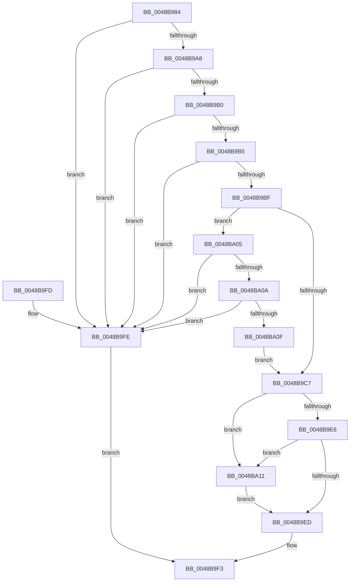

# RtlUnicodeStringPrintf

- RVA: `0x0048B984`–`0x0048BA1B` (길이 `151` bytes)
- VA: `0x000000014048B984`
- 실행 섹션: `.text`
- PDB 이름 있음: `예`; PDB Function 태그: `아니요`
- unwind 정보 RVA: `0x000B0AB0`
- 디코드: `54`개 명령, `151/151` bytes 표시
- 미해석 바이트: `0` (있으면 어셈블리에 `.byte`로 보존)

> 이 문서는 커널 이미지의 기계어와 PDB 기호를 분석해 생성했습니다. 4번과 5번은 함수 원형과 자료형을 바이너리 사용 방식에서 추정한 C 해석이며 원본 소스 복구 결과는 아닙니다.

## 1. Dependencies

- 직접 호출 지점: **1**; 고유 호출 대상: **1**
- 직접 호출자로 확인된 함수: **23**
- RIP 상대 이미지 참조: **0**

### Outgoing calls
- `0x0048B9DD` → [vsnwprintf](../4F/vsnwprintf_function_004FEF30.md) (function, `0x004FEF30`)

### Direct callers
- [FsRtlOpenFileSystemRegistryKeyFromFsGuid](../../page/71/FsRtlOpenFileSystemRegistryKeyFromFsGuid_function_00715980.md) at `0x00715A86`
- [PiDrvDbResolveNodeFilePaths](../../page/74/PiDrvDbResolveNodeFilePaths_function_007433A4.md) at `0x007434B0`
- [CmpOpenDevicesControlSet](../../page/7D/CmpOpenDevicesControlSet_function_007DC5B0.md) at `0x007DC639`
- [CmpOpenDevicesControlSet](../../page/7D/CmpOpenDevicesControlSet_function_007DC5B0.md) at `0x007DC6C5`
- [CmpSaveBootControlSet](../../page/7D/CmpSaveBootControlSet_function_007DC744.md) at `0x007DC8CD`
- [CmSetAcpiHwProfile](../../page/7E/CmSetAcpiHwProfile_function_007E2584.md) at `0x007E2D72`
- [CmpDeleteCorruptedLogfile](../../page/7F/CmpDeleteCorruptedLogfile_function_007F6C80.md) at `0x007F7163`
- [ExProcessCounterSetCallback](../../page/91/ExProcessCounterSetCallback_function_0091CDF0.md) at `0x0091D188`
- [PiDevCfgConfigureDevice](../../page/97/PiDevCfgConfigureDevice_function_00977BB4.md) at `0x00979296`
- [PiDevCfgBuildDriverNodeStrongName](../../page/97/PiDevCfgBuildDriverNodeStrongName_function_0097A33C.md) at `0x0097A46F`
- [PiDevCfgBuildIndirectString](../../page/97/PiDevCfgBuildIndirectString_function_0097A890.md) at `0x0097AAD7`
- [SshpGenerateDeviceFriendlyName](../../page/A2/SshpGenerateDeviceFriendlyName_function_00A2E184.md) at `0x00A2E409`
- [PopGetCallerContextFromBuffer](../../page/A3/PopGetCallerContextFromBuffer_function_00A39AAC.md) at `0x00A39C04`
- [PopSleepstudyUlongFormatter](../../page/AA/PopSleepstudyUlongFormatter_function_00AA3F30.md) at `0x00AA3F8C`
- [PopSleepstudyUlong64Formatter](../../page/AA/PopSleepstudyUlong64Formatter_function_00AA7060.md) at `0x00AA70BC`
- [PiCreateDriverSwDeviceCallback](../../page/AB/PiCreateDriverSwDeviceCallback_function_00ABB420.md) at `0x00ABBBF4`
- [PiDevCfgBuildDriverConfigurationId](../../page/AB/PiDevCfgBuildDriverConfigurationId_function_00ABC0D0.md) at `0x00ABC2B3`
- [PopIdleWakeGenerateDescriptionString](../../page/AB/PopIdleWakeGenerateDescriptionString_function_00ABD584.md) at `0x00ABD68E`
- [PopIdleWakeGenerateDescriptionString](../../page/AB/PopIdleWakeGenerateDescriptionString_function_00ABD584.md) at `0x00ABD753`
- [PopIdleWakeGenerateDescriptionString](../../page/AB/PopIdleWakeGenerateDescriptionString_function_00ABD584.md) at `0x00ABD765`
- [sub_00B4A5F8](../../page/B4/Unknown_function_00B4A5F8.md) at `0x00B4A66B`
- [IopStoreBootDriveLetter](../../init/C2/IopStoreBootDriveLetter_function_00C2D5CC.md) at `0x00C2D702`
- [CmpAddAliasEntry](../../init/C5/CmpAddAliasEntry_function_00C56584.md) at `0x00C5668F`
- [CmpCreateControlSet](../../init/C5/CmpCreateControlSet_function_00C56910.md) at `0x00C569A0`
- [CmpCreateControlSet](../../init/C5/CmpCreateControlSet_function_00C56910.md) at `0x00C56AE2`
- [CmpCreateControlSet](../../init/C5/CmpCreateControlSet_function_00C56910.md) at `0x00C56C35`
- [CmpCreateControlSetOverride](../../init/C5/CmpCreateControlSetOverride_function_00C56CC8.md) at `0x00C56D3F`
- [CmpCreateHardwareProfiles](../../init/C5/CmpCreateHardwareProfiles_function_00C56EF4.md) at `0x00C5712F`
- [CmpCreateHardwareProfiles](../../init/C5/CmpCreateHardwareProfiles_function_00C56EF4.md) at `0x00C572D5`
- [CmpCreateHardwareProfiles](../../init/C5/CmpCreateHardwareProfiles_function_00C56EF4.md) at `0x00C57566`
- [CmpCreateHardwareProfiles](../../init/C5/CmpCreateHardwareProfiles_function_00C56EF4.md) at `0x00C575FC`
- [CmpCreateHardwareProfiles](../../init/C5/CmpCreateHardwareProfiles_function_00C56EF4.md) at `0x00C57686`

### Static image references
- 디코드된 RIP-relative 메모리 참조가 없습니다.

## 2. Other-region calls and transfers

- 다른 실행 섹션으로 향하는 call: **0**
- 별도 외부 분기/꼬리 이동을 확인하지 못했습니다.

## 3. Assembly (complete function range)

```asm
0048B984  48 89 54 24 10                  mov qword ptr [rsp + 0x10], rdx
0048B989  4C 89 44 24 18                  mov qword ptr [rsp + 0x18], r8
0048B98E  4C 89 4C 24 20                  mov qword ptr [rsp + 0x20], r9
0048B993  53                              push rbx
0048B994  56                              push rsi
0048B995  57                              push rdi
0048B996  48 83 EC 30                     sub rsp, 0x30
0048B99A  48 8B F9                        mov rdi, rcx
0048B99D  4C 8B D2                        mov r10, rdx
0048B9A0  0F B7 09                        movzx ecx, word ptr [rcx]
0048B9A3  F6 C1 01                        test cl, 1
0048B9A6  75 56                           jne 0x14048b9fe
0048B9A8  0F B7 47 02                     movzx eax, word ptr [rdi + 2]
0048B9AC  A8 01                           test al, 1
0048B9AE  75 4E                           jne 0x14048b9fe
0048B9B0  66 3B C8                        cmp cx, ax
0048B9B3  77 49                           ja 0x14048b9fe
0048B9B5  BA FE FF 00 00                  mov edx, 0xfffe
0048B9BA  66 3B C2                        cmp ax, dx
0048B9BD  77 3F                           ja 0x14048b9fe
0048B9BF  33 DB                           xor ebx, ebx
0048B9C1  48 39 5F 08                     cmp qword ptr [rdi + 8], rbx
0048B9C5  74 3E                           je 0x14048ba05
0048B9C7  0F B7 77 02                     movzx esi, word ptr [rdi + 2]
0048B9CB  4C 8D 4C 24 60                  lea r9, [rsp + 0x60]
0048B9D0  48 8B 4F 08                     mov rcx, qword ptr [rdi + 8]
0048B9D4  4D 8B C2                        mov r8, r10
0048B9D7  48 D1 EE                        shr rsi, 1
0048B9DA  48 8B D6                        mov rdx, rsi
0048B9DD  E8 4E 35 07 00                  call 0x1404fef30
0048B9E2  85 C0                           test eax, eax
0048B9E4  78 2B                           js 0x14048ba11
0048B9E6  48 98                           cdqe
0048B9E8  48 3B C6                        cmp rax, rsi
0048B9EB  77 24                           ja 0x14048ba11
0048B9ED  66 03 C0                        add ax, ax
0048B9F0  66 89 07                        mov word ptr [rdi], ax
0048B9F3  8B C3                           mov eax, ebx
0048B9F5  48 83 C4 30                     add rsp, 0x30
0048B9F9  5F                              pop rdi
0048B9FA  5E                              pop rsi
0048B9FB  5B                              pop rbx
0048B9FC  C3                              ret
0048B9FD  CC                              int3
0048B9FE  BB 0D 00 00 C0                  mov ebx, 0xc000000d
0048BA03  EB EE                           jmp 0x14048b9f3
0048BA05  66 85 C9                        test cx, cx
0048BA08  75 F4                           jne 0x14048b9fe
0048BA0A  66 85 C0                        test ax, ax
0048BA0D  75 EF                           jne 0x14048b9fe
0048BA0F  EB B6                           jmp 0x14048b9c7
0048BA11  48 8B C6                        mov rax, rsi
0048BA14  BB 05 00 00 80                  mov ebx, 0x80000005
0048BA19  EB D2                           jmp 0x14048b9ed
```

## 4. C-style interpretation (structured pseudocode)

```c
__int64 __fastcall RtlUnicodeStringPrintf(__int64 a1, __int64 a2, __int64 a3, __int64 a4)
{
    __int64 result;
    __int64 v_rbx;
    __int64 v_rsi;
    __int64 v_rsp;
    unsigned __int64 v_stack_p10;
    unsigned __int64 v_stack_p18;
    unsigned __int64 v_stack_p20;

    v_stack_p10 = a2;
    v_stack_p18 = a3;
    v_stack_p20 = a4;
    v_rsp = (v_rsp) - (48);
    if ((((unsigned __int8)(*(unsigned __int16 *)(a1))) & (1)) != 0) goto loc_0048B9FE;
    if ((((unsigned __int8)(*(unsigned __int16 *)(a1 + 2))) & (1)) != 0) goto loc_0048B9FE;
    if (((unsigned __int16)(*(unsigned __int16 *)(a1))) > ((unsigned __int16)(*(unsigned __int16 *)(a1 + 2)))) goto loc_0048B9FE;
    if (((unsigned __int16)(*(unsigned __int16 *)(a1 + 2))) > ((unsigned __int16)((unsigned int)(0xFFFEULL)))) goto loc_0048B9FE;
    v_rbx = 0;
    if ((*(unsigned __int64 *)(a1 + 8)) == 0) goto loc_0048BA05;
loc_0048B9C7:
    v_rsi = (*(unsigned __int16 *)(a1 + 2)) >> (1);
    result = vsnwprintf(*(unsigned __int64 *)(a1 + 8), v_rsi, a2, v_stack_p18);
    if (sign_flag) goto loc_0048BA11;
    if (result > v_rsi) goto loc_0048BA11;
loc_0048B9ED:
    result = (unsigned __int16)((result) + ((unsigned __int16)(result)));
    *(unsigned __int16 *)(a1) = (unsigned __int16)(result);
loc_0048B9F3:
    v_rsp = (v_rsp) + (48);
    return 0;
loc_0048B9FE:
    goto loc_0048B9F3;
loc_0048BA05:
    if ((unsigned __int16)(*(unsigned __int64 *)(a1 + 8)) != 0) goto loc_0048B9FE;
    if (0 != 0) goto loc_0048B9FE;
    goto loc_0048B9C7;
loc_0048BA11:
    goto loc_0048B9ED;
}
```

## 5. (Beta) C Style

```c
int64_t RtlUnicodeStringPrintf(void *Arg1, int64_t Arg2, int64_t Arg3, int64_t Arg4)
{
    uint8_t *arg1 = (uint8_t *)Arg1;

    int64_t result;
    int64_t local_rbx;
    int64_t local_rsi;
    int64_t local_rsp;
    uint64_t v_stack_p10;
    uint64_t v_stack_p18;
    uint64_t v_stack_p20;

    v_stack_p10 = Arg2;
    v_stack_p18 = Arg3;
    v_stack_p20 = Arg4;
    local_rsp = (local_rsp) - (48);
    if ((((uint8_t)(*(uint16_t *)(arg1))) & (1)) != 0) goto loc_0048B9FE;
    if ((((uint8_t)(*(uint16_t *)(arg1 + 0x2))) & (1)) != 0) goto loc_0048B9FE;
    if (((uint16_t)(*(uint16_t *)(arg1))) > ((uint16_t)(*(uint16_t *)(arg1 + 0x2)))) goto loc_0048B9FE;
    if (((uint16_t)(*(uint16_t *)(arg1 + 0x2))) > ((uint16_t)((uint32_t)(0xFFFEULL)))) goto loc_0048B9FE;
    local_rbx = 0;
    if ((*(uint64_t *)(arg1 + 0x8)) == 0) goto loc_0048BA05;
loc_0048B9C7:
    local_rsi = (*(uint16_t *)(arg1 + 0x2)) >> (1);
    result = vsnwprintf(*(uint64_t *)(arg1 + 0x8), local_rsi, Arg2, v_stack_p18);
    if (sign_flag) goto loc_0048BA11;
    if (result > local_rsi) goto loc_0048BA11;
loc_0048B9ED:
    result = (uint16_t)((result) + ((uint16_t)(result)));
    *(uint16_t *)(arg1) = (uint16_t)(result);
loc_0048B9F3:
    local_rsp = (local_rsp) + (48);
    return 0;
loc_0048B9FE:
    goto loc_0048B9F3;
loc_0048BA05:
    if ((uint16_t)(*(uint64_t *)(arg1 + 0x8)) != 0) goto loc_0048B9FE;
    if (0 != 0) goto loc_0048B9FE;
    goto loc_0048B9C7;
loc_0048BA11:
    goto loc_0048B9ED;
}
```

### 관측된 메모리 오프셋

구조체 형식이 확인되지 않은 접근은 인자 기준의 오프셋으로만 기록했습니다.

| 기준 인자 | 오프셋 표현 | 폭 (bit) | 접근 |
|---|---:|---:|---|
| `Arg1` | `+ 0x0` | `16` | `R` |
| `Arg1` | `+ 0x0` | `16` | `W` |
| `Arg1` | `+ 0x2` | `16` | `R` |
| `Arg1` | `+ 0x8` | `64` | `R` |

## 6. Execution-region graph

[열기: 2D/3D 그래프와 함수 탐색 컨트롤 패널](../../../control-panel.html?section=text&rva=0x0048B984&view=graph)

- 2D 그래프는 위에서 아래로 흐르고, 3D 그래프는 빈 공간을 드래그해 회전합니다. Shift+드래그는 이동, 휠은 확대·축소, 함수 노드 선택은 대상 보고서 이동입니다.

### Static fallback


