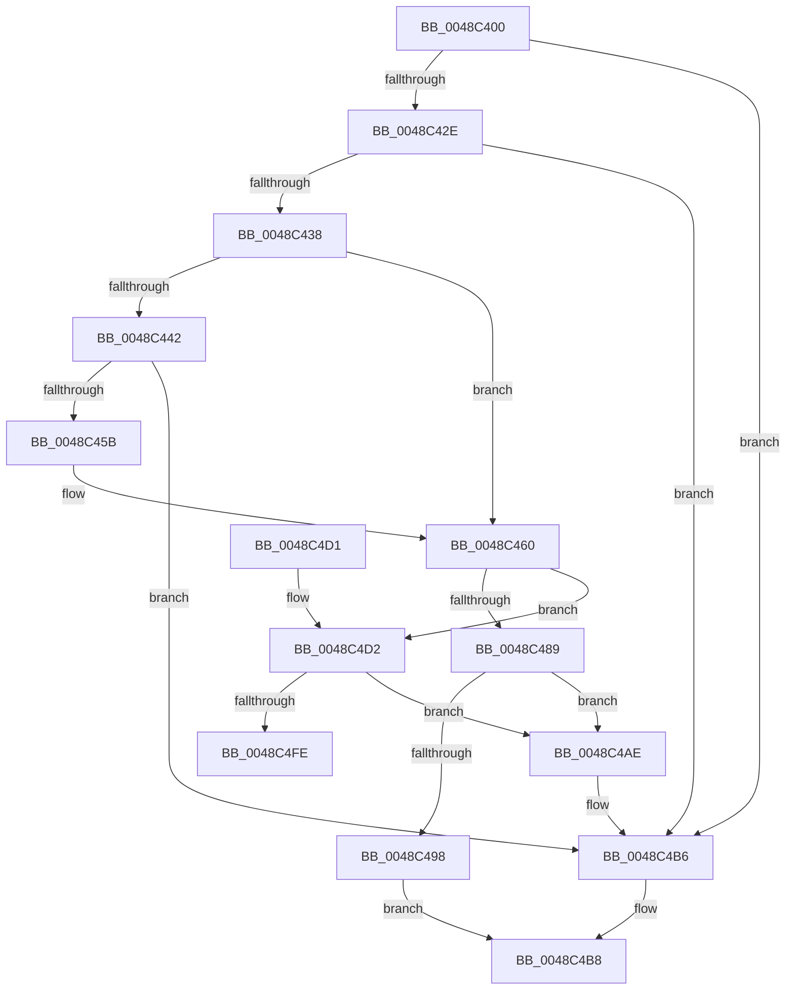

# RtlpCreateHashTable

- RVA: `0x0048C400`–`0x0048C519` (길이 `281` bytes)
- VA: `0x000000014048C400`
- 실행 섹션: `.text`
- PDB 이름 있음: `예`; PDB Function 태그: `예`
- unwind 정보 RVA: `0x000B0E60`
- 디코드: `85`개 명령, `281/281` bytes 표시
- 미해석 바이트: `0` (있으면 어셈블리에 `.byte`로 보존)

> 이 문서는 커널 이미지의 기계어와 PDB 기호를 분석해 생성했습니다. 4번과 5번은 함수 원형과 자료형을 바이너리 사용 방식에서 추정한 C 해석이며 원본 소스 복구 결과는 아닙니다.

## 1. Dependencies

- 직접 호출 지점: **6**; 고유 호출 대상: **5**
- 직접 호출자로 확인된 함수: **5**
- RIP 상대 이미지 참조: **0**

### Outgoing calls
- `0x0048C44E` → [ExAllocatePool2](../../poolcode/B8/ExAllocatePool2_function_00B820F0.md) (function, `0x00B820F0`)
- `0x0048C48B` → [RtlpAllocateSecondLevelDir](RtlpAllocateSecondLevelDir_function_0048C520.md) (function, `0x0048C520`)
- `0x0048C49E` → [RtlpInitializeSecondLevelDir](RtlpInitializeSecondLevelDir_function_0048C54C.md) (function, `0x0048C54C`)
- `0x0048C4B1` → [RtlDeleteHashTable](RtlDeleteHashTable_function_0048C570.md) (function, `0x0048C570`)
- `0x0048C4F1` → [ExAllocatePool2](../../poolcode/B8/ExAllocatePool2_function_00B820F0.md) (function, `0x00B820F0`)
- `0x0048C509` → [memset](../6C/memset_function_006C6C40.md) (function, `0x006C6C40`)

### Direct callers
- [RtlCreateHashTable](RtlCreateHashTable_function_0048C3E0.md) at `0x0048C3EF`
- [RtlCreateHashTableEx](../5E/RtlCreateHashTableEx_function_005E85F0.md) at `0x005E85F4`
- [SepInitializeAntiTamperTable](../60/SepInitializeAntiTamperTable_function_0060B1EC.md) at `0x0060B215`
- [SepBuildCapPolicyTable](../60/SepBuildCapPolicyTable_function_0060B8F0.md) at `0x0060BA3D`
- [SepInitializeSingletonAttributesStructures](../../init/C4/SepInitializeSingletonAttributesStructures_function_00C4B9A0.md) at `0x00C4BA7E`

### Static image references
- 디코드된 RIP-relative 메모리 참조가 없습니다.

## 2. Other-region calls and transfers

- 다른 실행 섹션으로 향하는 call: **2**
  - `0x0048C44E` → [ExAllocatePool2](../../poolcode/B8/ExAllocatePool2_function_00B820F0.md) (`.text` → `POOLCODE`)
  - `0x0048C4F1` → [ExAllocatePool2](../../poolcode/B8/ExAllocatePool2_function_00B820F0.md) (`.text` → `POOLCODE`)
- call이 아닌 외부 분기/꼬리 이동: **1**
  - `0x0048C514` → [sub_006F647C](../6F/Unknown_function_006F647C.md) (`tail-transfer`)

## 3. Assembly (complete function range)

```asm
0048C400  48 89 5C 24 08                  mov qword ptr [rsp + 8], rbx
0048C405  48 89 6C 24 18                  mov qword ptr [rsp + 0x18], rbp
0048C40A  48 89 74 24 20                  mov qword ptr [rsp + 0x20], rsi
0048C40F  57                              push rdi
0048C410  41 56                           push r14
0048C412  41 57                           push r15
0048C414  48 83 EC 20                     sub rsp, 0x20
0048C418  8D 72 FF                        lea esi, [rdx - 1]
0048C41B  41 8B E9                        mov ebp, r9d
0048C41E  45 8B F0                        mov r14d, r8d
0048C421  8B FA                           mov edi, edx
0048C423  4C 8B F9                        mov r15, rcx
0048C426  85 F2                           test edx, esi
0048C428  0F 85 88 00 00 00               jne 0x14048c4b6
0048C42E  8D 42 80                        lea eax, [rdx - 0x80]
0048C431  3D 00 FF 7F 00                  cmp eax, 0x7fff00
0048C436  77 7E                           ja 0x14048c4b6
0048C438  48 8B 19                        mov rbx, qword ptr [rcx]
0048C43B  33 C0                           xor eax, eax
0048C43D  48 85 DB                        test rbx, rbx
0048C440  75 1E                           jne 0x14048c460
0048C442  8D 50 28                        lea edx, [rax + 0x28]
0048C445  41 B8 48 54 61 62               mov r8d, 0x62615448
0048C44B  8D 48 40                        lea ecx, [rax + 0x40]
0048C44E  E8 9D 5C 6F 00                  call 0x140b820f0
0048C453  48 8B D8                        mov rbx, rax
0048C456  48 85 C0                        test rax, rax
0048C459  74 5B                           je 0x14048c4b6
0048C45B  B8 01 00 00 00                  mov eax, 1
0048C460  48 83 63 14 00                  and qword ptr [rbx + 0x14], 0
0048C465  0B C5                           or eax, ebp
0048C467  48 83 63 1C 00                  and qword ptr [rbx + 0x1c], 0
0048C46C  BA 80 00 00 00                  mov edx, 0x80
0048C471  83 63 24 00                     and dword ptr [rbx + 0x24], 0
0048C475  83 63 0C 00                     and dword ptr [rbx + 0xc], 0
0048C479  89 03                           mov dword ptr [rbx], eax
0048C47B  89 7B 08                        mov dword ptr [rbx + 8], edi
0048C47E  89 73 10                        mov dword ptr [rbx + 0x10], esi
0048C481  44 89 73 04                     mov dword ptr [rbx + 4], r14d
0048C485  3B FA                           cmp edi, edx
0048C487  77 49                           ja 0x14048c4d2
0048C489  33 C9                           xor ecx, ecx
0048C48B  E8 90 00 00 00                  call 0x14048c520
0048C490  4C 8B C0                        mov r8, rax
0048C493  48 85 C0                        test rax, rax
0048C496  74 16                           je 0x14048c4ae
0048C498  8B 53 08                        mov edx, dword ptr [rbx + 8]
0048C49B  48 8B C8                        mov rcx, rax
0048C49E  E8 A9 00 00 00                  call 0x14048c54c
0048C4A3  4C 89 43 20                     mov qword ptr [rbx + 0x20], r8
0048C4A7  49 89 1F                        mov qword ptr [r15], rbx
0048C4AA  B0 01                           mov al, 1
0048C4AC  EB 0A                           jmp 0x14048c4b8
0048C4AE  48 8B CB                        mov rcx, rbx
0048C4B1  E8 BA 00 00 00                  call 0x14048c570
0048C4B6  32 C0                           xor al, al
0048C4B8  48 8B 5C 24 40                  mov rbx, qword ptr [rsp + 0x40]
0048C4BD  48 8B 6C 24 50                  mov rbp, qword ptr [rsp + 0x50]
0048C4C2  48 8B 74 24 58                  mov rsi, qword ptr [rsp + 0x58]
0048C4C7  48 83 C4 20                     add rsp, 0x20
0048C4CB  41 5F                           pop r15
0048C4CD  41 5E                           pop r14
0048C4CF  5F                              pop rdi
0048C4D0  C3                              ret
0048C4D1  CC                              int3
0048C4D2  8D 47 7F                        lea eax, [rdi + 0x7f]
0048C4D5  BD 01 00 00 00                  mov ebp, 1
0048C4DA  0F BD F0                        bsr esi, eax
0048C4DD  41 B8 48 54 61 62               mov r8d, 0x62615448
0048C4E3  8B CE                           mov ecx, esi
0048C4E5  83 C6 F9                        add esi, -7
0048C4E8  D3 E5                           shl ebp, cl
0048C4EA  B9 40 00 00 00                  mov ecx, 0x40
0048C4EF  33 E8                           xor ebp, eax
0048C4F1  E8 FA 5B 6F 00                  call 0x140b820f0
0048C4F6  4C 8B F0                        mov r14, rax
0048C4F9  48 85 C0                        test rax, rax
0048C4FC  74 B0                           je 0x14048c4ae
0048C4FE  33 D2                           xor edx, edx
0048C500  41 B8 80 00 00 00               mov r8d, 0x80
0048C506  48 8B C8                        mov rcx, rax
0048C509  E8 32 A7 23 00                  call 0x1406c6c40
0048C50E  33 FF                           xor edi, edi
0048C510  4C 89 73 20                     mov qword ptr [rbx + 0x20], r14
0048C514  E9 63 9F 26 00                  jmp 0x1406f647c
```

## 4. C-style interpretation (structured pseudocode)

```c
__int64 __fastcall RtlpCreateHashTable(__int64 a1, __int64 a2, int a3, int a4)
{
    __int64 result;
    __int64 v_rbp;
    __int64 v_rdi;
    __int64 v_rsi;
    __int64 v_rsp;
    unsigned __int64 v_stack_p18;
    unsigned __int64 v_stack_p20;
    unsigned __int64 v_stack_p8;

    v_stack_p8 = v_rbx;
    v_stack_p18 = v_rbp;
    v_stack_p20 = v_rsi;
    v_rsp = (v_rsp) - (32);
    if ((((unsigned int)(a2)) & ((unsigned int)(a2 - 1))) != 0) goto loc_0048C4B6;
    if (((unsigned int)(a2 - 128)) > 0x7FFF00ULL) goto loc_0048C4B6;
    result = 0;
    if (*(unsigned __int64 *)(a1) != 0) goto loc_0048C460;
    result = ExAllocatePool2(result + 64, result + 40, (unsigned int)(0x62615448ULL), a4);
    if (result == 0) goto loc_0048C4B6;
loc_0048C460:
    result = (unsigned int)((1) | ((unsigned int)((unsigned int)(a4))));
    *(unsigned int *)(result) = (unsigned int)(result);
    *(unsigned int *)(result + 8) = (unsigned int)((unsigned int)((unsigned int)(a2)));
    *(unsigned int *)(result + 16) = (unsigned int)(a2 - 1);
    *(unsigned int *)(result + 4) = (unsigned int)((unsigned int)(a3));
    if (((unsigned int)((unsigned int)((unsigned int)(a2)))) > 128) goto loc_0048C4D2;
    a1 = 0;
    result = RtlpAllocateSecondLevelDir(a1, 128, (unsigned int)(0x62615448ULL), a4);
    if (result == 0) goto loc_0048C4AE;
    result = RtlpInitializeSecondLevelDir(result, (unsigned int)(*(unsigned int *)(result + 8)), result, a4);
    *(unsigned __int64 *)(result + 32) = result;
    *(unsigned __int64 *)(a1) = result;
    goto loc_0048C4B8;
loc_0048C4AE:
    result = RtlDeleteHashTable(result, (unsigned int)(*(unsigned int *)(result + 8)), result, a4);
loc_0048C4B6:
    result = 0;
loc_0048C4B8:
    v_rsp = (v_rsp) + (32);
    return result;
loc_0048C4D2:
    v_rsi = (unsigned int)((v_stack_p20) + (-7));
    v_rbp = (unsigned int)((1) << ((unsigned __int8)((unsigned int)((unsigned int)(v_stack_p20)))));
    v_rbp = (unsigned int)((v_rbp) ^ ((unsigned int)((unsigned int)((unsigned int)(a2)) + 127)));
    result = ExAllocatePool2(64, (unsigned int)(*(unsigned int *)(result + 8)), (unsigned int)(0x62615448ULL), a4);
    if (result == 0) goto loc_0048C4AE;
    a2 = 0;
    result = memset(result, a2, 128, a4);
    v_rdi = 0;
    *(unsigned __int64 *)(v_stack_p8 + 32) = result;
}
```

## 5. (Beta) C Style

```c
int64_t RtlpCreateHashTable(void *Arg1, void *Arg2, int32_t Arg3, int32_t Arg4)
{
    uint8_t *arg1 = (uint8_t *)Arg1;
    uint8_t *arg2 = (uint8_t *)Arg2;

    int64_t result;
    int64_t local_rbp;
    int64_t local_rdi;
    int64_t local_rsi;
    int64_t local_rsp;
    uint64_t v_stack_p18;
    uint64_t v_stack_p20;
    uint64_t v_stack_p8;

    v_stack_p8 = local_rbx;
    v_stack_p18 = local_rbp;
    v_stack_p20 = local_rsi;
    local_rsp = (local_rsp) - (32);
    if ((((uint32_t)(Arg2)) & ((uint32_t)(Arg2 - 1))) != 0) goto loc_0048C4B6;
    if (((uint32_t)(Arg2 - 128)) > 0x7FFF00ULL) goto loc_0048C4B6;
    result = 0;
    if (*(uint64_t *)(arg1) != 0) goto loc_0048C460;
    result = ExAllocatePool2(result + 64, result + 40, (uint32_t)(0x62615448ULL), Arg4);
    if (result == 0) goto loc_0048C4B6;
loc_0048C460:
    result = (uint32_t)((1) | ((uint32_t)((uint32_t)(Arg4))));
    *(uint32_t *)(result) = (uint32_t)(result);
    *(uint32_t *)(result + 0x8) = (uint32_t)((uint32_t)((uint32_t)(Arg2)));
    *(uint32_t *)(result + 0x10) = (uint32_t)(Arg2 - 1);
    *(uint32_t *)(result + 0x4) = (uint32_t)((uint32_t)(Arg3));
    if (((uint32_t)((uint32_t)((uint32_t)(Arg2)))) > 128) goto loc_0048C4D2;
    Arg1 = 0;
    result = RtlpAllocateSecondLevelDir(Arg1, 128, (uint32_t)(0x62615448ULL), Arg4);
    if (result == 0) goto loc_0048C4AE;
    result = RtlpInitializeSecondLevelDir(result, (uint32_t)(*(uint32_t *)(result + 0x8)), result, Arg4);
    *(uint64_t *)(result + 0x20) = result;
    *(uint64_t *)(arg1) = result;
    goto loc_0048C4B8;
loc_0048C4AE:
    result = RtlDeleteHashTable(result, (uint32_t)(*(uint32_t *)(result + 0x8)), result, Arg4);
loc_0048C4B6:
    result = 0;
loc_0048C4B8:
    local_rsp = (local_rsp) + (32);
    return result;
loc_0048C4D2:
    local_rsi = (uint32_t)((v_stack_p20) + (-7));
    local_rbp = (uint32_t)((1) << ((uint8_t)((uint32_t)((uint32_t)(v_stack_p20)))));
    local_rbp = (uint32_t)((local_rbp) ^ ((uint32_t)((uint32_t)((uint32_t)(Arg2)) + 127)));
    result = ExAllocatePool2(64, (uint32_t)(*(uint32_t *)(result + 0x8)), (uint32_t)(0x62615448ULL), Arg4);
    if (result == 0) goto loc_0048C4AE;
    Arg2 = 0;
    result = memset(result, Arg2, 128, Arg4);
    local_rdi = 0;
    *(uint64_t *)(v_stack_p8 + 0x20) = result;
}
```

### 관측된 메모리 오프셋

구조체 형식이 확인되지 않은 접근은 인자 기준의 오프셋으로만 기록했습니다.

| 기준 인자 | 오프셋 표현 | 폭 (bit) | 접근 |
|---|---:|---:|---|
| `Arg1` | `+ 0x0` | `64` | `R` |
| `Arg1` | `+ 0x0` | `64` | `W` |
| `Arg2` | `- 0x1` | `32` | `R` |

## 6. Execution-region graph

[열기: 2D/3D 그래프와 함수 탐색 컨트롤 패널](../../../control-panel.html?section=text&rva=0x0048C400&view=graph)

- 2D 그래프는 위에서 아래로 흐르고, 3D 그래프는 빈 공간을 드래그해 회전합니다. Shift+드래그는 이동, 휠은 확대·축소, 함수 노드 선택은 대상 보고서 이동입니다.

### Static fallback


