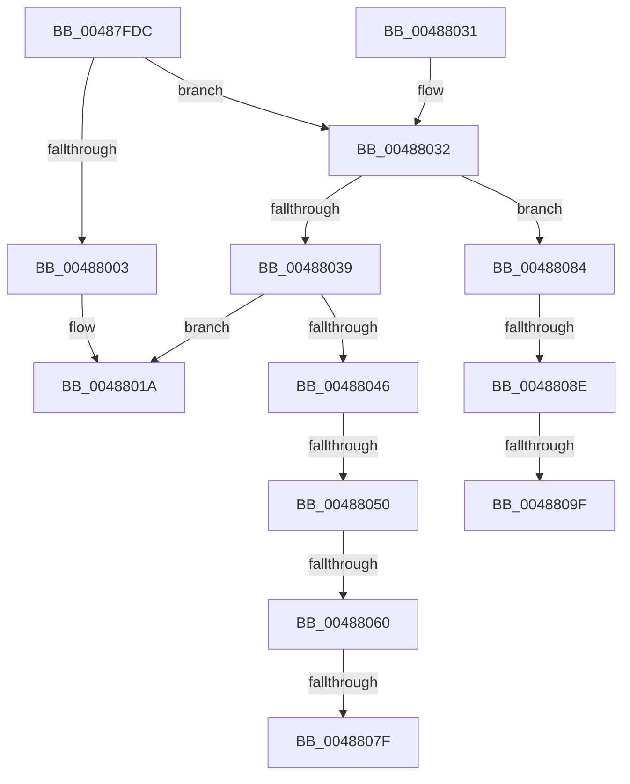

# RtlpFreeNTHeapInternal

- RVA: `0x00487FDC`–`0x004880AF` (길이 `211` bytes)
- VA: `0x0000000140487FDC`
- 실행 섹션: `.text`
- PDB 이름 있음: `예`; PDB Function 태그: `예`
- unwind 정보 RVA: `0x000AFC54`
- 디코드: `64`개 명령, `211/211` bytes 표시
- 미해석 바이트: `0` (있으면 어셈블리에 `.byte`로 보존)

> 이 문서는 커널 이미지의 기계어와 PDB 기호를 분석해 생성했습니다. 4번과 5번은 함수 원형과 자료형을 바이너리 사용 방식에서 추정한 C 해석이며 원본 소스 복구 결과는 아닙니다.

## 1. Dependencies

- 직접 호출 지점: **2**; 고유 호출 대상: **2**
- 직접 호출자로 확인된 함수: **1**
- RIP 상대 이미지 참조: **0**

### Outgoing calls
- `0x00488013` → [RtlpHpVsContextFree](../36/RtlpHpVsContextFree_function_00361630.md) (function, `0x00361630`)
- `0x00488039` → [RtlpProbeUserBufferSafe](../4F/RtlpProbeUserBufferSafe_function_004F6F60.md) (function, `0x004F6F60`)

### Direct callers
- [RtlFreeHeap](RtlFreeHeap_function_00487F60.md) at `0x00487F97`

### Static image references
- 디코드된 RIP-relative 메모리 참조가 없습니다.

## 2. Other-region calls and transfers

- 다른 실행 섹션으로 향하는 call: **0**
- call이 아닌 외부 분기/꼬리 이동: **7**
  - `0x0048804A` → [sub_006F57DA + 0x120](../6F/Unknown_function_006F57DA.md) (`tail-transfer`)
  - `0x0048805A` → [sub_006F57DA + 0x39](../6F/Unknown_function_006F57DA.md) (`tail-transfer`)
  - `0x00488079` → [sub_006F57DA + 0x39](../6F/Unknown_function_006F57DA.md) (`tail-transfer`)
  - `0x0048807F` → [sub_006F57DA + 0xD9](../6F/Unknown_function_006F57DA.md) (`tail-transfer`)
  - `0x00488088` → [sub_006F57DA + 0x14](../6F/Unknown_function_006F57DA.md) (`tail-transfer`)
  - `0x00488099` → [sub_006F57DA](../6F/Unknown_function_006F57DA.md) (`tail-transfer`)
  - `0x004880AA` → [sub_006F57DA](../6F/Unknown_function_006F57DA.md) (`tail-transfer`)

## 3. Assembly (complete function range)

```asm
00487FDC  48 8B C4                        mov rax, rsp
00487FDF  48 89 58 10                     mov qword ptr [rax + 0x10], rbx
00487FE3  48 89 68 18                     mov qword ptr [rax + 0x18], rbp
00487FE7  56                              push rsi
00487FE8  57                              push rdi
00487FE9  41 56                           push r14
00487FEB  48 83 EC 50                     sub rsp, 0x50
00487FEF  33 DB                           xor ebx, ebx
00487FF1  45 8B F0                        mov r14d, r8d
00487FF4  81 79 10 DD CC DD CC            cmp dword ptr [rcx + 0x10], 0xccddccdd
00487FFB  48 8B EA                        mov rbp, rdx
00487FFE  48 8B F1                        mov rsi, rcx
00488001  75 2F                           jne 0x140488032
00488003  4C 8B C2                        mov r8, rdx
00488006  89 58 08                        mov dword ptr [rax + 8], ebx
00488009  33 D2                           xor edx, edx
0048800B  4C 8D 48 08                     lea r9, [rax + 8]
0048800F  48 83 C1 40                     add rcx, 0x40
00488013  E8 18 96 ED FF                  call 0x140361630
00488018  8B D8                           mov ebx, eax
0048801A  4C 8D 5C 24 50                  lea r11, [rsp + 0x50]
0048801F  8B C3                           mov eax, ebx
00488021  49 8B 5B 28                     mov rbx, qword ptr [r11 + 0x28]
00488025  49 8B 6B 30                     mov rbp, qword ptr [r11 + 0x30]
00488029  49 8B E3                        mov rsp, r11
0048802C  41 5E                           pop r14
0048802E  5F                              pop rdi
0048802F  5E                              pop rsi
00488030  C3                              ret
00488031  CC                              int3
00488032  8B 41 78                        mov eax, dword ptr [rcx + 0x78]
00488035  A8 01                           test al, 1
00488037  74 4B                           je 0x140488084
00488039  E8 22 EF 06 00                  call 0x1404f6f60
0048803E  48 8B F8                        mov rdi, rax
00488041  48 85 FF                        test rdi, rdi
00488044  74 D4                           je 0x14048801a
00488046  80 7D FF 05                     cmp byte ptr [rbp - 1], 5
0048804A  0F 85 AA D8 26 00               jne 0x1406f58fa
00488050  4C 8D 86 88 00 00 00            lea r8, [rsi + 0x88]
00488057  39 5E 7C                        cmp dword ptr [rsi + 0x7c], ebx
0048805A  0F 84 B3 D7 26 00               je 0x1406f5813
00488060  8B 57 08                        mov edx, dword ptr [rdi + 8]
00488063  41 33 10                        xor edx, dword ptr [r8]
00488066  8B CA                           mov ecx, edx
00488068  8B C2                           mov eax, edx
0048806A  C1 E9 10                        shr ecx, 0x10
0048806D  C1 E8 08                        shr eax, 8
00488070  32 C8                           xor cl, al
00488072  32 CA                           xor cl, dl
00488074  C1 EA 18                        shr edx, 0x18
00488077  3A D1                           cmp dl, cl
00488079  0F 84 94 D7 26 00               je 0x1406f5813
0048807F  E9 2F D8 26 00                  jmp 0x1406f58b3
00488084  40 F6 C5 0F                     test bpl, 0xf
00488088  0F 85 60 D7 26 00               jne 0x1406f57ee
0048808E  48 8D 7A F0                     lea rdi, [rdx - 0x10]
00488092  0F 0D 0F                        prefetchw byte ptr [rdi]
00488095  80 7F 0F 05                     cmp byte ptr [rdi + 0xf], 5
00488099  0F 85 3B D7 26 00               jne 0x1406f57da
0048809F  0F B6 47 0E                     movzx eax, byte ptr [rdi + 0xe]
004880A3  48 C1 E0 04                     shl rax, 4
004880A7  48 2B F8                        sub rdi, rax
004880AA  E9 2B D7 26 00                  jmp 0x1406f57da
```

## 4. C-style interpretation (structured pseudocode)

```c
__int64 __fastcall RtlpFreeNTHeapInternal(__int64 a1, __int64 a2, int a3)
{
    __int64 result;
    __int64 v_rbx;
    __int64 v_rdi;
    __int64 v_rsp;
    unsigned __int64 v_stack_m18;

    *(unsigned __int64 *)(v_rsp + 16) = v_rbx;
    *(unsigned __int64 *)(v_rsp + 24) = v_rbp;
    v_rsp = (v_rsp) - (80);
    v_rbx = 0;
    if ((*(unsigned int *)(a1 + 16)) != 0xCCDDCCDDULL) goto loc_00488032;
    *(unsigned int *)(v_rsp + 8) = 0;
    a2 = 0;
    a1 = (a1) + (64);
    result = RtlpHpVsContextFree(a1, a2, a2, v_rsp + 8);
loc_0048801A:
    return (unsigned int)((unsigned int)((unsigned int)((unsigned int)(result))));
loc_00488032:
    if ((((unsigned __int8)((unsigned int)(*(unsigned int *)(a1 + 120)))) & (1)) == 0) goto loc_00488084;
    result = RtlpProbeUserBufferSafe(a1, a2, a2, v_rsp + 8);
    if (result == 0) goto loc_0048801A;
    a2 = (unsigned int)(((unsigned int)(*(unsigned int *)(result + 8))) ^ (*(unsigned int *)(a1 + 136)));
    a1 = (unsigned int)(((unsigned int)((unsigned int)(a2))) >> (16));
    result = (unsigned int)(((unsigned int)((unsigned int)(a2))) >> (8));
    a1 = (unsigned __int8)((a1) ^ ((unsigned __int8)(result)));
    a1 = (unsigned __int8)((a1) ^ ((unsigned __int8)(a2)));
    a2 = (unsigned int)((a2) >> (24));
loc_00488084:
    result = (*(unsigned __int8 *)(a2 - 16 + 14)) << (4);
    v_rdi = (a2 - 16) - (result);
}
```

## 5. (Beta) C Style

```c
int64_t RtlpFreeNTHeapInternal(void *Arg1, void *Arg2, int32_t Arg3)
{
    uint8_t *arg1 = (uint8_t *)Arg1;
    uint8_t *arg2 = (uint8_t *)Arg2;

    int64_t result;
    int64_t local_rbx;
    int64_t local_rdi;
    int64_t local_rsp;
    uint64_t v_stack_m18;

    *(uint64_t *)(local_rsp + 0x10) = local_rbx;
    *(uint64_t *)(local_rsp + 0x18) = local_rbp;
    local_rsp = (local_rsp) - (80);
    local_rbx = 0;
    if ((*(uint32_t *)(arg1 + 0x10)) != 0xCCDDCCDDULL) goto loc_00488032;
    *(uint32_t *)(local_rsp + 0x8) = 0;
    Arg2 = 0;
    Arg1 = (Arg1) + (64);
    result = RtlpHpVsContextFree(Arg1, Arg2, Arg2, local_rsp + 8);
loc_0048801A:
    return (uint32_t)((uint32_t)((uint32_t)((uint32_t)(result))));
loc_00488032:
    if ((((uint8_t)((uint32_t)(*(uint32_t *)(arg1 + 0x78)))) & (1)) == 0) goto loc_00488084;
    result = RtlpProbeUserBufferSafe(Arg1, Arg2, Arg2, local_rsp + 8);
    if (result == 0) goto loc_0048801A;
    Arg2 = (uint32_t)(((uint32_t)(*(uint32_t *)(result + 0x8))) ^ (*(uint32_t *)(arg1 + 0x88)));
    Arg1 = (uint32_t)(((uint32_t)((uint32_t)(Arg2))) >> (16));
    result = (uint32_t)(((uint32_t)((uint32_t)(Arg2))) >> (8));
    Arg1 = (uint8_t)((Arg1) ^ ((uint8_t)(result)));
    Arg1 = (uint8_t)((Arg1) ^ ((uint8_t)(Arg2)));
    Arg2 = (uint32_t)((Arg2) >> (24));
loc_00488084:
    result = (*(uint8_t *)(arg2 - 0x10 + 0xE)) << (4);
    local_rdi = (Arg2 - 16) - (result);
}
```

### 관측된 메모리 오프셋

구조체 형식이 확인되지 않은 접근은 인자 기준의 오프셋으로만 기록했습니다.

| 기준 인자 | 오프셋 표현 | 폭 (bit) | 접근 |
|---|---:|---:|---|
| `Arg1` | `+ 0x0` | `32` | `R` |
| `Arg1` | `+ 0x10` | `32` | `R` |
| `Arg1` | `+ 0x78` | `32` | `R` |
| `Arg1` | `+ 0x7C` | `32` | `R` |
| `Arg1` | `+ 0x88` | `64` | `R` |
| `Arg2` | `- 0x10` | `64` | `R` |
| `Arg2` | `- 0x1` | `8` | `R` |
| `Arg2` | `+ 0x0` | `8` | `R` |
| `Arg2` | `+ 0xE` | `8` | `R` |
| `Arg2` | `+ 0xF` | `8` | `R` |

## 6. Execution-region graph

[열기: 2D/3D 그래프와 함수 탐색 컨트롤 패널](../../../control-panel.html?section=text&rva=0x00487FDC&view=graph)

- 2D 그래프는 위에서 아래로 흐르고, 3D 그래프는 빈 공간을 드래그해 회전합니다. Shift+드래그는 이동, 휠은 확대·축소, 함수 노드 선택은 대상 보고서 이동입니다.

### Static fallback


