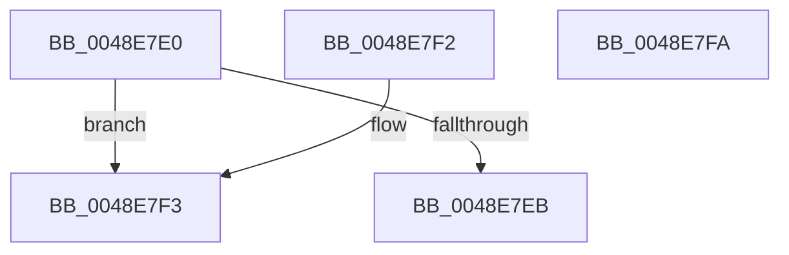

# RtlpHpEnvCompactionIsScheduled

- RVA: `0x0048E7E0`–`0x0048E7FB` (길이 `27` bytes)
- VA: `0x000000014048E7E0`
- 실행 섹션: `.text`
- PDB 이름 있음: `예`; PDB Function 태그: `아니요`
- unwind 정보 RVA: `0x000DB714`
- 디코드: `10`개 명령, `27/27` bytes 표시
- 미해석 바이트: `0` (있으면 어셈블리에 `.byte`로 보존)

> 이 문서는 커널 이미지의 기계어와 PDB 기호를 분석해 생성했습니다. 4번과 5번은 함수 원형과 자료형을 바이너리 사용 방식에서 추정한 C 해석이며 원본 소스 복구 결과는 아닙니다.

## 1. Dependencies

- 직접 호출 지점: **0**; 고유 호출 대상: **0**
- 직접 호출자로 확인된 함수: **3**
- RIP 상대 이미지 참조: **2**

### Outgoing calls
- 직접 디코드된 call 명령이 없습니다.

### Direct callers
- [RtlpHpAllocateHeapSlow](../2E/RtlpHpAllocateHeapSlow_function_002E9DEC.md) at `0x002EA32F`
- [ExAllocateHeapPool](../35/ExAllocateHeapPool_function_0035BA30.md) at `0x0035D3E1`
- [sub_006DE832](../6D/Unknown_function_006DE832.md) at `0x006DEAEF`

### Static image references
- `0x0048E7EB` → RVA `0x00EFA7BC` (`.data`; read)
- `0x0048E7F3` → RVA `0x00EFA7C0` (`.data`; read)

## 2. Other-region calls and transfers

- 다른 실행 섹션으로 향하는 call: **0**
- 별도 외부 분기/꼬리 이동을 확인하지 못했습니다.

## 3. Assembly (complete function range)

```asm
0048E7E0  48 8B 01                        mov rax, qword ptr [rcx]
0048E7E3  48 C1 E8 08                     shr rax, 8
0048E7E7  3C 01                           cmp al, 1
0048E7E9  75 08                           jne 0x14048e7f3
0048E7EB  8B 05 CB BF A6 00               mov eax, dword ptr [rip + 0xa6bfcb]
0048E7F1  C3                              ret
0048E7F2  CC                              int3
0048E7F3  8B 05 C7 BF A6 00               mov eax, dword ptr [rip + 0xa6bfc7]
0048E7F9  C3                              ret
0048E7FA  CC                              int3
```

## 4. C-style interpretation (structured pseudocode)

```c
__int64 __fastcall RtlpHpEnvCompactionIsScheduled(__int64 a1)
{
    __int64 result;

    result = (*(unsigned __int64 *)(a1)) >> (8);
    if (((unsigned __int8)(result)) != 1) goto loc_0048E7F3;
    return (unsigned int)(*(unsigned int *)(v_rip + 10928075));
loc_0048E7F3:
    return (unsigned int)(*(unsigned int *)(v_rip + 10928071));
}
```

## 5. (Beta) C Style

```c
int64_t RtlpHpEnvCompactionIsScheduled(void *Arg1)
{
    uint8_t *arg1 = (uint8_t *)Arg1;

    int64_t result;

    result = (*(uint64_t *)(arg1)) >> (8);
    if (((uint8_t)(result)) != 1) goto loc_0048E7F3;
    return (uint32_t)(*(uint32_t *)(v_rip + 0xA6BFCB));
loc_0048E7F3:
    return (uint32_t)(*(uint32_t *)(v_rip + 0xA6BFC7));
}
```

### 관측된 메모리 오프셋

구조체 형식이 확인되지 않은 접근은 인자 기준의 오프셋으로만 기록했습니다.

| 기준 인자 | 오프셋 표현 | 폭 (bit) | 접근 |
|---|---:|---:|---|
| `Arg1` | `+ 0x0` | `64` | `R` |

## 6. Execution-region graph

[열기: 2D/3D 그래프와 함수 탐색 컨트롤 패널](../../../control-panel.html?section=text&rva=0x0048E7E0&view=graph)

- 2D 그래프는 위에서 아래로 흐르고, 3D 그래프는 빈 공간을 드래그해 회전합니다. Shift+드래그는 이동, 휠은 확대·축소, 함수 노드 선택은 대상 보고서 이동입니다.

### Static fallback


