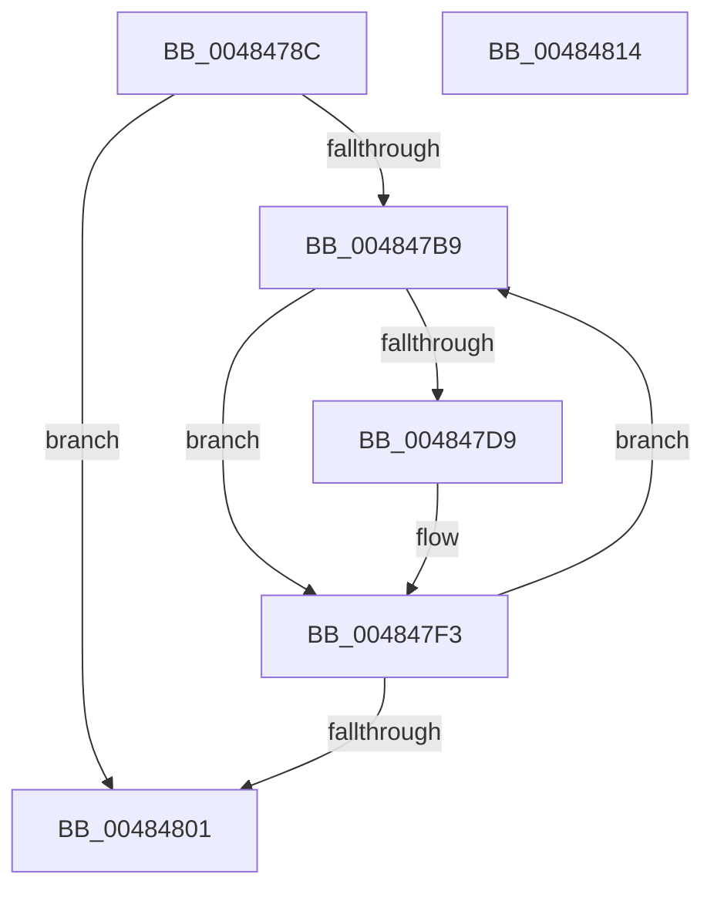

# RtlpHpLfhSubsegmentSetWitheldBlocks

- RVA: `0x0048478C`–`0x00484815` (길이 `137` bytes)
- VA: `0x000000014048478C`
- 실행 섹션: `.text`
- PDB 이름 있음: `예`; PDB Function 태그: `아니요`
- unwind 정보 RVA: `0x000AF220`
- 디코드: `38`개 명령, `137/137` bytes 표시
- 미해석 바이트: `0` (있으면 어셈블리에 `.byte`로 보존)

> 이 문서는 커널 이미지의 기계어와 PDB 기호를 분석해 생성했습니다. 4번과 5번은 함수 원형과 자료형을 바이너리 사용 방식에서 추정한 C 해석이며 원본 소스 복구 결과는 아닙니다.

## 1. Dependencies

- 직접 호출 지점: **0**; 고유 호출 대상: **0**
- 직접 호출자로 확인된 함수: **2**
- RIP 상대 이미지 참조: **0**

### Outgoing calls
- 직접 디코드된 call 명령이 없습니다.

### Direct callers
- [RtlpHpLfhSubsegmentInitialize](../2E/RtlpHpLfhSubsegmentInitialize_function_002E806C.md) at `0x002E8335`
- [RtlpHpLfhSubsegmentDelayFreeListProcess](../32/RtlpHpLfhSubsegmentDelayFreeListProcess_function_00323CE0.md) at `0x0032419F`

### Static image references
- 디코드된 RIP-relative 메모리 참조가 없습니다.

## 2. Other-region calls and transfers

- 다른 실행 섹션으로 향하는 call: **0**
- 별도 외부 분기/꼬리 이동을 확인하지 못했습니다.

## 3. Assembly (complete function range)

```asm
0048478C  48 89 5C 24 08                  mov qword ptr [rsp + 8], rbx
00484791  48 89 74 24 18                  mov qword ptr [rsp + 0x18], rsi
00484796  48 89 7C 24 20                  mov qword ptr [rsp + 0x20], rdi
0048479B  41 0F B7 F1                     movzx esi, r9w
0048479F  45 33 DB                        xor r11d, r11d
004847A2  41 C1 E9 10                     shr r9d, 0x10
004847A6  41 BA 00 10 00 00               mov r10d, 0x1000
004847AC  49 8B F8                        mov rdi, r8
004847AF  48 8B D9                        mov rbx, rcx
004847B2  44 39 54 24 28                  cmp dword ptr [rsp + 0x28], r10d
004847B7  76 48                           jbe 0x140484801
004847B9  8B 47 48                        mov eax, dword ptr [rdi + 0x48]
004847BC  41 8B D2                        mov edx, r10d
004847BF  41 2B D1                        sub edx, r9d
004847C2  41 8B CA                        mov ecx, r10d
004847C5  48 0F AF D0                     imul rdx, rax
004847C9  48 C1 EA 20                     shr rdx, 0x20
004847CD  8B C2                           mov eax, edx
004847CF  0F AF C6                        imul eax, esi
004847D2  2B C8                           sub ecx, eax
004847D4  41 3B C9                        cmp ecx, r9d
004847D7  74 1A                           je 0x1404847f3
004847D9  4C 8B C2                        mov r8, rdx
004847DC  48 C1 EA 06                     shr rdx, 6
004847E0  41 83 E0 3F                     and r8d, 0x3f
004847E4  48 8B 0C D3                     mov rcx, qword ptr [rbx + rdx*8]
004847E8  4C 0F AB C1                     bts rcx, r8
004847EC  48 89 0C D3                     mov qword ptr [rbx + rdx*8], rcx
004847F0  41 FF C3                        inc r11d
004847F3  41 81 C2 00 10 00 00            add r10d, 0x1000
004847FA  44 3B 54 24 28                  cmp r10d, dword ptr [rsp + 0x28]
004847FF  72 B8                           jb 0x1404847b9
00484801  48 8B 5C 24 08                  mov rbx, qword ptr [rsp + 8]
00484806  41 8B C3                        mov eax, r11d
00484809  48 8B 74 24 18                  mov rsi, qword ptr [rsp + 0x18]
0048480E  48 8B 7C 24 20                  mov rdi, qword ptr [rsp + 0x20]
00484813  C3                              ret
00484814  CC                              int3
```

## 4. C-style interpretation (structured pseudocode)

```c
__int64 __fastcall RtlpHpLfhSubsegmentSetWitheldBlocks(__int64 a1, __int64 a2, __int64 a3, int a4, unsigned int a5)
{
    __int64 result;
    __int64 v_r10;
    __int64 v_r11;
    unsigned __int64 v_stack_p18;
    unsigned __int64 v_stack_p20;
    unsigned __int64 v_stack_p8;

    v_stack_p8 = v_rbx;
    v_stack_p18 = v_rsi;
    v_stack_p20 = v_rdi;
    v_r11 = 0;
    a4 = (unsigned int)((a4) >> (16));
    if (a5 <= ((unsigned int)((unsigned int)(0x1000ULL)))) goto loc_00484801;
loc_004847B9:
    a2 = (unsigned int)(((unsigned int)((unsigned int)((unsigned int)(0x1000ULL)))) - (a4));
    a2 = (a2) * ((unsigned int)(*(unsigned int *)(a3 + 72)));
    a2 = (a2) >> (32);
    result = (unsigned int)(((unsigned int)((unsigned int)(a2))) * ((unsigned int)((unsigned __int16)(a4))));
    a1 = (unsigned int)(((unsigned int)((unsigned int)((unsigned int)(0x1000ULL)))) - ((unsigned int)(result)));
    if (((unsigned int)(a1)) != a4) {
        a3 = a2;
        a2 = (a2) >> (6);
        a3 = (unsigned int)((a3) & (63));
        a1 = *(unsigned __int64 *)(a1 + a2 * 8);
        *(unsigned __int64 *)(a1 + a2 * 8) = a1;
        v_r11 = (unsigned int)((v_r11) + 1);
    }
    v_r10 = (unsigned int)(((unsigned int)(0x1000ULL)) + (0x1000ULL));
    if (((unsigned int)(v_r10)) < a5) goto loc_004847B9;
loc_00484801:
    return (unsigned int)((unsigned int)(v_r11));
}
```

## 5. (Beta) C Style

```c
int64_t RtlpHpLfhSubsegmentSetWitheldBlocks(void *Arg1, int64_t Arg2, void *Arg3, int32_t Arg4, uint32_t Arg5)
{
    uint8_t *arg1 = (uint8_t *)Arg1;
    uint8_t *arg3 = (uint8_t *)Arg3;

    int64_t result;
    int64_t local_r10;
    int64_t local_r11;
    uint64_t v_stack_p18;
    uint64_t v_stack_p20;
    uint64_t v_stack_p8;

    v_stack_p8 = local_rbx;
    v_stack_p18 = local_rsi;
    v_stack_p20 = local_rdi;
    local_r11 = 0;
    Arg4 = (uint32_t)((Arg4) >> (16));
    if (Arg5 <= ((uint32_t)((uint32_t)(0x1000ULL)))) goto loc_00484801;
loc_004847B9:
    Arg2 = (uint32_t)(((uint32_t)((uint32_t)((uint32_t)(0x1000ULL)))) - (Arg4));
    Arg2 = (Arg2) * ((uint32_t)(*(uint32_t *)(arg3 + 0x48)));
    Arg2 = (Arg2) >> (32);
    result = (uint32_t)(((uint32_t)((uint32_t)(Arg2))) * ((uint32_t)((uint16_t)(Arg4))));
    Arg1 = (uint32_t)(((uint32_t)((uint32_t)((uint32_t)(0x1000ULL)))) - ((uint32_t)(result)));
    if (((uint32_t)(Arg1)) != Arg4) {
        Arg3 = Arg2;
        Arg2 = (Arg2) >> (6);
        Arg3 = (uint32_t)((Arg3) & (63));
        Arg1 = *(uint64_t *)(arg1 + Arg2 * 8);
        *(void **)(arg1 + Arg2 * 8) = Arg1;
        local_r11 = (uint32_t)((local_r11) + 1);
    }
    local_r10 = (uint32_t)(((uint32_t)(0x1000ULL)) + (0x1000ULL));
    if (((uint32_t)(local_r10)) < Arg5) goto loc_004847B9;
loc_00484801:
    return (uint32_t)((uint32_t)(local_r11));
}
```

### 관측된 메모리 오프셋

구조체 형식이 확인되지 않은 접근은 인자 기준의 오프셋으로만 기록했습니다.

| 기준 인자 | 오프셋 표현 | 폭 (bit) | 접근 |
|---|---:|---:|---|
| `Arg1` | `+ 0x0 + rdx*8` | `64` | `R` |
| `Arg1` | `+ 0x0 + rdx*8` | `64` | `W` |
| `Arg3` | `+ 0x48` | `32` | `R` |

## 6. Execution-region graph

[열기: 2D/3D 그래프와 함수 탐색 컨트롤 패널](../../../control-panel.html?section=text&rva=0x0048478C&view=graph)

- 2D 그래프는 위에서 아래로 흐르고, 3D 그래프는 빈 공간을 드래그해 회전합니다. Shift+드래그는 이동, 휠은 확대·축소, 함수 노드 선택은 대상 보고서 이동입니다.

### Static fallback


