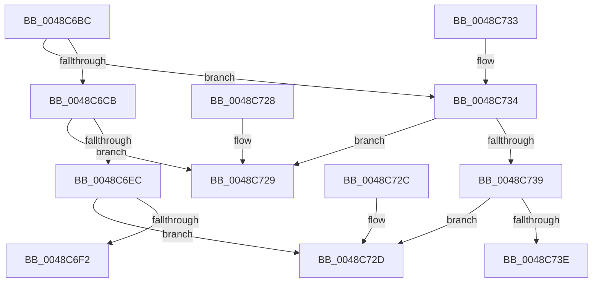

# RtlpHpSegMgrApplyLargePagePolicy

- RVA: `0x0048C6BC`–`0x0048C74A` (길이 `142` bytes)
- VA: `0x000000014048C6BC`
- 실행 섹션: `.text`
- PDB 이름 있음: `예`; PDB Function 태그: `예`
- unwind 정보 RVA: `0x000DB714`
- 디코드: `44`개 명령, `142/142` bytes 표시
- 미해석 바이트: `0` (있으면 어셈블리에 `.byte`로 보존)

> 이 문서는 커널 이미지의 기계어와 PDB 기호를 분석해 생성했습니다. 4번과 5번은 함수 원형과 자료형을 바이너리 사용 방식에서 추정한 C 해석이며 원본 소스 복구 결과는 아닙니다.

## 1. Dependencies

- 직접 호출 지점: **0**; 고유 호출 대상: **0**
- 직접 호출자로 확인된 함수: **1**
- RIP 상대 이미지 참조: **1**

### Outgoing calls
- 직접 디코드된 call 명령이 없습니다.

### Direct callers
- [RtlpHpSegMgrCommitInitiate](../32/RtlpHpSegMgrCommitInitiate_function_003271DC.md) at `0x0032724D`

### Static image references
- `0x0048C73E` → RVA `0x00E28340` (`.data`; read)

## 2. Other-region calls and transfers

- 다른 실행 섹션으로 향하는 call: **0**
- call이 아닌 외부 분기/꼬리 이동: **1**
  - `0x0048C745` → `0x006F64BA` (`tail-transfer`)

## 3. Assembly (complete function range)

```asm
0048C6BC  0F B6 41 0D                     movzx eax, byte ptr [rcx + 0xd]
0048C6C0  48 8B D1                        mov rdx, rcx
0048C6C3  83 E0 07                        and eax, 7
0048C6C6  83 F8 01                        cmp eax, 1
0048C6C9  77 69                           ja 0x14048c734
0048C6CB  48 0F BF 49 16                  movsx rcx, word ptr [rcx + 0x16]
0048C6D0  48 03 CA                        add rcx, rdx
0048C6D3  4C 8B 49 28                     mov r9, qword ptr [rcx + 0x28]
0048C6D7  48 8B 51 30                     mov rdx, qword ptr [rcx + 0x30]
0048C6DB  4C 8B 51 38                     mov r10, qword ptr [rcx + 0x38]
0048C6DF  48 8B 41 40                     mov rax, qword ptr [rcx + 0x40]
0048C6E3  48 03 D0                        add rdx, rax
0048C6E6  48 3B 51 50                     cmp rdx, qword ptr [rcx + 0x50]
0048C6EA  73 3D                           jae 0x14048c729
0048C6EC  48 3B 51 48                     cmp rdx, qword ptr [rcx + 0x48]
0048C6F0  72 3B                           jb 0x14048c72d
0048C6F2  44 0F B6 41 58                  movzx r8d, byte ptr [rcx + 0x58]
0048C6F7  48 B8 15 AE 47 E1 7A 14 AE 47   movabs rax, 0x47ae147ae147ae15
0048C701  4C 0F AF C2                     imul r8, rdx
0048C705  33 C9                           xor ecx, ecx
0048C707  49 C1 E0 09                     shl r8, 9
0048C70B  49 F7 E0                        mul r8
0048C70E  4B 8D 04 0A                     lea rax, [r10 + r9]
0048C712  4C 2B C2                        sub r8, rdx
0048C715  49 D1 E8                        shr r8, 1
0048C718  4C 03 C2                        add r8, rdx
0048C71B  49 C1 E8 06                     shr r8, 6
0048C71F  49 3B C0                        cmp rax, r8
0048C722  0F 93 C1                        setae cl
0048C725  8B C1                           mov eax, ecx
0048C727  C3                              ret
0048C728  CC                              int3
0048C729  33 C0                           xor eax, eax
0048C72B  C3                              ret
0048C72C  CC                              int3
0048C72D  B8 01 00 00 00                  mov eax, 1
0048C732  C3                              ret
0048C733  CC                              int3
0048C734  83 F8 02                        cmp eax, 2
0048C737  74 F0                           je 0x14048c729
0048C739  83 F8 03                        cmp eax, 3
0048C73C  74 EF                           je 0x14048c72d
0048C73E  48 8B 15 FB BB 99 00            mov rdx, qword ptr [rip + 0x99bbfb]
0048C745  E9 70 9D 26 00                  jmp 0x1406f64ba
```

## 4. C-style interpretation (structured pseudocode)

```c
__int64 __fastcall RtlpHpSegMgrApplyLargePagePolicy(__int64 a1)
{
    __int64 result;

    result = (unsigned int)((*(unsigned __int8 *)(a1 + 13)) & (7));
    if (((unsigned int)(result)) > 1) goto loc_0048C734;
    a1 = ((__int16)(*(unsigned __int16 *)(a1 + 22))) + (a1);
    a2 = (*(unsigned __int64 *)(a1 + 48)) + (*(unsigned __int64 *)(a1 + 64));
    if (a2 >= (*(unsigned __int64 *)(a1 + 80))) goto loc_0048C729;
    if (a2 < (*(unsigned __int64 *)(a1 + 72))) goto loc_0048C72D;
    a3 = (*(unsigned __int8 *)(a1 + 88)) * (a2);
    a1 = 0;
    a3 = (a3) << (9);
    a3 = (a3) - (a2);
    a3 = (a3) >> (1);
    a3 = (a3) + (a2);
    a3 = (a3) >> (6);
    a1 = ((*(unsigned __int64 *)(a1 + 56) + *(unsigned __int64 *)(a1 + 40) * 1) >= a3) ? 1 : 0;
    return (unsigned int)((unsigned int)(a1));
loc_0048C729:
    result = 0;
    return result;
loc_0048C72D:
    return 1;
loc_0048C734:
    if (1 == 2) goto loc_0048C729;
    if (1 == 3) goto loc_0048C72D;
}
```

## 5. (Beta) C Style

```c
int64_t RtlpHpSegMgrApplyLargePagePolicy(void *Arg1)
{
    uint8_t *arg1 = (uint8_t *)Arg1;

    int64_t result;

    result = (uint32_t)((*(uint8_t *)(arg1 + 0xD)) & (7));
    if (((uint32_t)(result)) > 1) goto loc_0048C734;
    Arg1 = ((int16_t)(*(uint16_t *)(arg1 + 0x16))) + (Arg1);
    a2 = (*(uint64_t *)(arg1 + 0x30)) + (*(uint64_t *)(arg1 + 0x40));
    if (a2 >= (*(uint64_t *)(arg1 + 0x50))) goto loc_0048C729;
    if (a2 < (*(uint64_t *)(arg1 + 0x48))) goto loc_0048C72D;
    a3 = (*(uint8_t *)(arg1 + 0x58)) * (a2);
    Arg1 = 0;
    a3 = (a3) << (9);
    a3 = (a3) - (a2);
    a3 = (a3) >> (1);
    a3 = (a3) + (a2);
    a3 = (a3) >> (6);
    Arg1 = ((*(uint64_t *)(arg1 + 0x38) + *(uint64_t *)(arg1 + 0x28) * 1) >= a3) ? 1 : 0;
    return (uint32_t)((uint32_t)(Arg1));
loc_0048C729:
    result = 0;
    return result;
loc_0048C72D:
    return 1;
loc_0048C734:
    if (1 == 2) goto loc_0048C729;
    if (1 == 3) goto loc_0048C72D;
}
```

### 관측된 메모리 오프셋

구조체 형식이 확인되지 않은 접근은 인자 기준의 오프셋으로만 기록했습니다.

| 기준 인자 | 오프셋 표현 | 폭 (bit) | 접근 |
|---|---:|---:|---|
| `Arg1` | `+ 0xD` | `8` | `R` |
| `Arg1` | `+ 0x16` | `16` | `R` |

## 6. Execution-region graph

[열기: 2D/3D 그래프와 함수 탐색 컨트롤 패널](../../../control-panel.html?section=text&rva=0x0048C6BC&view=graph)

- 2D 그래프는 위에서 아래로 흐르고, 3D 그래프는 빈 공간을 드래그해 회전합니다. Shift+드래그는 이동, 휠은 확대·축소, 함수 노드 선택은 대상 보고서 이동입니다.

### Static fallback


